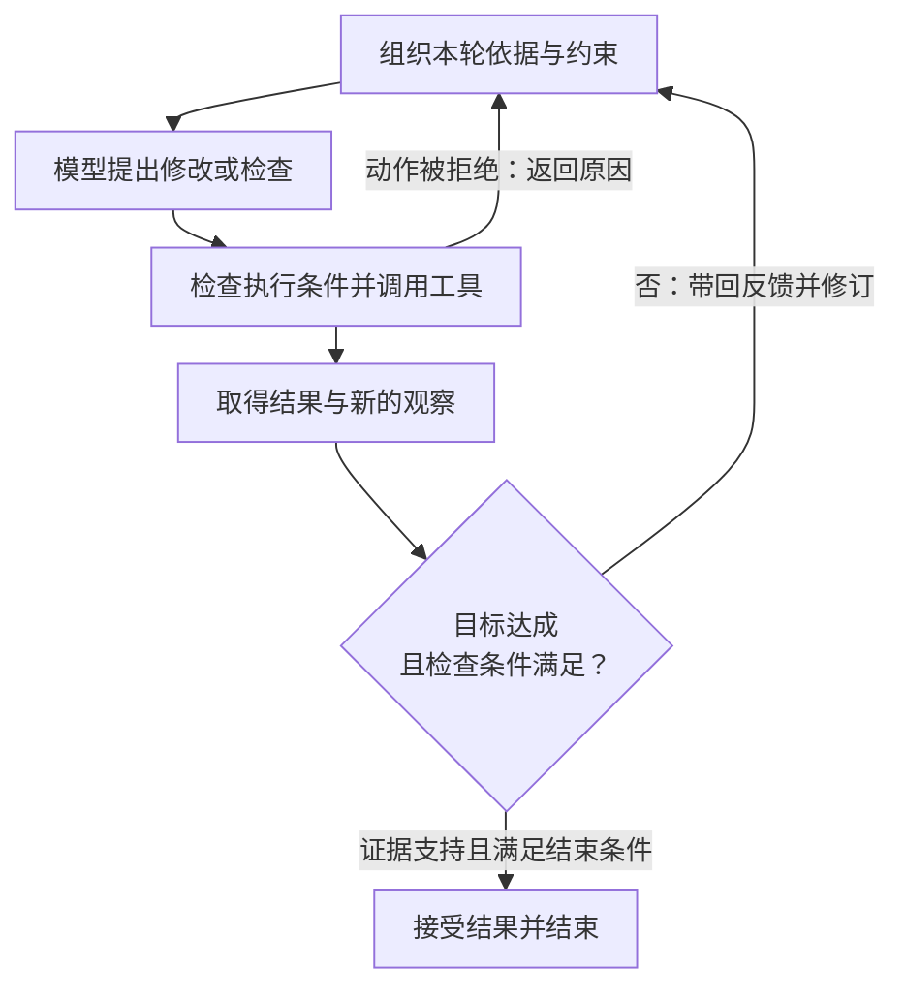
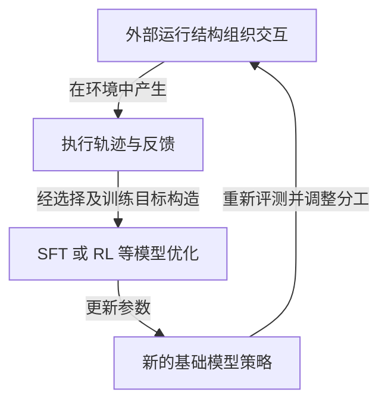

# Evolution：从 Prompt 到 Runtime

[[wiki/foundations/Formalization|Formalization]] 已经把 Agent 写成模型策略与 harness 的耦合系统。本页接着问：**为什么围绕模型的工程，会从提示词扩展到上下文，最后扩展到整条执行轨迹？每次扩展补上了什么，又留下了什么？**

阅读主线是：**怎样让模型发挥已有能力 → 怎样让它获得当前需要的依据 → 怎样让一连串决策在真实反馈中继续推进 → 怎样把执行经验转成以后的能力。** 这是本库据 S001 组织的理解线索；阶段划分与演进解释来自综述，不是全领域唯一的历史分期，也不是一组统一实验得出的定律。[[raw/surveys/Towards Long-Horizon Agents.pdf#page=15|S001 · §3 · pp.15–16 · Table 1 / Fig.6]]

页内导航：[[wiki/foundations/Evolution#从 Formalization 接过来的问题|从循环看发展]] · [[wiki/foundations/Evolution#Stage II 的三个部分，怎样接在一起|RAG、工具与记忆]] · [[wiki/foundations/Evolution#为什么还要进入 Runtime|为什么需要运行时]] · [[wiki/foundations/Evolution#外化与内化：能力怎样在系统中重新分工|外化与内化]]。

## 从 Formalization 接过来的问题

在 $a_t\sim\pi_\theta(\cdot\mid c_t)$ 中，固定模型面对不同上下文，本来就可能提出不同动作。围绕它的工程，既能改变本次的 $c_t$，也能改变动作如何执行、反馈如何返回，以及下一次调用何时发生。**本库思考：这让“模型会不会”变成了一个还不够完整的问题——还要问它得到了什么依据、能采取什么行动、失败后还有没有修正机会。** [[raw/surveys/Towards Long-Horizon Agents.pdf#page=9|S001 · §2.1 · Eq.1 与运行循环 · p.9]]

用这个循环重读作者的三个阶段，可以看到控制范围怎样逐层扩大：

| 作者的阶段划分 | 主要控制对象 | 放回运行循环中理解 | 扩大控制范围的原因 |
| --- | --- | --- | --- |
| Prompt Engineering（2020–2023） | 单次请求的语言表达 | 在输入中给出指令、示例和推理组织方式 | 更好的问法仍不能补上缺失的外部事实 |
| Context Engineering（2023–2025） | 一次调用可依据的信息 | 从证据、工具描述、观察和历史中组装 $c_t$ | 这次输入合适，仍不能保证行动后的过程可靠 |
| Runtime Harnesses（2025–该版本所述时期） | 整条执行轨迹 | 组织多次调用、执行、反馈、检查与恢复 | 必须对跨步骤的状态和后果持续负责 |

表中阶段与控制对象来自原文，循环映射为本库解释。年份表示作者所述的主导时期，不是方法的首次发表时间；三个阶段是**嵌套累积**的。今天的 runtime 仍要设计提示和上下文，早期方法也可能已出现后一个阶段的机制。[[raw/surveys/Towards Long-Horizon Agents.pdf#page=15|S001 · §3 · Table 1 · p.15]]；[[raw/surveys/Towards Long-Horizon Agents.pdf#page=16|Fig.6 · p.16]]

> [!warning] 三个历史阶段，不对应 H1、H2、H3 三个能力等级
> H1–H3 问任务依赖跨越什么边界，三个阶段问工程主要控制什么。Table 1 也把二者分成不同轴：Runtime 一行的 C3 仍只标为部分具备。**本库解释：**有了运行框架，不能据此判定一个具体系统已经能够跨任务积累并改善能力。[[raw/surveys/Towards Long-Horizon Agents.pdf#page=15|S001 · Table 1 · p.15]]；[[wiki/foundations/Formalization#H1–H3 与 C1–C3|回看任务与能力层级]]。

## Stage I 留下的思想：能力可以被组织出来

综述将逐步推理、任务分解、规划和搜索放在这一阶段，强调同一个固定模型会因输入的组织方式不同而表现出不同能力。这里重要的变化是：系统建设者开始尝试**不更新权重，先用外部结构引导模型怎样解决问题**。同时，这种能力对措辞、示例与格式可能很敏感，因而又推动了提示优化和训练内化。[[raw/surveys/Towards Long-Horizon Agents.pdf#page=16|S001 · §3.1 · pp.16–17]]

**本库思考：写出计划，与让计划在环境中成立之间，隔着一次检验。** 在纸面上推导“先改函数，再跑测试”，只说明提出了一条路径；实际运行后可能发现依赖不兼容，必须回到先前的假设。沿着 Formalization 的部分可观测性理解，计划应当能被后来的观察修订，不能只把它当成必须执行到底的文本。依据为原文对规划雏形、环境反馈与持久运行不足的讨论。[[raw/surveys/Towards Long-Horizon Agents.pdf#page=17|S001 · §3.1 · Decomposition, Planning, and Search · p.17]]

Stage I 的边界也因此更清楚：即使模型已有分析能力，若当前仓库、最新文档或私有资料没有进入输入，换一种问法仍不能提供这些事实。**本库解释：这次失败可能缺的是依据，继续要求“更认真地思考”未必能解决。** 这才把问题推向 Stage II。[[raw/surveys/Towards Long-Horizon Agents.pdf#page=17|S001 · §3.1 结尾 · p.17]]

## Stage II 的三个部分，怎样接在一起

用户讨论中的困惑集中在这里：RAG、Tool Use、Long Context / Memory 为什么并列，它们是不是三套额外模型？综述把它们并列，是因为它们共同扩大了单次调用可以依靠的信息与外部能力；它们有交叉，也可以在同一个系统中协作。[[raw/surveys/Towards Long-Horizon Agents.pdf#page=17|S001 · §3.2 · pp.17–18]]

| 部分 | 在系统中增加了什么 | 仍需分开的判断 |
| --- | --- | --- |
| RAG：检索增强生成 | 从外部语料找相关证据，将其带入生成过程 | 找到了文本，不等于文本可靠、完整或被正确使用 |
| Tool Use / Function Calling | 让模型提出可由外部系统执行的请求，取得结果，或改变环境 | 调用格式合法，不等于选对工具、参数合适或任务成功 |
| Long Context / Memory / Context Engineering | 扩大当前容量、在窗口外保存信息，并选择、压缩与刷新本轮输入 | 信息存着、放得下、现在可见、能正确利用，是不同条件 |

表中机制概括依据 §3.2，“仍需分开的判断”为本库据运行循环提出的辨析，不是综述所引方法的新实验结果。[[raw/surveys/Towards Long-Horizon Agents.pdf#page=17|S001 · §3.2 · RAG / Tool Use · pp.17–18]]；[[raw/surveys/Towards Long-Horizon Agents.pdf#page=18|Long Context, Memory, and Context Engineering · p.18]]

### RAG 那句话里的 models，不等于“另加一个大模型”

§3.2 的 *retrieval- and memorization-augmented models* 指前面一系列把参数化知识与外部语料结合的模型或方法。它描述的是**怎样增强语言模型**，不能仅凭复数 *models*，就推断系统必须在生成模型旁再放一个 LLM。具体检索器、外部存储和训练方式，需要逐篇核对；综述此句没有规定统一架构。[[raw/surveys/Towards Long-Horizon Agents.pdf#page=17|S001 · §3.2 · RAG 段 · p.17 · refs.[38,200,246,247,270,273,304]；此处未回读所引原论文]]

**本库解释：**先把最小信息路径看清即可：问题交给检索系统 → 从外部语料取出相关内容 → 内容进入生成模型的上下文 → 模型据此回答。“检索系统是否另用学习模型”与“回答是否利用了外部证据”是两个问题。外部证据进入上下文，也不表示知识已写入生成模型的权重。

这里的 memorization-augmented 也不能直接等同于后文 Agent 的跨会话记忆。**本库辨析：**前一句是在回顾语言模型如何结合外部知识；后者还要问，同一任务的进度能否恢复、过去经验怎样进入未来任务。不能仅因都出现“memory”，就认为它们解决了同一种连续性问题。[[raw/surveys/Towards Long-Horizon Agents.pdf#page=17|S001 · §3.2 · p.17]]；[[raw/surveys/Towards Long-Horizon Agents.pdf#page=18|同节记忆段 · p.18]]；[[wiki/foundations/Formalization#H2 的记忆与自我演化的记忆，为什么不是一回事|回看两种记忆用途]]。

### 获取、保存与本轮使用，是可以分别失败的

**本库构造的例子：**Agent 修复 bug 时，检索找回 API 文档，测试工具返回报错，外部记忆保存已尝试的方案；上下文工程再把其中与当前诊断有关的部分放入下一次输入。检索可以由工具实现，记忆也可以通过检索读取。因此，这些名称并不对应互不重叠的盒子。

如果相关约束还在文件里，却没有被选入本轮输入，扩充存储未必有帮助；如果约束已进入输入却被误解，增加检索次数也未必有帮助。**本库思考：应沿信息路径定位遗漏发生在哪里，而不把所有问题都叫作“模型记不住”。** 这接续了 Formalization 对状态、观察和上下文的区分，也解释了为什么 §3.2 从“装得下”继续走向“选得对、用得好”。[[raw/surveys/Towards Long-Horizon Agents.pdf#page=9|S001 · §2.1 · p.9]]；[[raw/surveys/Towards Long-Horizon Agents.pdf#page=18|§3.2 · 长上下文与信息利用 · p.18]]

> [!note]- 综述列出的检索路线，重点看谁在决定下一次检索
> **综述转述：**本节从一次检索后阅读，谈到跨步骤检索、主动检索与反思后重新检索。这里保留的启发是：检索逐渐成为可根据当前进展作出的决策，而不只是生成前固定执行的准备动作。各方法的具体能力与效果仍须回读原论文，不把这段叙事理解为一条人人依次经过的升级路线。[[raw/surveys/Towards Long-Horizon Agents.pdf#page=17|S001 · §3.2 · RAG 段 · p.17 · refs.[22,258,612]；此处未回读所引原论文]]

## 为什么还要进入 Runtime

### “这次看到了什么”之外，还有“做完以后怎么办”

§3.2 结尾指出，单次调用之前的输入组织，无法充分处理连续行动中的错误累积、对世界的判断偏移和不可逆副作用。§3.3 因而把工程对象扩展到 reasoning、action、observation、verification、recovery 组成的轨迹。[[raw/surveys/Towards Long-Horizon Agents.pdf#page=18|S001 · §3.2 结尾—§3.3 · p.18]]

下面沿用修复 bug 的**本库解释例子**，突出输入准备之后新增的责任：

*本库据 §2.1 与 §3.3 绘制的简化流程；箭头表示可能的运行路径，不表示检查绝不会误判，也不要求所有系统都用同一协议。预算耗尽等其他停止路径见 Formalization。* [[raw/surveys/Towards Long-Horizon Agents.pdf#page=9|S001 · §2.1 · p.9]]；[[raw/surveys/Towards Long-Horizon Agents.pdf#page=19|§3.3 · Harness Engineering · p.19]]

**本库思考：循环给了系统继续行动的机会，治理循环才决定它怎样继续。** 不断把工具结果送回模型，可能只是让错误重复更多次。需要进一步明确：什么结果值得保留，什么失败触发重试或改计划，哪些动作要先满足执行条件，什么证据足以接受结果。状态、权限、检查和恢复由此成为过程中的职责。原文在 Agent Loops 后接 Harness Engineering，正是在推进这层问题。[[raw/surveys/Towards Long-Horizon Agents.pdf#page=19|S001 · §3.3 · Agent Loops / Harness Engineering · p.19]]

### 为什么叫 runtime harness

本页采用“**运行时执行与控制机制**”来理解 runtime harness。Runtime 强调任务实际运行时，多次模型调用与环境交互怎样被组织；harness 指围绕模型连接提示、状态、工具、权限、验证和恢复的系统结构。这个译法是本库的阅读选择，不是原文给出的标准中文术语。[[raw/surveys/Towards Long-Horizon Agents.pdf#page=19|S001 · §3.3 · Harness Engineering · p.19]]

**本库辨析：**runtime 的范围在这里覆盖模型推理以及调用之间的执行、保存和调度，并不要求系统持续更新模型参数，也不要求运行很多小时。规则可以事先写好，却在每次实际行动前后生效；规划和验证也可能调用模型完成，不能据“外部机制”就把它想成完全没有模型参与的固定程序。

这把 horizon 的含义也接了回来。本库沿用“长程”，也可理解为“长时程”；这里要抓住的是**相互依赖的决策需要被维持多远**。更长的运行时间、更多 token、更多工具调用，都不能单独代替这个判断。Runtime 是组织执行的一种手段，long-horizon 则描述系统要面对的依赖与连续性要求。[[raw/surveys/Towards Long-Horizon Agents.pdf#page=7|S001 · §2.1 · pp.7,9]]；[[raw/surveys/Towards Long-Horizon Agents.pdf#page=13|§2.4.1 · p.13]]

### Stage II 已有交互，Stage III 到底新增了什么

这里需要保留原文的表述张力：§3.2 既介绍主动检索、记忆和 ReAct 式交互，又在结尾将 context engineering 概括为单次、开环的输入组织。**本库解释：应将“开环”限定为它正在抽象的控制对象——一次调用行动之前的条件设置；不能推广成“本节所有方法都不接收反馈”。** 作者也明确将 ReAct 等放在两阶段的桥梁位置。[[raw/surveys/Towards Long-Horizon Agents.pdf#page=18|S001 · §3.2 · Tool Use 段与结尾 · p.18]]

真正值得带走的差别，是设计关注是否已扩展到**一整个目标的执行连续性与后果**。一个方法可以同时涉及上下文组织和运行控制；无需先给它判定唯一“时代”，再决定怎样理解它。这也是嵌套分期比互斥分类更合适的原因。

## 外化与内化：能力怎样在系统中重新分工

p.19 的 Harness Engineering 与 Internalizing the Loop，把历史主线接到后面的 §4 和 §5：前者通过外部结构组织行为，后者通过轨迹级 SFT、RL 等训练，让模型吸收部分交互决策能力。原文强调，不同 harness 暴露的动作格式、反馈渠道与失败方式不同，因此内化不能只视为同一种通用训练配方。[[raw/surveys/Towards Long-Horizon Agents.pdf#page=19|S001 · §3.3 · Internalizing the Loop · pp.19–20]]

*本库据综述绘制的协同演进示意。箭头表示经验进入训练、再回到运行的路径；每条轨迹都适合训练、每轮都能提升，均不是图的前提。* [[raw/surveys/Towards Long-Horizon Agents.pdf#page=19|S001 · §3.3 · pp.19–20]]

### 内化的是哪部分能力

**本库解释例子：**起初可以由外部流程规定“修改后必须运行测试，失败后进入诊断”；训练则可能让模型学会依据报错选下一项检查、何时换一种修法。即使这类决策学进了参数，测试仍要在环境中执行，输出仍要返回，权限仍要落实。因而“学会使用反馈”与“替代产生反馈的环境及执行系统”是不同事情。原文也明确说内化不会使 harness 消失。[[raw/surveys/Towards Long-Horizon Agents.pdf#page=19|S001 · §3.3 · Internalizing the Loop · pp.19–20]]

同样，不能从一次“主动纠错”就推断能力已经内化。固定模型也可以因输入里出现报错、历史或新指令而改变动作；若要声称这项行为来自训练，需要对应的训练记录和受控评价。这接续了 [[wiki/foundations/Formalization#固定 policy，为什么行动还能不断改变|固定策略与反馈适应的区别]]。**本库思考：行为看起来更主动，是待解释的现象；改变发生在权重、提示、记忆还是流程中，才是需要定位的机制。** [[raw/surveys/Towards Long-Horizon Agents.pdf#page=9|S001 · §2.1 · p.9]]；[[raw/surveys/Towards Long-Horizon Agents.pdf#page=19|§3.3 · p.19]]

### 从反馈到学习，中间不能省掉什么

Formalization 已区分环境观察与奖励：报错能帮助当前任务改路，却不直接标出所有早期决策的贡献。**本库思考：外部执行产生轨迹，只是让学习有了材料；还要决定保留哪些经验、怎样判断成败、监督什么，以及学到的东西能否用于后续任务。** 不能把“保存了很多轨迹”直接写成“系统已经持续进步”。[[raw/surveys/Towards Long-Horizon Agents.pdf#page=9|S001 · §2.1 · 延迟效用与信用分配 · p.9]]；[[raw/surveys/Towards Long-Horizon Agents.pdf#page=19|§3.3 · Internalizing the Loop · pp.19–20]]

还要分清本章的历史演进与 self-evolution。这里的模型—harness 共同演进，可以包含研究者设计流程、收集数据再训练的迭代；它没有说明每个运行中的 Agent 都会自己更新。Foundation 中 self-evolving 的定义还包括记忆、工具和拓扑的持久改变，范围比这里强调的“进入模型权重”更宽。两者相关，但不能用同一个“演化”词直接等同。[[raw/surveys/Towards Long-Horizon Agents.pdf#page=14|S001 · §2.4.3 · p.14]]；[[raw/surveys/Towards Long-Horizon Agents.pdf#page=19|§3.3 · pp.19–20]]

## 带着什么问题进入 Harness

这次阅读形成的**本库提问方式**是：先定位轨迹在哪里失去连续性，再看一个机制究竟改变了什么，而不是先记六类组件的名单。

- **缺依据，还是没用好依据？** 是没有观察到、没有选进上下文，还是已经看见却推断错了？这决定应追问检索、记忆、上下文管理还是策略能力。
- **会继续，还是会有依据地继续？** 哪些反馈触发改计划，怎样保存当前有效状态，什么检查约束副作用，凭什么接受结果？这把循环接到验证与恢复。
- **这次成功，留下了什么？** 只是当前任务恢复了，还是形成了以后可复用的经验，或通过训练改变了策略？这把 C2 的任务连续性接到 C3 与能力内化。

这些问题由 §2 的定义与 §3 的演进主线共同支持，是分析入口，不是对任何具体系统的能力证明。[[raw/surveys/Towards Long-Horizon Agents.pdf#page=15|S001 · §2 结尾—§3 · p.15]]；[[raw/surveys/Towards Long-Horizon Agents.pdf#page=20|§3 结尾—§4 入口 · p.20]]

若看到“更强模型加更复杂 harness，任务成功率提高”，还应追问提升怎样归因。**本库思考：**固定模型比较 harness、固定 harness 比较模型，都要同时说明工具、预算、重试和评测条件；二者也可能相互依赖。单个最终分数无法替代这些比较。原文也指出进展趋势本身不能分开模型与 harness 的贡献。[[raw/surveys/Towards Long-Horizon Agents.pdf#page=12|S001 · §2.3 结尾 · p.12]]

## 交叉阅读与本次依据

- [[wiki/foundations/Formalization|Formalization]]：回查运行循环、部分可观测、信用分配、H1–H3 与 self-evolution。
- [[wiki/harness/Overview|Harness]]：沿上述失败位置理解六类运行机制。
- [[wiki/optimization/Overview|Optimization]]：继续问交互能力怎样通过架构与训练进入模型。
- [[wiki/frontier/Overview|Frontier]]：追问机制的适用前提、能力迁移与尚待验证的问题。

2026-10-25 根据用户的[“解释 RAG 模型含义”阅读讨论](chatgpt-conversation://6adde2a3-ebc4-83ee-b6a9-58fa2bc4b22c)重读 S001 的 §3（PDF pp.15–20，p.20 含本节结尾与 §4 入口），核看 Table 1 与 Fig.6 页面图像，并回接 §2 的运行循环及概念辨析。对话用于定位疑问，不计作学术来源；本页不据综述的转述新增所引论文的已读状态，不引用其性能数字。原文所述时期保留为该本地版本的历史叙事，没有据此核验当下全领域的发展阶段。

返回 [[wiki/index|索引]]。
