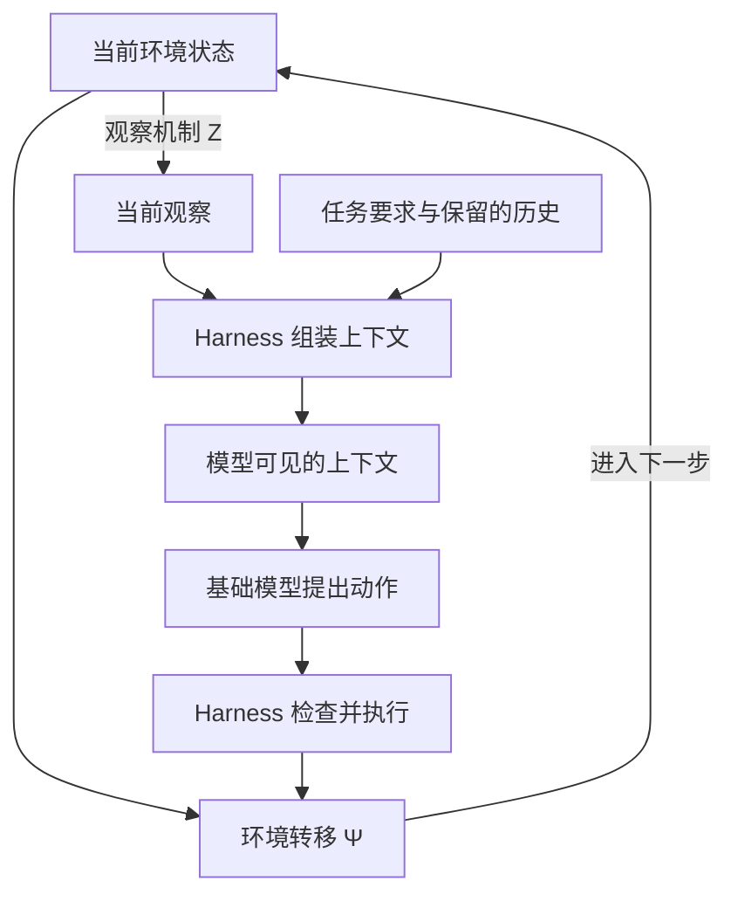
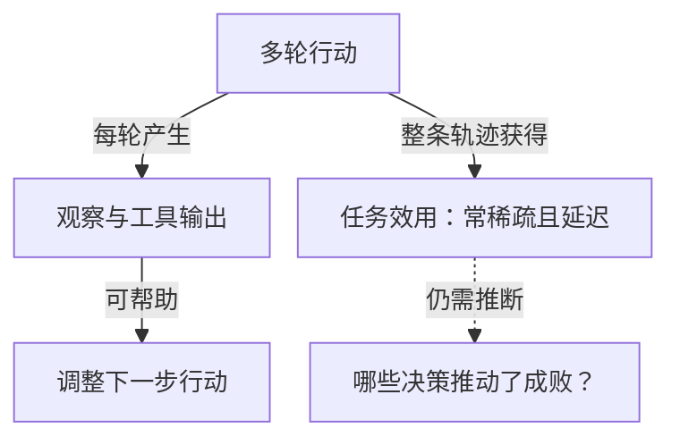
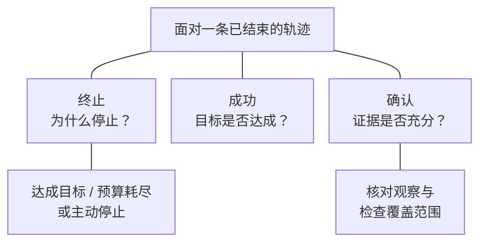
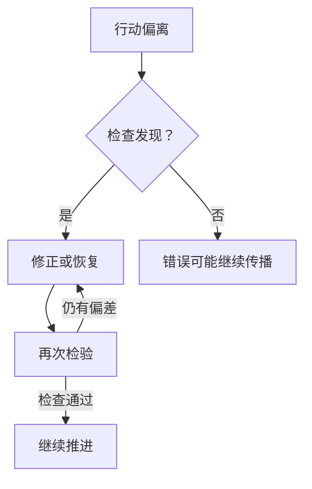
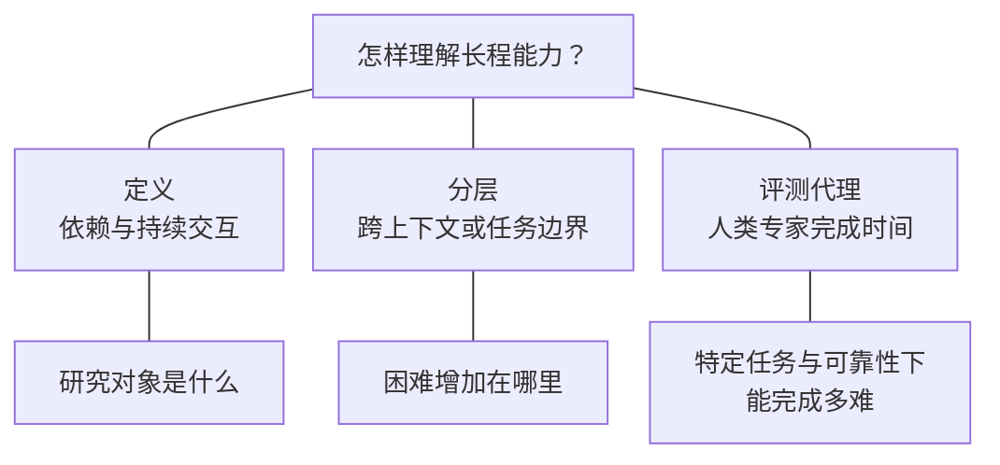

# Foundation：定义、运行循环与理解辨析

这是一张围绕问题展开的**基础理解页**：既保留定义，也记录为什么需要这些定义、它们如何相互解释。当前依据 [[wiki/surveys/Towards Long-Horizon Agents|S001]] 的 Foundation（PDF pp.7–15；p.8 为全篇分类图，p.15 为本节结尾与 Evolution 的衔接）。这是该综述的框架，不是全领域已统一接受的标准。

**阅读线索：**长程任务难在哪里 → Agent 怎样一步步推进 → 为什么上下文、记忆与反馈不可互相替代 → H1–H3 增加了哪些要求 → 自我演化究竟改变了什么。下文“原文框架”复述已核读内容；“本库解释 / 思考”是据此形成的理解和例子，不是论文实验结论。

页内导航：[[wiki/foundations/Formalization#Agent 每一步究竟怎样循环|运行循环]] · [[wiki/foundations/Formalization#H1–H3 与 C1–C3|任务与能力层级]] · [[wiki/foundations/Formalization#与相邻概念的区别|概念辨析]] · [[wiki/foundations/Formalization#从这套基础定义还能多理解什么|按问题跳转]]。

> [!tip] 阅读方式
> 这是一份正文与图解共同组织的笔记：图解释关系，文字补充原因和例子，详细依据与推导按需展开。关键判断、适用边界及来源仍直接可见。

## 从这套基础定义还能多理解什么

按困惑直接进入对应解释；顺序阅读则从下方的依赖结构与运行循环开始。图解已放回各自的问题旁。

- 理解交互循环后，追问 [[wiki/foundations/Formalization#有环境反馈，不等于已经知道哪一步应获奖励|为什么有反馈仍难分配奖励]]，以及 [[wiki/foundations/Formalization#终止、成功和知道成功，是不同判断|为什么停止不等于成功]]。
- 理解 H1–H3 后，追问 [[wiki/foundations/Formalization#长程可靠性包含发现错误和恢复的能力|纠错恢复怎样参与可靠性]]，以及 [[wiki/foundations/Formalization#为什么不用时长定义，却又用 time horizon 衡量进展|时间指标与定义有何区别]]。

## 长程的关键是依赖结构

**原文框架：**任务起初可能不够明确，需要边做边澄清；可行路径不止一条，若干复杂子任务彼此耦合。Agent 要根据环境反馈不断选择、检验和修正方向，将许多相互依赖的决策接成连贯轨迹。长程的核心是这种持续的依赖与交互，而非耗时或 token 数。[[raw/surveys/Towards Long-Horizon Agents.pdf#page=7|S001 · §2.1 · pp.7,9]]

**本库思考：为什么“做很多步”仍不足以说明长程？** 假设要处理一万个互不相关的文件，一个失败通常不影响另一个怎样处理；而修复一个 bug 时，前面的诊断决定改哪里，改动影响后面的测试，测试又可能推翻诊断。后一个任务即使更短，也必须把前后决策接起来。这是依据原文的批处理反例作的解释。[[raw/surveys/Towards Long-Horizon Agents.pdf#page=13|S001 · §2.4.1 · p.13]]

这里的“依赖”也不只是排定步骤顺序。**本库思考：**开始时可能连下一步该做什么都不知道，必须先行动取得信息。因此，计划是一种有待环境检验的假设；检查失败后改计划，可以是维持目标一致性的表现。评价重点应是反馈有没有帮助修正路径，而不是有没有严格执行最初的清单。这一理解来自作者对“逐步澄清目标、检验并修正推理方向”的描述。[[raw/surveys/Towards Long-Horizon Agents.pdf#page=9|S001 · §2.1 · p.9]]

## 模型与运行机制的耦合

原文用下面的式子界定研究对象：

$$
\mathrm{Agent}=\pi_\theta\oplus\mathcal H.
$$

$\pi_\theta$ 是参数为 $\theta$ 的基础模型策略，负责提出动作；$\mathcal H$ 是 harness，负责调用时机、上下文、工具与技能、状态保存、编排、检查和执行。$\oplus$ 表示运行时耦合，不是算术相加，也不是性能提升定律。[[raw/surveys/Towards Long-Horizon Agents.pdf#page=9|S001 · §2.1 · Eq.1 · p.9]]

**本库解释：**基础模型回答“给我这些信息，下一步建议做什么”；完整 Agent 还要解决“信息怎样进入模型、建议怎样成为真实动作、结果怎样回来、何时继续或停止”。模型提出“运行测试”，与测试真的执行并将输出带回下一轮，是两件事。Harness 把它们接成闭环。更详细的组件分工见 [[wiki/harness/Overview|Harness]]。

**本库思考：**同一个模型放在不同 harness 中，可能面对不同信息、可用动作和纠错机会，因此不能只凭模型名字解释整条轨迹的表现；反过来，接入记忆和工具也不自动保证模型会正确利用它们。这是“系统耦合”的含义，不代表模型与 harness 的贡献已被实验分离。原文在 §2.3 末也明确指出，进展曲线不能回答贡献来自哪一方。[[raw/surveys/Towards Long-Horizon Agents.pdf#page=12|S001 · §2.3 · p.12]]

## Agent 每一步究竟怎样循环

### 先分清环境状态、观察和上下文

原文分别定义 $s_t$、$o_t$、$c_t$；下表的修复 bug 场景是**本库构造的解释例子**。[[raw/surveys/Towards Long-Horizon Agents.pdf#page=9|S001 · §2.1 · Agent–Environment Loop · p.9]]

| 对象 | 回答什么 | 修复 bug 的例子 |
| --- | --- | --- |
| 环境状态 $s_t$ | 此刻环境实际是什么样？ | 当前代码、文件与运行状态；包括尚未读取的部分 |
| 观察 $o_t$ | 这次获得了什么信息？ | 一段源码、一次工具返回、一条测试报错 |
| 上下文 $c_t$ | 这次模型调用实际拿到了什么？ | 任务要求、选入的历史、当前报错、检索出的记忆和相关工具信息 |

“环境中存在”“工具曾返回过”“现在仍在模型输入中”是三个不同条件。原文说观察只提供环境的局部视图，上下文又是历史的有损摘要。**本库思考：**一次遗漏可能出在没有观察到，也可能出在已经观察到却没保留或没检索回来；把两者都归为“模型忘了”，会看不清应改进感知、上下文管理还是推理。[[raw/surveys/Towards Long-Horizon Agents.pdf#page=9|S001 · §2.1 · p.9]]

### 四个式子写的是同一轮交互

图为**本库据原文绘制的运行解释**：同时展开了原文式外说明的检查与执行职责。四个式子没有单独表示动作被拒绝、工具调用失败或并行调度的所有细节；不能把它当成某个实际软件的完整执行协议。特别是 $c_t=\mathcal H(\cdots)$ 只突出上下文构造，并没有把 harness 缩减成“拼 prompt”。[[raw/surveys/Towards Long-Horizon Agents.pdf#page=9|S001 · §2.1 · Eq.1 说明与循环段落 · p.9]]

> [!note]- 展开四个式子、符号含义与时间下标
> 先从当前环境取得观察，再整理输入、提出动作，最后由动作影响环境。将原文的式子按执行顺序排列：
>
> $$
> \begin{aligned}
> o_t &\sim Z(\cdot\mid s_t) &&\text{获得当前观察}\\
> c_t &=\mathcal H(o_{0:t},a_{0:t-1},Q) &&\text{组装本轮上下文}\\
> a_t &\sim\pi_\theta(\cdot\mid c_t) &&\text{提出本轮动作}\\
> s_{t+1} &\sim\Psi(\cdot\mid s_t,a_t) &&\text{环境转移到下一状态}.
> \end{aligned}
> $$
>
> $t$ 是交互步，$Q$ 是任务规格；$Z$ 描述如何从环境取得观察，$\Psi$ 描述当前状态和动作怎样决定下一状态的分布。$\sim$ 表示服从分布，点号是待取值的位置。这些是建模关系，不是从第一行推导出最后一行的定理；也不要求每种环境都随机，确定性情况可以包含在这个表示中。原式见 [[raw/surveys/Towards Long-Horizon Agents.pdf#page=9|S001 · §2.1 · p.9]]。
>
> 为什么观察写到 $t$，动作只写到 $t-1$？因为本轮观察已经到来，本轮动作还没选。为什么下一状态不是只由动作决定？因为“修改这一行”作用于不同代码状态会有不同后果，必须同时给出 $s_t$。进入下一轮时，再从 $s_{t+1}$ 获得 $o_{t+1}$，组装 $c_{t+1}$，才提出 $a_{t+1}$。

### 用一次修复过程把循环接起来

以下是**本库解释例子**，不描述某产品已验证的实现。为了看清反馈，暂把每次工具调用作为一轮动作：

1. 收到失败测试的输出。Harness 将任务要求、已知代码和报错组装进上下文，模型提出读取相关函数。
2. 读取结果成为新观察。下一轮上下文增加相关源码，模型据此提出修改；工具真正执行后，代码状态才改变。
3. 修改结果返回。模型再提出运行测试，环境执行测试，输出成为后续观察。
4. 若测试仍失败，新报错会影响下一轮诊断；若检查满足要求，系统可以进入结束判断。

每一轮都有状态转移的表示，**不等于每一轮都必须改动业务对象**。读取文件可以不改代码，却让 Agent 获得新信息；运行测试可能改变进程或日志状态，也为下一步提供证据。状态里具体包括哪些变量，取决于建模粒度。这里最重要的是区分“世界发生变化”和“Agent 对世界的了解发生变化”。这是对 §2.1 观察与转移分工的解释。

### 为什么环境状态可以是马尔可夫的，上下文却还要用历史

这对应阅读时的一个疑问：既然 $\Psi$ 只用当前状态，为什么 $\mathcal H$ 要看过去？

**本库解释：**前一个式子假设 $s_t$ 已包含预测下一环境状态所需的信息；后一个式子面对的是 Agent 看不到完整 $s_t$ 的现实，只能用观察历史重建可用信息。二者讨论的对象不同，并不矛盾。“只看当前完整状态即可描述转移”也不表示随便取一条当前报错，就足以代表状态。依据是原文的转移建模与部分可观测说明。[[raw/surveys/Towards Long-Horizon Agents.pdf#page=9|S001 · §2.1 · p.9]]

作者据此采用**部分可观测马尔可夫决策过程（POMDP）**来描述系统：环境有状态及其转移规律，Agent 却只能在不完整信息下持续决策，上下文压缩还可能进一步丢失历史信息。**本库解释：**这是一种描述问题的框架，不等于系统必须显式算出所有状态的概率，也不等于每次运行都必须进行强化学习训练。[[raw/surveys/Towards Long-Horizon Agents.pdf#page=9|S001 · §2.1 · p.9]]

**需要保留的纠偏：**不能因为 $c_t$ 由历史构造，就说它一定没有马尔可夫性。问题在于它是否保留了预测后续所需的信息，原文并未保证普通上下文具备这种充分性。例如两份摘要都写“测试失败”，却省略了此前不同的修改，表面相同的上下文便可能掩盖影响后续行为的差异。这是本库的说明例子，不是原文证明。

对话中 belief state 与贝叶斯推导帮助追问了“怎样根据证据更新对隐藏状态的判断”。本页保留这个问题意识，不展开其数学推导，也不将自然语言摘要等同于精确的 belief state。真正需要带到后文的问题是：**压缩后还剩哪些能支持下一步判断的证据，哪些不确定性被误写成了确定事实？**

### 有环境反馈，不等于已经知道哪一步应获奖励

> [!question] 每一步都有反馈，为什么还难学习？
> **看见结果，不等于知道谁该负责。**
>
> **边界：**运行时纠错不等于已经解决训练的信用分配。
>
> *本库解释，依据 S001 的框架。*
> [[raw/surveys/Towards Long-Horizon Agents.pdf#page=9|原文 · §2.1 · p.9]]
^foundation-feedback-summary

*本库解释：实线区分反馈与效用的用途；虚线表示尚需解决的贡献归因，不是已知奖励标签。*

> [!quote]- 论文依据 · §2.1 · p.9
> 原文将完整执行写成轨迹 $\tau=(s_0,o_0,a_0,\ldots,s_T)$，任务为它赋予效用 $R(\tau)$；这种信号通常稀疏、延迟，可能到终止时才获得。因此，判断中间哪个决策真正推动了成败，成为信用分配问题。[[raw/surveys/Towards Long-Horizon Agents.pdf#page=9|S001 · §2.1 · p.9]]

> [!note]- 展开思考与适用边界
> **本库解释：**每轮都有工具输出，不代表每轮都有可靠的奖励标签。测试报错可以帮助选下一步，但它不必直接告诉我们更早的哪次诊断应该承担多少责任。这也解释了为什么“运行时会纠错”与“能从轨迹中学到更好的策略”需要分别研究。与 [[wiki/optimization/reinforcement-learning|训练中的信用分配]] 相连。

### 终止、成功和知道成功，是不同判断

> [!question] Agent 说“完成了”，就算成功吗？
> **结束运行、任务达标、证据充分，要分开。**
>
> **边界：**有限检查通过，只支持其覆盖范围内的结论。
>
> *本库解释，依据 S001 的框架。*
> [[raw/surveys/Towards Long-Horizon Agents.pdf#page=9|原文 · §2.1 · termination · p.9]]
^foundation-success-summary

*本库解释：无箭头连线表示三个并列的检查角度，不表示“停止”会推出“成功”。*

> [!quote]- 论文依据 · §2.1 · p.9
> 原文的终止集合包含达到目标、预算耗尽或主动停止；停止只说明轨迹结束。[[raw/surveys/Towards Long-Horizon Agents.pdf#page=9|S001 · §2.1 · termination · p.9]]

> [!note]- 展开思考与适用边界
> **本库思考：**在部分可观测环境中，系统还需要依据可得证据判断任务是否达标。模型说“完成了”属于输出，真实任务是否完成以及现有检查是否足以确认它，需要分别看待。一个有限测试集通过，也只能支持该检查覆盖范围内的结论。这将前面的观察问题接到了 [[wiki/harness/verification|验证]]：长程执行既要会做，也要有依据地判断何时结束。

## H1–H3 与 C1–C3

原文将“依赖需要跨越多远”转成可观察的操作性分层，并为每层配上能力要求。H 描述任务情境，C 描述完成它所需的能力；这是综述的嵌套框架。[[raw/surveys/Towards Long-Horizon Agents.pdf#page=10|S001 · §2.2 · Fig.3 · pp.10–11]]

| 任务层级 | 新增的失败方式 | 对应能力及其含义 |
| --- | --- | --- |
| H1：单上下文内任务 | 单步看似合理，串起来却偏离目标，或不能利用反馈纠错 | C1：在环境交互中持续推理、检查、修正，保持轨迹连贯 |
| H2：跨上下文任务 | 当前窗口结束、会话重启或交接后，约束与进度丢失 | C2：在 C1 基础上压缩、外化、检索状态，忠实恢复同一任务 |
| H3：跨任务流 | 单次任务能成功，后续任务却无法受益于先前经验 | C3：在 C1/C2 基础上积累、复用和泛化经验，随目标及环境变化持续改进 |

原文附带的分钟、小时到天、终身等时长是描述性尺度，不是判定层级的阈值。[[raw/surveys/Towards Long-Horizon Agents.pdf#page=10|S001 · §2.2 · p.10]]

**本库思考：H1 不是“简单问答”，H3 也不是“积攒了很多聊天”。** H1 已经要求多次环境交互和相互依赖的决策；H3 的重点是开放任务流及其经验积累要求。仅靠任务数量或调用次数不能判定层级。原文以“单步准确仍不够 → 大窗口仍不够 → 单次成功仍不够”说明能力为何逐层增加。[[raw/surveys/Towards Long-Horizon Agents.pdf#page=11|S001 · §2.2 · p.11]]

上下文跨度是依赖负担的代理，不是定义本身。**本库推断：**把窗口扩大，可能让一个原先需要跨窗口的任务在单窗口内完成，但不会自动消除它内部的决策依赖；把独立工作人为拆成多个窗口，也不能据此证明 H2 能力。因而比较层级时，应说明任务、窗口和交接条件，不能把 H1/H2 当作完全脱离系统条件的永久标签。[[raw/surveys/Towards Long-Horizon Agents.pdf#page=10|S001 · §2.2 · p.10]]

### 长程可靠性包含发现错误和恢复的能力

> [!question] 出现错误，就说明 Agent 不可靠吗？
> **可靠性，也包含发现偏差与恢复。**
>
> **边界：**不能把单步成功率无条件连乘成任务成功率。
>
> *本库解释，依据 S001 的框架。*
> [[raw/surveys/Towards Long-Horizon Agents.pdf#page=10|原文 · §2.2 · pp.10–11]]
^foundation-recovery-summary

*本库解释：箭头表示可能的执行与检查路径；检查通过不保证最终任务成功。*

> [!quote]- 论文依据 · §2.2 · pp.10–11
> 原文强调，错误会沿依赖图累积，任务成功取决于整条轨迹，而非单步准确率；C1 明确包含反馈修正，C2 包含忠实恢复。[[raw/surveys/Towards Long-Horizon Agents.pdf#page=10|S001 · §2.2 · pp.10–11]]

> [!note]- 展开思考与适用边界
> **本库思考：**“每步都对”是一种理想，“偏离后能发现并回到有效路径”也是实际能力的一部分。一次失败测试可能是阻止错误继续传播的有效观察。因此，不能只数失败动作，也不能把“总成功率等于单步成功率的连乘”当成无条件公式：决策相关性、可恢复性和成功路径的多样性都会影响结果。当前原文未提供这样的简化成功率公式，本页也不由轨迹概率直接推出它。

### 为什么不用时长定义，却又用 time horizon 衡量进展

> [!question] 不按时长定义，为什么又按时间测量？
> **定义、难度分层、评测代理，各有用途。**
>
> **边界：**人类专家用时不是 Agent 运行时长；指标不单独证明 C2/C3。
>
> *本库解释；评测为综述转述，原数据源未读。*
> [[raw/surveys/Towards Long-Horizon Agents.pdf#page=11|原文 · §2.3 · pp.11–12 · Fig.4]]
^foundation-horizon-summary

*本库解释：连线表示用途分类，不是三者等价或互相推出。评测信息为综述转述，原数据源未读。*

> [!quote]- 论文依据 · §2.3 · pp.11–12 · Fig.4
> **综述转述（原数据源未读）：**§2.3 采用 METR 的 50% 完成率 time horizon，指被评测系统预计能以该可靠性完成的任务所对应的**人类专家完成时间**。它不是 Agent 自己运行的时长。综述用它作为任务难度和能力进展的可观察代理，并讨论协议拼接、任务覆盖与上界不确定性；引用涉及综述参考文献 [286]、[429]，本库未独立读取这些来源或复算拟合。[[raw/surveys/Towards Long-Horizon Agents.pdf#page=11|S001 · §2.3 · pp.11–12 · Fig.4]]

> [!note]- 展开思考与适用边界
> **本库思考：**定义、分层和指标各做一件事：逻辑依赖说明研究对象是什么；跨上下文/任务的范围帮助定位困难；人类任务时长在特定评测中帮助观察进展。代理有用，不意味着它能取代定义。测得能完成更长的人类任务，不能单凭这一项就证明 C2 的恢复能力或 C3 的跨任务学习，更不能证明增长来自模型还是 harness。原文将趋势联系到 H1→H2→H3，是作者的解释；本库不把它升级为逐项能力已获验证。[[raw/surveys/Towards Long-Horizon Agents.pdf#page=12|S001 · §2.3 · p.12]]

## 与相邻概念的区别

### 它们从不同维度看同一个 Agent

| 维度 | 主要问题 | 不能直接替代的判断 |
| --- | --- | --- |
| Long-horizon | 系统能否应付任务依赖所要求的持续交互、跨上下文状态与跨任务经验？ | 要看相应的 C1–C3 能力 |
| Long-running | 执行能持续多久，能否中断后恢复？ | 跑得久不自动说明有复杂的决策依赖 |
| Autonomous | 哪些决定由系统自行作出，人保留多少控制？ | 少人工干预不自动说明任务能力强 |
| Self-evolving | 经验是否持久改变系统，以改善未来表现？ | 会自我改变不自动说明当前长轨迹能可靠完成 |

这是原文 §2.4 的区分。一个系统可以同时具有这些性质；它们不是互斥的四类产品，也不是线性的升级顺序。高能力系统可以设置人工审批，自动化程度很高的系统也可能只会完成一个短操作。[[raw/surveys/Towards Long-Horizon Agents.pdf#page=13|S001 · §2.4.1–2.4.2 · pp.13–14]]；[[raw/surveys/Towards Long-Horizon Agents.pdf#page=14|§2.4.3 · Fig.5 · pp.14–15]]

### 固定 policy，为什么行动还能不断改变

阅读时容易把“根据反馈调整行动”与“策略自身学习”混在一起。回到循环就能分开：在 $a_t\sim\pi_\theta(\cdot\mid c_t)$ 中，模型参数可以保持不变，而上下文已经随着报错、源码和检查结果改变。同一个条件策略面对不同输入，本来就可以提出不同动作。[[raw/surveys/Towards Long-Horizon Agents.pdf#page=9|S001 · §2.1 · p.9]]

**本库解释：**先读源码、后改代码、再根据失败测试换一种修法，能够由固定基础模型完成；这体现了任务中的反馈适应，并不能仅凭动作变化证明模型参数更新。反过来，参数不变也不能证明整个 Agent 没有自我演化，因为它的长期记忆、工具或协作机制可能发生了持久变化。必须区分基础模型策略 $\pi_\theta$ 与整个耦合系统的策略。[[raw/surveys/Towards Long-Horizon Agents.pdf#page=9|S001 · §2.1 · p.9]]；[[raw/surveys/Towards Long-Horizon Agents.pdf#page=14|§2.4.3 · p.14]]

因此，原文的意思是 **H1/H2 不以 self-evolution 为必要条件**，不是“所有 H1/H2 都固定 policy”，更不是“它们不能学习”。能用已有能力完成当前任务，与利用任务经验持久改变自身，是两个不同判断。[[raw/surveys/Towards Long-Horizon Agents.pdf#page=14|S001 · §2.4.3 · Distinctions · p.14]]

### Self-evolving 的四种改变对象

**原文定义：**经验驱动系统的参数、记忆、工具或拓扑发生持久改变，目的是改善未来表现。这里是四类可能的改变位置，**不要求四种同时变化，也不要求一定更新参数**。下表对象来自原文，例子为本库解释。[[raw/surveys/Towards Long-Horizon Agents.pdf#page=14|S001 · §2.4.3 · p.14]]

| 对象 | 可能持久改变什么 | 帮助理解的例子 |
| --- | --- | --- |
| Parameters | 基础模型内部的策略参数 | 用执行经验更新模型，改变以后面对相似输入时的行为 |
| Memory | 以后可检索和利用的经验内容 | 保存带适用条件的失败教训，而不只记录本次任务进度 |
| Tools | 系统以后可调用的工具或程序性技能 | 从反复解决的问题中形成可复用检查工具 |
| Topology | Agent 的组织、连接或协作结构 | 根据经验调整长期采用的角色分工或复核路径 |

**本库思考：**判别重点是“这次经验留下了什么，会怎样进入未来决策”。一次临时改计划、一次普通工具调用、一次任务日志落盘，都不足以单独证明自我演化。即使形成了持久更新，也要把“以改进为目标”与“已证实改进”分开：后者还需要对照和后续任务证据。原文给出的是定义与意图，不是任何自我修改必然有益的保证。[[raw/surveys/Towards Long-Horizon Agents.pdf#page=14|S001 · §2.4.3 · p.14]]

### H2 的记忆与自我演化的记忆，为什么不是一回事

下面两个文件都可能存放很久，但用途不同。这是结合 C2、C3 与 self-evolution 定义构造的**本库解释例子**。[[raw/surveys/Towards Long-Horizon Agents.pdf#page=11|S001 · §2.2 · C2/C3 · p.11]]；[[raw/surveys/Towards Long-Horizon Agents.pdf#page=14|§2.4.3 · p.14]]

| 保存的内容 | 下次怎样使用 | 说明什么 |
| --- | --- | --- |
| “模块 A 已修好，模块 B 还没测；必须保持旧接口兼容” | 换窗口后继续同一个任务 | 当前任务的连续性，即 C2 的用途 |
| “这类错误常由某种依赖变动引起；先做这项检查，并核对这些适用条件” | 后续不同任务检索并复用这段经验 | 面向未来任务的经验积累；若形成经验驱动的持久系统改变，则与 self-evolution 相交 |

两者区别在存续范围和使用目的，而不是 `.md` 文件还是数据库。同一记忆系统可以同时承担两种用途。H2 可以需要跨窗口持久状态，却不要求留下跨任务的能力更新；因此原文“temporary state”应结合任务边界理解，不能读成“禁止外部保存”。

用“当前任务内的循环”与“跨任务的经验更新”两种尺度，有助于理解这个区别。不过**本库解释：**这不是规定更新只能在任务结束时发生；关键仍是经验改变的对象、持续范围及未来用途，不能仅凭更新发生的时刻分类。

### H3 与 self-evolving 的重叠，应保留到什么程度

原文说两者在 H3 尺度高度重叠，并将 self-evolution 视为实现 C3 的一种机制；与此同时，C3 本身已经包含将经验转化为持久能力、积累技能和持续改进。[[raw/surveys/Towards Long-Horizon Agents.pdf#page=11|S001 · §2.2 · C3 · p.11]]；[[raw/surveys/Towards Long-Horizon Agents.pdf#page=14|§2.4.3 · p.14]]

**本库思考：**这里最稳妥的区分是提问角度：H3/C3 从任务流要求什么能力出发；self-evolving 从经验怎样改变系统出发。若某系统已持续积累并利用经验改善后续任务，按原文的宽泛定义，它可能同时满足两种描述。不要为追求整齐分类，硬把“外部记忆积累”排除在 self-evolution 之外，或声称原文给出了二者互斥的数学边界。

还应保留原文的用词边界：§2.4.3 将 self-evolution 称作一种 internalized mechanism，但同段定义列出的 memory、tools、topology 并不都等于模型权重。**本库解释：**此处不能将 internalized 机械地翻译成“只在参数内部更新”；四类改变对象仍应按定义保留。它与全篇内化/外化分类如何精确对应，原文此处没有进一步展开。[[raw/surveys/Towards Long-Horizon Agents.pdf#page=14|S001 · §2.4.3 · p.14]]

至于“所有 long-horizon agent 是否都必须终身学习”，当前仍保留 [[wiki/frontier/Overview#需保留的原文表述张力|T001 的范围问题]]；本页不将针对 H3 的要求推广到全部 H1/H2。

## 如何用这页继续阅读

**本库形成的提问方式：**看到一个新系统，先问它承担什么依赖、跨越什么边界；再沿循环找它改变了哪一环——提供更好的观察、保留更有用的上下文、改进动作选择，还是增加检查与恢复；若它声称学习或演化，则追问经验留下了什么，以及后续任务如何受益。最后检查评价证据是否真的覆盖了所声称的能力。依据是 §2 的定义、能力层级与结尾提出的系统评测要求。[[raw/surveys/Towards Long-Horizon Agents.pdf#page=15|S001 · §2.4 结尾 · p.15]]

这套基础理解仍未证明 S001 的分层适合所有任务，也未验证其引用研究的性能结果。相关机制继续放在 [[wiki/harness/Overview|Harness]]、[[wiki/optimization/Overview|Optimization]]，能力证据见 [[wiki/applications/Overview|应用与评测]]，控制单位的历史变化见 [[wiki/foundations/Evolution|Evolution]]。

本次问题线索来自用户阅读时的[“解释四个基础问题”对话](chatgpt-conversation://6ad61ee0-cad8-83ec-b6b9-cd37a78a0336)，于 2026-10-24 回看。对话是疑问与解释的线索，不计作独立学术证据；可读内容覆盖运行循环、马尔可夫性与 self-evolution，最初“四个问题”的助手回复仅返回引用占位，未据其补写内容。重要学术表述均以上述 PDF 定位为依据。

> [!info]- 旧的浏览器展示
> [[wiki/foundations/Foundation-visual.html|2026-10-24 HTML 快照]] 仅保留作历史浏览器展示，未随本次改版同步；当前知识以本页为准。

返回 [[wiki/index|索引]]。
