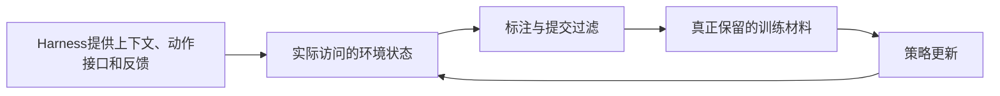

# Frontier：前沿与待检验问题

当前尚未选定细分研究方向。本页分别保存 [[wiki/surveys/Towards Long-Horizon Agents|S001]] 作者的展望、本库的疑问和证据缺口；这些内容不是已经成立的研究成果。

## 第一轮结果与亲读入口

**R001已完成文献研究与两轮讨论，尚未选定最终题目。** Harness六方向与Optimization七方向各选5篇，共65个方向名额，S041跨方向复用后为64篇独立核心论文；查新再纳入5篇。加上S001，本库现有70篇学术来源。下列优先级是本库对下一步阅读价值的判断，依据是已有现象、问题是否可区分以及下一条证据是否明确，不是创新性评分。

| 阅读优先级          | 收窄后的问题与主要落点                                                   | 本轮留下它的理由                              | 当前状态                       |
| -------------- | ------------------------------------------------------------- | ------------------------------------- | -------------------------- |
| 优先亲读，进入门槛较低    | [[wiki/harness/Questions#H-B：准入正确后，约束为什么仍未被使用\|记忆准入与后续使用]]     | TRACE有两类不同失败的具体案例；先判断改进应落在准入还是决策使用    | 本库材料问题；宽泛失效检测构思已关闭         |
| 优先亲读，需要概率与RL基础 | [[wiki/optimization/Questions#O-A：局部比较组究竟提供什么信用信息\|局部信用的比较条件]] | 论文、当前代码与反事实参照已能明确估计对象；仍缺实际分组样本与实验版本对应 | 本库材料/解释问题；未证明GiGPO有害或新方法必要 |
| 第二梯队，适合沿训练路线追踪 | [[wiki/optimization/Questions#O-B：哪些学生失败前缀真正进入训练\|访问、标注与最终保留]] | 教师执行、教师标签和有效提交过滤是不同环节；可先查清数据路径        | 本库材料问题；未证明筛选损伤恢复能力         |
| 第二梯队，先补轨迹与近邻   | [[wiki/harness/Questions#H-F：修复过程中是否真的破坏了其他稳定需求\|修复中的非目标需求变化]] | 需求过时、测试错误和真实退化需要分开；当前尚缺稳定判据下连续产物的直接证据 | 待材料与查新；回归检查和重试本身已有覆盖       |

完整问题卡、反对证据、下一条区分证据与关闭条件只在上述主要落点维护。**本轮没有确认新颖研究缺口。**“已有工作覆盖”关闭的是宽泛创新表述，不表示任务已经被彻底解决；“继续追踪”也不等于已证明值得训练一个新系统。

### 三条短阅读路线

1. **先理解记忆为何仍会失败：**[[raw/papers/harness/memory/HiAgent.pdf#page=3|HiAgent §3 · pp.3–4]] → [[raw/papers/harness/memory/TRACE.pdf#page=24|TRACE Appendix C.8 · p.24]] → [[raw/papers/harness/memory/TRACE.pdf#page=25|TRACE指标定义 · pp.25–27]]。读完应能区分初始误判、后来失效、未取回与取回后未使用；不要把VIA在不同数据集中的定义混成一个“记忆正确率”。
2. **再看局部信用如何产生：**[[raw/papers/optimization/reinforcement-learning/GiGPO.pdf#page=5|GiGPO §4.2–4.3 · pp.5–6]] → [[raw/papers/optimization/reinforcement-learning/GiGPO.pdf#page=16|Appendix C · pp.16–17]] → [[raw/papers/optimization/reinforcement-learning/C3.pdf#page=4|C3 §2.3 · p.4]]、[[raw/papers/optimization/reinforcement-learning/C3.pdf#page=26|B.5 · p.26]]。分别回答：比较对象是什么、如何恢复条件、数学期望与有限预算可靠性为什么不同。源码细节按[[wiki/papers/optimization/reinforcement-learning/GiGPO#公开实现核查：分组观察与策略输入分别保存|唯一页]]按需展开。
3. **把训练与运行接起来：**[[raw/papers/optimization/distillation/DAgger-LLM.pdf#page=4|DAgger §3.2 · p.4]] → [[raw/papers/optimization/distillation/DAgger-LLM.pdf#page=18|Table5/F.2 · p.18]] → [[raw/papers/harness/verification/SpecRover.pdf#page=5|SpecRover §III.C–D · p.5]]。画出谁执行、谁标注、什么提交被保留、哪个测试决定什么；特别区分valid submission、passing patch、需求语义与最终任务成功。

## Harness与Optimization的三个接口

两个模块分别组织阅读与内部讨论有用，但分类不能证明技术相互独立。以下是本库根据直接原文建立的接口检查，不是新算法或跨任务的统一因果定律。

### 保存证据与恢复环境是两个条件

HiAgent取回旧轨迹，TRACE选择当前允许进入上下文的记录；这些机制改善的是决策可见信息。C3的反事实参照还要求影响后续分布的状态能恢复，或能按给定记录的正确条件分布重采样。BRIDGE的回滚对象则是本地图和未发消息，不能撤销任意外部副作用。因此把运行日志直接交给训练算法，并未自动满足反事实信用的条件。[[raw/papers/harness/memory/HiAgent.pdf#page=4|S007 §3.4 · p.4]] [[raw/papers/harness/memory/TRACE.pdf#page=5|S066 §3.5 · p.5]] [[raw/papers/optimization/reinforcement-learning/C3.pdf#page=4|S068 §2.3 · p.4]] [[raw/papers/harness/orchestration/BRIDGE.pdf#page=6|S067 §3.5 · p.6]]

Agent-R的已审代码进一步把三件事分开：采树阶段重置并重放动作、构造训练文本时拼接失败前缀与成功节点、在线评估时真实执行失败前缀后继续。文本接续不能独自证明环境也恢复到了相应状态；Table3对应入口及部分执行细节仍未完全对齐。见[[wiki/papers/optimization/finetuning/Agent-R#公开实现核查：三个阶段怎样处理环境状态|Agent-R代码核查]]。这是固定commit的阅读结论，未运行实现。[[raw/code/S050-Agent-R/82fcc1ca7873b460949ed49022146dd988c32e31/mcts_utils/webshop/mcts_ws.py|采树 L147–169]]；[[raw/code/S050-Agent-R/82fcc1ca7873b460949ed49022146dd988c32e31/path_collection.py|训练构造 L139–166]]；[[raw/code/S050-Agent-R/82fcc1ca7873b460949ed49022146dd988c32e31/mcts_utils/llm_server.py|恢复执行 L144–213]]。

### 检查结果如何成为训练材料

运行时检查会改变下一步行动和访问状态，采集后的过滤又决定哪些状态留下来训练。DAgger在访问状态上查询教师，却仍按是否有有效最终patch提交过滤轨迹；Table5把它与SFT的测试通过过滤分列，不能写成同一种成功筛选。SpecRover则说明既有测试也可能因合法新需求而过时。两者共同提示：核查反馈来源、判定版本与保留单位，才能解释实际训练分布；它们没有证明某一种过滤必然更好。[[raw/papers/optimization/distillation/DAgger-LLM.pdf#page=4|S057 §3.2 · p.4]] [[raw/papers/optimization/distillation/DAgger-LLM.pdf#page=18|Table5/F.2 · p.18]] [[raw/papers/harness/verification/SpecRover.pdf#page=5|S070 §III.D · p.5]]

本库重绘的分析关系：箭头表示数据或策略依赖，不表示每篇方法都包含全部节点，也不声称这些关系已由一次统一实验识别。问题O-B负责保存具体待核查项。

### 局部通过、终局成功与优化信号分别举证

TRACE准入正确后仍有回答使用失败；BRIDGE有本地验证通过而最终失败的案例；SpecRover的验收测试通过也不完全等同于作者人工语义判断。训练侧，C3的条件无偏不保证有限预算排序稳定，R-Quest的有效题门控也不消除多数答案标签与外部标注锚点。因而“增加反馈”必须先说清增加的是证据、模型判定、训练标签还是可重复的终局结果，再匹配调用、采样和筛选成本。[[raw/papers/harness/memory/TRACE.pdf#page=24|S066 Appendix C.8 · p.24]] [[raw/papers/harness/orchestration/BRIDGE.pdf#page=18|S067 Table13 · p.18]] [[raw/papers/harness/verification/SpecRover.pdf#page=7|S070 §V.A · p.7]] [[raw/papers/optimization/reinforcement-learning/C3.pdf#page=26|S068 B.5 · p.26]] [[raw/papers/optimization/self-evolution/R-Quest.pdf#page=19|S069 C.2 · p.19]]

## 第一轮讨论与验收记录

共同证据版本、两轮角色协议与验收限制见[[maintenance/research/R001#讨论与验收协议|R001维护记录]]；本页保留研究理解与查新边界。

## 作者提出的四条前沿轴

S001 将 §7 明确写作作者的立场与展望，分为四条轴、九个方向。下表是其 Table 8 的简要归纳。[[raw/surveys/Towards Long-Horizon Agents.pdf#page=67|S001 · §7 · p.67]]；[[raw/surveys/Towards Long-Horizon Agents.pdf#page=68|Table 8 · p.68]]

| 前沿轴 | 方向 | 作者指出的开放挑战与展望 |
| --- | --- | --- |
| Evolution | Self-evolving Harness and Agents | 改进目标与范围仍多由人设定；需要控制长期漂移与过拟合 |
| Evolution | Harness Generalization and Transferability | 模型与特定运行机制绑定；研究跨 harness 训练、可移植经验与协议 |
| Evolution | Continual and Lifelong Learning | 外部经验有噪声，参数更新可能遗忘；研究经过验证的经验积累与内化 |
| Effectiveness | Real-world Environment Interaction | 真实交互慢、贵且部分不可逆；模拟与合成环境需检查真实性 |
| Effectiveness | From Digital to Embodied Agents | 慢规划与快控制时间尺度冲突；研究分层控制和多尺度反馈 |
| Efficiency | Cost- and Budget-aware Agency | 感知成本、判断不可行、运行中调整路线并执行预算上限 |
| Efficiency | Multimodal and Omni Harnesses | 跨模态证据保留、预算分配和验证仍缺统一组织方式 |
| Trustworthiness | Reflection and Error Robustness | 反馈延迟且有噪声；需要及时发现失败、转换路径与外部校验 |
| Trustworthiness | Safety and Governance | 外部输入和经验复用会带入风险；自我修改需要保持约束并独立验证 |

作者对环境建设、harness 作用和未来演进的强判断，应继续作为待检验立场保存；不能因为它们出现在综述结论中就视为已证明。

## 本库的待检验问题

初始化时据综述提出的三个宽泛问题仍保留，但首轮直接阅读已改变下一步的问法。它们不是最终选题，具体问题卡与关闭理由已归入两个模块。

| 原阅读问题 | 首轮后的更新 | 具体落点 |
| --- | --- | --- |
| 相同模型在不同harness下的差异来自哪里？ | 状态接口、反馈权限、实际访问和提交过滤各自改变比较条件，不能只控制模型名称 | 本页“检查结果如何成为训练材料”，以及[[wiki/optimization/Questions#O-B：哪些学生失败前缀真正进入训练\|O-B]] |
| 跨上下文恢复怎样保持约束与进度？ | 取回旧记录、判断当前准入、正确使用与恢复环境分别有条件；初始误判与后来失效不能相互作证 | [[wiki/harness/Questions#H-B：准入正确后，约束为什么仍未被使用\|H-B]]；H-A暂缓完整失败链 |
| 什么证据说明经验应进入参数？ | 本轮尚无统一等预算的外部复用/参数内化迁移对照；已有自演化和蒸馏工作改变了不同监督、数据与反馈锚点 | [[wiki/optimization/self-evolution\|自我演化机制比较]]；保留为跨任务阅读问题，未新增研究卡 |

前两行是对本页已引原文关系的归纳；第三行界定本轮材料范围，不宣称领域缺少该对照。综述原始提问依据仍为S001 §7.1.2、§4.2与§7.1.3。[[raw/surveys/Towards Long-Horizon Agents.pdf#page=69|S001 p.69]] [[raw/surveys/Towards Long-Horizon Agents.pdf#page=23|p.23]] [[raw/surveys/Towards Long-Horizon Agents.pdf#page=70|p.70]]

## 需保留的原文表述张力

**T001：终身学习是否是所有长程 Agent 的必要条件？**

- §2.4.3 明确允许 H1/H2 Agent 使用固定策略与临时状态完成任务，不要求自我演化。[[raw/surveys/Towards Long-Horizon Agents.pdf#page=14|S001 · p.14]]
- §7.1.3 在讨论跨任务、持续改进的展望时，将终身学习称为长程能力的必要条件。[[raw/surveys/Towards Long-Horizon Agents.pdf#page=70|S001 · p.70]]

**本库推断：**后一句可能针对作者期望的 H3/长期部署目标，前一句则覆盖 H1/H2 定义；但原文没有在这句“必要条件”中明确限定范围。因此暂记为适用范围待澄清，不将“所有长程 Agent 都必须终身学习”写入 [[wiki/foundations/Formalization|基础定义]]。状态：开放，等待更精确的定义讨论或后续证据。

## 第一轮查新范围与未决线索

检索日期为2026-10-25。查新阶段实际执行16条定向查询：Harness反证6条、Optimization反证6条、修复回归补充4条。前述核心选文检索不包含在此数内。下表保存实际查询词；长工具输出位于临时区。结果只用于找原始来源，论文结论仍以已归档原文及定位为证据。不同查询曾合并返回，不把下表当逐query完整排名。

> [!info]- 展开实际查询词与范围（16条）
>
> | 组别 | 实际查询词 | 搜索范围 |
> | --- | --- | --- |
> | Harness反证 1 | `site.arxiv.org LLM agents transactional execution rollback irreversible actions checkpoint` | 查询含site:arxiv.org；站外结果未用作证据 |
> | Harness反证 2 | `site.arxiv.org agent memory provenance temporal validity contradiction memory update benchmark` | 查询含site:arxiv.org；站外结果未用作证据 |
> | Harness反证 3 | `site.arxiv.org adaptive agent guardrail memory poisoning safety checks` | 查询含site:arxiv.org；站外结果未用作证据 |
> | Harness反证 4 | `LLM agent verification adaptive stopping self correction miscorrection budget` | arxiv.org / aclanthology.org / openreview.net |
> | Harness反证 5 | `multi agent communication information loss causal intervention handoff benchmark` | arxiv.org / aclanthology.org / openreview.net |
> | Harness反证 6 | `LLM agent skill library contamination revalidation preconditions` | arxiv.org / aclanthology.org / openreview.net |
> | Optimization反证 1 | `site.arxiv.org LLM agent reinforcement learning credit assignment state aliasing history group advantage` | arxiv.org；作者原始渠道 |
> | Optimization反证 2 | `site.arxiv.org self evolving reasoning majority vote label noise collapse R-Zero` | arxiv.org；作者原始渠道 |
> | Optimization反证 3 | `site.arxiv.org recurrent language models state tracking future queries memory compression benchmark` | arxiv.org；作者原始渠道 |
> | Optimization反证 4 | `"GiGPO" "state" "history" credit assignment` | arxiv.org；作者原始渠道 |
> | Optimization反证 5 | `"DAgger" LLM agents teacher intervention budget recovery` | arxiv.org；作者原始渠道 |
> | Optimization反证 6 | `"self-evolution" "question" "collapse" R-Zero` | arxiv.org；作者原始渠道 |
> | 修复回归补充 1 | `"LLM agent" "regression" "requirements" repair verification` | 未设域过滤；只留原论文/作者渠道 |
> | 修复回归补充 2 | `"agent" "iterative repair" "regression" tests impact analysis` | 未设域过滤；只留原论文/作者渠道 |
> | 修复回归补充 3 | `"EvoClaw" "regression" "requirements"` | arxiv.org / openreview.net / github.com |
> | 修复回归补充 4 | `"agent" "change impact" "regression" test selection` | arxiv.org / openreview.net / github.com / dl.acm.org |

实际进入原文摄入的综述外近邻是[[wiki/papers/harness/memory/TRACE|TRACE]]、[[wiki/papers/harness/orchestration/BRIDGE|BRIDGE]]、[[wiki/papers/optimization/reinforcement-learning/C3|C3]]、[[wiki/papers/optimization/self-evolution/R-Quest|R-Quest]]、[[wiki/papers/harness/verification/SpecRover|SpecRover]]，各自版本、URL、哈希和读取范围均在唯一页。[[wiki/papers/optimization/reinforcement-learning/GiGPO|GiGPO]]与[[wiki/papers/optimization/finetuning/Agent-R|Agent-R]]另有固定commit的同源代码核查，不另计论文。

**未决线索：**[EvoClaw原始PDF入口](https://openreview.net/pdf/1d13e6fc2280313b13882de15791b9b18b638355.pdf)遇验证页/403，作者与版本未确认；搜索片段不是已读正文，不据此确认或关闭精确需求转移指标。[REAgent](https://arxiv.org/abs/2604.06861)仅预筛方法段，未完整摄入；AgentRewind、Atomix、SafeHarbor、VaG、AgentAsk、Expected Attention、KVzip、EVOL-RL、Reward-DAgger等也只是未完整核读线索，不自动成为下一轮阅读队列。

本轮不是全领域穷尽查新。继续追踪仅表示证据问题具体，不能声称创新性、实验可行性或最终选题已确认。未验证的新观点保留为本库推断；没有运行实验、训练或新系统。

## 当前证据缺口

13个方向的核心原文及5篇查新补读已经摄入，实际正文/附录/代码读取范围以唯一页为准。尚缺的关键材料包括实际分组样本、有效提交过滤实现与逐轨迹统计、稳定需求的连续产物对，以及部分返回/交接失败的完整后缀。未读近邻不计已验证来源，跨任务分数不做直接排名；本轮没有复现实验。首轮已结束，这些证据需求留作下一轮候选，不后台自动继续。

返回[[wiki/index|索引]]，或查看[[maintenance/research/R001#范围与检查点|范围与Git检查点]]。
