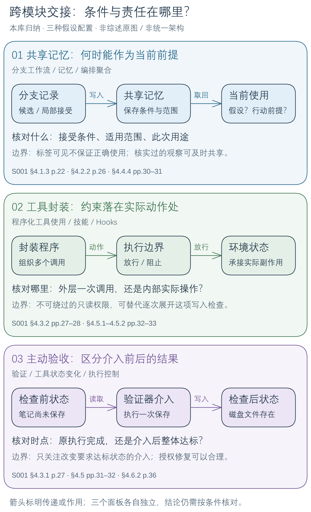

# Harness：跨模块联系与阶段性理解

**本库归纳：组合 Harness 时，需要说明何时接纳一条依据、何处约束实际动作、怎样区分介入前后的结果。** 共享、封装和主动验收会改变后续步骤看到什么、能做什么、依据什么报告成功。这三个问题提供阶段性的阅读视角；下图是本库综合与假设配置，不是综述原图或已验证的统一架构。

[放大关系图](../assets/diagrams/harness-connections/connections.png) · [可编辑 Excalidraw 图源](../assets/diagrams/harness-connections/connections.excalidraw)。图内面板分别对应下文三条联系，依据为 S001 §4；具体页码紧邻各段。

## 共享记忆：保存了，不代表当前可以直接采用

**原文：**分支先评价后承诺；harness 决定记忆的写入与取回；编排还承担并行输出的聚合。[[raw/surveys/Towards Long-Horizon Agents.pdf#page=22|§4.1.3 · pp.22–23]] [[raw/surveys/Towards Long-Horizon Agents.pdf#page=26|§4.2.2 · p.26]] [[raw/surveys/Towards Long-Horizon Agents.pdf#page=30|§4.4.4 · pp.30–31]]

**本库归纳：**共享存储会影响将来的上下文，因而候选、局部接受的结论和当前行动前提要分别理解。两个分支都标“已接受”，也可能分别依赖不同假设。取回作反证线索，与取回后据以行动，需要不同的使用约定。

**待检验问题：**最低限度应暴露哪些接受条件、范围和用途，才能支持这种区分？例如文献比较的局部结论只在某个评测条件下成立，条件不应在共享时被丢掉。标签提供核对入口，不保证模型使用正确；已核实且与分支假设无关的观察仍可尽早共享，不要求全面隔离。

## 工具封装：检查覆盖的是哪一层动作

**原文：**代码可组合工具调用、循环和分支；政策也可先编译成工件再用于执行约束，可靠性仍受编译质量限制。[[raw/surveys/Towards Long-Horizon Agents.pdf#page=27|§4.3.2 · pp.27–28]] [[raw/surveys/Towards Long-Horizon Agents.pdf#page=32|§4.5.1–4.5.2 · pp.32–33]]

**本库归纳：**工具程序产生动作，政策工件约束动作；同为代码并不使职责等价。把十次调用封装成一次，不必增加合法能力，却可能改变外层检查的观察粒度。因此应核对实际副作用发生处由谁约束，而不能只看外层调用是否获准。

**待检验问题：**一条“原 PDF 不得覆盖”的约束，是由不可绕过的只读权限保证，还是需要在内部写入前拦截？前者未必需要逐步展开，后者须同时具备观察和阻止能力。技能返回原页定位可降低复核成本；它不证明解释正确，也不能代替对过程要求的执行保证。[[raw/surveys/Towards Long-Horizon Agents.pdf#page=24|§4.2.1 · p.24]]

## 主动验收：谁促成了最终达标

**原文：**验证器可调用工具并主动探查环境；工具可能改变任务状态，实际动作仍有授权与执行控制边界。[[raw/surveys/Towards Long-Horizon Agents.pdf#page=36|§4.6.2 · p.36]] [[raw/surveys/Towards Long-Horizon Agents.pdf#page=27|§4.3.1 · p.27]] [[raw/surveys/Towards Long-Horizon Agents.pdf#page=31|§4.5–4.5.1 · pp.31–32]]

**本库归纳：**如果检查者先保存未保存的草稿，再看到文件存在，只能支持介入后达标，不能倒推原执行已完成。检查并修复可以是合法目标，但应明确验收口径。

**待检验问题：**对会使未满足要求变为满足的验证动作，保留哪些要求相关的介入前证据和动作记录，足以区分两种结果？不要求记录无关焦点变化或完整环境快照，也不将所有主动取证视为问题。

## 当前边界与继续讨论的入口

优先继续“共享记录如何成为行动依据”，保留及时共享与条件核对之间的取舍。这些联系只依据综述第 4 章，未查新、未实验；没有确认研究缺口或收益。正式证据来自上列原文，形成过程见 [[组会/2026-10-28-Harness/讨论记录|本轮完整讨论]] 与 [[组会/2026-10-28-Harness/README|轮次约定]]。

六类组件入口见 [[wiki/harness/Overview|Harness 地图]]；第一轮跨论文问题与关闭依据仍见 [[wiki/harness/Questions|第一轮问题页]]，不把两轮的证据范围合并。
