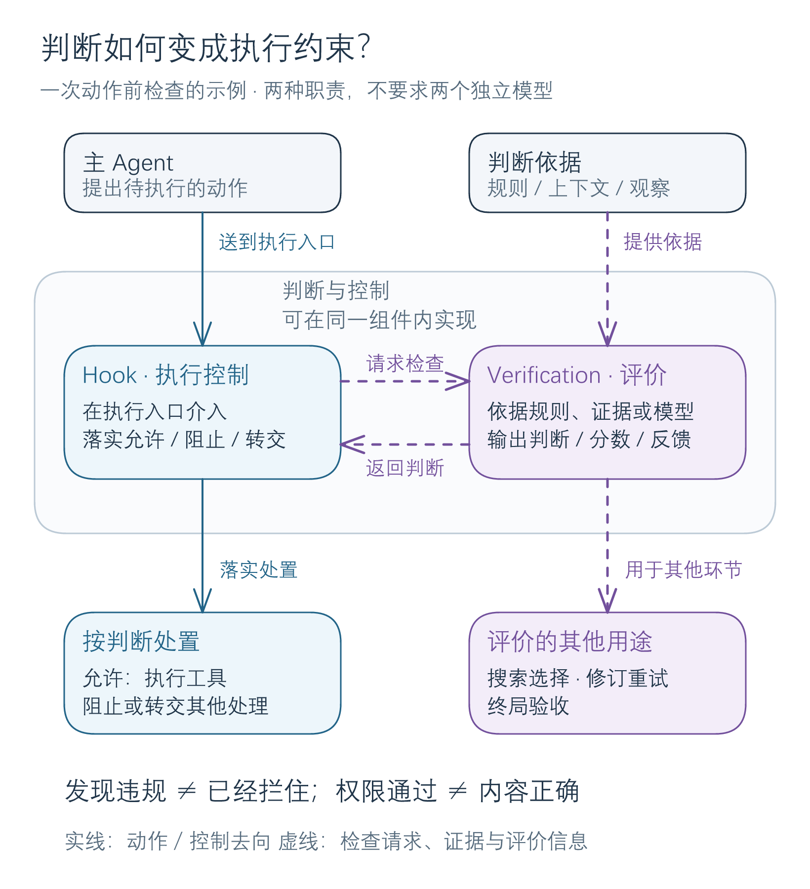
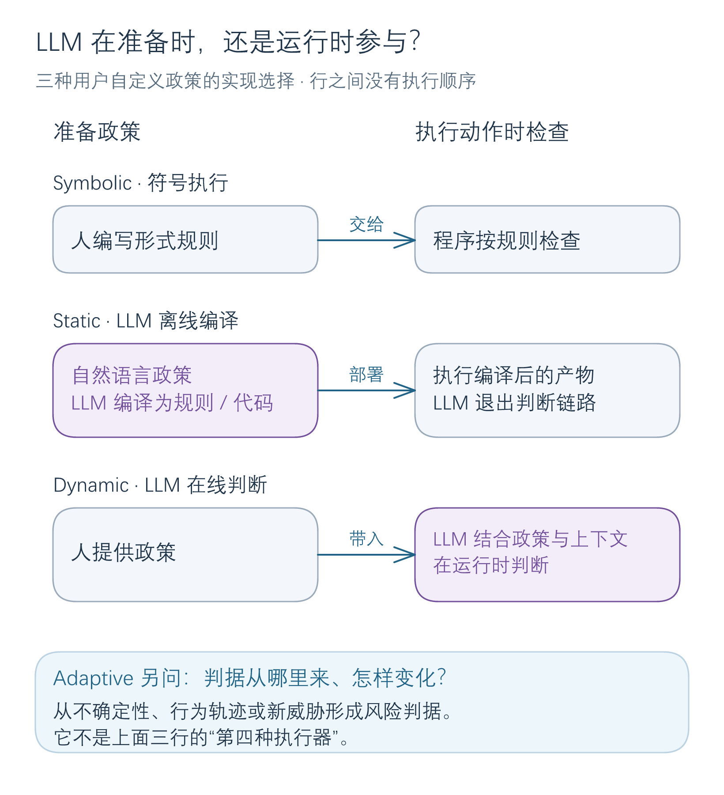

# Hooks 与中间件

Hooks 把约束落实在 harness 的执行路径上。模型即使答应遵守规则，仍可能提出危险动作；运行系统需要在实际执行处拥有**放行、阻止或转交**的能力。综述将这类可编程边界统称为 hooks，没有严格划分 hook 与 middleware 的上下级关系。[[raw/surveys/Towards Long-Horizon Agents.pdf#page=31|S001 · §4.5、Fig.10 · p.31]]

## 与 Verification 的关系

**同一次检查，可以同时承担评价与执行控制两种职责。** 从 [[wiki/harness/verification|Verification]] 看，问题是“依据什么证据，判断是否符合要求”；从 Hooks 看，问题是“在哪个执行点介入，怎样让判断真正约束动作”。例如，一个检查文件权限并拒绝写入的函数，就兼有两种职责，无须拆成两个独立模型。以下为依据综述的本库机制归纳。[[raw/surveys/Towards Long-Horizon Agents.pdf#page=31|S001 · §4.5 · p.31]]；[[raw/surveys/Towards Long-Horizon Agents.pdf#page=34|§4.6 · p.34]]

*本库教学示意：画出一种动作前检查的配合方式，不要求所有系统按此拆分。实线表示动作／控制去向，虚线表示检查请求、证据与评价信息。依据 S001 §4.5–4.6（PDF pp.31、34、36）；[可编辑图源](../assets/diagrams/hooks-verification/relationship.excalidraw)。*

**贯穿例子：整理知识库，`raw/` 只读、`wiki/` 可写，笔记须忠实于论文。** 下表为教学情境，不是论文实验：

| 情况 | 要形成的判断 | 判断怎样被使用 |
| --- | --- | --- |
| 准备覆盖原始 PDF | 是否违反只读约束 | Hook 在写入前阻止动作。 |
| 笔记可合法写入，但夸大了结论 | 原文证据是否支持该表述 | 要求修订或不接受产物；权限通过不能代替内容核验。 |
| 有三条后续分析路径 | 哪条更值得继续 | 评分供搜索选择，不一定涉及禁止动作。 |

检测器发现违规，执行程序若不使用这个判断，动作仍可能发生。反过来，拦住越权操作也不能证明报告内容正确。**两者按职责区分；验证既可在执行前进行，也可用于中间步骤和终局验收。** [[raw/surveys/Towards Long-Horizon Agents.pdf#page=34|S001 · §4.6 · p.34]]；[[raw/surveys/Towards Long-Horizon Agents.pdf#page=36|§4.6.2–4.6.3 · pp.36–37]]

## 三类可选方案：判断标准从哪里来

| 主类 | 标准来源 | 综述怎样细分 |
| --- | --- | --- |
| 预定义规则 | 框架作者规定通用底线 | 按**检查位置**：输入边界过滤进入模型的数据；工具调用边界检查参数；协议边界认证身份、逐动作授权。 |
| 用户自定义 | 部署者规定应用政策 | 按**政策执行机制**：符号执行、LLM 离线编译、LLM 在线判断，见下图。 |
| 运行时自适应 | 从数据与运行信号形成判据 | 按**信号来源**：不确定性、行为偏离、威胁变化；分别关注推理是否可靠、轨迹是否异常、旧检测标准是否失效。 |

来源：[[raw/surveys/Towards Long-Horizon Agents.pdf#page=31|S001 · §4.5.1 · pp.31–32]]；[[raw/surveys/Towards Long-Horizon Agents.pdf#page=32|§4.5.2 · pp.32–33]]；[[raw/surveys/Towards Long-Horizon Agents.pdf#page=33|§4.5.3 · pp.33–34]]。

**本库机制辨析：**这些类别并不争夺同一个位置。用户政策可以在工具调用边界执行，也可结合运行时风险信号。因而“在哪里介入、谁规定标准、怎样形成判断”要分别描述；三类可以组合，表格不规定执行顺序。

## 用户政策：准备期与运行期有什么不同

*依据 S001 §4.5.2–4.5.3（PDF pp.32–34）的本库对照示意；箭头表示规则交付、部署或政策输入，三行是可选实现。[可编辑图源](../assets/diagrams/hooks-verification/phases.excalidraw)。*

上图按**综述的类别定义**绘制，不能据此推定每篇所列论文的完整实现。[[wiki/harness/hooks#规则来源与执行权是两条轴|下文的实现核对]]保留了 ShieldAgent 的差异：综述归入 Static，但归档原文包含运行时模型参与。符号执行受政策覆盖范围限制，静态编译可能误译意图，在线模型判断则可能误判。[[raw/surveys/Towards Long-Horizon Agents.pdf#page=32|S001 · §4.5.2 · pp.32–33]]

**Dynamic 问“运行时由谁判断”，Adaptive 问“判据怎样从数据和信号中形成或变化”。** 每次让 LLM 检查人给定的政策，不代表标准具有自适应性；自适应也不必每一步重训模型，可以使用统计信号、行为模型或可更新的检查清单。[[raw/surveys/Towards Long-Horizon Agents.pdf#page=33|S001 · §4.5.3 · pp.33–34]]

> [!tip] “有没有额外模型”要拆成三个问题
> 是否增加模型推理调用？是否使用另一套权重？是否为检查任务专门训练？三者不能互相替代：同一套权重可承担额外检查调用，固定权重可在运行时判断，增加程序检查则未必调用模型。具体实现决定答案。

## 原论文中的机制与边界

第一轮 S022–S026 已完成摄入与整合；Obsidian 应用未测。下文分别核对规则来源、判断机制与实际执行权。

### 规则来源与执行权是两条轴

| 规则与状态从哪里来 | 谁判断、怎样介入 | 边界与原文 |
| --- | --- | --- |
| IsolateGPT 的通信类型、权限协议和隔离架构预定义；hub LLM 规划应用与数据需求 | 各 spoke 有独立 LLM/记忆；非 LLM operator 约束经 hub 的通信，丢弃格式不合规消息，按权限要求用户确认数据交换 | 隔离限制攻击跨应用传播；依赖可信 hub/系统中介与授权判断，单应用内部攻陷不在主要保护范围，原始字符串可能需人工筛查。[[wiki/papers/harness/hooks/IsolateGPT\|S022]]；[[raw/papers/harness/hooks/IsolateGPT.pdf#page=5\|§III.C–IV、Fig.2 · pp.5–9]] |
| AgentSpec 的 event–predicate–enforcement 规则由用户编写，也可由 LLM 生成 Python 谓词 | hook 截获动作前、观察返回后或结束事件；全部谓词为真表示触发违规，再停止、交人工、执行修复动作或让 LLM 自检 | 程序执行规则不等于规则覆盖全部风险；人工/模型处置还有各自误差，DSL 不提供进程隔离。[[wiki/papers/harness/hooks/AgentSpec\|S023]]；[[raw/papers/harness/hooks/AgentSpec.pdf#page=3\|§§2.3–4 · pp.3–6]] |
| ShieldAgent 离线从政策抽取/细化 LTL 规则，学习软权重；在线检索电路与成功检查工作流 | LLM 生成 shielding plan，结合搜索、二元检查、检测器为谓词赋值并生成验证代码，再作概率规则推断 | 形式检查覆盖编码模型与赋值，政策抽取和事实判断仍可能错；软规则评分不是现实安全概率。[[wiki/papers/harness/hooks/ShieldAgent\|S024]]；[[raw/papers/harness/hooks/ShieldAgent.pdf#page=3\|§3、Fig.1、Eqs.4–6 · pp.3–6]] |
| InfrastructureSentinel 的自然语言政策与角色、历史、时序、健康/锁状态共同进入 GuardianLLM | 在输入、工具计划、紧邻执行前和执行后审计四处检查；计划已批准后仍可按新状态拒绝执行 | Guardian 解释政策仍依赖模型；审计能反馈但不能撤销已发生副作用。[[wiki/papers/harness/hooks/InfrastructureSentinel\|S025]]；[[raw/papers/harness/hooks/InfrastructureSentinel.pdf#page=3\|Fig.1、§4 · pp.3–5]] |
| AGrail 按泛化动作键保存自然语言检查清单；Analyzer 增补/合并规则，Executor 删除冗余或过度防御项 | Executor 以推理或工具检查当前动作，有不安全项就阻止，否则允许，再保存保留的清单 | 两角色使用同一模型；记忆更新不等于参数训练，也不自动具有可信标签或不可删除的硬约束。[[wiki/papers/harness/hooks/AGrail\|S026]]；[[raw/papers/harness/hooks/AGrail.pdf#page=4\|§4、Fig.2 · pp.4–5]]、[[raw/papers/harness/hooks/AGrail.pdf#page=14\|Appendix B、Algorithms 1–3 · pp.14–15]] |

**保留综述与原文的两种证据身份：**S001 §4.5.2 将 ShieldAgent [80] 置于 Static LLM-compiled Hooks，并称该类在编译后执行时无需进一步 LLM 介入。归档的 S024 arXiv v2 正文却明确包含在线计划、赋值、工具调用和代码生成。因此本库沿“规则何时形成”和“执行期是否依赖模型”两轴修订理解，不能直接把综述类别当作完整实现。这里核读的是 arXiv v2，尚未与 PMLR 版本逐项对齐，也不据此断言差异来自何种版本变更。[[raw/surveys/Towards Long-Horizon Agents.pdf#page=33|S001 §4.5.2、引文80 · p.33]] [[raw/papers/harness/hooks/ShieldAgent.pdf#page=3|S024 §3、Fig.1 · pp.3–6]]

### 检查通过后，环境和规则还会变化吗

**本库比较轴：**运行时安全需要同时说明“检查时看到什么状态”和“允许后谁能执行”。IsolateGPT 的独立记忆、受限进程与 hub 通道限制跨域传播；它不把恶意语义从单应用内彻底消除。AgentSpec 把规则放在明确事件上，作者也说明它不预测长期后果。InfrastructureSentinel 则突出计划检查与真正执行之间的健康、锁与权限变化，增加紧邻执行的再检查。这三者分别处理隔离边界、事件处置和状态新鲜度，不能用“有 hook”互相替代。[[raw/papers/harness/hooks/IsolateGPT.pdf#page=17|S022 Appendix A · pp.17–18]] [[raw/papers/harness/hooks/AgentSpec.pdf#page=11|S023 §6.3 · p.11]] [[raw/papers/harness/hooks/InfrastructureSentinel.pdf#page=4|S025 §4 · pp.4–5]]

与 [[wiki/harness/memory|记忆]] 的接口也分两种：ShieldAgent 保存成功检查的工作流，AGrail 保存可继续修改的检查清单。后者允许删除过度防御规则以改善正常任务效用，但清单演化依赖模型自己的判断和工具结果；其工具还包含 LLM 生成并调试的 Python。**本库推断：**若把这种检查结果进一步用作训练奖励，应另行记录标签来源、错误传播和清单版本，不能把“适应后表现改善”当作外部正确性认证。ShieldAgent 的规则权重学习/工具模型微调与 AGrail 的记忆更新是不同更新对象。[[raw/papers/harness/hooks/ShieldAgent.pdf#page=5|S024 §3.2.4–3.3 · pp.5–6]] [[raw/papers/harness/hooks/AGrail.pdf#page=4|S026 §4 · pp.4–5]] [[raw/papers/harness/hooks/AGrail.pdf#page=22|Appendix D · p.22]]

### 拦住了什么，正常任务还能做多少

下面列出的证据口径不同，不能组成统一安全排行榜。检测率、提示用户的比例、误拒率、条件任务成功与实际副作用必须分别报告。

| 实际测试与报告对象 | 可以支持什么，不能升级成什么 |
| --- | --- |
| IsolateGPT：GPT-4、自建 VanillaGPT 对照、1,598 次攻击；Table I 分开权限申请 PA 与警告率 WR | WR=100% 是出现权限对话时的警告情况，不是 100% 自动拦截；用户仍可批准。性能测试自动授予权限，未计真实人工审核时间。[[raw/papers/harness/hooks/IsolateGPT.pdf#page=9\|S022 §V、Table I · pp.9–10]]、[[raw/papers/harness/hooks/IsolateGPT.pdf#page=14\|Table IV · p.14]] |
| AgentSpec：代码、具身与 8 个驾驶场景；人工规则与自动生成规则分开 | 受测具身风险类别的 unsafe task completion 为 0，同时安全任务完成率从 58.62% 降至 54.26%；自动规则会漏泛化文件名、漏对象状态或过度禁止动作。8 场景不支持开放道路普遍保证。[[raw/papers/harness/hooks/AgentSpec.pdf#page=7\|S023 Tables 3–6、§5 · pp.7–9]] |
| ShieldAgent：网页安全轨迹分类、规则检索、在线 AWM policy compliance | Table 2 的 FPR=5.6/4.0 与规则召回并非攻击拦截率；Table 4 在线指标条件于任务成功，也未证明所有副作用发生前拦截。数据总量/构成在归档版多处不一致，详见唯一论文页。[[raw/papers/harness/hooks/ShieldAgent.pdf#page=7\|S024 §5、Tables 2–4 · pp.7–8]] |
| InfrastructureSentinel：HPE HPC 初步部署与模拟 MCP 攻击测试 | Table 1 仅给不同攻击类别 ADR 下界（>50% 至 >90%）及总体 FPR<10%；样本量、实际模型版本、阈值选择、方差和分层消融缺失，延迟仅定性陈述。证据支持初步可行性，不能与配置清楚的大规模实验证据等量齐观。[[raw/papers/harness/hooks/InfrastructureSentinel.pdf#page=5\|S025 §5、Table 1、§6 · pp.5–6]] |
| AGrail：Safe-OS、AdvWeb/EIA 攻击、正常任务保留，以及冻结记忆或测试时适应 | Safe-OS 会筛掉任务 Agent 已自行拒绝的攻击，并只在任务 Agent 能完成的正常任务上计算保留；它测 guardrail 条件效用，不是原始任务端到端成功。冻结与持续适应协议应分开，少量案例语义相似度趋稳不证明终身收敛。[[raw/papers/harness/hooks/AGrail.pdf#page=6\|S026 §§5–6 · pp.6–9]]、[[raw/papers/harness/hooks/AGrail.pdf#page=17\|Appendix C.2 · pp.17–18]] |

**后续证据需求，尚非已成立研究缺口：**在同一有状态任务中同时记录动作提出、检查时状态、批准、实际执行、事后观察与规则版本，才能区分漏检、检查后状态变化、权限绕行和错误规则复用。本批未证明自适应清单在对抗污染下稳定，也没有证明隔离、逻辑检查和 LLM guardian 的组合普遍安全；这些仍是限定材料下的待核查条件，不是已查新的创新点。

## 论文入口与交叉方向

- [[wiki/papers/harness/hooks/IsolateGPT|S022 · IsolateGPT]]：主归属。
- [[wiki/papers/harness/hooks/AgentSpec|S023 · AgentSpec]]：主归属。
- [[wiki/papers/harness/hooks/ShieldAgent|S024 · ShieldAgent]]：主归属。
- [[wiki/papers/harness/hooks/InfrastructureSentinel|S025 · InfrastructureSentinel]]：主归属。
- [[wiki/papers/harness/hooks/AGrail|S026 · AGrail]]：主归属。

[[wiki/harness/Overview|返回模块地图]] · [[maintenance/research/R001|本轮选读理由与维护记录]]。
