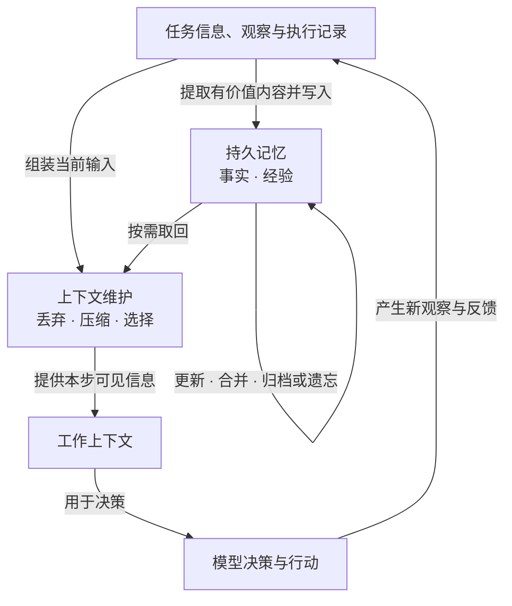

# 上下文与记忆

**工作流决定怎样推进，上下文与记忆决定推进时依据什么信息。** 综述 §4.2 将它们视为 workflow 与模型之间的状态接口：让当前决策所需的信息保持可见，也让以后仍有价值的信息得以延续。下面先读概念与关系，再看原论文的机制比较。[[raw/surveys/Towards Long-Horizon Agents.pdf#page=23|S001 · §4.2 · Fig.8 · p.23]]

## 两类状态怎样配合

| 状态 | 回答的问题 | 典型内容与作用 |
| --- | --- | --- |
| **工作上下文 Working Context** | 下一次模型调用现在能依据什么？ | 指令、近期观察、当前计划、检索证据、压缩历史；构成容量受限的活跃工作区。 |
| **持久记忆 Persistent Memory** | 什么要跨越当前窗口、任务或会话保留下来？ | 项目规则、用户偏好、任务状态、案例和教训；供后续更新与取回。 |

两者按**运行时作用与存续范围**区分，而不只看是否落盘。例如，规则保存在 `AGENTS.md` 中时是持久状态，加载到某次调用的输入后也成为工作上下文；这里的“工作记忆 Working Memory”指有限工作区，不另设第三大类。[[raw/surveys/Towards Long-Horizon Agents.pdf#page=23|S001 · §4.2–4.2.1 · p.23]] [[raw/surveys/Towards Long-Horizon Agents.pdf#page=26|§4.2.2 · 项目规则示例 · p.26]]

*本库依据 [[raw/surveys/Towards Long-Horizon Agents.pdf#page=23|S001 · Fig.8、§4.2 · pp.23–26]] 重绘的信息流示意；三种上下文操作可组合，图中不表示它们必须依次执行。Context Selection 从“组织当前输入”看选择，Memory Retrieval 从“持久存储”看取回；一次检索可以连接两者，但选择的来源也包括其他外部记录。*

## 工作上下文：控制当前该看什么

综述指出，信息过多会混入过时状态与噪声，出现 context rot、lost-in-the-middle 等利用退化；信息过少又会丢掉约束、证据与进度。因此目标是维护**容量受控、与下一步相关的工作区**。以下操作是综述分类；风险栏是本库据其目标归纳的检查点。[[raw/surveys/Towards Long-Horizon Agents.pdf#page=24|S001 · §4.2.1 · p.24]]

| 操作 | 怎样处理状态 | 需要防止什么 |
| --- | --- | --- |
| **丢弃 Discard** | 从当前输入移除低价值、失效或冗长内容；也可在进入前裁剪工具说明。 | 必要证据一并移出，且没有恢复通道。 |
| **压缩 Compress** | 缩减当前大段输入，或把累计轨迹整合成持续维护的任务状态。 | 摘要遗漏约束、未完成目标或失败线索。 |
| **选择 Select** | 丰富记录留在窗口外，需要时取回与当前决策有关的部分。 | 漏检依赖，或取回过多导致再次过载。 |

**移出当前输入不等于删除外部原件；摘要也只是压缩的一种形式。** 轨迹整合还可保留事实表、约束清单、带完成标记的计划或依赖图。选择则可检索 Agent 自己的观察、工具结果与产物，需要决定何时查、怎样构造查询、查哪个存储、如何筛选并注入。[[raw/surveys/Towards Long-Horizon Agents.pdf#page=24|S001 · §4.2.1 · Discard / Compression / Selection · p.24]]

## 持久记忆：存什么，与怎样管理

| 内容分类 | 保存什么 | 主要用途 |
| --- | --- | --- |
| **事实记忆 Factual Memory** | 偏好、规则、承诺、环境状态、文档或代码库事实。 | 延续已知条件，减少重复确认和推断。 |
| **经验记忆 Experiential Memory** | 成败案例、状态—动作示例、教训、推理模式或流程。 | 复用过去的尝试，减少重复探索。 |

两者是按内容与用途划分的并列类别；**经验可以只是一个案例，无须先成为通用规则**。经验还可加工成脚本、API 包装器或可执行 skill，从而与 [[wiki/harness/tools|工具与技能]] 相接。自然语言笔记、摘要、图、向量和代码技能则涉及表示形式，不能与事实／经验混成同一层分类。[[raw/surveys/Towards Long-Horizon Agents.pdf#page=26|S001 · §4.2.2 · Memory Contents · p.26]] [[raw/surveys/Towards Long-Horizon Agents.pdf#page=25|Table 3 · State form · p.25]]

两类内容都需要 **写入 Write**（提取哪些信息、保留到什么粒度）、**维护 Maintain**（合并、去重、更新、关联、归档或遗忘）和 **取回 Retrieve**（何时查、如何排序过滤、放回多少）。维护使记忆库能够处理过时与冲突；取回让保存的信息重新影响当前决策。运行时改记忆不等于改模型参数，但管理策略本身可以经过训练，不能将这一节所有方法概括为“无需训练”。[[raw/surveys/Towards Long-Horizon Agents.pdf#page=26|S001 · §4.2.2 · Memory Operations · p.26]] [[raw/surveys/Towards Long-Horizon Agents.pdf#page=25|Table 3 · Train-free 列 · p.25]]

**与长程能力的联系（本库综合）：**工作区维护支持窗口内连续行动；状态跨窗口保存与恢复支撑 [[wiki/foundations/Formalization#H1–H3 与 C1–C3|C2 连续性]]；案例、教训和技能跨任务复用支撑 C3 经验积累。这是作用联系，不能把事实记忆只分给 C2、经验记忆只分给 C3。综述最终关心的是：**正确的信息是否在需要时被保存、更新、取回并用于下一步行动**；孤立事实的召回不足以证明长程执行有效。[[raw/surveys/Towards Long-Horizon Agents.pdf#page=10|S001 · §2.2 · pp.10–11]] [[raw/surveys/Towards Long-Horizon Agents.pdf#page=26|§4.2.2 · 评估边界 · p.26]]

## 原论文机制与证据边界

以下保留已读论文的机制比较与适用条件；具体阅读范围、实验设置及验收状态见各唯一论文页。

### 先区分保存的对象，再问怎样取回

“有记忆”不足以说明后续行为怎样改变。下面沿两个问题比较：**保存的是执行细节、组织后的信息还是经验规则；这些内容怎样重新进入当前决策。** 这是本库依据原文组织的比较轴，不是论文间的性能排名。

| 保存对象与更新边界 | 重新进入决策的方式 | 可回查的原文 |
| --- | --- | --- |
| 当前子目标保留完整行动—观察；完成的子目标改为摘要 | 摘要维持可见进度，需要细节时取回旧轨迹；压缩不等于删除原轨迹 | [[wiki/papers/harness/memory/HiAgent\|HiAgent]]；[[raw/papers/harness/memory/HiAgent.pdf#page=3\|S007 §3 · PDF pp.3–4 / 印刷 pp.32781–32782]] |
| 超出窗口的消息留在 Recall，其他内容可写入 Archival；主上下文单独维护 | 模型经函数读写，队列管理器自动淘汰；heartbeat 可把多步检索连起来 | [[wiki/papers/harness/memory/MemGPT\|MemGPT]]；[[raw/papers/harness/memory/MemGPT.pdf#page=2\|S008 §2 · pp.2–4]] |
| 交互成为带关键词、标签、描述和链接的 notes；新 note 可更新旧 note 组织 | 生成的元信息参与向量检索，关联内容再交给回答模型 | [[wiki/papers/harness/memory/A-MEM\|A-MEM]]；[[raw/papers/harness/memory/A-MEM.pdf#page=3\|S009 Figure 2、§3 · pp.3–5]] |
| 训练任务成败轨迹提炼成可修改的经验规则，成功轨迹另存 | 规则直接加入提示，相似成功轨迹作为示例；无参数更新仍有经验收集阶段 | [[wiki/papers/harness/memory/ExpeL\|ExpeL]]；[[raw/papers/harness/memory/ExpeL.pdf#page=3\|S010 §4、Figure 1 · pp.3–6]] |
| 接近窗口上限时，把搜索历史压成相关证据摘要 | 以“原问题＋摘要”重置上下文并继续搜索；本文用系统阈值触发 | [[wiki/papers/harness/memory/ReSum\|ReSum]]；[[raw/papers/harness/memory/ReSum.pdf#page=3\|S011 §3.1 · p.3]]、[[raw/papers/harness/memory/ReSum.pdf#page=13\|Algorithm 1 · p.13]] |

这组对照澄清了两种容易混淆的扩展：HiAgent / ReSum 主要让**同一任务继续执行**；ExpeL 主要让**不同任务之间复用经验**。MemGPT / A-MEM 提供可跨当前窗口存续的信息与取回机制，其主实验则偏向对话、文档或合成检索。存续范围、操作方式与实际评测任务需要分别登记，不能用“长期记忆”一个词替代三者。[[raw/papers/harness/memory/HiAgent.pdf#page=4|S007 §4.1 · PDF p.4 / 印刷 p.32782]] [[raw/papers/harness/memory/ExpeL.pdf#page=7|S010 §5 · pp.7–9]] [[raw/papers/harness/memory/MemGPT.pdf#page=5|S008 §3 · pp.5–8]] [[raw/papers/harness/memory/A-MEM.pdf#page=5|S009 §4.1 · pp.5–7]]

**补充诊断证据（S036 已完成摄入，应用未测）：**[[wiki/papers/optimization/architecture/Lost-in-the-Middle|Lost in the Middle]] 的开放域 QA 实验中，增加文档后检索召回仍增长，reader 准确率却较早饱和；把 query 同时放在数据前后，明显改善合成 KV 检索，却没有同样消除语义 QA 的位置趋势。因此本库需分别问“是否取回”“如何编排”和“是否被模型使用”；这不是对上述五种记忆方法的直接反证，也不证明重排能够普遍修复 Agent。对应 [[wiki/optimization/architecture|架构基础]] 的有效上下文边界。[[raw/papers/optimization/architecture/Lost-in-the-Middle.pdf#page=8|S036 §4.2、Fig.9 · p.8]] [[raw/papers/optimization/architecture/Lost-in-the-Middle.pdf#page=9|§5、Fig.11 · pp.9–10]]

**跨用户轮次的记忆补充（S031，已完成摄入）：**[[wiki/papers/harness/verification/Self-MAP|Self-MAP]] 按当前指令与动作检索历史，缩减无关DOM，再为已给定历史动作生成rationale，供微调后的规划模型预测下一步。这里的reflection是在加工记忆解释，并非运行时发现错误后重试；positive element与历史动作的信息权限、静态HTML快照和Turn Success Rate边界见 [[wiki/harness/verification#检查对象决定成功指标|验证对象]]。它补充了省略、指代和任务切换下的记忆使用，不能由“保留旧历史”推断所有旧约束始终有效。[[raw/papers/harness/verification/Self-MAP.pdf#page=5|§4 · PDF pp.5–6 / 印刷8799–8800]] [[raw/papers/harness/verification/Self-MAP.pdf#page=12|Appendix A.2 · PDF p.12 / 印刷8806]]

**学习记忆操作与使用（S055，完成摄入，应用未测）：**[[wiki/papers/optimization/reinforcement-learning/Memory-R1|Memory-R1]]让Manager生成ADD/UPDATE/DELETE/NOOP及内容，再让Answer从60个候选中选择证据回答；二者分阶段RL，训练一方时另一方固定。运行时更新记忆不等于实时更新参数，最终QA reward也不逐条验证存储内容。主要证据为对话问答，LongMemEval采用**oracle版本**；因此不能当作完整大记忆库检索或自主执行的可靠性证据。训练快照与反馈依赖见 [[wiki/optimization/reinforcement-learning#记忆写入和使用也能成为训练接口|Optimization记忆接口]]。[[raw/papers/optimization/reinforcement-learning/Memory-R1.pdf#page=4|§3 · PDF pp.4–5 / 印刷12808–12809]] [[raw/papers/optimization/reinforcement-learning/Memory-R1.pdf#page=14|Appendix B · PDF p.14 / 印刷12818]]

### 来源真实、当前准入与后续使用是三个条件

HiAgent的旧轨迹取回回答“历史细节是否可见”，Self-MAP的历史使用回答“怎样解释当前指令”；团队在执行者缺席期间改变状态以后，还需要判断旧记录现在是否适用。综述外补读[[wiki/papers/harness/memory/TRACE|S066 TRACE]]专门处理这个返回边界：合并离开检查点与缺席更新，应用显式撤销并用模型扫描/核验隐式失效，再逐项检查权限、时效、任务适用性与来源，按预算选择覆盖当前义务的证据。私人经验只有其绑定来源仍在Return View中时才能重新进入上下文。**这已直接覆盖“相关且真实的旧记忆仍可能过期”的机制问题。**已完成摄入，应用未测。[[raw/papers/harness/memory/TRACE.pdf#page=3|S066 §2–3 · pp.3–5]] [[raw/papers/harness/memory/TRACE.pdf#page=19|Appendix C.3–C.4 · p.19]]

| 条件 | 它能说明什么 | 仍不能说明什么 |
| --- | --- | --- |
| 来源可追溯 | 记录绑定哪次观察或确认 | 观察为真、记录仍有效；被取消的订房确认仍有真实来源。[[raw/papers/harness/memory/TRACE.pdf#page=18\|C.1 · p.18]] |
| 当前准入通过 | 在本次身份、任务、状态与义务条件下，记录可进入受控返回视图 | 所有隐式失效都被识别、信息已经被正确使用；scanner/verifier仍会漏检。[[raw/papers/harness/memory/TRACE.pdf#page=18\|C.2–C.4 · pp.18–19]] |
| 后续回答或行动满足要求 | 需要另行观察任务结果 | 不能由签名、来源齐全或局部覆盖直接推出。TRACE有准入正确但回答未采用新约束的失败案例。[[raw/papers/harness/memory/TRACE.pdf#page=24\|C.8 · p.24]] |

TRACE的证据也限定了比较口径：STALE中的VIA映射为把更新用于新问题的IPA问答probe，ManBench-Return中的VIA才直接测候选是否进入视图；后者筛选初始答案正确的episode，Old-Stale还要求多数活跃Agent答对。它不是现实外部操作的完成率。Memora没有一致领先，CUPMem子集比较更准确也更贵；精确预算、分母及准入/使用错误见唯一论文页，不能据统一指标名汇总成通用可靠性。[[raw/papers/harness/memory/TRACE.pdf#page=25|D.1–D.5 · pp.25–27]] [[raw/papers/harness/memory/TRACE.pdf#page=7|Table2 · p.7]] [[raw/papers/harness/memory/TRACE.pdf#page=31|Table7 · p.31]]

### 机制可比较，分数必须留在原条件中

这些来源并不构成同一评测上的五个竞品。HiAgent 使用 GPT-4、五个行动环境、最多 30 步；MemGPT 的召回对照中，普通模型只见历史摘要而系统可搜索完整历史；A-MEM 的主证据是长对话 QA，检索 k 还按模型与题型调整。ExpeL 有训练任务重试和更强模型归纳经验的成本；ReSum 的主要推理比较为固定工具预算下的网页搜索，但默认摘要器本身经过训练。每项提升必须保留这些条件。[[raw/papers/harness/memory/HiAgent.pdf#page=4|S007 §4 · PDF pp.4–5 / 印刷 pp.32782–32783]] [[raw/papers/harness/memory/MemGPT.pdf#page=5|S008 §3.1.1 · p.5]] [[raw/papers/harness/memory/A-MEM.pdf#page=18|S009 Table 8 · p.18]] [[raw/papers/harness/memory/ExpeL.pdf#page=15|S010 Table 4 · p.15]] [[raw/papers/harness/memory/ReSum.pdf#page=4|S011 §3.2、§4.1 · pp.4–5]]

**本库推断：**工作记忆应同时检查“压缩后保留什么”和“丢失后怎样恢复”，持久经验则应检查“生成的解释如何影响以后检索或行动”。HiAgent 的轨迹取回与 MemGPT 的外部历史让恢复通道具体可见；A-MEM 元信息、ExpeL 规则和 ReSum 摘要均包含模型加工后的理解，不能与原始观察自动视为同等可靠。

**待检验问题，尚非已成立研究缺口：**如何区分写入错误、压缩遗漏、检索提前停止和经验规则不适用？如何在匹配探索预算后判断“更好的状态表示”与“更多继续执行机会”的贡献？ReSum 的训练比较正提示这个归因问题：普通 GRPO 训练限 40 次工具调用，ReSum-GRPO 为 60，不能把收益全部归给训练算法的一项变化。详见 [[wiki/optimization/reinforcement-learning|运行状态与策略训练的接口]]。[[raw/papers/harness/memory/ReSum.pdf#page=15|S011 附录 D.2 · p.15]]

## 论文入口与交叉方向

- [[wiki/papers/harness/memory/HiAgent|S007 · HiAgent]]：主归属。
- [[wiki/papers/harness/memory/MemGPT|S008 · MemGPT]]：主归属。
- [[wiki/papers/harness/memory/A-MEM|S009 · A-MEM]]：主归属。
- [[wiki/papers/harness/memory/ExpeL|S010 · ExpeL]]：主归属。
- [[wiki/papers/harness/memory/ReSum|S011 · ReSum]]：主归属。
- [[wiki/papers/harness/tools/Voyager|S015 · Voyager]]：交叉关联；主归属为`harness/tools`。
- [[wiki/papers/harness/verification/Self-MAP|S031 · Self-MAP]]：交叉关联；主归属为`harness/verification`。
- [[wiki/papers/optimization/architecture/Lost-in-the-Middle|S036 · Lost-in-the-Middle]]：交叉关联；主归属为`optimization/architecture`。
- [[wiki/papers/optimization/reinforcement-learning/Memory-R1|S055 · Memory-R1]]：交叉关联；主归属为`optimization/reinforcement-learning`。
- [[wiki/papers/harness/memory/TRACE|S066 · TRACE]]：主归属。

[[wiki/harness/Overview|返回模块地图]] · [[maintenance/research/R001|本轮选读理由与维护记录]]。
