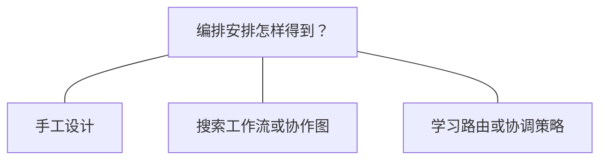

# 编排

编排（Orchestration）把多个执行循环组织起来，承担分工、协调与交接；这些循环可以是一个 Agent 的子任务，也可以属于多个专门化 Agent。综述将其称为 **长程控制结构的外化（externalized）**：由模型外围的 harness 显式组织工作如何推进。[[raw/surveys/Towards Long-Horizon Agents.pdf#page=29|S001 · §4.4 · p.29]]

> [!important] 这一节是一张方案地图
> §4.4 从四个问题介绍可行设计，**没有规定一套所有系统都必须采用的编排流程**。理解重点是“哪些安排可以选择或改变”，而非把四个小节依次执行一遍。

## 四个问题，看清编排的选择空间

下表按综述 §4.4.1–4.4.4 归纳；各维度可以组合，不是互斥的整套方案。[[raw/surveys/Towards Long-Horizon Agents.pdf#page=29|S001 · pp.29–31]]

| 维度 | 关心什么 | 可行选择与关键关系 |
| --- | --- | --- |
| **分解与角色** Decomposition & Roles | 拆成什么工作，交给谁？ | 可预定义，也可随反馈调整或生成执行者；粒度过粗会压垮单个执行者，过细会增加协调开销。 |
| **协调拓扑** Coordination Topologies | 谁与谁连接，谁控制谁？ | 可集中、分布或分层组织；DAG 表达任务依赖。**连接结构**与**合作／竞争关系**是不同维度。 |
| **编排优化** Orchestration Optimization | 这些安排怎样得到或改进？ | 可搜索工作流、优化提示与连边，也可学习模型路由或协调策略；优化对象是系统的组织与调用安排。 |
| **Agent 协议** Agent Protocols | 怎样交换任务、状态与产物？ | 共同的消息与任务约定支撑交接；**结果聚合**是配套职责，负责把多个输出选取或合成最终结果。 |

## Externalized：控制可以外化，安排也可以演化

综述在 §4.4.3 再次强调 **externalized evolution**：工作流、提示、通信图或路由安排本身也能成为改进对象。这里要区分“改进外围组织方式”与“把能力内化进模型参数”；**自动优化不等于从零训练底层 LLM，RL 只是可选路线之一**。[[raw/surveys/Towards Long-Horizon Agents.pdf#page=30|S001 · §4.4.3 · p.30]]

*本库依据 §4.4.3 绘制的选择示意：连线表示可选路线，可以组合，不表示先后步骤。*

**本库辨析：方案的来源与运行时是否固定，是两个问题。** 搜索所得的流程可以在后续任务中固定使用；学到的协调策略也可以根据当前状态动态派活。外化描述控制的落点，不要求整个系统完全不训练：§4.4.2 的竞争式编排就可以服务于参与者训练，其收益最终内化到模型。[[raw/surveys/Towards Long-Horizon Agents.pdf#page=30|S001 · §4.4.2–4.4.3 · p.30]]

> [!note] 协议支撑协作，但不替编排作决定
> **编排**决定谁做什么、何时继续；**协议**约定怎样表达委派、状态和交付；**聚合**决定多个结果怎样形成一个输出。综述末尾将其概括为向 protocol-mediated coordination 转变；**本库限定：**这是作者的趋势判断，使用协议或投票本身并不推出组织必然去中心化，固定层级也可通过共同协议协作。[[raw/surveys/Towards Long-Horizon Agents.pdf#page=30|S001 · §4.4.4 · pp.30–31]]

## 已读论文中的机制与证据边界

以下保留原论文比较，检验具体安排在什么条件下有效；不能由“用了多个 Agent”直接推出能力提升，也不将不同任务的分数排成优劣。

### 谁负责分工，交接时保留什么

**本库比较轴：**团队成员是否固定、执行顺序是否固定、信息怎样流动，是三个不同问题。固定成员可以动态调度；生成新执行者也不意味着新的模型参数；通信图被学习也不等于每次行动都在重新规划。

| 分工与控制责任 | 共享或传递的状态 | 反馈后改变什么 | 直接证据 |
| --- | --- | --- | --- |
| MetaGPT：预定义专业角色按 SOP 协作 | PRD、架构/接口、任务列表、代码等进入共享 message pool，按角色订阅，依赖满足后行动 | 工程师依据执行测试和历史修复代码；主流程仍由既定 SOP 组织 | [[wiki/papers/harness/orchestration/MetaGPT\|S017 MetaGPT]]；[[raw/papers/harness/orchestration/MetaGPT.pdf#page=4\|§3、Fig.2 · pp.4–6]] |
| Magentic-One：Orchestrator 选择固定工具团队中的执行者 | Task Ledger 区分事实、待查/待推导信息、猜测和计划；Progress Ledger 保存完成/进展判断及下一指令 | 每步调整执行者与指令；停滞超过阈值后更新计划并重置 Agent 上下文 | [[wiki/papers/harness/orchestration/Magentic-One\|S018 Magentic-One]]；[[raw/papers/harness/orchestration/Magentic-One.pdf#page=5\|§4.1、Fig.2 · pp.5–7]] |
| TDAG：MainAgent 拆任务，Generator 定制当前执行者 | 子任务与前序结果进入执行；定制工具文档和检索到的文本技能提供上下文 | 前序结果更新后续子任务；成功判定后的经验总结更新技能库 | [[wiki/papers/harness/orchestration/TDAG\|S020 TDAG]]；[[raw/papers/harness/orchestration/TDAG.pdf#page=5\|§4、Algorithm1 · pp.5–7]] |
| GPTSwarm：Agent 是操作子图，团队是组合 DAG | 节点沿边接收前驱输出；节点历史可用于提示改进 | 用任务 utility 学习 Agent 间边分布，或优化节点提示；固定图执行按拓扑依赖进行 | [[wiki/papers/harness/orchestration/GPTSwarm\|S019 GPTSwarm]]；[[raw/papers/harness/orchestration/GPTSwarm.pdf#page=2\|§2、Algorithms1–3 · pp.2–4]] |

这组比较修正了“固定与动态”过粗的分类：Magentic-One 团队固定但路由与计划可变，TDAG 同时定制执行者上下文，GPTSwarm 则把通信边分布作为学习对象。上述主要改变发生在外部控制、提示与状态，不能仅因使用 REINFORCE 就归为基础 LLM 权重训练。[[raw/papers/harness/orchestration/Magentic-One.pdf#page=19|S018 §6.2 · p.19]] [[raw/papers/harness/orchestration/TDAG.pdf#page=6|S020 §4.2 · p.6]] [[raw/papers/harness/orchestration/GPTSwarm.pdf#page=4|S019 §§2.3–2.4 · p.4]]

与 [[wiki/harness/memory|记忆]] 相接时，还要检查状态的有效期：Magentic-One 明确丢弃任务间经验；TDAG 保留文本技能，但作者承认环境不能保证技能正确。本库尚未确认 TDAG 测试遍历时技能库的初始化、重置与顺序，不能据“有库”直接推定独立任务上的迁移收益。**本库推断：**清除 Agent 上下文与撤销外部动作也不同，重规划后的状态一致性须另有证据。[[raw/papers/harness/orchestration/Magentic-One.pdf#page=6|S018 §4.1 · p.6]] [[raw/papers/harness/orchestration/Magentic-One.pdf#page=19|§6.2 · p.19]] [[raw/papers/harness/orchestration/TDAG.pdf#page=6|S020 §4.2 · pp.6–7]] [[raw/papers/harness/orchestration/TDAG.pdf#page=12|Appendix B · p.12]]

### 整体系统有效，是否知道哪项编排起了作用

四篇方法论文支持的作用范围不同，需要保留消融究竟移除了什么。

- **角色增加不等于纯数量效应。**MetaGPT 的角色消融仅对两项任务平均，增加角色时文档、调用与成本也改变。Magentic-One 删除专项 Agent 时同时减少工具能力；把完整协调者换成 GroupChat 又一次移除账本、规划、进展追踪、循环检测和明确指令。因此可以说这些组合在相应实验中有帮助，不能把收益单独归给 Agent 数量或某一本账本。[[raw/papers/harness/orchestration/MetaGPT.pdf#page=9|S017 §4.4、Table3 · p.9]] [[raw/papers/harness/orchestration/Magentic-One.pdf#page=12|S018 §5.3、Fig.3 · pp.12–14]]
- **框架展示不等于优化组件的证据。**GPTSwarm 的 GAIA 实验明确没有节点或边优化；TDAG 的 WebShop/TextCraft 实验明确不启用 Agent Generation。这些结果分别支持所测框架配置或动态拆解，不能挪用为拓扑学习、动态定制执行者的泛化证明。[[raw/papers/harness/orchestration/GPTSwarm.pdf#page=7|S019 §3.4 · pp.7–8]] [[raw/papers/harness/orchestration/TDAG.pdf#page=9|S020 §5.5 · p.9]]
- **成绩需要对应反馈与终局选择。**GPTSwarm 的填字优化/评估使用同20题，utility 是候选中的 best-state word accuracy；TDAG 的旅行主成绩是分层细粒度评分，非整任务成功率。额外优化、候选搜索和测试反馈的费用与权限必须保留，不能只比较最终一个分数。[[raw/papers/harness/orchestration/GPTSwarm.pdf#page=5|S019 §3.2 · pp.5–6]] [[raw/papers/harness/orchestration/GPTSwarm.pdf#page=25|Table11 · p.25]] [[raw/papers/harness/orchestration/TDAG.pdf#page=4|S020 §3.3 · pp.4–5]]

### 失败发生在设计、交接，还是验收

[[wiki/papers/harness/orchestration/Multi-Agent-Failures|S021 MAST]] 提供分析反面证据的分类工具：系统设计问题覆盖职责、历史和终止规则；Agent 间错位覆盖信息未传、未用、未澄清和偏离目标；任务验证覆盖过早终止、检查缺失和错误检查。其14类模式来自轨迹归纳，不是14种已隔离的因果机制；标注一致性也不等于根因已被完全识别。[[raw/papers/harness/orchestration/Multi-Agent-Failures.pdf#page=5|§3、Table2 · pp.5–6]] [[raw/papers/harness/orchestration/Multi-Agent-Failures.pdf#page=24|Appendix A · pp.24–25]]

**本库推断：**比较交接机制时，可沿“执行者是否掌握关键信息—是否传给协调者—协调者是否采用—最终结果是否被核查”追踪同一事实。MAST 的电话号码登录例子说明，有接口文档和消息通道仍可能漏传决定性约束。这支持细分检查责任，但作者关于 social reasoning 和目标训练的解释仍是观点，不能据单例确立唯一根因。[[raw/papers/harness/orchestration/Multi-Agent-Failures.pdf#page=6|S021 Fig.3 · p.6]] [[raw/papers/harness/orchestration/Multi-Agent-Failures.pdf#page=8|§4 FC2 · p.8]]

MAST 的干预案例进一步说明效果有条件：AG2 在不同模型上对拓扑改变的响应不同；ChatDev 的32项 ProgramDev-v0 测试改变验证/终止流程后，任务准确率得到改善，但不是全1642条数据上的统一提升。不同系统在不同任务的失败率不能互排；成功轨迹也会带有失败模式标签，因此标签减少与终局成功要分别检查。原文个别图文计数张力保留在唯一论文页，不据此否定任务结果。[[raw/papers/harness/orchestration/Multi-Agent-Failures.pdf#page=26|S021 Fig.5 · p.26]] [[raw/papers/harness/orchestration/Multi-Agent-Failures.pdf#page=33|Appendix H、Table5 · pp.33–35]] [[raw/papers/harness/orchestration/Multi-Agent-Failures.pdf#page=36|Appendix J.1 · p.36]]

### 从故障分类到选择性交接修复

综述外补读[[wiki/papers/harness/orchestration/BRIDGE|S067 BRIDGE]]进一步把公开记录和执行合同组织成依赖图，定位“信息未观察到”“已经送达但未消费”“送错角色”等前沿。HandoffProbe在同一故障前缀上分别原样继续与加入修复，并用终局程序验收标记帮助、损害或结果不变；这些离线统计冻结后，在线控制器按效用、经验损害率、样本支持和预算选择修复。**受控交接干预与选择性修复已有直接机制覆盖，不能只在MAST分类后新增一个反思节点就称为新方法。**已完成摄入，应用未测。[[raw/papers/harness/orchestration/BRIDGE.pdf#page=4|S067 §3.1–3.4 · pp.4–6]]

修复必须先满足图上的后置条件才提交；否则恢复本地图并发送原消息。这个回滚**只覆盖控制器的图与未发送消息缓冲区**，不撤销已执行的外部工具副作用。形式检查依赖合同和可见事件正确地表示所需事实及消费关系，不会直接读取Agent内部是否理解；p.18的已核验修复仍有最终任务失败实例。[[raw/papers/harness/orchestration/BRIDGE.pdf#page=6|§3.5、Algorithm1 · p.6]] [[raw/papers/harness/orchestration/BRIDGE.pdf#page=13|Appendix A · pp.13–14]] [[raw/papers/harness/orchestration/BRIDGE.pdf#page=18|Appendix E、Table13 · p.18]]

BRIDGE的MAST562是281个handoff正例与281个控制的**诊断**子集，控制中多数含其他执行错误，不能写成全部轨迹的在线修复成绩。完整token成本与正文“2%开销”、INTEGRATE是否使用模型重构等口径有冲突，详见[[wiki/papers/harness/orchestration/BRIDGE#精确成本与实现归因仍需核对|原文差异记录]]；当前不用总体效率措辞替代明确账目。后续归因应先核对依赖如何从可观察事件得到、局部条件与真实任务的关系及完整预算，而不是把分类或图结构当作因果正确性的证明。[[raw/papers/harness/orchestration/BRIDGE.pdf#page=15|Appendix C.1–C.2 · p.15]] [[raw/papers/harness/orchestration/BRIDGE.pdf#page=18|Appendix F、Table14 · pp.18–19]]

## 论文入口与交叉方向

- [[wiki/papers/harness/orchestration/MetaGPT|S017 · MetaGPT]]：主归属。
- [[wiki/papers/harness/orchestration/Magentic-One|S018 · Magentic-One]]：主归属。
- [[wiki/papers/harness/orchestration/GPTSwarm|S019 · GPTSwarm]]：主归属。
- [[wiki/papers/harness/orchestration/TDAG|S020 · TDAG]]：主归属。
- [[wiki/papers/harness/orchestration/Multi-Agent-Failures|S021 · Multi-Agent-Failures]]：主归属。
- [[wiki/papers/harness/orchestration/BRIDGE|S067 · BRIDGE]]：主归属。

[[wiki/harness/Overview|返回模块地图]] · [[maintenance/research/R001|本轮选读理由与维护记录]]。
