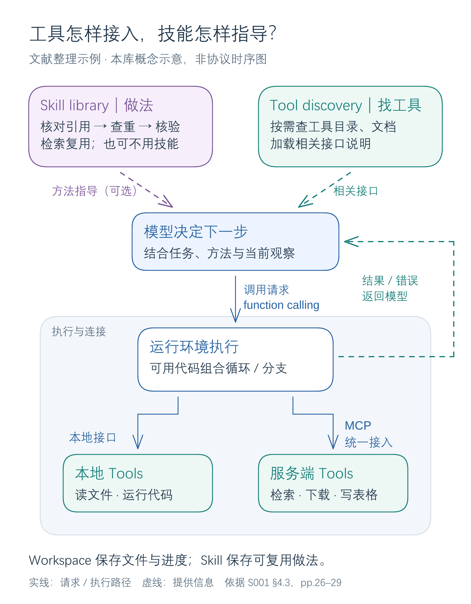
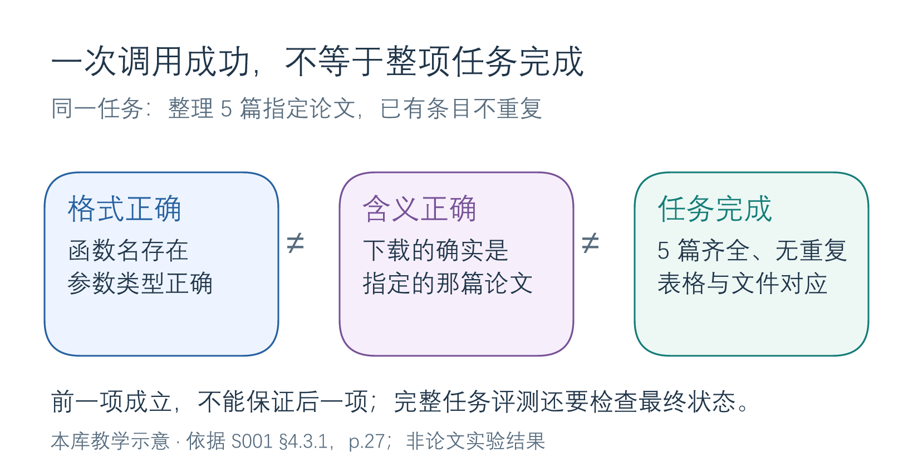

# 工具、MCP 与技能

## 概念总览：从可调用能力到可复用方法

**Tool 提供可执行能力，skill 保存运用这些能力的做事方法；function calling、MCP 和工具发现分别处理调用表达、统一接入和按需选择。** 综述 §4.3 按“接口与协议 → 主动工具发现 → 技能库”展开；下面的定义依据原文，关系辨析与例子为本库归纳。[[raw/surveys/Towards Long-Horizon Agents.pdf#page=26|S001 · §4.3 · pp.26–29]]

### 几个概念各管什么

| 概念 | 回答的问题 | 含义与位置 |
| --- | --- | --- |
| **Tool（工具）** | 能执行什么操作？ | 模型之外的可调用能力，如搜索、运行代码、读写数据库；执行后返回观察结果。[[raw/surveys/Towards Long-Horizon Agents.pdf#page=26\|§4.3 · pp.26–27]] |
| **Function calling（函数调用）** | 怎样表达一次调用？ | 模型依据接口说明选择函数、填写参数，由运行环境执行并返回结果，模型再继续处理。[[raw/surveys/Towards Long-Horizon Agents.pdf#page=27\|§4.3.1 · p.27]] |
| **MCP（Model Context Protocol）** | 不同工具服务怎样统一接入？ | 通过统一的 host–client–server 交互机制连接服务，使其能力可被发现、调用；一个 server 可以提供多个工具。[[raw/surveys/Towards Long-Horizon Agents.pdf#page=27\|§4.3.1 · p.27]] |
| **Active tool discovery（主动工具发现）** | 工具太多，当前该加载哪些？ | 按需检索工具、读取定义或文档，只把相关接口带入上下文，避免每步都塞入整个目录。[[raw/surveys/Towards Long-Horizon Agents.pdf#page=27\|§4.3.2 · pp.27–28]] |
| **Programmatic tool use（程序化工具使用）** | 怎样高效组合多个调用？ | 用代码中的变量、循环和分支连接工具，把多次调用组织在一个程序里执行；综述将其与按需发现一起放在 §4.3.2。[[raw/surveys/Towards Long-Horizon Agents.pdf#page=27\|§4.3.2 · pp.27–28]] |
| **Skill / skill library（技能／技能库）** | 怎样复用已经有效的做法？ | 将经过验证的工具用法、控制流程和领域知识封装为可复用、可参数化的过程；可写成 Markdown 指南、可执行代码，或按依赖与组合关系组织成库。[[raw/surveys/Towards Long-Horizon Agents.pdf#page=28\|§4.3.3 · p.28]] |

### 它们怎样配合

**读图：上方提供做事依据，中间决定并表达动作，下方接入和执行工具；右侧反馈让下一步依赖实际结果。** Skill 与 MCP 分处“方法”和“连接”两个位置。

本库概念示意，以文献整理为教学例子，非论文实验或 MCP 协议时序图。依据 [[raw/surveys/Towards Long-Horizon Agents.pdf#page=26|S001 · §4.3 · pp.26–29]]；[可编辑图源](../assets/diagrams/tools-overview/tools-relations.excalidraw)。

图示一种常见组织方式：**可执行 skill 也能封装成 tool，代码也能直接作为动作表示**；发现、组合、复用没有固定先后。下方按接入方式分支，MCP 服务也可以在本机运行，左右两侧的工具示例不限定各自能提供的能力。

技能库由 harness 获取、检索、版本管理、修改和淘汰；**改库不必改模型参数**，也有研究通过训练将技能内化。复用旨在减少重复规划并提高可靠性，但旧技能在新环境中仍需核验。[[raw/surveys/Towards Long-Horizon Agents.pdf#page=28|§4.3.3 · pp.28–29]]

### 为什么接口清楚了，还需要学习与评测

接口给出能力与参数约定，模型仍要把用户需求转成合适的调用，并根据返回结果继续行动。

本库教学示意，依据 [[raw/surveys/Towards Long-Horizon Agents.pdf#page=27|S001 · §4.3.1 · p.27]]；[可编辑图源](../assets/diagrams/tools-overview/tools-evaluation.excalidraw)。

Benchmark 是“测试任务＋可交互环境＋成功标准”。**有状态环境**会保留写入的文件、记录等，后续动作受其影响，完整任务评测还须核验最终约束。综述转述的 MCP 相关基准显示：所测条件下任务完成仍困难，输入 token 随步骤增长，失败更多涉及理解、判断与规划；这不是 MCP 导致失败的因果结论，也不是所有模型的固定表现。此处为综述转述（参考文献 31、350、411、700），已直接核读的 MCPMark 证据见下文。[[raw/surveys/Towards Long-Horizon Agents.pdf#page=27|§4.3.1 · p.27]]

## 已读论文：发现、表示、复用与验收

第一轮 S012–S016 已完成摄入与本节整合，内容与结构验收通过，Obsidian 应用未测；尚未独立核读 MCP 协议规范，上述说明限于综述层面的概念，不替代协议文档。

### 发现、表示、复用和验收改变的是不同对象

**本库比较轴：**工具存在以后，还需要决定何时调用、找出合适接口、组合依赖动作、复用过去程序，并确认外部任务完成。下面五项工作改变不同环节，不能按各自成功率排成同一榜单。

| 要解决的问题 | 实际改变的对象 | 运行与训练边界、原文 |
| --- | --- | --- |
| 何时调用已有工具，怎样填写参数？ | Toolformer 采样并执行候选调用，以后续 token 预测损失改善筛选数据，再微调模型；推理时暂停生成并插入工具结果 | 有参数训练；不是主动发现新工具。[[wiki/papers/optimization/finetuning/Toolformer\|Toolformer]]；[[raw/papers/optimization/finetuning/Toolformer.pdf#page=3\|S012 §2 · pp.3–4]] |
| 大工具库中漏检后怎样继续找？ | AnyTool 维护分类层级中的搜索历史、完成标记与全局 API 候选池，失败理由驱动逐层重启发现 | 运行时多 Agent / solver / 反思，无新增参数训练。[[wiki/papers/harness/tools/AnyTool\|AnyTool]]；[[raw/papers/harness/tools/AnyTool.pdf#page=5\|S013 §4 · pp.5–6]] |
| 一次动作能表达多少依赖操作？ | CodeAct 用 Python 变量、循环与分支组合工具，解释器结果或异常返回下一轮 | 动作表示可直接用于现成模型；CodeActAgent 的 SFT 是另一项变化。[[wiki/papers/harness/tools/CodeAct\|CodeAct]]；[[raw/papers/harness/tools/CodeAct.pdf#page=3\|S014 §2.1 · pp.3–4]] |
| 已做成的程序怎样用于以后任务？ | Voyager 把成功判定后的 JavaScript 程序及描述存入技能库，以描述检索程序，再生成、组合和修复代码 | 更新程序库与任务进度，GPT-4 参数不更新。[[wiki/papers/harness/tools/Voyager\|Voyager]]；[[raw/papers/harness/tools/Voyager.pdf#page=4\|S015 §2.2–2.3 · pp.4–6]] |
| 工具调用结束后，任务约束满足了吗？ | MCPMark 初始化环境、运行工具循环、程序检查最终状态，再重置进行重复测量 | 是评测与验收框架，不是训练方法。[[wiki/papers/harness/tools/MCPMark\|MCPMark]]；[[raw/papers/harness/tools/MCPMark.pdf#page=5\|S016 §2.3–3.1 · pp.5–6]] |

这也解释了工具与技能的区别：工具接口提供当前可调用能力；Voyager 的技能则是过去任务产生的可执行程序经验。它的检索描述帮助找程序，但检索正确与新状态中执行成功仍是两件事。与 [[wiki/harness/memory|持久记忆]] 对接时，要记录保存的是事实、经验规则还是程序，以及它如何进入动作；不能仅凭“有技能库”推断环境前提仍成立。[[raw/papers/harness/tools/Voyager.pdf#page=4|S015 §2.2 · pp.4–5]] [[raw/papers/harness/tools/Voyager.pdf#page=42|B.4.4、Table A.4 · p.42]]

### 依赖怎样执行，失败以后改哪里

在CodeAct式动作之外，[[wiki/papers/optimization/finetuning/Agent-Distillation|S049 Agent Distillation，已完成摄入，应用未测]]加上SAG：每步生成多个thought/action、执行代码过滤异常、按观察结果多数选择，再继续单条轨迹；全部失败时把一个错误返回后续修正。它是运行时选择，离线蒸馏是另一项参数变化。该证据来自最多5步的固定检索/数学环境；输出一致不保证语义正确，迁移到有副作用的操作前须另查候选隔离与提交机制。详见 [[wiki/optimization/finetuning#状态由谁产生，哪些输出受到监督|训练与推理机制比较]]。[[raw/papers/optimization/finetuning/Agent-Distillation.pdf#page=5|§4、Fig.3 · pp.5–6]]

Toolformer 的训练调用独立生成，原文明确不能学习把一个工具输出交给下一个工具；评测每条输入最多一次调用。因此它支持“调用选择可被学到”，尚不支持长程多工具依赖已解决。AnyTool 则把失败反馈用于改变**可选工具集合**；CodeAct 把局部依赖写进**可执行动作**，再用结果修订后续代码。三者作用不同，也有不同资源开销。[[raw/papers/optimization/finetuning/Toolformer.pdf#page=6|S012 §4 · p.6]] [[raw/papers/optimization/finetuning/Toolformer.pdf#page=9|§6 · p.9]] [[raw/papers/harness/tools/AnyTool.pdf#page=6|S013 §4.3 · p.6]] [[raw/papers/harness/tools/CodeAct.pdf#page=3|S014 §2.1 · pp.3–4]]

比较执行效率时，必须先统一“一步”的单位：CodeAct 的 M³ToolEval 对照让 JSON / Text 每轮只调用一个工具，而代码一轮可调用多个，故轮数下降不能直接解释为底层调用减少。AnyTool 的反思消融没有匹配总调用成本；其全系统 token 预算还包括发现和反思，不能只拿 solver 的 API 次数代表总资源。[[raw/papers/harness/tools/CodeAct.pdf#page=17|S014 Appendix F.3–F.5 · p.17]] [[raw/papers/harness/tools/AnyTool.pdf#page=7|S013 §5.3 · pp.7–8]] [[raw/papers/harness/tools/AnyTool.pdf#page=12|Appendix A.1 · p.12]]

Voyager 更进一步跨任务保留程序：新世界测试清空物品，却保留技能库，因而是已有经验迁移；它依赖 Minecraft 结构化状态、Mineflayer 高层接口和复活保留物品等设置。主要探索最多 160 次 prompting iterations、三次运行中钻石级仅一次达到，不能把一次探索突破写成稳定或无限持续能力。[[raw/papers/harness/tools/Voyager.pdf#page=7|S015 §3.3、Tables 1–2 · pp.7–8]] [[raw/papers/harness/tools/Voyager.pdf#page=38|Appendix B.1 · p.38]]

### 协议接通与任务完成之间还差什么证据

AnyTool 使用 GPT-4 判断解答；Voyager 用 GPT-4 critic 决定任务成功和技能入库；MCPMark 则针对任务写程序检查环境状态。它们都称“成功”，但判断对象和误差来源不同。AnyTool 对旧 ToolBench 的检查还说明：若把候选 API 无法解决也计入 pass，检索失败可能使分数变好；统计分母本身也是证据的一部分。[[raw/papers/harness/tools/AnyTool.pdf#page=4|S013 §3.2 · p.4]] [[raw/papers/harness/tools/AnyTool.pdf#page=6|§5.1 · p.6]] [[raw/papers/harness/tools/Voyager.pdf#page=5|S015 §2.3 · pp.5–6]] [[raw/papers/harness/tools/MCPMark.pdf#page=5|S016 §2.3 · p.5]]

MCPMark 的 127 个任务、38 个初始状态覆盖五类服务；GitHub 案例检查配置、工作流、PR 与 CI 先失败后成功等联合约束，展示了“调用返回正常”和“任务完成”的距离。每次限 100 turns / 3600 秒；pass@1、四次至少成功一次的 pass@4、四次全成功的 pass^4 分别测量单次表现、重试覆盖和重复稳定性。统一 MCP 接口没有取消这些区别；程序 verifier 本身的规范覆盖也需核查。详见 [[wiki/harness/verification|验证]]。[[raw/papers/harness/tools/MCPMark.pdf#page=4|S016 §2.1–3.1 · pp.4–6]] [[raw/papers/harness/tools/MCPMark.pdf#page=27|Appendix E · pp.27–29]]

**待检验问题，尚未完成查新：**固定模型、初始状态、工具版本和总资源后，工具发现、代码组合与技能复用各减少了哪类未满足约束？一次被判成功的程序在何种条件下需要重新验证？现有五篇使问题更具体，尚不能据此宣布新的研究缺口；训练数据与参数的接口另见 [[wiki/optimization/finetuning|微调]]。

## 论文入口与交叉方向

- [[wiki/papers/optimization/finetuning/Toolformer|S012 · Toolformer]]：交叉关联；主归属为`optimization/finetuning`。
- [[wiki/papers/harness/tools/AnyTool|S013 · AnyTool]]：主归属。
- [[wiki/papers/harness/tools/CodeAct|S014 · CodeAct]]：主归属。
- [[wiki/papers/harness/tools/Voyager|S015 · Voyager]]：主归属。
- [[wiki/papers/harness/tools/MCPMark|S016 · MCPMark]]：主归属。
- [[wiki/papers/optimization/finetuning/Agent-Distillation|S049 · Agent-Distillation]]：交叉关联；主归属为`optimization/finetuning`。

[[wiki/harness/Overview|返回模块地图]] · [[maintenance/research/R001|本轮选读理由与维护记录]]。
