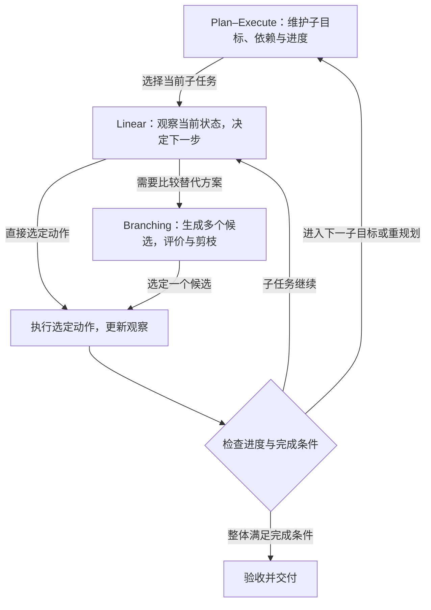

# 循环与工作流

工作流决定模型调用、行动、观察与状态更新如何接续。S001 的三类划分回答的是 **Agent 怎样组织执行过程**，不是三种任务类型，也不是能力等级。[[raw/surveys/Towards Long-Horizon Agents.pdf#page=20|S001 · §4.1 · p.20]]

> [!abstract] 先抓住三个区别
> **Linear 沿一条轨迹持续行动；Plan–Execute 用显式计划管理子目标；Branching 在选定路径前比较替代方案。**
> 按原文机制综合：三者在分类上并列，在功能上可以补强和嵌套，**没有必须逐级升级的顺序，也不保证越复杂越好**。这里的关系判断与下文组合图属于本库归纳；三类定义来自综述 §4.1。

## 三类工作流：定义、特点与取舍

下表概括 **综述本节的论述**，不作为统一预算下的性能排名。Plan–Execute 的局限一格另标为本库推断。

| 维度 | Linear：线性工作流 | Plan–Execute：计划—执行工作流 | Branching：分支工作流 |
| --- | --- | --- | --- |
| **定义** | 沿一条不断演化的轨迹，循环观察、行动和更新状态 | 创建或维护显式计划，用子目标、依赖与进度指导执行 | 生成多个候选动作、计划或答案，比较后决定走哪条路径 |
| **核心特点** | 下一步由最新状态与反馈决定；基本形式不单独维护计划或搜索树 | 计划是可检查、更新、恢复或作废的执行对象；部分实现支持重规划 | **先评价，再选定**；harness 控制候选数、评分、剪枝、回溯与最终选择 |
| **主要优点** | 简单、轻量、响应快，便于持续接收环境反馈 | 缓解短视，把长期目标变成可跟踪、可核验的检查点与失败条件 | 减少早期选错后继续投入大量轨迹预算的风险 |
| **主要局限** | 单条轨迹承接早期错误；可能循环、漂移或过早停止；重复推理挤占上下文 | **本库推断：**生成和维护计划增加开销；错误或过时计划可能持续误导执行，收益依赖监测与修订能力 | 搜索放大 token／工具成本；分支状态可能不兼容、来源难追溯；反馈弱、延迟或昂贵时吸引力下降 |
| **何时更有用** | 网页导航、调试、工具使用、探索检索等需要即时反馈的交互 | 多阶段、子目标存在依赖，需要长期跟踪进度与完成条件的任务 | 选错代价高，且部分状态能被**较低成本、有意义地评价**的决策点 |
| **综述定位** | [[raw/surveys/Towards Long-Horizon Agents.pdf#page=21\|§4.1.1 · p.21]]；[[raw/surveys/Towards Long-Horizon Agents.pdf#page=22\|Fig.7 · p.22]] | [[raw/surveys/Towards Long-Horizon Agents.pdf#page=21\|§4.1.2 · pp.21–22]] | [[raw/surveys/Towards Long-Horizon Agents.pdf#page=22\|§4.1.3 · pp.22–23]] |

> [!note] 三个容易混淆的边界
> - **Linear 仍然有反馈和纠错。**“线性”指只推进一条轨迹，不表示预先写死动作，更不表示只调用模型一次。综述也讨论在基本链外加入验证、持久状态、成本限制与恢复策略。[[raw/surveys/Towards Long-Horizon Agents.pdf#page=21|§4.1.1 · p.21]]
> - **Plan–Execute 不保证动态重规划。**综述将重规划列为部分实现；不能据类别名称认定每个系统都会根据观察修改计划。下文 ReWOO 的预定结构与证据变量正是需要区分的情况。[[raw/surveys/Towards Long-Horizon Agents.pdf#page=21|§4.1.2 · p.21]]
> - **Branching 不等于实际试遍所有路径。**本库归纳：候选可以是文本部分解、可恢复环境中的动作路径，也可以是执行前模拟；要看状态如何复制、评价与提交。多采样只有结合比较与选择，才体现这里强调的搜索控制。具体证据见下文“分支能否撤回，评价能否被信任”。

## 它们怎样关联：并列分类，可嵌套组合

**本库归纳：** Linear 提供局部交互循环，Plan–Execute 管理跨步骤的任务承诺与进度，Branching 在需要时加入替代方案搜索。后两者分别补强目标管理与候选选择，不能简单排成“Linear → Plan–Execute → Branching”的升级路线。组合也增加控制与维护成本，其价值取决于任务和反馈条件。依据为 [[raw/surveys/Towards Long-Horizon Agents.pdf#page=21|S001 · §4.1.1–4.1.2 · p.21]] 与 [[raw/surveys/Towards Long-Horizon Agents.pdf#page=22|§4.1.3 · pp.22–23]]。

下面是 **本库绘制的一种组合方式**，不是原文 Fig.7 的复刻，也不表示所有 Agent 必须按此实现。箭头表示控制或反馈的流向；Branching 可用于选择局部动作，也可用于比较整份计划，这里只画前者。

**例子（本库类比）：**文献调研的外层计划是“检索—精读—比较”；精读时沿单条轨迹根据新疑问继续查证；遇到关键解释分歧时，提出多个假设，比较证据后再继续。三种机制可以出现在同一项任务里。

**分类不能只看有没有树。**综述把 Arbor 放在 Plan–Execute 下，尽管它维护假设树；此处强调的是持久任务结构与 Coordinator–Executor 循环。[[raw/surveys/Towards Long-Horizon Agents.pdf#page=21|§4.1.2 · pp.21–22]] **本库归纳：**判断 Branching 还要看替代候选怎样被评价和选择；分类说明主导机制，不能据此断言一个系统只含一种结构。

## 结合已读论文：状态、反馈与恢复

第一轮 S002–S006 已完成摄入与本节整合。以下保留原论文层面的比较，用来核对上述分类在具体实现中的边界；各论文读取范围见唯一来源页。

### 状态保留什么，反馈何时改变后续决策

**本库比较轴：**工作流的区别不只在有没有计划或树，而在保存的状态、观察进入决策的时点，以及允许重试什么。下面比较机制，不把不同模型、任务、反馈权限和调用预算的分数排成优劣。

| 维持的状态 | 反馈怎样进入下一步 | 重选或恢复的边界 | 原文与唯一论文页 |
| --- | --- | --- | --- |
| 线性的 thought–action–observation 历史 | 外部动作返回观察后，可重新解释状态、调整后续动作；thought 本身只写回上下文 | 可以动态调整单条轨迹，没有自动保存所有替代分支或保证从错误中恢复 | [[wiki/papers/harness/workflows/ReAct\|ReAct]]；[[raw/papers/harness/workflows/ReAct.pdf#page=3\|S002 · §2 · pp.3–4]] |
| 预生成的计划结构与 `#E` 证据变量 | 工具结果填入变量，后续工具使用实际值，Solver 最后综合；基本流程不让观察重新设计整份计划 | 信息不足且需探索时，预期的证据可能不存在，计划结构也可能需要改变 | [[wiki/papers/harness/workflows/ReWOO\|ReWOO]]；[[raw/papers/harness/workflows/ReWOO.pdf#page=3\|S003 · §2.1 · pp.3–4]]、[[raw/papers/harness/workflows/ReWOO.pdf#page=8\|§4 · pp.8–9]] |
| 假设、实验事实、解释与实现版本组成的研究树 | 每批 Executor 返回实验结果后，Coordinator 归纳认识、细化或剪枝，并选择候选材料 | Executor 固定假设、隔离实现；树边表示假设细化，当前最佳代码另有版本引用 | [[wiki/papers/harness/workflows/Arbor\|Arbor]]；[[raw/papers/harness/workflows/Arbor.pdf#page=6\|S004 · §4.2–4.3 · pp.6–8]] |
| 同一道题的多个部分解与搜索候选集合 | 模型为候选评分或投票，BFS/DFS 程序决定保留、继续、剪枝和回溯 | 文本部分解可复制回退；模型评价可能剪掉正确分支 | [[wiki/papers/harness/workflows/Tree-of-Thoughts\|ToT]]；[[raw/papers/harness/workflows/Tree-of-Thoughts.pdf#page=3\|S005 · §3 · pp.3–4]]、[[raw/papers/harness/workflows/Tree-of-Thoughts.pdf#page=8\|§4.3 · p.8]] |
| 记录行动和观察的搜索树，以及失败轨迹与反思 | 先取得观察再评价状态；终局奖励作 MCTS 数值回传，失败反思以文本影响下一次尝试 | 需要可回退或重试的环境；观察、奖励、自评和反思的可靠性各不相同 | [[wiki/papers/harness/workflows/LATS\|LATS]]；[[raw/papers/harness/workflows/LATS.pdf#page=4\|S006 · §4 · pp.4–6]]、[[raw/papers/harness/workflows/LATS.pdf#page=14\|Appendix B · p.14]] |

由此可以更具体地问“失败后怎样改”：ReAct 可改变下一动作；ReWOO 让已有结构接收实际变量值，但作者的未知位置例子说明结构本身未必可提前确定；Arbor 则在实验结束后修订下一批假设。**本库推断：**先判断新信息只是补齐参数，还是会改变应执行的操作，才有依据选择反馈时点。这个问题尚是比较框架，不是已查新的研究缺口。[[raw/papers/harness/workflows/ReAct.pdf#page=3|S002 · §2 · pp.3–4]] [[raw/papers/harness/workflows/ReWOO.pdf#page=8|S003 · §4 · pp.8–9]] [[raw/papers/harness/workflows/Arbor.pdf#page=7|S004 · §4.3 · pp.7–8]]

### 分支能否撤回，评价能否被信任

反事实信用的综述外补读[[wiki/papers/optimization/reinforcement-learning/C3|S068 C3]]给出更严格的恢复条件：对每个替代消息，记录前缀恢复后的后续分布必须与真实完整状态干预相同；工具副作用、记忆和路由须能恢复，或按正确条件分布重采样。仅保留文字历史不满足这个条件。它在文本数学团队中构造满足条件的系统，不能直接保证任意外部工具环境；信用估计与预算证据统一见 [[wiki/optimization/reinforcement-learning#局部比较组从哪里来，决定了什么可被区分|Optimization局部比较组]]。[[raw/papers/optimization/reinforcement-learning/C3.pdf#page=4|§2.3、Eq.2 · p.4]] [[raw/papers/optimization/reinforcement-learning/C3.pdf#page=8|§6 · p.8]]

ToT 回退的是保存在搜索程序中的部分解；LATS 将这种选择扩展到行动与观察，却明确要求环境可恢复。**本库推断：**重新放入旧历史不等于撤销外部副作用，真实交互若不能重置，就需要另行说明分支怎样评估与提交。ToT 的 24 点和填字实验不能独自支持现实长程任务的恢复能力；LATS 的受控环境也不能替代不可逆任务证据。[[raw/papers/harness/workflows/Tree-of-Thoughts.pdf#page=4|S005 · §3–4 · pp.4–5]] [[raw/papers/harness/workflows/LATS.pdf#page=14|S006 · Appendix B · p.14]]

训练中的修复也须说明状态接口。[[wiki/papers/optimization/finetuning/Agent-R#公开实现核查：三个阶段怎样处理环境状态|S050 Agent-R的公开实现核查]]将三处操作分开：**MCTS采树会reset并重放节点动作；训练样本只拼接坏前缀、修订信号与好后缀文本；恢复函数先真实执行给定失败前缀，再在线续做。** 前者不自动证明训练拼接后的状态一致性，后者也不能被概括为纯文本评测。已核读并归档commit `82fcc1c`；实际恢复实验入口与底层AgentGym的wait/reset语义仍未确认，不能保证任意不可逆状态都可恢复。代码行定位见唯一论文页，训练接口见 [[wiki/optimization/finetuning#学到修订行为以后，环境是否能继续|训练与恢复接口]]。原文拼接定义与修订信号边界见 [[raw/papers/optimization/finetuning/Agent-R.pdf#page=5|§3.1、Eq.3 · p.5]]、[[raw/papers/optimization/finetuning/Agent-R.pdf#page=21|Appendix B · p.21]]。

**执行前模拟提供另一种分支方式（S039，已完成摄入，应用未测）：**[[wiki/papers/optimization/data-environments/WebDreamer|WebDreamer]] 用世界模型预测候选动作后的页面变化、由 LLM 评分，只执行选中动作，再用真实新观察重新规划。它不需要为每个候选实际回退网站，但也不保证模拟正确或操作安全；主实验模拟 H=1，更深模拟反而受到不可用动作幻觉影响。Dreamer-7B 的训练对象是变化描述，score 仍由 GPT-4o 提供，详见 [[wiki/optimization/data-environments#生成了什么，真实执行到了哪里|数据与环境]]。[[raw/papers/optimization/data-environments/WebDreamer.pdf#page=4|S039 §3.2 · pp.4–5]] [[raw/papers/optimization/data-environments/WebDreamer.pdf#page=8|§5.1 · p.8]]

评价信号同样要分开：ToT 的模型启发式会误剪罕见但正确的填字状态；LATS 的 HotpotQA 在提交答案后有 oracle 告知对错，编程则先用内部合成测试搜索、最后用真正测试集测量。相同的“反思”或“成功”标签，因此不意味着取得了同等质量的依据。对应 [[wiki/harness/verification|验证]] 中“何时检查、怎样产生判断”的区分。[[raw/papers/harness/workflows/Tree-of-Thoughts.pdf#page=8|S005 · §4.3 · p.8]] [[raw/papers/harness/workflows/LATS.pdf#page=6|S006 · §5.1–5.2 · pp.6–7]]

Arbor 还引入另一种风险边界：事实结果和归纳后的 insight 应分别保留，否则单次实现失败可能被提升成整个方向的负面约束。这是本库对其状态表示的分析，不是已测量的因果错误率。其 `E_test` 在合并准入与最终验证中的使用关系也仍需核查：循环算法包含准入测试，任务说明又强调保留最终验证；现有文字不足以确认完整的独立评估安排，不能据此断言实际运行发生泄漏。[[raw/papers/harness/workflows/Arbor.pdf#page=6|S004 · §4.2 · p.6]] [[raw/papers/harness/workflows/Arbor.pdf#page=7|Algorithm1 · p.7]] [[raw/papers/harness/workflows/Arbor.pdf#page=23|Appendix A · p.23]] [[raw/papers/harness/workflows/Arbor.pdf#page=34|Appendix C.4 · p.34]]

与 [[wiki/harness/memory|上下文与记忆]] 相连时，也须保留状态的存续范围：ToT / LATS 的搜索状态主要服务当前任务，Arbor 将同一研究任务的假设树落盘用于压缩后恢复；这不同于已经验证跨任务经验迁移。Arbor 的实验目标是给定材料与评测器下的优化，对本库文献探索的分工和证据组织只能提供机制类比，不能证明系统会自动提出新颖 idea。[[raw/papers/harness/workflows/LATS.pdf#page=3|S006 · Table1注释、§4 · pp.3–6]] [[raw/papers/harness/workflows/Arbor.pdf#page=23|S004 · Appendix A–B · pp.23–27]]

**后续比较条件：**固定反馈权限、可回退性和总资源口径后，再区分候选覆盖、状态评价、反思与输出选择各自的贡献。ReAct 的平均/最佳提示表现、ReWOO 的 Accuracy/EM、ToT 的系统输出/oracle 最佳状态、LATS 的属性平均分/严格成功率已在各论文页分开；当前不据这些异质分数决定研究方向。

## 论文入口与交叉方向

- [[wiki/papers/harness/workflows/ReAct|S002 · ReAct]]：主归属。
- [[wiki/papers/harness/workflows/ReWOO|S003 · ReWOO]]：主归属。
- [[wiki/papers/harness/workflows/Arbor|S004 · Arbor]]：主归属。
- [[wiki/papers/harness/workflows/Tree-of-Thoughts|S005 · Tree-of-Thoughts]]：主归属。
- [[wiki/papers/harness/workflows/LATS|S006 · LATS]]：主归属。

[[wiki/harness/Overview|返回模块地图]] · [[maintenance/research/R001|本轮选读理由与维护记录]]。
