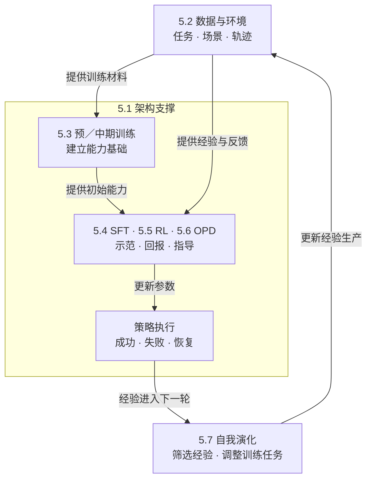

# Optimization：能力内化与训练

**第 5 章的主问题是：长程 Agent 需要的行为，怎样从运行时的组织与帮助，逐步变成策略本身更稳定的能力？** 模型学会选择工具、利用观察和恢复，并不意味着外部工具与环境消失；“内化”说的是学会相应行为。综述按架构基础和六个能力发展环节组织这一问题。[[raw/surveys/Towards Long-Horizon Agents.pdf#page=37|S001 · §5 总述 · p.37]]

## 从七节看到三层关系

下面的三层是**本库教学归纳**，保留原文七节编号，不替代作者分类。

- **训练条件（§5.1–5.2）：能承载什么，能经历什么。** 架构决定历史的表示与处理成本；数据／环境决定任务、可执行动作、反馈及轨迹来源。两者贯穿后续训练。[[raw/surveys/Towards Long-Horizon Agents.pdf#page=37|§5.1–5.2 · pp.37–43]]
- **能力形成与适配（§5.3–5.6）：用什么信号学会行动。** 预／中期训练形成推理、状态利用和感知基础；SFT 学习示范，RL 利用交互回报，OPD 在学生自己的状态上补充指导。后面三者可以配合，章节顺序不规定每个系统的训练顺序。[[raw/surveys/Towards Long-Horizon Agents.pdf#page=43|§5.3–5.6 · pp.43–53]]
- **经验改进循环（§5.7）：表现怎样改变下一轮学习。** 把成功、失败及反馈筛选为新材料，必要时调整任务与环境，再通过 SFT、RL 或蒸馏更新策略。它组织跨轮改进，不能仅凭出现循环就断言能力持续增长。[[raw/surveys/Towards Long-Horizon Agents.pdf#page=53|§5.7、Fig.13 · pp.53–55]]

*本库依据 §5 总述、Fig.11 与 §5.6–5.7 的关系示意。箭头表示材料供给、参数更新和经验反馈，外框表示架构的支撑范围；SFT／RL／OPD 共置一框表示可组合的学习方式，不表示三者同时执行。§5.7 标记对经验回写的组织，不是部署中每步自动改权重；共同演化还可改变环境设置。* [[raw/surveys/Towards Long-Horizon Agents.pdf#page=39|S001 · Fig.11 · p.39]] [[raw/surveys/Towards Long-Horizon Agents.pdf#page=52|§5.6–5.7 · pp.52–55]]

## 方向地图：用同一组问题比较七节

| 环节与主要作用 | 经验／状态从哪里来 | 信号与改变对象 | 仍要检查什么 |
| --- | --- | --- | --- |
| [[wiki/optimization/architecture\|§5.1 架构]]：承载长历史 | 输入历史与内部表示 | 选择表示和计算机制；架构本身不指定独立训练目标 | 容量、访问精度与成本；能容纳不等于会使用 |
| [[wiki/optimization/data-environments\|§5.2 数据与环境]]：提供可学经验 | 构造任务、环境，采集专家／策略轨迹 | 执行与验证产生材料、奖励和标签；改变经验分布 | 可执行、可验证与部署条件是否相符 |
| [[wiki/optimization/pretraining\|§5.3 预／中期训练]]：形成基础能力 | 大规模语料及定向能力数据 | 预训练目标与数据配方更新模型参数 | 训练长度、数据覆盖与真实任务表现 |
| [[wiki/optimization/finetuning\|§5.4 微调]]：塑造交互行为 | 筛选的示范、教师／历史模型轨迹 | 指定输出的监督，更新行为策略 | 示范未覆盖的错误状态怎样处理 |
| [[wiki/optimization/reinforcement-learning\|§5.5 Agentic RL]]：优化反馈驱动决策 | 本章主要讨论策略与环境交互，也包含经验复用 | 回报／优势等信号更新策略及可训练决策模块 | 信用、探索、更新稳定性和交互成本 |
| [[wiki/optimization/distillation\|§5.6 OPD]]：在自身状态上适配 | 当前学生生成的前缀／交互，可含混合执行 | 教师或辅助信息构造指导，更新学生 | 状态覆盖、指导可靠性与训练信息权限 |
| [[wiki/optimization/self-evolution\|§5.7 自我演化]]：组织跨轮改进 | 当前能力产生的经验与反馈 | 每轮用 SFT／RL／蒸馏；还可改任务与环境 | 验证锚点、分布收缩与是否真的持续进步 |

表为本库按共同维度重组，依据 [[raw/surveys/Towards Long-Horizon Agents.pdf#page=38|S001 · Table 5 · p.38]] 及各节正文；不把不同任务的性能数字排列成优劣。前两项是支撑条件，最后一项是循环组织，它们并非七种同层级优化算法。

## 用一次修复任务贯穿理解

以下是**教学情境，非论文实验**。Agent 先读报错、定位函数、改代码、运行测试；失败后又要判断是定位错了，还是修改引入了新问题。

架构使它能处理仓库片段和累积日志，数据／环境给出可运行的仓库、修复目标与测试；预／中期训练提供理解代码和依赖的基础。SFT 示范如何观察、修改与检查；RL 让采到的尝试及其结果影响行动概率；OPD 则可在学生已经改错文件的状态上补充教师指导。自我演化再把这些失败与恢复整理成下一轮练习，必要时调整任务难度。这是对上述章节分工的串联，不表示一次修复中依次执行七次训练。[[raw/surveys/Towards Long-Horizon Agents.pdf#page=40|§5.2 · pp.40–43]] [[raw/surveys/Towards Long-Horizon Agents.pdf#page=45|§5.4–5.7 · pp.45–55]]

因此，只看“测试最终通过”还不够回答训练问题：成功前的搜索是否必要，改错文件后的恢复是否进入训练，换工具或缩短预算后是否仍能成功，都需要另外的证据。这些疑问形成 [[wiki/optimization/Questions#从综述自然引出的三个RL问题|本次三个 RL 讨论入口]]。

## 跨节阅读时保留四个区别

- **数据合成与自我演化：**前者按任务、环境、轨迹说明经验如何构造，后者说明当前表现如何影响下一轮构造与学习。§5.2 已有自适应课程，不能按静态／动态一刀切。[[raw/surveys/Towards Long-Horizon Agents.pdf#page=41|§5.2.1 · p.41]] [[raw/surveys/Towards Long-Horizon Agents.pdf#page=54|§5.7 · pp.54–55]]
- **离线蒸馏与 OPD：**关键是训练围绕谁到达的状态组织；固定旧轨迹即使来自学生，也不自动代表当前学生分布。[[raw/surveys/Towards Long-Horizon Agents.pdf#page=46|§5.4.3 · pp.46–47]] [[raw/surveys/Towards Long-Horizon Agents.pdf#page=52|§5.6 · pp.52–53]]
- **RL 与 OPD：**前者借回报优化决策，后者学习指导目标；二者可以共用轨迹、组合训练。不能简化成 RL 只有稀疏奖励、OPD 必然正确。[[raw/surveys/Towards Long-Horizon Agents.pdf#page=48|§5.5.1 · pp.48–50]] [[raw/surveys/Towards Long-Horizon Agents.pdf#page=52|§5.6 · pp.52–53]]
- **运行时改变与参数学习：**写下一条记忆或一次自我检查，可以改变下一步输入；只有相关行为进入训练更新，才是这里的能力内化。课程也可跨 SFT／RL 使用，被放在哪节不决定算法身份。[[raw/surveys/Towards Long-Horizon Agents.pdf#page=46|§5.4.2 · p.46]] [[raw/surveys/Towards Long-Horizon Agents.pdf#page=52|§5.5.4 · p.52]]

## 问题与跨模块联系

本次 [[wiki/optimization/Questions#2026-10-28：从整体理解转向RL提问|RL问题与宏观讨论]] 面向理解和交流，允许已有研究回答；[[wiki/optimization/Questions#第一轮Brainstorm结案|第一轮问题、反对证据与关闭条件]] 保留较细的材料核查，尚无新颖性已确认的研究缺口。跨模块综合见 [[wiki/frontier/Overview|Frontier]]。

本次完整形成过程见 [[组会/2026-10-28-Optimization-RL/README|Optimization-RL组会批次]]；历史选读队列、派发与提交流水见 [[maintenance/research/R001|R001维护记录]]。新论文仍整合到唯一来源页和相关主题；主归属目录不限制交叉关联。
