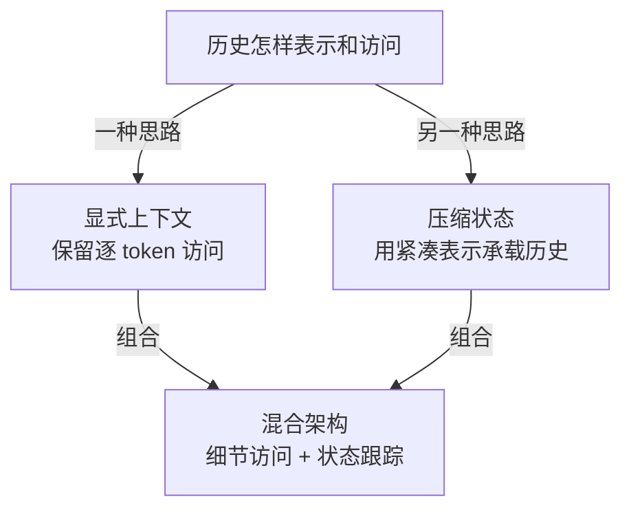
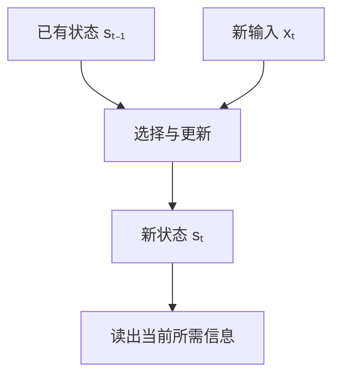

# 架构基础

**§5.1 先解决一个基础问题：模型怎样以可承受的成本，保存并使用很长的交互历史？** 观察、工具结果和用户约束不断累积；后续训练要让模型学会长期行为，先要有能承载这些历史的架构。[[raw/surveys/Towards Long-Horizon Agents.pdf#page=37|S001 · §5–5.1 · p.37]]

> [!abstract] 读这一节，先分清两个问题
> **历史怎样表示和访问？** 显式上下文、压缩状态、两者混合。
>
> **运行成本怎样降低？** 优化生成路径、KV 缓存与算子 I/O。
>
> 前者是表示思路，后者是效率维度；同一种方法可以同时影响两者。MLA 就是关键例子。

本页分类依据 [[wiki/surveys/Towards Long-Horizon Agents|S001]] §5.1，讲解顺序参考用户提供的“解释 MLA 优势”对话；对话不作学术来源。图和例子为本库教学重组。已有原论文证据直接链接；其余代表工作标为**综述转述，待原文核验**。

## 历史留在哪里，下一步怎样使用

*本库依据 §5.1.1–5.1.3 绘制的关系示意；箭头表示分类与组合，不是升级顺序。两种思路有交叉，MLA 的位置见下文。* [[raw/surveys/Towards Long-Horizon Agents.pdf#page=38|S001 · §5.1 · pp.38–40]]

| 路线 | 主要作用 | 付出的代价 |
| --- | --- | --- |
| **显式上下文 Explicit-context** | 保留具体历史位置，提供回看旧证据的通道 | 全局访问的成本随历史增长；局部或稀疏访问可能漏掉远处证据 |
| **压缩状态 Compressed-state** | 用紧凑表示降低历史处理成本；递归方法适合持续更新 | 若旧 token 只融入有限状态，未保住的细节不能再从独立位置回查 |
| **混合架构 Hybrid** | 将细节访问与低成本状态跟踪放进同一模型 | 需要选择两种机制的配比；仍承担部分全局 attention 成本 |

前三项作用与取舍来自综述；混合架构的配比和剩余成本结合 Kimi Linear 原文归纳，不能据此排出普遍优劣。[[raw/surveys/Towards Long-Horizon Agents.pdf#page=38|S001 · §5.1.1–5.1.3 · pp.38–40]] [[raw/papers/optimization/architecture/Kimi-Linear.pdf#page=6|S034 · §4、Fig.3 · p.6]]

## 1. 显式上下文：留下历史，再决定能看哪里

**保留逐 token 表示，用 attention 从历史中取信息。** 例如很早的工具结果中出现了一个文件路径，之后仍有对应位置可供访问；但“位置还在”不保证模型一定找到并正确使用它。这里的“显式”也不要求每层都保存和读取全部历史。[[raw/surveys/Towards Long-Horizon Agents.pdf#page=38|S001 · §5.1.1 · pp.38–39]]

这一类内部，主要区别是**允许哪些位置相互访问**：

| 访问方式 | 怎样工作 | 代表性例子 |
| --- | --- | --- |
| **全局 Full / global attention** | 访问全部允许的位置；自回归生成仍受因果遮罩限制 | Qwen2.5、Qwen3 的 attention 主干；MoE 变体也保留 attention |
| **局部 / 滑窗 Local / sliding-window** | 每层主要访问附近窗口，减少远距离连接 | Mistral 7B |
| **局部 + 全局通道** | 局部连接配少量全局位置，或交替使用局部层与全局层 | Longformer 的全局 token；Gemma 2/3 的局部—全局层 |
| **块稀疏 / 可学习稀疏** | 只连接选定的块或位置；部分方法在训练中学习选择 | Big Bird；NSA、MoBA |

例子除 Longformer 外均为**综述转述**：S001 §5.1.1，refs.[32, 252, 398, 595, 596, 601, 744, 786, 792]，待原文核验。它们可组合，表格不是互斥分类。[[raw/surveys/Towards Long-Horizon Agents.pdf#page=38|S001 · pp.38–39]]

**稀疏化省的是连接，不等于压掉所有旧位置。** Longformer 在固定窗口、受控全局位置数下把 attention 成本随长度的增长降为线性；全局位置由任务指定，例如分类的 `[CLS]` 或问答中的问题 token，不能理解为自动找出了所有关键证据。[[raw/papers/optimization/architecture/Longformer.pdf#page=3|S032 · §3.1、Fig.2 · pp.3–4]]

## 2. 压缩状态：先问压缩了什么

综述的这一类比较宽，包含 attention 表示压缩、递归状态，也讨论 MLA。它们都使用紧凑表示，但**压缩对象不同，缓存增长和回查能力也不同**。[[raw/surveys/Towards Long-Horizon Agents.pdf#page=39|S001 · §5.1.2 · p.39]]

| 思路 | 怎样变紧凑 | 代表性例子与边界 |
| --- | --- | --- |
| **低秩 / 核化 attention** | 改写 attention 的表示或计算，减少显式成对交互 | 综述 refs.[92, 651]；具体压缩轴、近似和成本依方法而异 |
| **递归 / 状态空间** | 读入新 token，更新已有状态；历史不再逐位置独立存档 | RetNet、RWKV、SSM、Mamba；模型尺寸固定时，递归推理状态可不随历史增长 |
| **潜变量 KV 压缩 MLA** | 每个 token 保存更小的 KV latent | DeepSeek-V2/V3、Kimi-K2；仍保留逐位置访问，缓存仍随历史增长 |

除下文直接核对的 Mamba、DeepSeek-V3 外，例子为**综述转述**：S001 §5.1.2，refs.[92, 110, 111, 186, 187, 476, 576, 597, 651]，待原文核验。[[raw/surveys/Towards Long-Horizon Agents.pdf#page=39|S001 · p.39]]

### 递归状态：不断更新当前状态

*本库对递归机制的教学示意；箭头表示信息流，下一步继续使用新状态。依据 Mamba §3.1–3.2，非其完整架构图。* [[raw/papers/optimization/architecture/Mamba.pdf#page=5|S033 · pp.5–6、Algorithm 2]]

**作用：让连续观察的处理成本可控。** Mamba 让 Δ、B、C 随输入变化，调节旧状态延续、新信息写入和读出。它适合把历史中的有用信号持续带到下一步，但选择能力与状态容量共同限制能留下什么；高效 scan 解决计算问题，不能证明任意旧字符串都能恢复。[[raw/papers/optimization/architecture/Mamba.pdf#page=5|S033 · §3.1–3.3 · pp.5–7]]

### MLA：每份记录变小，记录的位置还在

假设已处理 $N$ 个 token，比较固定模型、单层、单条序列的推理历史存储：

| 方法 | 留下什么 | 能否分别访问旧位置 | 历史增长时 |
| --- | --- | --- | --- |
| **全局 MHA** | 每个 token 的多头 K、V | 可以 | $N$ 份较宽记录 |
| **全局 MLA** | 每个 token 的低维 latent；V3 另存位置 key | 可以 | $N$ 份较窄记录 |
| **Mamba 式递归状态** | 持续更新的有限状态 | 没有全部旧 token 的独立存档 | 状态尺寸不随 $N$ 增长 |

此表是机制比较，不是精确召回率排名；不含模型权重、训练激活或外部存储。依据 [[raw/papers/optimization/architecture/GQA.pdf#page=2|S035 · §2.2、Fig.2 · PDF p.2 / 印刷 p.4896]]、[[raw/papers/optimization/pretraining/DeepSeek-V3.pdf#page=7|S042 · §2.1.1、Eqs.1–11 · pp.7–8]]、[[raw/papers/optimization/architecture/Mamba.pdf#page=5|S033 · §3.1 · p.5]]。

**为什么变小后仍能做 attention？** 以 DeepSeek-V3 为例，忽略头拆分和位置编码，KV 的内容部分可简写为：

$$
c_i=W_Dh_i,\qquad K_i^C=W_Kc_i,\qquad V_i=W_Vc_i.
$$

$h_i$ 是第 $i$ 个 token 的输入表示，$c_i$ 是共同的低维表示；各头的 K、V 内容由它产生。推理缓存保存 $c_i$ 和单独的位置 key，后续 query 仍能给不同历史位置分配不同权重。这里省略的是公式细节，**没有省掉历史位置**。[[raw/papers/optimization/pretraining/DeepSeek-V3.pdf#page=7|S042 · §2.1.1、Fig.2、Eqs.1–11 · pp.7–8]]

**因此，MLA 的作用有两层：** 更小的 KV 表示降低缓存存储与读写负担；逐 token 访问保留了回看旧证据的通道。在其他资源允许时，同样显存可以容纳更多上下文或并发请求，这是存储机制的推论，不是特定部署的提速承诺。历史变为十倍，固定精度下这部分缓存仍约为十倍，全局 attention 仍需面对更多位置。[[raw/surveys/Towards Long-Horizon Agents.pdf#page=39|S001 · §5.1.2、§5.1.4 · pp.39–40]] [[raw/papers/optimization/pretraining/DeepSeek-V3.pdf#page=8|S042 · §2.1.1 · p.8]]

> [!important] 有了 MLA，为什么还需要 explicit？
> **MLA 正在使用 explicit 的逐位置访问能力。** “压缩每份记录”和“把全部历史融入一个状态”是两回事。
>
> 综述说 MLA 避免了上述 exact-recall loss，应限定为避免“取消独立历史位置”造成的那类损失；不能扩大成无损压缩或百分之百准确召回，也不能据此认定它无代价替代所有普通 attention。这个限定是本库对分类边界的辨析。[[raw/surveys/Towards Long-Horizon Agents.pdf#page=39|S001 · §5.1.2 · p.39]]

**教学例子：**早先约定输出名为 `result_0427.csv`。MLA 保留对应 token 的位置，提供回查通道；纯递归状态需要在后续更新中保住这段信息。两者都仍需学会正确使用它，这不是一次实际召回实验。

## 3. 混合架构：让两种机制分担工作

**目标是兼顾细节回查与低成本的长期跟踪。** Attention 提供具体内容的访问通道，压缩或递归模块持续携带状态；可按层、头或模块组合。这是设计目标，不是所有混合模型已经实现的保证。[[raw/surveys/Towards Long-Horizon Agents.pdf#page=40|S001 · §5.1.3 · p.40]]

| 例子 | 组合方式 | 说明什么 |
| --- | --- | --- |
| **Jamba** | Transformer + Mamba + MoE | Attention 与状态空间机制可共存；MoE 另管专家计算。综述转述 ref.[300]，待原文核验 |
| **Kimi Linear** | 每 3 层 KDA 配 1 层全局 MLA | KDA 更新压缩状态，MLA 保留全局访问；3:1 是该论文所测配置的折中 |

来源：[[raw/surveys/Towards Long-Horizon Agents.pdf#page=40|S001 · §5.1.3 · p.40]]；[[raw/papers/optimization/architecture/Kimi-Linear.pdf#page=6|S034 · §4、Fig.3 · p.6]]。Kimi Linear 的 MLA 层使用 NoPE，不应把上文 V3 的位置 key 实现直接套过来。

**组合仍有成本。** Kimi Linear 的固定大小状态只适用于 KDA 部分，全模型还有随历史增长的 MLA 缓存与全局 attention。也不能把“局部 attention + 全局 attention”自动叫作这里的 Hybrid：两者若都保留显式 token 访问，仍可属于显式上下文内部的组合。前者据原文，后者为本库分类辨析。[[raw/papers/optimization/architecture/Kimi-Linear.pdf#page=6|S034 · §4 · p.6]] [[raw/surveys/Towards Long-Horizon Agents.pdf#page=38|S001 · §5.1.1、§5.1.3 · pp.38–40]]

## 4. 高吞吐：分别降低哪种运行成本

长上下文建立后，Agent 还可能生成大量中间 token。§5.1.4 讨论怎样降低持续生成的成本，是与历史表示交叉的优化维度。[[raw/surveys/Towards Long-Horizon Agents.pdf#page=40|S001 · §5.1.4 · p.40]]

### 生成路径：减少昂贵的串行步骤

| 机制 | 做法与作用 | 代表例子 / 限定 |
| --- | --- | --- |
| **推测解码 Speculative decoding** | 先提出多个候选 token，再由目标模型并行验证 | Medusa 用多个解码头提出候选；EAGLE 在特征空间构造草稿信号 |
| **多 token 预测 MTP** | 训练时增加对未来多个位置的预测监督，可为推测解码提供能力 | DeepSeek-V3；首先是训练目标，推理时可丢弃额外模块或将其用于草稿生成 |
| **扩散语言模型** | 采用并行生成路线，减轻逐 token 生成的串行负担 | 综述 ref.[559]；并非自回归的“草稿—验证”机制 |

推测解码、Medusa、EAGLE、扩散路线为**综述转述**：refs.[43, 302, 352, 559]，待原文核验。MTP 的训练／推理区别另据 V3 原文；预测更远 token 不等于学会规划未来环境动作。[[raw/surveys/Towards Long-Horizon Agents.pdf#page=40|S001 · §5.1.4 · p.40]] [[raw/papers/optimization/pretraining/DeepSeek-V3.pdf#page=10|S042 · §2.2、Fig.3 · pp.10–11]]

### KV 缓存：共享表示，或让表示更紧凑

| 机制 | 每个历史位置怎样省空间 | 保留什么 |
| --- | --- | --- |
| **MQA** | 所有 query 头共享一组 K、V | 多个 query 头、各历史位置 |
| **GQA** | query 头分组，组内共享 K、V | 比 MQA 更多的 KV 组、各历史位置 |
| **MLA** | 多头 KV 内容由共同低维 latent 表示 | 各历史位置及其注意力权重 |

MQA/GQA 侧重**共享 KV 头**，MLA 侧重**低秩表示**；都不是把整个时间历史压成固定状态。GQA 原文的质量与速度对照基于经过 uptraining 的 T5 encoder–decoder，不应当作所有模型的部署保证。[[raw/papers/optimization/architecture/GQA.pdf#page=2|S035 · §2.2–3、Fig.2 · PDF pp.2–3 / 印刷 pp.4896–4897]] [[raw/papers/optimization/pretraining/DeepSeek-V3.pdf#page=7|S042 · §2.1.1 · pp.7–8]]

### 算子 I/O：改变 attention 怎样执行

**FlashAttention** 用分块计算减少显存读写，避免在显存中完整存放 attention 矩阵，保留精确 attention 的计算目标。它优化硬件执行；稀疏 attention 则改变参与计算的位置连接，两者不能混为一谈。此处为综述转述 ref.[108]，原论文待核验。[[raw/surveys/Towards Long-Horizon Agents.pdf#page=40|S001 · §5.1.4 · p.40]]

## 补充：MoE 放在哪里？

**MoE 决定 token 交给哪些前馈专家处理，调节模型容量与激活计算；它本身不决定历史怎样保存。** 因而 DeepSeek-V3 可以组合 MLA 与 MoE，Jamba 可以组合 attention、Mamba 与 MoE。不能把 MoE 列成第四种历史表示方式。[[raw/surveys/Towards Long-Horizon Agents.pdf#page=38|S001 · §5.1 · p.38]] [[raw/papers/optimization/pretraining/DeepSeek-V3.pdf#page=7|S042 · §2.1、Fig.2 · pp.7–9]]

## 容量、检索、任务质量和效率分别举证

**可运行很长，不代表所有任务都利用了那么长的历史。** Mamba 的百万长度结果包含小词表合成关联任务，以及 DNA / 音频序列；这些不能直接替代百万自然语言 token 的任意检索。Kimi Linear 主长上下文对照是 1.4T 训练后的 128k 测试，而 1M RULER 属于另一个 5.7T checkpoint；不能把两组结果拼成同一个受控实验。[[raw/papers/optimization/architecture/Mamba.pdf#page=10|S033 §4.1 · pp.10–11]] [[raw/papers/optimization/architecture/Mamba.pdf#page=13|§4.3–4.4 · pp.13–14]] [[raw/papers/optimization/architecture/Kimi-Linear.pdf#page=12|S034 §5.5、Table 5 · p.12]] [[raw/papers/optimization/architecture/Kimi-Linear.pdf#page=28|Appendix D · p.28]]

**显式访问也需要行为检查。** [[wiki/papers/optimization/architecture/Lost-in-the-Middle|S036 Lost in the Middle]] 固定问题和证据、改变证据位置，在所测旧模型的多文档 QA 中观察到位置差异；但 Claude 的合成 KV 检索近乎完美，Llama-2 7B 主要呈近因偏好。因此它支持“检查位置和干扰”的评测要求，不建立所有模型都遵守的 U 形定律，也没有直接评测 Mamba 或 Kimi Linear。[[raw/papers/optimization/architecture/Lost-in-the-Middle.pdf#page=5|S036 §2.3、Fig.5 · p.5]] [[raw/papers/optimization/architecture/Lost-in-the-Middle.pdf#page=7|§3.2、Fig.7 · p.7]] [[raw/papers/optimization/architecture/Lost-in-the-Middle.pdf#page=16|Appendix E、Fig.16 · p.16]]

**吞吐结果保留部署条件。** Mamba 的生成比较在 A100、2048-token prompt、128-token 输出下改变 batch；Kimi Linear 的 batch=1 图与扩大 batch 后约 6.3× 的论述不能混用；GQA 则按各模型优化批量与分片。它们说明资源配置下的计算行为，不是完整 Agent 运行耗时或成功率。模型质量、任务成功与工具等待需另行测量。[[raw/papers/optimization/architecture/Mamba.pdf#page=36|S033 Appendix E.5 · p.36]] [[raw/papers/optimization/architecture/Kimi-Linear.pdf#page=13|S034 Fig.7 · p.13]] [[raw/papers/optimization/architecture/Kimi-Linear.pdf#page=16|§6.3 · p.16]] [[raw/papers/optimization/architecture/GQA.pdf#page=3|S035 §3.1–3.2 · PDF p.3 / 印刷 p.4897]]

**待检验阅读问题，尚未查新：**当未来目标尚未出现时，压缩状态需要保留哪些关联，全局访问又能恢复哪些细节？将位置/干扰检查迁移到 Agent 轨迹时，必须保持任务语义和时序依赖，不能任意洗牌后仍当成同一任务。现有证据让问题具体化，尚未证明它是未被研究的缺口；与 [[wiki/harness/memory|运行时状态选择]] 共同讨论。

## 论文入口与交叉方向

- [[wiki/papers/optimization/architecture/Longformer|S032 · Longformer]]：主归属。
- [[wiki/papers/optimization/architecture/Mamba|S033 · Mamba]]：主归属。
- [[wiki/papers/optimization/architecture/Kimi-Linear|S034 · Kimi-Linear]]：主归属。
- [[wiki/papers/optimization/architecture/GQA|S035 · GQA]]：主归属。
- [[wiki/papers/optimization/architecture/Lost-in-the-Middle|S036 · Lost-in-the-Middle]]：主归属。
- [[wiki/papers/optimization/pretraining/DeepSeek-V3|S042 · DeepSeek-V3]]：主归属为预训练；本页使用 MLA 与 MTP 的原文说明。

[[wiki/optimization/Overview|返回模块地图]] · [[maintenance/research/R001|本轮选读理由与维护记录]]。
