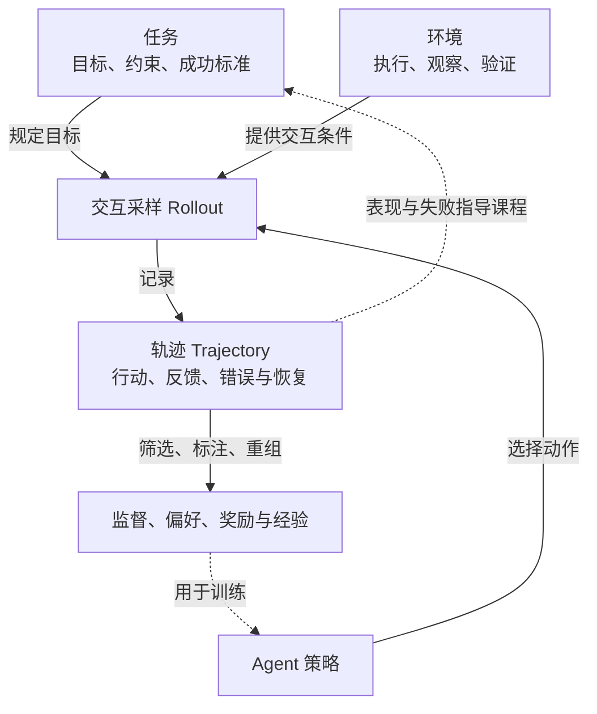

# 数据与环境合成

**§5.2 讨论怎样构造可执行、有反馈、可复用的长程交互经验。** 三个小节按合成对象划分：任务规定练什么，环境提供行动与验证条件，轨迹把交互经历变成训练信号。这里的 synthesis 包含任务组合、真实系统的封装、执行采样及记录加工。[[raw/surveys/Towards Long-Horizon Agents.pdf#page=40|S001 · §5.2 · pp.40–43]]

## 任务、环境、轨迹怎样配合

以“修复程序 bug”为教学例子：**任务**是修复目标与成功标准；**环境**是可运行的仓库、终端、依赖和测试；**轨迹**是某次尝试中读日志、改代码、测试失败、重新定位的记录。一个任务可以产生多条不同轨迹。

图为依据 S001 §5.2 的**本库关系归纳**：实线表示经验如何产生，虚线表示可选的改进反馈；三类对象相互配合，不是三个必须依次生成的阶段。例如，已有执行轨迹也可反推出新任务。[[raw/surveys/Towards Long-Horizon Agents.pdf#page=41|§5.2.1 · p.41]] [[raw/surveys/Towards Long-Horizon Agents.pdf#page=43|§5.2.3 · p.43]]

## 任务合成：考什么，怎样增加难度

前三种构造视角决定**能力压力来自哪里**，可以交叉；Curriculum（课程）是另一维度，调节任务难度如何随当前策略能力变化。它可以叠加到任一种构造方式。[[raw/surveys/Towards Long-Horizon Agents.pdf#page=41|S001 · §5.2.1 · p.41]]

| 构造视角 | 怎样形成长程性 | 主要考什么 |
| --- | --- | --- |
| 依赖链 Dependency-chain | 前一步结果成为后一步前提 | 维持计划、传递中间结果；关键是必要依赖加深，不只是操作次数增加 |
| 证据图 Graph-structured Information | 沿网页、文档或证据图寻找并整合线索 | 在分支、缺失或遮蔽信息中选择证据 |
| 状态转移 State-transition | 从初始状态到目标状态，或从错误状态恢复 | 修改状态、诊断与修复；也可从执行记录或错误状态反推任务 |

**课程调节的是难度：**根据当前能力和失败情况调整任务、补充练习，让任务保持可学，避免过易饱和或过难导致训练不稳。例如，同一类状态修复任务可从单文件逐步增加到跨文件依赖。

**关系辨析（本库归纳）：**依赖链侧重“后一步靠什么才能做”，证据图侧重“下一条线索怎样找到”；状态修复任务可以同时包含两者，例如先找到报错原因，再按依赖顺序修改多个文件。

## 环境合成：谁负责状态变化与反馈

环境闭合“动作 → 状态变化 → 观察与反馈 → 下一步动作”的循环，并支持重置、复现、并行采样和验证。综述按**转移与反馈的产生机制**分成三类。[[raw/surveys/Towards Long-Horizon Agents.pdf#page=41|S001 · §5.2.2 · pp.41–42]]

| 环境类型 | 运行机制与内部层次 | 收益与边界 |
| --- | --- | --- |
| 符号 Symbolic | 用代码、测试、数据库或业务规则执行；仓库、终端、GUI／网页／游戏、领域工具是不同执行载体 | 硬状态较易核查；歧义、动态界面和跨工具副作用仍难覆盖 |
| 神经 Neural／World Model | 模型预测后续状态、观察或反馈；内部按表示分为**像素、文本、潜在空间**三路 | 减少真实交互成本；可能产生幻觉、累积漂移和模拟—现实差距 |
| 混合 Neural–symbolic | 程序、数据库等保留硬状态与最终验证，模型补充用户、语言界面或难以编写的观察 | 兼顾灵活交互与可核查执行；关键是模型模拟与符号验证的边界 |

**教学例子：**LLM 扮演客户，数据库保存订单，业务程序执行修改，最后检查订单状态——这是混合环境。由 LLM 生成过环境代码，不足以判为神经环境，还要看运行时由谁执行和验证；这是依据上述分类的本库辨析。[[raw/surveys/Towards Long-Horizon Agents.pdf#page=42|S001 · §5.2.2 · p.42]]

> [!important] 反馈不等于成功证明
> 观察／反馈告诉 Agent 发生了什么，验证进一步判断是否符合任务要求；同一段测试输出可以同时承担两者。测试、数据库检查、页面检查和 LLM judge 各有覆盖边界。环境看不见的变化、验证器识别不了的错误，也会成为轨迹标签的盲区。[[raw/surveys/Towards Long-Horizon Agents.pdf#page=42|S001 · §5.2.2–5.2.3 · p.42；概念辨析为本库归纳]]

## 轨迹合成：把经历变成可学材料

**Rollout 是让策略运行并采样的过程，Trajectory 是所得交互记录。** 轨迹合成还包括把记录加工成监督、偏好、奖励或记忆。以下四项是可叠加的改进方向，不是互斥类型，也不规定加工顺序。[[raw/surveys/Towards Long-Horizon Agents.pdf#page=42|S001 · §5.2.3 · pp.42–43；关系归纳]]

| 改进方向 | 核心问题 | 具体做法与必要边界 |
| --- | --- | --- |
| 执行依据 Environment-grounded | 记录能否对应实际发生的事？ | 保留工具返回、状态变化、副作用和错误；只有“已完成”的文字或调用列表不够 |
| 策略匹配 Policy-aligned | 谁来跑，是否覆盖当前模型会遇到的状态？ | 专家示范用于冷启动；on-policy／near-on-policy 由当前／接近当前的策略采样，暴露自身探索、错误与恢复状态 |
| 步骤归因与失败复用 Credit Assignment / Failure Reuse | 哪一步影响结果，失败还能教什么？ | 对动作、片段或关键决策给信号；修正步骤、学习恢复，或按实际达成的其他目标重标注。失败也可能来自工具、上下文、验证器或 harness |
| 历史压缩与经验复用 History Compression / Experience Reuse | 长记录怎样保留可学习、可复用的信息？ | 分段、摘要、折叠、转成记忆与经验；记忆编辑本身也可作为动作接受归因 |

例如，专家总能直接找到故障文件，当前策略却可能先改错文件；后者的执行记录可用于定位错误、训练恢复，再整理成经验。这是四项配合的教学情境，不表示所有失败记录都应直接用于模仿。这里压缩的是**交互历史与经验组织**，与 [[wiki/optimization/architecture|§5.1 的 KV／内部状态压缩]] 处于不同层面；运行时如何使用摘要与记忆见 [[wiki/harness/memory|上下文与记忆]]。[[raw/surveys/Towards Long-Horizon Agents.pdf#page=43|S001 · §5.2.3 · p.43]]

## 原论文比较：执行、标签与分布

以下保留 S037–S041 的原论文证据，用于检查上述概念在具体系统中成立到哪一步；不将综述分类当作统一实验结论。

### 生成了什么，真实执行到了哪里

**本库比较轴：**先确认被生成的是问题、可执行环境、状态预测还是训练轨迹，再核对标签来源。“真实工具”“可验证任务”和“高质量轨迹”分别描述不同环节，不能相互替代。下表比较机制，不把不同模型与基准的分数排列成优劣。

| 生成或构建对象 | 执行与标签的来源 | 关键限定及原文 |
| --- | --- | --- |
| 任务的依赖结构 | TaskCraft 从真实工具内容抽答案，再以深度扩展替换输入索引、以宽度扩展合并子题；原子任务执行，长链主要做增量语言核查 | 设计好的路径不等于最终问题被端到端成功执行；一个 hop 也不等于一次调用。[[wiki/papers/optimization/data-environments/TaskCraft\|S037 TaskCraft]]；[[raw/papers/optimization/data-environments/TaskCraft.pdf#page=3\|§2–3 · pp.3–6]] |
| 可执行训练环境 | SWE-Gym 将真实 issue、仓库快照、依赖和测试配套；实际运行轨迹的测试成败用于筛选策略数据及训练 verifier | 环境半手工配置；测试标签受测试覆盖限制，学习 verifier 的预测另有误差。[[wiki/papers/optimization/data-environments/SWE-Gym\|S038 SWE-Gym]]；[[raw/papers/optimization/data-environments/SWE-Gym.pdf#page=4\|§3.1 · p.4]]、[[raw/papers/optimization/data-environments/SWE-Gym.pdf#page=7\|§5.1.1 · p.7]] |
| 动作后的状态变化描述 | WebDreamer 先真实网页随机交互，教师根据前后截图描述变化；Dreamer-7B 学习预测这种描述，测试时用模拟辅助选动作 | 不是完整可执行网页模拟器；主实验模拟 H=1，评分器与环境真实成功反馈不同。[[wiki/papers/optimization/data-environments/WebDreamer\|S039 WebDreamer]]；[[raw/papers/optimization/data-environments/WebDreamer.pdf#page=4\|§3.2–3.3 · pp.4–6]]、[[raw/papers/optimization/data-environments/WebDreamer.pdf#page=8\|§5.1 · p.8]] |
| 合成任务与工具交互轨迹 | TOUCAN 从 MCP spec 倒推任务，教师真正调用工具，规则检查调用，模型判断完整与简洁；多轮用户由自模拟产生 | 真实返回不自动验证最终副作用；“可验证性”是质量评分维度，不是统一执行 oracle。[[wiki/papers/optimization/data-environments/TOUCAN\|S040 TOUCAN]]；[[raw/papers/optimization/data-environments/TOUCAN.pdf#page=4\|§3.1–3.2 · pp.4–5]]、[[raw/papers/optimization/data-environments/TOUCAN.pdf#page=32\|Appendix D.4 · p.32]] |
| 当前策略的在线经验 | AgentGym-RL 在独立环境实例中执行当前策略，收集观察和结局反馈，再做 RL；ScalingInter 分阶段提高交互上限 | 真正调用基准环境不等于实机实验；策略、horizon 和重置条件共同决定训练状态分布。[[wiki/papers/optimization/reinforcement-learning/AgentGym-RL\|S041 AgentGym-RL]]；[[raw/papers/optimization/reinforcement-learning/AgentGym-RL.pdf#page=5\|§3.1、Fig.3 · p.5]]、[[raw/papers/optimization/reinforcement-learning/AgentGym-RL.pdf#page=9\|§3.3 · p.9]] |

### 筛选不只改变质量，也改变能学到的状态

TaskCraft 保留特定 Agent 比裸 LLM 答得更好的原子任务；SWE-Gym 训练策略主要使用成功轨迹，并在 MoatlessTools 实验限制每题成功样本数，避免易题占满数据；TOUCAN 排除需凭据/特殊配置的服务器和错误调用轨迹，再按模型标签筛选。这些选择都定义了分布，而非仅从一个不变总体中“去掉噪声”。后一句是本库分析；它提醒后续检查困难状态、替代工具方案和失败恢复经验是否被保留，不表示已测出每种偏差的影响。[[raw/papers/optimization/data-environments/TaskCraft.pdf#page=19|S037 Appendix C.1 · p.19]] [[raw/papers/optimization/data-environments/SWE-Gym.pdf#page=6|S038 §4.3 · p.6]] [[raw/papers/optimization/data-environments/TOUCAN.pdf#page=4|S040 §3.1 · pp.4–5]]

在线 RL 也不是无选择的经验收集。AgentGym-RL 的 WebArena 实验为并行 rollout 排除插入/更新/删除的 Content & Config 任务，使用 372 训练和 50 测试 query；它不支持把结果推广到完整不可逆写入任务。与之对应，WebDreamer 的在线网页规划避免通过真实回退搜索候选，但模拟可能产生不存在的动作；两者解决不同约束，不能合并成“真实环境问题已经解决”。[[raw/papers/optimization/reinforcement-learning/AgentGym-RL.pdf#page=32|S041 Appendix B.1 · p.32]] [[raw/papers/optimization/data-environments/WebDreamer.pdf#page=6|S039 §4.1 · p.6]] [[raw/papers/optimization/data-environments/WebDreamer.pdf#page=8|§5.1 · p.8]]

### 从数据量到学习效果，还要保留哪层证据

公开数据规模、实际训练子集和执行预算分别登记：TaskCraft 的 SFT 实验用 3,202 条轨迹；SWE-Gym 的 OpenHands policy 用 491 条成功轨迹；TOUCAN 发布约 1.5M，实验只筛选/重平衡 119.3K。三者都提供具体训练价值的证据，却不构成“更多数据必然更好”的统一实验。SWE-Gym 的一次 OpenHands 自采样再训练还使 Lite 下降，而受限 MoatlessTools 工作流仅小幅改善，说明产生经验的策略与使用经验的方式同样重要。[[raw/papers/optimization/data-environments/TaskCraft.pdf#page=9|S037 §4.4 · p.9]] [[raw/papers/optimization/data-environments/SWE-Gym.pdf#page=5|S038 §4.2–4.3 · pp.5–6]] [[raw/papers/optimization/data-environments/TOUCAN.pdf#page=7|S040 §4.1 · p.7]]

标签需要独立看待：TOUCAN 的任务 judge 与人工对照只有 50 样本、Kimi-K2 Pearson r=0.264；WebDreamer 的 intrinsic evaluation 则通过世界模型加评分器判断正确/偏离动作的排序，平分也算正确。前者不是全数据人工验收，后者不是逐项验证页面转移保真度。原文中的数值口径差异和实验细节留在唯一论文页。[[raw/papers/optimization/data-environments/TOUCAN.pdf#page=20|S040 Appendix C.1、Fig.13 · p.20]] [[raw/papers/optimization/data-environments/WebDreamer.pdf#page=19|S039 Appendix D.1–D.3 · pp.19–20]]

**待检验问题，尚未完成查新：**固定任务、工具版本和总预算后，生成路径是否必要、真实执行是否可达、标签是否准确、筛选后哪些状态缺失，分别能解释多少训练收益？当前五篇将这些问题拆开，尚不能据此宣布研究空白。运行时选择与验证见 [[wiki/harness/workflows#分支能否撤回，评价能否被信任|分支执行]]、[[wiki/harness/verification|验证]]；参数学习接口见 [[wiki/optimization/finetuning|微调]] 和 [[wiki/optimization/reinforcement-learning#交互上限怎样改变在线训练|在线交互课程]]。

## 论文入口与交叉方向

- [[wiki/papers/optimization/data-environments/TaskCraft|S037 · TaskCraft]]：主归属。
- [[wiki/papers/optimization/data-environments/SWE-Gym|S038 · SWE-Gym]]：主归属。
- [[wiki/papers/optimization/data-environments/WebDreamer|S039 · WebDreamer]]：主归属。
- [[wiki/papers/optimization/data-environments/TOUCAN|S040 · TOUCAN]]：主归属。
- [[wiki/papers/optimization/reinforcement-learning/AgentGym-RL|S041 · AgentGym-RL]]：交叉关联；主归属为`optimization/reinforcement-learning`。

[[wiki/optimization/Overview|返回模块地图]] · [[maintenance/research/R001|本轮选读理由与维护记录]]。
