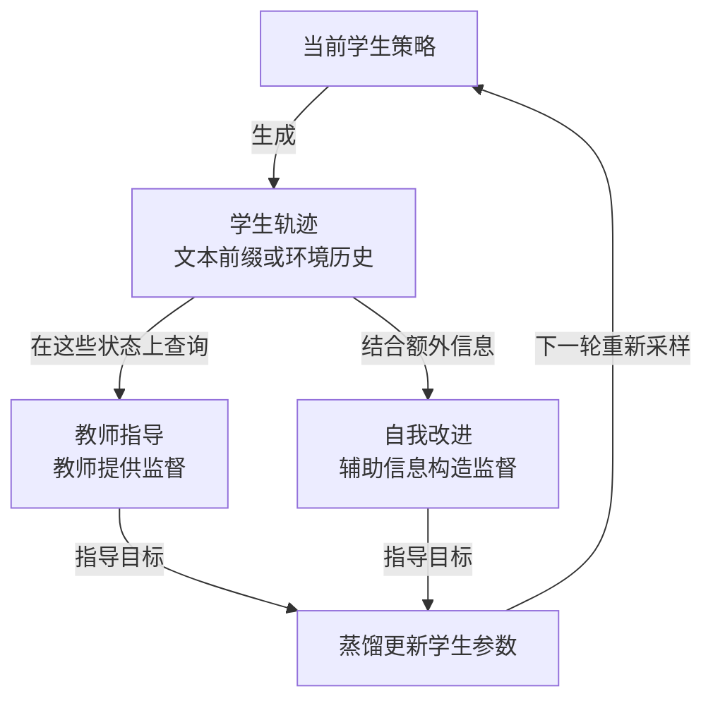

# On-Policy Distillation

**OPD（同策略蒸馏）让学生先按当前策略生成轨迹，再在它实际经过的状态上提供监督，更新学生参数。** 它同时回答两个问题：**在哪里学**——学生自己会到达的状态；**向什么学**——教师或辅助信息构造的指导目标。S001 将其定位为在自身状态分布上巩固行为、缓解分布偏移的训练环节。[[raw/surveys/Towards Long-Horizon Agents.pdf#page=37|S001 · §5 总览 · p.37]] [[raw/surveys/Towards Long-Horizon Agents.pdf#page=52|§5.6 · pp.52–53]]

## 为什么要在学生自己的轨迹上教

离线示范覆盖的是教师经过的状态；学生一旦走偏，后续输入也会改变，原有示范未必教过如何继续。OPD 保留这些学生实际产生的上下文，再构造监督，给纠错和恢复提供训练机会；不是把学生的错误答案原样当作标签。[[raw/surveys/Towards Long-Horizon Agents.pdf#page=52|S001 · §5.6 · p.52]]

> **教学例子：**教师顺利修好函数，学生却改错位置并得到新报错。此时需要教的是“面对这份错误修改和报错，下一步怎样排查”，而不只是重复教师最初的成功路径。能否学会恢复，仍取决于这些状态是否被采到、指导是否可靠。

图为依据 S001 §5.6（pp.52–53）的**本库机制示意**；两条路线可组合，不要求每次同时使用。回路表示更新后的学生会产生新的轨迹。“状态”须按方法核对：GKD 主要是学生生成的 token 前缀，DAgger-LLM 还涉及动作执行后的环境历史；两者的覆盖范围不同。[[raw/papers/optimization/distillation/GKD.pdf#page=4|S056 · §3.1 · p.4]] [[raw/papers/optimization/distillation/DAgger-LLM.pdf#page=4|S057 · §3.2 · pp.4–5]]

## 两条监督路线，各自解决什么问题

### 教师指导：怎样安排指导，怎样构造信号

Teacher-guided OPD 在学生访问的状态上查询一个或多个教师。**教师参数可以固定，监督内容仍随学生轨迹变化。** 综述将设计拆成两个可组合的维度。[[raw/surveys/Towards Long-Horizon Agents.pdf#page=52|S001 · §5.6.1 · pp.52–53]]

| 设计维度 | 核心问题 | 综述列举的做法 |
| --- | --- | --- |
| 监督调度（Scheduling） | 何时教、按什么粒度教？ | 回合级插值、逐步监督；随能力调整课程、难度和偏好指导 |
| 教师信号（Signals） | 教什么，指导怎样产生？ | 汇集多教师意见、组织专业 agent、加入检索参考与示范轨迹 |

依据 [[raw/surveys/Towards Long-Horizon Agents.pdf#page=53|S001 · §5.6.1 · p.53]]。调度和信号共同决定一次监督：例如，在关键步骤查询多个专家。综述未展开统一的“回合级插值”公式，具体含义要回到各方法；更多教师也不自动保证指导正确。

### 自我改进：用信息优势构造监督

Self-improving OPD 利用训练阶段的辅助信息，减少对外部强教师的依赖。同一模型在看到额外证据后，可以提供不同于初次作答的预测；蒸馏再把这种指导训练进常规输入下的学生。**“自我”不表示没有数据、验证器或外部反馈，也不要求师生模型大小不同。** [[raw/surveys/Towards Long-Horizon Agents.pdf#page=53|S001 · §5.6.2 · p.53]] [[raw/papers/optimization/distillation/Self-Distillation-Zero.pdf#page=4|S060 · §2.1–2.2 · p.4]]

| 信息视角 | 关注什么 | 怎样用于监督 |
| --- | --- | --- |
| 特权信息（Privileged Information） | 训练时能看到、部署决策时看不到什么？ | 用最终结果、额外标注、细粒度视觉或轨迹构造过程，形成更充分的指导 |
| 环境反馈（Environment Feedback） | 执行或验证返回了什么？ | 将奖励、报错、点评或验证结果，转成反馈条件化预测、修订或反思，再用于学习 |

依据 [[raw/surveys/Towards Long-Horizon Agents.pdf#page=53|S001 · §5.6.2 · p.53]]。**本库辨析：**二者可以重叠——最终测试结果来自环境；用它指导更早的决策时，又提供了当时未知的特权信息。反馈是否有用，还取决于如何筛选、加工，以及是否含噪声或已经过期。

一个具体例子是 [[wiki/papers/optimization/distillation/Self-Distillation-Zero|SD-Zero]]：先训练修订能力，再让冻结修订者看到“完整初答＋对错”，为学生当前前缀提供 token 分布监督；学生只看题目和当前前缀。它借助的是**信息条件差异**。仅把反思存进上下文或记忆，还没有完成这里的参数蒸馏。[[raw/papers/optimization/distillation/Self-Distillation-Zero.pdf#page=4|S060 · §2.2、Eq.4 · p.4]]

## 在 Model Optimization 中的位置

按本库对综述的概念归纳，OPD 可视为后训练中的**行为巩固与分布适配**：让已有能力适应学生自己造成的局面。章节次序不是强制流水线；GKD 就从已做 SFT 的学生开始，并可与 RL 合用。[[raw/surveys/Towards Long-Horizon Agents.pdf#page=37|S001 · §5 总览 · p.37]] [[raw/papers/optimization/distillation/GKD.pdf#page=4|S056 · §3.1–3.2 · pp.4–5]]

| 相邻环节 | 与 OPD 的关键区别和联系 |
| --- | --- |
| [[wiki/optimization/finetuning\|§5.4 微调中的离线蒸馏]] | 消费固定教师或过去模型的轨迹；OPD 围绕当前学生新生成的轨迹组织监督。旧轨迹即使由学生自己生成，也不自动属于当前策略分布。 |
| [[wiki/optimization/reinforcement-learning\|§5.5 Agentic RL]] | 通过回报或优势优化行为；OPD 主要学习指导目标或预测分布。二者可共用轨迹并组合目标；不能把 RL 一概等同于只用终局奖励。 |
| [[wiki/optimization/self-evolution\|§5.7 自我演化]] | 进一步让经验数据、任务或环境设置进入持续更新循环；OPD 可作为其中的参数更新机制。 |

依据 [[raw/surveys/Towards Long-Horizon Agents.pdf#page=52|S001 · §5.6–5.7 · pp.52–54]] 与 [[raw/papers/optimization/distillation/GKD.pdf#page=5|S056 · §3.2、Eq.5 · p.5]]，表中关系为本库归纳。S001 用“固定任务和环境”区分 OPD 与自我演化，这是综述的组织口径；库内 π-Play 同时更新出题分布并使用蒸馏，实际方法可以跨类。固定环境设置也不意味着动作后的环境状态不变。[[raw/papers/optimization/distillation/Pi-Play.pdf#page=4|S059 · §2.2–2.5 · pp.4–5]]

## 原论文比较：监督覆盖到哪一层

### 状态由谁产生，教师能看到什么

下表比较信息流与更新对象，不排列不同任务的分数。固定教师指本次学生更新时教师参数不随梯度改变；教师输入仍可逐样本变化。

| 方法 | 采样状态与教师信息权限 | 输出监督与更新对象 |
| --- | --- | --- |
| [[wiki/papers/optimization/distillation/GKD\|S056 GKD]] | 学生生成token前缀，可与固定序列按λ混合；教师看到相同前缀 | 教师token概率，散度可选；固定教师、更新学生，采样停止梯度。RL是另加的可选项。[[raw/papers/optimization/distillation/GKD.pdf#page=4\|§3.1–3.2 · pp.4–5]] |
| [[wiki/papers/optimization/distillation/DAgger-LLM\|S057 DAgger-LLM]] | 教师/学生按轮混合执行，真实环境返回观察；每个访问状态都查询教师动作 | 教师动作文本交叉熵，动作内部前缀也是教师标签；不要求教师logits。固定教师、按批更新学生。[[raw/papers/optimization/distillation/DAgger-LLM.pdf#page=4\|§3.2、Eqs.8–13 · pp.4–5]] |
| [[wiki/papers/optimization/distillation/MAD-OPD\|S058 MAD-OPD]] | 学生采样动作；讨论历史只对教师可见；训练环境历史覆盖需另核查 | 置信度加权各教师散度之和；教师固定，学生更新；agentic用JSD、code用reverse KL是本文配方。[[raw/papers/optimization/distillation/MAD-OPD.pdf#page=6\|§4.2–4.4 · pp.6–7]] |
| [[wiki/papers/optimization/distillation/Pi-Play\|S059 π-Play]] | 学生搜索rollout；教师额外看出题构造路径QCP，examiner还更新题目分布 | 学生GRPO＋KL(学生‖教师)，教师EMA软更新；examiner用难度反馈另更新。[[raw/papers/optimization/distillation/Pi-Play.pdf#page=4\|§2.2–2.5 · pp.4–5]] |
| [[wiki/papers/optimization/distillation/Self-Distillation-Zero\|S060 SD-Zero]] | 学生生成文本解答；教师额外看完整初答及二元验证结果 | 先双损失SRT训练修订者，再用冻结修订者做reverse KL；额外同步教师属于后续迭代实验。[[raw/papers/optimization/distillation/Self-Distillation-Zero.pdf#page=4\|§2.1–2.2 · p.4]]、[[raw/papers/optimization/distillation/Self-Distillation-Zero.pdf#page=7\|§3.4 · pp.7–8]] |

DAgger提供本批直接的多轮软件环境证据，但实际教师执行概率最低仍为0.6，不是训练末期纯学生环境分布。MAD-OPD的算法写有在线环境循环，附录训练数据却是ToolACE独立step样本；仅从PDF不能确认整个训练历史都由学生执行后刷新。GKD、SD-Zero主要是文本生成/数学代码推理，不能把自回归长度当成真实环境恢复验证。[[raw/papers/optimization/distillation/DAgger-LLM.pdf#page=17|S057 F.1–F.2 · pp.17–18]] [[raw/papers/optimization/distillation/MAD-OPD.pdf#page=12|S058 Algorithm 1、B.3 · pp.12–13]] [[raw/papers/optimization/distillation/GKD.pdf#page=5|S056 §4 · pp.5–9]] [[raw/papers/optimization/distillation/Self-Distillation-Zero.pdf#page=5|S060 §3.1 · p.5]]

### 稠密监督来自额外条件，不等于因果信用

教师监督可以是固定专家概率、教师动作文本、讨论条件化概率、出题路径条件化概率或结果条件化修订者。稠密表示每个位置都有优化信号；它仍可能继承教师错误、置信度偏差或合成任务错误。SD-Zero的完整分布KL与样本token的log概率比也不同，后者可正可负；信号集中在少数位置不等于验证器证明了这些位置的因果责任。[[raw/papers/optimization/distillation/MAD-OPD.pdf#page=6|S058 §4.2–4.3 · p.6]] [[raw/papers/optimization/distillation/Pi-Play.pdf#page=4|S059 §2.2–2.3 · p.4]] [[raw/papers/optimization/distillation/Self-Distillation-Zero.pdf#page=8|S060 §4.1 · p.8]]

**本库数学核查，限定S058的普遍理论主张。** MAD-OPD D.3在不相交支持混合与无约束softmax下宣称reverse KL单模态全局最优；但取$p=q=(0.6,0.4)$，KL=0且梯度为0，集中解成本反而为−log0.6>0。故这些假设不足以保证单模态最优或普遍收敛，需额外可行族/优化条件。其固定教师、独立位置logit界与Table 4经验消融分别保留，不升级为参数训练稳定或代码连贯性的普遍定理，完整说明见 [[wiki/papers/optimization/distillation/MAD-OPD#理论主张的适用前提：本库数学核查|唯一论文页]]。[[raw/papers/optimization/distillation/MAD-OPD.pdf#page=22|S058 D.3–D.5 · pp.22–23]] [[raw/papers/optimization/distillation/MAD-OPD.pdf#page=17|Table 4 · p.17]]

### 比较收益之前，先核对分母和成本

本批不支持“OPD普遍优于RL”。DAgger的GRPO基线使用不同任务子集，SWE Verified只评466/500；MAD-OPD用BFCL/LCB选checkpoint，部分交互评测排除执行失败；SD-Zero的大部分增益来自SRT，且采样预算与实现表仍有配置口径差异。π-Play同时使用GRPO和蒸馏，最多5轮训练交互；它的“2–3倍演化效率”不能直接当墙钟加速。具体条件已在各论文页归位。[[raw/papers/optimization/distillation/DAgger-LLM.pdf#page=6|S057 §4.1 · p.6]] [[raw/papers/optimization/distillation/MAD-OPD.pdf#page=13|S058 B.6、B.9–B.10 · pp.13–15]] [[raw/papers/optimization/distillation/Self-Distillation-Zero.pdf#page=19|S060 C.1–C.3 · pp.19–23]] [[raw/papers/optimization/distillation/Pi-Play.pdf#page=13|S059 B–C.2、Table 11 · pp.13–15]]

## 论文入口与交叉方向

- [[wiki/papers/optimization/distillation/GKD|S056 · GKD]]：主归属。
- [[wiki/papers/optimization/distillation/DAgger-LLM|S057 · DAgger-LLM]]：主归属。
- [[wiki/papers/optimization/distillation/MAD-OPD|S058 · MAD-OPD]]：主归属。
- [[wiki/papers/optimization/distillation/Pi-Play|S059 · Pi-Play]]：主归属。
- [[wiki/papers/optimization/distillation/Self-Distillation-Zero|S060 · Self-Distillation-Zero]]：主归属。

[[wiki/optimization/Overview|返回模块地图]] · [[maintenance/research/R001|本轮选读理由与维护记录]]。
