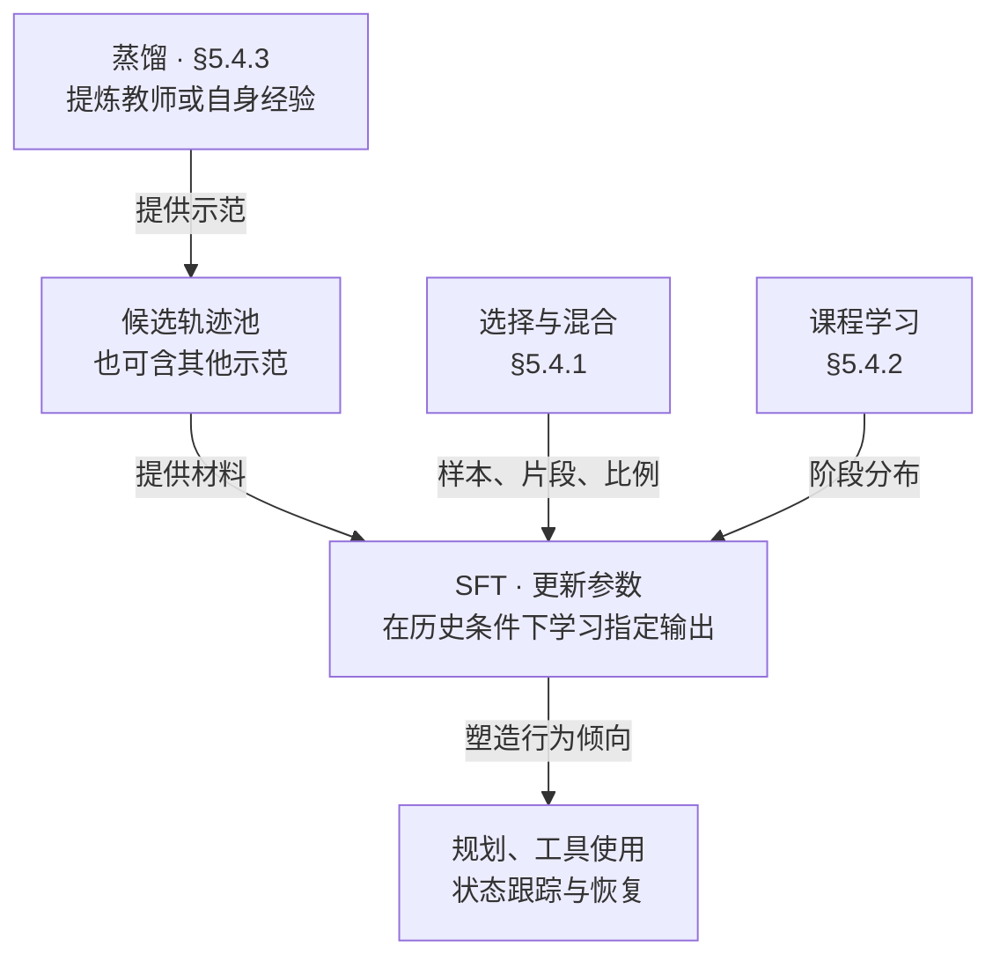
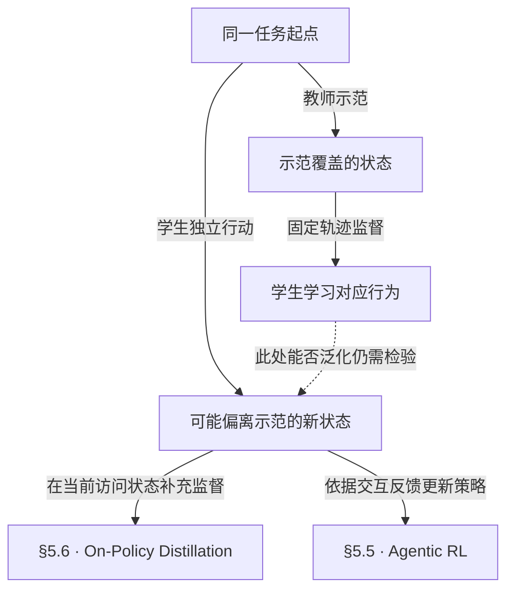

# 微调

**§5.4 以监督微调（SFT）塑造交互行为：让模型从示范中学习怎样规划、调用工具、理解反馈、恢复和结束任务。** 它在 Model Optimization 中承担“行为塑造与冷启动”的作用：以预训练／中期训练的能力为基础，建立可用的初始策略，供后续在线优化继续改进。这里的冷启动不是从零训练模型，也不是所有 RL 方法的必经阶段。[[raw/surveys/Towards Long-Horizon Agents.pdf#page=37|S001 · §5 · p.37]] [[raw/surveys/Towards Long-Horizon Agents.pdf#page=45|§5.4 · p.45]]

## 学的是交互过程，三类设计共同决定监督

Agent SFT 的单位是带历史和反馈的轨迹。例如，“搜索为空 → 判断关键词过窄 → 改写查询”教的是**在特定观察后怎样继续行动**。这个教学例子说明：轨迹包含工具返回，模型学习的输出位置却要另行规定；Agent Distillation 学习思考与动作，环境观察只作条件输入、不计损失。[[raw/surveys/Towards Long-Horizon Agents.pdf#page=45|S001 · §5.4 · p.45]] [[raw/papers/optimization/finetuning/Agent-Distillation.pdf#page=4|S049 · §4、Eq.3–4 · p.4]]

图为依据 S001 §5.4（PDF pp.45–47）的**本库关系归纳**。箭头表示数据供给或训练控制；三者可以组合，章节顺序不规定执行顺序。[[wiki/optimization/data-environments|§5.2 数据合成]] 侧重经验如何产生，本节侧重经验怎样成为参数更新的监督。

### 选择与混合：哪些行为值得学、各占多少

§5.4.1 从选择原则讲到小样本现象，再把质量要求落实到工具数据。这里的 instruction 包含完整轨迹与决策片段。

| 层次 | 机制与作用 | 要保留的限定 |
| --- | --- | --- |
| 轨迹质量与决策覆盖 | 覆盖规划、调用、纠错等关键行为；选择可细到轨迹内部 | ATLAS 只监督关键步骤，完整历史仍输入；减少监督位置不等于缩短输入 |
| 少量高质量示范 | 在底座已有能力上提供组织推理与行动的模板 | 综述同时收录规模仍重要的结果，不能推出“数据越少越好” |
| 工具有效性与数据混合 | 检查格式、执行、语义及观察依据；混合通用与多领域数据以扩大覆盖 | 调用能执行不保证任务正确；统一轨迹格式有助于混合，不保证无负迁移 |

依据：[[raw/surveys/Towards Long-Horizon Agents.pdf#page=45|S001 · §5.4.1 · pp.45–46]]；ATLAS 的输入与损失区别直接核对 [[raw/papers/optimization/finetuning/ATLAS.pdf#page=4|S048 · §3.2–3.3 · PDF p.4 / 印刷 p.25337]]。

代表机制中，AgentTuning 混合 Agent 与通用数据，ATLAS 选择监督步骤；具体效果见后文原论文比较。APIGen 的多层检查、Agent Data Protocol 的统一轨迹表示，以及 LIMO／s1 的小样本结果在此仅为**综述转述，原论文未核读**，分别见 S001 引文 [392]、[558]、[770]/[442]，不作普遍效果保证。[[raw/surveys/Towards Long-Horizon Agents.pdf#page=45|S001 · §5.4.1 · pp.45–46]]

### 课程：随训练进展改变接触的任务

课程控制**何时接触什么挑战**。综述主要沿两轴展开：先短后长，增加行动链与跨步依赖；先易后难，逐步改变推理和决策要求。长度与难度不是同一个量，还可组合工具复杂度、反馈密度和恢复要求。[[raw/surveys/Towards Long-Horizon Agents.pdf#page=46|S001 · §5.4.2 · p.46]]

**本库辨析：**长上下文训练侧重“能否利用长历史”，交互课程侧重“怎样逐渐维持长行动链”；最终成败反馈延迟，也不妨碍 SFT 在中间示范输出上计算损失。课程是分布安排原则，可以用于 SFT 或 RL；综述举出的 AgentGym-RL 属于在线 RL，不能当作 SFT 课程有效的直接证据。[[raw/papers/optimization/finetuning/Agent-Distillation.pdf#page=4|S049 · Eq.4 · p.4]] [[raw/papers/optimization/reinforcement-learning/AgentGym-RL.pdf#page=9|S041 · §3.3 · p.9]]

### 蒸馏：监督来自哪里，保留怎样的过程

§5.4.3 采用**离线轨迹蒸馏**视角：把教师或历史模型的轨迹整理成固定 SFT 数据，传递规划、动作、观察解释和恢复方式。来源与监督结构是不同维度：

| 概念 | 回答的问题 | 典型机制 |
| --- | --- | --- |
| Strong-to-weak | 能力从谁转移？ | 从强模型或高成本 Agent 系统提炼示范，供学生模仿；教师的优势可来自搜索或多 Agent 协作 |
| Self-distillation | 自身经验如何成为监督？ | 通过搜索、筛选、验证或反思，把原始尝试加工为更好的轨迹；如 Agent-R 构造纠错监督 |
| Process-aware | 示范保留什么、怎样监督？ | 保留推理—行动—观察的结构，可分别处理推理与动作；可同时用于上述两种来源 |

这是对正文与 Fig.11 的**本库分类辨析**：三者不是互斥类别。自蒸馏的改进机会来自经验加工，重复训练原始输出并不自动变好；两种来源都可能强化原有偏差。[[raw/surveys/Towards Long-Horizon Agents.pdf#page=39|S001 · Fig.11 · p.39]] [[raw/surveys/Towards Long-Horizon Agents.pdf#page=46|§5.4.3 · pp.46–47]]

## 它连接什么，又留下什么

SFT 把运行经验中的有效行为内化为模型倾向；实际调用仍需工具执行器与环境反馈。**能模仿示范，不代表能处理自己偏离示范后遇到的所有状态。** 这也是固定轨迹监督与后续在线优化的主要接口。[[raw/surveys/Towards Long-Horizon Agents.pdf#page=45|S001 · §5.4 · pp.45–47]] [[raw/surveys/Towards Long-Horizon Agents.pdf#page=52|§5.6 · p.52]]

图为**本库机制示意**；两条后续路线可组合，也都不保证消除误差。OPD 关注学生当前访问状态上的监督；[[wiki/optimization/self-evolution|自我演化]] 则把经验产生、筛选和训练组织成持续循环，可能进一步改变任务与环境。离线／在线描述训练时如何取得数据，不能仅凭“自己生成数据”判定属于哪一类。详见 [[wiki/optimization/distillation|OPD]]、[[wiki/optimization/reinforcement-learning|Agentic RL]]。[[raw/surveys/Towards Long-Horizon Agents.pdf#page=52|S001 · §5.6 · p.52]] [[raw/surveys/Towards Long-Horizon Agents.pdf#page=37|§5 各阶段定位 · p.37]]

## 原论文比较：状态、监督与恢复的边界

### 状态由谁产生，哪些输出受到监督

**本库比较轴：**“用了SFT”只说明更新目标，不能单独说明数据是固定教师生成，还是当前策略重新采集。再问模型学习全部输出、部分关键步骤，还是错误后的修订后缀，才看清这些训练方法的差别。以下比较机制和成立条件，不跨任务排列分数。

| 状态与数据来源 | 参数更新实际学习什么 | 必须保留的边界 |
| --- | --- | --- |
| AgentTuning：教师在六类任务中交互，筛选后固定为AgentInstruct，与通用对话混合 | 模型输出的监督最大似然；通用对话帮助维持能力 | 主要覆盖教师访问状态；Mind2Web是teacher-forced单步；混合不保证每项通用指标无损。[[wiki/papers/optimization/finetuning/AgentTuning\|S047]]；[[raw/papers/optimization/finetuning/AgentTuning.pdf#page=4\|§2.1–2.2 · PDF pp.4–5 / 印刷 pp.3056–3057]] |
| ATLAS：既有专家轨迹，由GPT-4o按计划/观察/动作/纠错语义选步骤 | 完整轨迹仍输入，仅选中的thought/action计loss | 至多30%指步骤监督覆盖，不是总输入或总成本；选择不直接产生学生失败状态。[[wiki/papers/optimization/finetuning/ATLAS\|S048]]；[[raw/papers/optimization/finetuning/ATLAS.pdf#page=4\|§3.2–3.3 · PDF p.4 / 印刷 p.25337]] |
| Agent Distillation：教师在检索/代码环境生成并按答案筛选轨迹，FTP改变教师首个thought前缀 | 学生监督学习thought/action，环境观察不计loss | 固定教师状态；SAG是额外测试时采样与执行筛选，不能归入训练收益。[[wiki/papers/optimization/finetuning/Agent-Distillation\|S049]]；[[raw/papers/optimization/finetuning/Agent-Distillation.pdf#page=4\|§4、Eq.4–5、Fig.3 · pp.4–5]] |
| Agent-R：每轮当前actor用MCTS采集好坏分支，再判错并构造修复轨迹 | 好轨迹＋修复信号/后续的SFT，混入通用对话；下轮重新采集 | 当前策略采样不自动等于RL或逐步OPD；树搜索、筛选与拼接都改变训练分布。[[wiki/papers/optimization/finetuning/Agent-R\|S050]]；[[raw/papers/optimization/finetuning/Agent-R.pdf#page=6\|§3.1–3.2 · pp.6–7]] |
| AgentGym-RL：当前策略在环境内在线rollout，逐阶段增大交互上限 | 根据环境reward做RL参数更新 | 主路线无需额外任务SFT；它是本方向的跨范式课程对照。[[wiki/papers/optimization/reinforcement-learning/AgentGym-RL\|S041，复用]]；[[raw/papers/optimization/reinforcement-learning/AgentGym-RL.pdf#page=9\|§3.3 · p.9]] |

### 减少模仿，改善泛化，还是降低成本

AgentTuning的混合训练优于只用agent数据，但13B在held-out上的general-only分数还略高于混合；通用任务也有退步。因此它支持在训练中检查通用能力保留，不能证明每种规模都从agent示范获得独立泛化收益。ATLAS把干预移到监督位置；它相对完整轨迹的held-in收益更明显，held-out上关键30%与随机30%平均仅38.36对38.04，缺少该差值置信区间。两者共同提醒：**数据选择机制、同骨干消融和逐任务结果比“泛化更强”的总称更有信息。** [[raw/papers/optimization/finetuning/AgentTuning.pdf#page=6|S047 Tables3–4 · PDF pp.6–7 / 印刷 pp.3058–3059]] [[raw/papers/optimization/finetuning/ATLAS.pdf#page=7|S048 Table3 · PDF p.7 / 印刷 p.25340]]

同样不能由“小数据”或“小模型”直接推出总成本优势。ATLAS保留完整输入并需强模型选择；Agent Distillation的SAG默认每步采8个动作再执行筛选。后者最多5步、固定Wikipedia 2018与数学代码任务，模型变小的结果包含外部工具和额外推理预算。训练token、选择/教师成本、环境执行次数和测试时延应分别记录。[[raw/papers/optimization/finetuning/ATLAS.pdf#page=4|S048 §3.2 · PDF p.4 / 印刷 p.25337]] [[raw/papers/optimization/finetuning/ATLAS.pdf#page=14|Appendix B.1 · PDF p.14 / 印刷 p.25347]] [[raw/papers/optimization/finetuning/Agent-Distillation.pdf#page=6|S049 §5 · p.6]]

### 学到修订行为以后，环境是否能继续

Agent-R的恢复测试让模型从基础Llama失败轨迹的随机截断处继续，最多50轮，检查特定失败状态上的后续结果。[[raw/papers/optimization/finetuning/Agent-R.pdf#page=11|S050 §4.4、Table3 · p.11]] **公开实现核查已缩小材料缺口：**MCTS采树有reset与动作前缀重放；离线训练构造直接拼接坏前缀、修订信号和好分支文本，不在构造函数内执行后缀核验；恢复函数则真实执行传入前缀后在线续做。三者不能互相替代为状态一致性证明。构造数据的loss字段已见，最终训练mask及恢复实验入口尚未完整核验；底层环境服务语义仍未知。固定commit `82fcc1c`的原始快照、行定位和剩余范围见 [[wiki/papers/optimization/finetuning/Agent-R#公开实现核查：三个阶段怎样处理环境状态|唯一论文页]]。因此现有证据既不保证任意不可逆任务恢复，也不支持因训练拼接疑点否定已报告的恢复评测。

这与 [[wiki/harness/workflows#分支能否撤回，评价能否被信任|运行时分支与状态恢复]] 形成接口：SFT提供行动倾向，harness决定哪些动作实际执行、失败后的状态怎样保留/恢复。ATLAS的关键步语义判断、Agent-R的actor判错、SAG的可执行/一致输出也各有误差，不能当作同一种可靠过程标签。当前未形成已查新的研究缺口。

### 与已有工具和数据路线的联系

**工具调用的训练接口（S012 / S014 已完成摄入，应用未测）：**[[wiki/papers/optimization/finetuning/Toolformer|Toolformer]] 用执行结果对后续 token 预测的帮助筛选调用，再微调模型，学到的对象包括调用时机、工具及参数；这个损失代理没有直接优化长程任务成功或调用成本，也没有链式工具训练。[[wiki/papers/harness/tools/CodeAct|CodeAct]] 则需分开动作表示和模型适应：CodeActInstruct 收集并筛选多轮成功及纠错轨迹，与通用对话混合后训练 CodeActAgent。其通用数据消融和不同基础模型表现说明，不能把收益全部归于“代码”或“纠错”一个因素。两者的运行时执行接口见 [[wiki/harness/tools|工具方向]]；AnyTool / Voyager 的候选池或技能库更新不应计作参数微调。[[raw/papers/optimization/finetuning/Toolformer.pdf#page=3|S012 §2 · pp.3–4]] [[raw/papers/optimization/finetuning/Toolformer.pdf#page=9|§6 · p.9]] [[raw/papers/harness/tools/CodeAct.pdf#page=6|S014 §3、Tables 4–5 · pp.6–8]] [[raw/papers/harness/tools/CodeAct.pdf#page=14|Table A.8 · p.14]]

**监督对象与课程范式（S037–S041，已完成摄入，应用未测）：**TaskCraft 用构造的多跳问答轨迹训练策略；SWE-Gym 用实际执行后测试成功的轨迹训练策略，并另外以成功/失败标签训练 verifier；TOUCAN 对真实工具轨迹进行模型质量筛选后做 SFT；WebDreamer 则训练“截图与动作→变化描述”的世界模型组件。它们学的对象不同，不能把共同出现的 fine-tuning 视为同一种 Agent 能力证据。[[raw/papers/optimization/data-environments/TaskCraft.pdf#page=9|S037 §4.4 · p.9]] [[raw/papers/optimization/data-environments/SWE-Gym.pdf#page=5|S038 §4–5 · pp.5–7]] [[raw/papers/optimization/data-environments/TOUCAN.pdf#page=7|S040 §4.1 · p.7]] [[raw/papers/optimization/data-environments/WebDreamer.pdf#page=5|S039 §3.3 · pp.5–6]]

AgentGym-RL 中，框架支持 SFT 与主方法实际使用 SFT 是不同事实；ScalingInter 的在线课程与环境状态边界见 [[wiki/optimization/reinforcement-learning#交互上限怎样改变在线训练|交互上限怎样改变在线训练]]。[[raw/papers/optimization/reinforcement-learning/AgentGym-RL.pdf#page=6|S041 §3.2.2 · p.6]] [[raw/papers/optimization/reinforcement-learning/AgentGym-RL.pdf#page=9|§3.3 · p.9]]

## 后训练分工与条件化泛化

[[wiki/papers/optimization/reinforcement-learning/DeepSeek-R1|S077 DeepSeek-R1]]是SFT与RL配合的实例：正式配方包含两段SFT和两段RL，Fig.2中的第二次SFT重新从V3-Base起步；R1-Distill则用固定轨迹做SFT，不能叫作学生当前分布上的OPD。它说明阶段、数据来源和初始化须一起看，不证明各环节只有唯一作用。[[raw/papers/optimization/reinforcement-learning/DeepSeek-R1.pdf#page=6|S077 · §3、Fig.2 · pp.6–8]] [[raw/papers/optimization/reinforcement-learning/DeepSeek-R1.pdf#page=60|F · pp.60–62]]

**固定示范有覆盖限制，不等于SFT必然不泛化。** [[wiki/papers/optimization/finetuning/Reasoning-SFT-Generalization|S079]]在所测推理模型中，发现跨域表现受优化进程、轨迹质量与底座能力共同影响；收益可以伴随其他能力退化。该文没有工具环境迁移实验，SFT–GRPO比较也未匹配总FLOPs，不能推出统一优劣。[[raw/papers/optimization/finetuning/Reasoning-SFT-Generalization.pdf#page=4|§3–6 · pp.4–9]] [[raw/papers/optimization/finetuning/Reasoning-SFT-Generalization.pdf#page=10|§8 · p.10]]

与 [[wiki/papers/optimization/reinforcement-learning/RL-Reasoning-Capacity|S078]]的联系是评价对象：成功概率、有限采样覆盖与实际选择并不相同；教师蒸馏又引入额外轨迹信息，不能只按SFT／RL标签归因。[[raw/papers/optimization/reinforcement-learning/RL-Reasoning-Capacity.pdf#page=5|§2.2 · p.5]] [[raw/papers/optimization/reinforcement-learning/RL-Reasoning-Capacity.pdf#page=9|§4.2 · p.9]]。这些边界用于 [[wiki/optimization/Questions#六个适合与学长讨论的宏观问题|本次训练分工与能力讨论]]，不将旧有状态覆盖问题取消。

## 论文入口与交叉方向

- [[wiki/papers/optimization/finetuning/Toolformer|S012 · Toolformer]]：主归属。
- [[wiki/papers/harness/tools/CodeAct|S014 · CodeAct]]：交叉关联；主归属为`harness/tools`。
- [[wiki/papers/optimization/data-environments/TaskCraft|S037 · TaskCraft]]：交叉关联；主归属为`optimization/data-environments`。
- [[wiki/papers/optimization/data-environments/SWE-Gym|S038 · SWE-Gym]]：交叉关联；主归属为`optimization/data-environments`。
- [[wiki/papers/optimization/data-environments/WebDreamer|S039 · WebDreamer]]：交叉关联；主归属为`optimization/data-environments`。
- [[wiki/papers/optimization/data-environments/TOUCAN|S040 · TOUCAN]]：交叉关联；主归属为`optimization/data-environments`。
- [[wiki/papers/optimization/reinforcement-learning/AgentGym-RL|S041 · AgentGym-RL]]：交叉关联；主归属为`optimization/reinforcement-learning`。
- [[wiki/papers/optimization/finetuning/AgentTuning|S047 · AgentTuning]]：主归属。
- [[wiki/papers/optimization/finetuning/ATLAS|S048 · ATLAS]]：主归属。
- [[wiki/papers/optimization/finetuning/Agent-Distillation|S049 · Agent-Distillation]]：主归属。
- [[wiki/papers/optimization/finetuning/Agent-R|S050 · Agent-R]]：主归属。

[[wiki/optimization/Overview|返回模块地图]] · [[maintenance/research/R001|本轮选读理由与维护记录]]。
