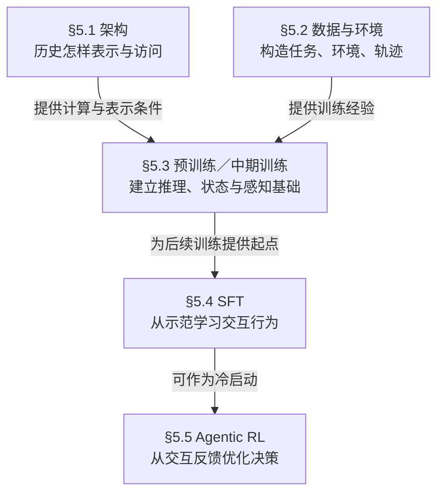

# 预训练与中期训练

**这一节讨论如何训练出长程交互的能力基础：持续推理、利用历史维护任务状态、理解环境观察。**预训练／中期训练是阶段，前三个小节是能力维度，§5.3.4 的数据与训练策略则横跨这些能力；四个小节不表示四个执行步骤。此层次划分为本库依据综述的教学整理。[[raw/surveys/Towards Long-Horizon Agents.pdf#page=43|S001 · §5.3 · pp.43–45]]

## 在 Model Optimization 中的位置

第 5 章关注将长程能力内化到模型参数。§5.3 承接架构与训练材料，为后续行为训练提供起点；综述将其意义概括为提前建立推理和动作—观察先验。这里的 **priors（先验）**可理解为执行具体任务前已学到的能力与倾向，不要求显式的贝叶斯先验分布。[[raw/surveys/Towards Long-Horizon Agents.pdf#page=37|S001 · §5 总述 · p.37]]

本库关系示意，箭头表示条件供给与典型训练衔接，**不是所有方法必经的流水线**。§5.2 的经验也可供 SFT／RL 使用；§5.6 在策略自己的状态分布上蒸馏，§5.7 组织持续改进，见 [[wiki/optimization/Overview|完整方向地图]]。[[raw/surveys/Towards Long-Horizon Agents.pdf#page=37|S001 · §5 · p.37]]、[[raw/surveys/Towards Long-Horizon Agents.pdf#page=45|§5.4 · p.45]]

| 阶段 | 本节采用的含义 |
| --- | --- |
| **Pre-training：预训练** | 通过大规模自监督学习，建立语言、知识、代码、数学和推理等广泛基础。 |
| **Mid-training：中期训练** | 在已有基础上、指令微调或 RL 之前，针对目标能力继续塑造模型，例如代码推理、仓库理解和交互模式；它是阶段与功能定位，不是一种独有算法。 |

定义依据 [[raw/surveys/Towards Long-Horizon Agents.pdf#page=43|S001 · §5.3–5.3.1 · pp.43–44]]。与后续章节的区别在于侧重：本节培养能力基础，[[wiki/optimization/finetuning|SFT]] 用示范组织交互行为，[[wiki/optimization/reinforcement-learning|RL]] 用反馈优化决策。**这不意味着 SFT 只教格式，也不意味着后训练不能改善能力。**综述关于后续训练受基础能力制约的表述是其组织观点，不是普遍的能力上限定理。

## 三类能力怎样配合

前三节回答“要学会什么”。它们是相互依赖的能力维度，不对应三个独立模块，也不要求分别训练。下表中的论文核对例子是教学情境；能力划分来自 [[raw/surveys/Towards Long-Horizon Agents.pdf#page=44|S001 · §5.3.1–5.3.3 · p.44]]。

| 能力 | 要学会什么，为什么 | 例：浏览论文并核对结果 |
| --- | --- | --- |
| **推理先验** Reasoning Priors | 分解目标、维持中间假设、检查结果、修订计划。代码与数学提供跨步依赖、可检查的中间状态和组合求解结构。 | 判断两项实验能否比较，决定下一步补查什么。 |
| **长上下文状态** Long-Context State | 把目标、观察、证据、工具返回、失败尝试和计划作为**序列化工作状态**使用，随新反馈更新判断。 | 保持筛选条件、证据来源与未解决问题，避免把已否定的结果继续当依据。 |
| **多模态感知** Multimodal Perception | 理解当前观察、定位可操作对象，并跨时间／模态对齐证据。**Grounding** 指将文字或要求对应到实际对象、位置或观察证据。 | 找到页面按钮，读懂结果图，确认操作后的界面变化。 |

三者在任务中配合：感知获得观察，状态维护把新观察与历史联系起来，推理据此判断下一步。观察错、历史丢失或推理失误，都可能破坏后续决策；这是本库的机制解释，不是独立消融结论。需要哪些模态取决于环境。

### 长上下文：扩展容量与学会使用互相补充

§5.3.2 分两条路线：**位置编码适配等方法扩展可用窗口；数据组成、训练长度与后续微调让模型学会使用长历史。**例如 YaRN 调整 RoPE 频率并配合适配训练；ProLong 比较长短数据混合、训练长度与 SFT。前者不是只改长度配置，后者也不是只增加长文本比例。[[raw/papers/optimization/pretraining/YaRN.pdf#page=5|S043 · §3.2–4.1 · pp.5–7]]、[[raw/papers/optimization/pretraining/ProLong.pdf#page=3|S044 · §3–5 · PDF pp.3–6 / 印刷 pp.7378–7381]]

> [!note] “状态”与“长度”的边界
> - 这里的 state 是**任务工作状态**，不专指 [[wiki/optimization/architecture|架构]] 中的压缩隐状态。内化到参数的是跟踪和使用状态的能力；当前任务的具体历史仍可在上下文、缓存或 [[wiki/harness/memory|运行时记忆]] 中。这是本库的概念辨析。
> - **长输入、有效利用历史、长输出、整任务成功是不同判断。**综述以 LongWriter [29] 说明长输入窗口不会自动带来长输出；此处仅为综述转述，原论文未读。[[raw/surveys/Towards Long-Horizon Agents.pdf#page=44|S001 · §5.3.2 · p.44]]

## 数据与训练策略：怎样培养并平衡这些能力

§5.3.4 回答“怎样学”，横跨上述三类能力。与 [[wiki/optimization/data-environments|§5.2]] 的区别是：后者侧重**经验怎样产生**，这里侧重**材料怎样进入训练**；两者有交叉。以下四问为本库对 [[raw/surveys/Towards Long-Horizon Agents.pdf#page=44|S001 · §5.3.4 · pp.44–45]] 的归纳。

| 训练选择 | 具体含义 |
| --- | --- |
| **选什么语料** | 选择质量可核对、与目标能力相关的数据，保留可复现的构建过程。 |
| **各类占多少** | 调整数据域比例，平衡学习信号；DoReMi 用小模型优化比例，再用于大模型训练。 |
| **哪些样本值得学** | 按学习价值选择样本；综述以 OPUS [649] 为例，原论文未读，不将其收益作为本库直接证据。 |
| **保留什么结构** | 保留时间依赖、观察—行动—反馈和失败恢复，使训练能看到决策之间的联系。 |

**教学例子：**“任务 → 答案”不包含中间失败的原因；“观察 → 行动 → 失败反馈 → 修正 → 后续结果”才暴露恢复所依赖的信息。保留过程使这些关系可学习，但不保证学会。综述在这里引用的工作跨越预训练与轨迹微调，因此不能仅凭被列在 §5.3，就把全部结果归为预训练收益。[[raw/surveys/Towards Long-Horizon Agents.pdf#page=45|S001 · §5.3.4 · p.45]]

## 原论文比较：改变对象与证据范围

以下为已核读论文的机制比较，**不作性能排名**。完整配置、成本与版本问题见各唯一论文页。

| 方法 | 改变什么 | 归因时须保留的边界 |
| --- | --- | --- |
| [[wiki/papers/optimization/pretraining/DeepSeek-V3\|DeepSeek-V3]] | MTP 增加未来 token 的监督；另含架构、数据、扩窗与后训练。 | MTP 消融来自较小 MoE；最终聊天／工程成绩含 SFT、RL 和 harness，不能归于 MTP 或预训练。[[raw/papers/optimization/pretraining/DeepSeek-V3.pdf#page=26\|S042 · §4.5.1、Table 4 · p.26]]、[[raw/papers/optimization/pretraining/DeepSeek-V3.pdf#page=30\|§5.3.1 · pp.30–31]] |
| [[wiki/papers/optimization/pretraining/YaRN\|YaRN]] | 分段调整 RoPE 频率和注意力温度，配合长文本适配训练。 | 主要测试语言建模、passkey 检索与短任务保持；128K 版本从 64K checkpoint 续训。[[raw/papers/optimization/pretraining/YaRN.pdf#page=7\|S043 · §4 · pp.7–9]] |
| [[wiki/papers/optimization/pretraining/ProLong\|ProLong]] | 比较继续训练的数据来源、长短比例、序列长度及后续 SFT。 | 以 SFT 后多类任务与短能力保持选配方；最终模型与消融的初始化不同。[[raw/papers/optimization/pretraining/ProLong.pdf#page=2\|S044 · §2–6 · PDF pp.2–7 / 印刷 pp.7377–7382]] |
| [[wiki/papers/optimization/pretraining/Qwen2-VL\|Qwen2-VL]] | 动态视觉 token、时间／高／宽 M-RoPE 与多模态训练。 | 感知消融和 Qwen-Agent 多轮实验的模型／组件不同，不能由前者归因后者的成功。[[raw/papers/optimization/pretraining/Qwen2-VL.pdf#page=5\|S045 · §2 · pp.5–7]]、[[raw/papers/optimization/pretraining/Qwen2-VL.pdf#page=13\|§3.2.7、§3.3 · pp.13–15]] |
| [[wiki/papers/optimization/pretraining/DoReMi\|DoReMi]] | 用小代理模型相对参考模型的 excess loss 优化数据域比例，再重采样训练大模型。 | 迁移的是比例；1024 长度的一般语言模型实验，未直接测长上下文或 Agent。[[raw/papers/optimization/pretraining/DoReMi.pdf#page=3\|S046 · §2–3.1 · pp.3–5]] |

### 可接受长度、可用证据与任务成功分别测试

**代理指标改善未必等于使用效果改善。**ProLong 在 Llama-3-8B、5B-token 消融中发现，增加长数据虽可改善困惑度，却可能降低 SFT 后的长任务表现；SFT 前后对配方的排序也可能不同。其最终模型仅用短 UltraChat SFT 取得强长上下文表现，仍不能推出短交互轨迹足以训练长程 Agent。[[raw/papers/optimization/pretraining/ProLong.pdf#page=4|S044 · §3.2、Fig.2 · PDF p.4 / 印刷 p.7379]]、[[raw/papers/optimization/pretraining/ProLong.pdf#page=6|§5 · PDF p.6 / 印刷 p.7381]]、[[raw/papers/optimization/pretraining/ProLong.pdf#page=16|Appendix B、Fig.4 · PDF pp.16–17 / 印刷 pp.7391–7392]]

**也应保留正面的交互证据。**Qwen2-VL 在 Qwen-Agent 下保留 32K 观察—动作历史，报告 ALFRED、卡牌和导航任务。但 AITZ 的 TM／EM 是动作匹配，ALFRED 的 SR／GC 是整任务／子目标指标；ALFRED 还使用模拟环境、高层动作与 SAM。它支持组合系统能进行多轮执行，不单独证明某项预训练机制带来成功；导航仍落后专用模型。[[raw/papers/optimization/pretraining/Qwen2-VL.pdf#page=13|S045 · §3.2.7 · p.13]]

### 数据配方的代理目标与使用目标是否一致

DoReMi 用相对损失寻找“还值得学多少”，无需按已知下游任务调比例；ProLong 则用多类下游评测指导配方，更依赖开发集覆盖。数据、模型、长度与预算不同，两者不能直接排名；DoReMi 的代理模型增大也未使收益单调提高。[[raw/papers/optimization/pretraining/DoReMi.pdf#page=3|S046 · §2 · pp.3–4]]、[[raw/papers/optimization/pretraining/DoReMi.pdf#page=8|§4、Fig.6 · p.8]]、[[raw/papers/optimization/pretraining/ProLong.pdf#page=2|S044 · §2 · PDF pp.2–3 / 印刷 pp.7377–7378]]

成本同样须统一口径：DoReMi 的主模型步数收益另有配方搜索成本；ProLong 的等 token 对照不等于等 FLOPs；DeepSeek-V3 正式训练成本不含前期研究／消融。[[raw/papers/optimization/pretraining/DoReMi.pdf#page=5|S046 · §3.1–3.2 · pp.5–6]]、[[raw/papers/optimization/pretraining/ProLong.pdf#page=5|S044 · §4、脚注4 · PDF p.5 / 印刷 p.7380]]、[[raw/papers/optimization/pretraining/DeepSeek-V3.pdf#page=5|S042 · Table 1 · p.5]]

**待检验，尚未查新：**固定模型、harness、动作权限和预算后，哪些困惑度／检索／感知改善能预测状态跟踪与恢复成功？若把任务族或恢复阶段视为数据域，小模型的相对损失能否指导配比？这些是待验证的对应关系，尚非已确认的研究空白。

## 论文入口与交叉方向

- [[wiki/papers/optimization/pretraining/DeepSeek-V3|S042 · DeepSeek-V3]]：主归属。
- [[wiki/papers/optimization/pretraining/YaRN|S043 · YaRN]]：主归属。
- [[wiki/papers/optimization/pretraining/ProLong|S044 · ProLong]]：主归属。
- [[wiki/papers/optimization/pretraining/Qwen2-VL|S045 · Qwen2-VL]]：主归属。
- [[wiki/papers/optimization/pretraining/DoReMi|S046 · DoReMi]]：主归属。

[[wiki/optimization/Overview|返回模块地图]] · [[maintenance/research/R001|本轮选读理由与维护记录]]。
