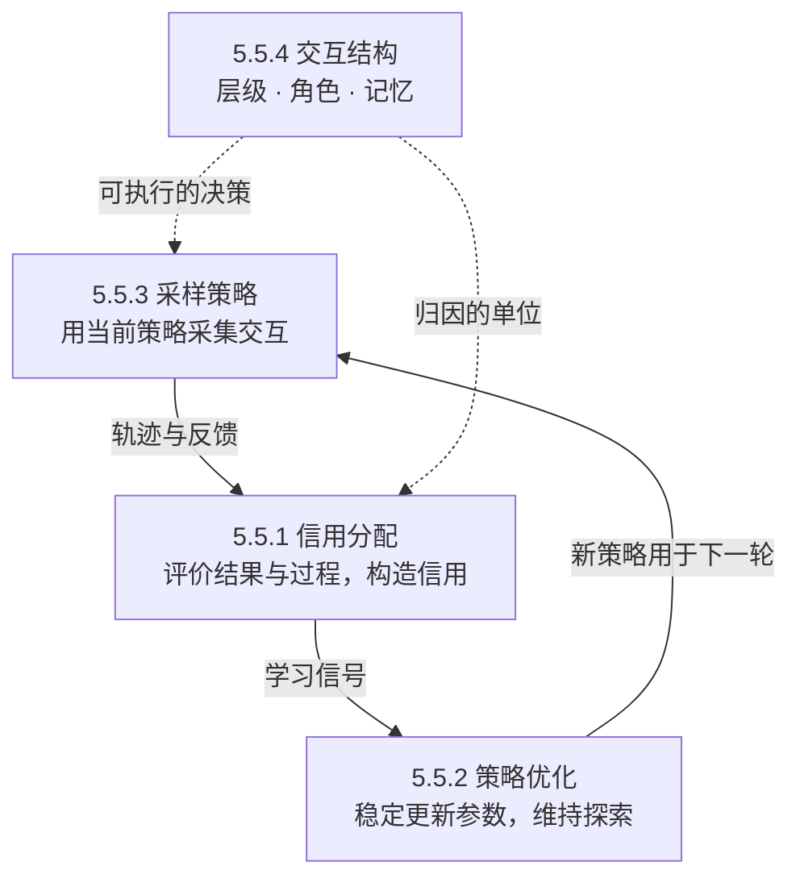

# Agentic Reinforcement Learning

**Agentic RL 用交互反馈优化行动策略，让学习目标从单次回答扩展到多轮决策及其长期后果。** §5.5 的四个小节分别讨论评价与归因、参数更新、经验采样和交互结构；它们是可组合的设计维度。[[raw/surveys/Towards Long-Horizon Agents.pdf#page=47|S001 · §5.5、Fig.12 · pp.47–48]]

## 在 Model Optimization 中的位置

沿第 5 章“能力内化”的主线，§5.5 可理解为**后训练中的交互式策略优化**。关键变化是：示范教模型怎样行动，在线交互训练还让它从**自己行动造成的状态**中学习，包括错误、工具反馈与恢复。章节顺序是组织框架，不要求每个系统依次完成所有阶段。[[raw/surveys/Towards Long-Horizon Agents.pdf#page=37|S001 · §5 · p.37]] [[raw/surveys/Towards Long-Horizon Agents.pdf#page=47|§5.4 结尾、§5.5 · pp.47–48]]

| 相邻部分 | 为 §5.5 提供什么／与它怎样配合 |
| --- | --- |
| §5.1 [[wiki/optimization/architecture\|架构]]、§5.2 [[wiki/optimization/data-environments\|数据与环境]] | 前者支撑长历史的表示与计算，后者提供任务、交互场景和反馈条件；贯穿训练过程 |
| §5.3 [[wiki/optimization/pretraining\|预／中期训练]]、§5.4 [[wiki/optimization/finetuning\|微调]] | 建立基础能力和交互行为，可提供 RL 初始策略；SFT 不是所有 RL 方法的必经步骤 |
| §5.6 [[wiki/optimization/distillation\|On-Policy Distillation]] | 在学生自己到达的状态上补充监督，可与 RL 配合，缓解仅靠稀疏结果奖励的困难 |
| §5.7 [[wiki/optimization/self-evolution\|自我演化]] | 将新经验、反馈及任务—环境更新组织成持续改进循环 |

表为本库按章节分工归纳；OPD 的边界另见 [[raw/surveys/Towards Long-Horizon Agents.pdf#page=52|S001 · §5.6 · p.52]]。本节的总体作用，是把已有能力训练成更能处理**延迟收益、累积错误与恢复**的策略；效果仍取决于经验覆盖、反馈质量、更新稳定性和交互条件。

## 四个维度怎样连成训练闭环

**策略（policy）**是在当前任务、历史和观察下选择下一步行动的方式；**rollout** 是运行策略得到的一段交互轨迹。下图按训练依赖重组四个维度：实线传递经验与学习信号，虚线表示交互结构对采样和归因的约束。

*本库教学示意，依据 [[raw/surveys/Towards Long-Horizon Agents.pdf#page=47|S001 · Fig.12、§5.5 · pp.47–52]]；不是原图，也不是所有方法的统一流水线。交互结构在训练中持续起作用，具体方法可能复用经验或只训练局部决策。*

## 5.5.1 信用分配：哪些决策值得强化

长任务最终成功，途中仍可能包含错误和冗余。信用分配要让反馈对应到有意义的决策单位；**得到一个分数与识别某个动作的长期贡献，是两件不同的事。**

| 视角 | 评价什么、怎样做 | 关键边界 |
| --- | --- | --- |
| **Outcome Credit** 结果信用 | 根据最终答案、任务成功或测试结果给分 | 可验证时便于规模化；仍可训练早期动作，但终局分数难以直接区分局部好坏 |
| **Process Credit** 过程信用 | 一条路线拆分单次决策质量，如工具与参数；另一条沿交互过程引入查询质量、成本、步骤价值等信号 | 过程信息可汇总为轨迹奖励，也可形成 step／turn 信号；不必每步都有独立即时奖励 |
| **Rubric Credit** 准则信用 | 用事实准确、完整性、证据支撑等显式标准表达质量 | 准则质量、判分偏差、权重与奖励投机仍影响信号 |

以上为综述分类。[[raw/surveys/Towards Long-Horizon Agents.pdf#page=48|S001 · §5.5.1 · pp.48–50]] **本库辨析：Outcome／Process 区分评价对象，Rubric 描述评价标准，因而可以交叉组合。** Rubric 规定“按什么评”，judge／reward model／verifier 执行评价；相关运行接口见 [[wiki/harness/verification|验证]]。

Rubric 还有两个独立设计轴：**来源**可以是专家／强模型编写、偏好对比归纳或上下文动态生成；**用途**可以是直接奖励、训练评分器，或在 rollout 时引导探索。写清准则不会自动解决信用归因。[[raw/surveys/Towards Long-Horizon Agents.pdf#page=48|S001 · Rubric Credit Assignment · pp.48、50]]

## 5.5.2 策略优化：怎样把信号写入参数

**优势（advantage）**可理解为相对某个基准的表现增量；基准与估计方法因算法而异。策略优化利用这类信号调整行动概率，三个分支各控制一个问题。[[raw/surveys/Towards Long-Horizon Agents.pdf#page=50|S001 · §5.5.2 · p.50]]

| 分支 | 要解决的问题 | 主要手段 |
| --- | --- | --- |
| **Clipping-based** 裁剪式优化 | 长轨迹、稀疏奖励和噪声统计使更新不稳 | 调整裁剪、归一化、估计单位或目标，控制策略漂移与估计偏差 |
| **Turn-level** 按轮次优化 | 整条轨迹的信号太粗，难区分局部选择 | 将优势对齐 segment、step、turn、子目标或分支，并构造局部比较组 |
| **Entropy-based** 熵与探索控制 | 过早强化少数成功路径，后续尝试趋同 | 控制概率集中程度、维持适当熵，或在关键位置增加分支 |

**长期目标与局部更新可以并存**：仍优化完整任务表现，但将信用落实到更细的决策。三类手段也可组合，分别关心更新稳定性、优化粒度与探索持续性；信用估计和采样会参与其中，不是互斥算法清单。[[raw/surveys/Towards Long-Horizon Agents.pdf#page=50|S001 · §5.5.2 · p.50]]

## 5.5.3 采样策略：哪些经验有机会被学到

三个分支对应**采样单位、样本组织、预算分配**，可叠加使用。[[raw/surveys/Towards Long-Horizon Agents.pdf#page=50|S001 · §5.5.3 · pp.50–51]]

| 分支 | 改变什么 | 与信用分配的关系 |
| --- | --- | --- |
| **Trajectory-level Rollout** 多轮轨迹 | 连续采集行动—观察—后续行动；早期选择会改变以后到达的状态 | 提供长期结果与过程的联系 |
| **Tree-structured Sampling** 树采样 | 共享前缀、扩展不同后续，减少重复并增加分支差异 | 为局部比较提供材料；能否公平比较还取决于状态恢复与接续条件 |
| **Budget-aware / Pruning** 预算与筛选 | 复用经验、按难度／通过率筛选、调节轨迹深度，或动态分配分支预算 | 决定有限 token、工具调用和环境执行成本花在哪里，也改变训练分布 |

树结构也可用于当次推理；这里关注它如何生成**用于参数更新**的经验。综述把熵引导分支同时放在探索控制与预算采样中，说明同一机制可跨维度；共享前缀也不自动保证因果归因，具体比较见下文。[[raw/surveys/Towards Long-Horizon Agents.pdf#page=50|S001 · §5.5.2–5.5.3 · pp.50–51]]

## 5.5.4 交互结构：把哪些选择变成学习对象

| 方向 | 可学习的决策结构 | 增加的难点 |
| --- | --- | --- |
| **Hierarchical** 层级 | 高层设子目标、低层执行；或从经历中形成、选择与复用技能。一个子目标覆盖多个动作，即时间抽象 | 子目标边界与高低层信用怎样对齐 |
| **Multi-agent** 多角色 | 优化多个角色的联合决策，包括协作、自博弈与辩论 | 共享奖励归因、联合动作空间扩大、其他角色同步学习带来的非平稳性 |
| **Memory-state Learning** 状态管理 | 学习记忆编辑、工作流选择与经验组织；也包括把既有工作流接成可训练样本的系统路线 | 当前写入会改变未来可用信息，反馈依赖后续策略怎样使用它 |

以上依据 [[raw/surveys/Towards Long-Horizon Agents.pdf#page=51|S001 · §5.5.4 · pp.51–52]]。**本库辨析：层级强调抽象尺度，多角色强调联合决策，记忆学习强调状态管理；三者可组合，多个角色也可以共享模型参数。**

与前文的分工是：[[wiki/optimization/architecture|§5.1 架构]]支撑历史的表示与读取；[[wiki/harness/Overview|第 4 章 Harness]]组织运行规则；§5.5.4 研究如何通过反馈改善其中的决策。**运行时改写记忆不等于实时更新参数**，只有把相关行为接入训练目标，才构成此处的策略学习。[[raw/surveys/Towards Long-Horizon Agents.pdf#page=37|S001 · §5.1 · pp.37–38]] [[raw/surveys/Towards Long-Horizon Agents.pdf#page=52|§5.5.4 · Memory-state Learning · p.52]]

> [!example] 用修复任务串起来（教学情境，非论文实验）
> 策略先定位、修改，再根据测试反馈重试；采样决定允许走多远、在哪里尝试不同修法；信用分配结合最终测试与过程信息评价；优化器据此更新策略。若再训练“何时转交角色、何时整理已排除的假设”，交互结构中的选择也成为学习对象。**最终测试通过，仍不能证明途中每次搜索和修改都值得强化。**

## 推理模型RL与Agentic RL：沿交互条件比较

这里比较的是训练设定，不是两个互斥的模型种类。R1与Search-R1可共享GRPO等优化思路，但后者在rollout内接收检索观察、继续行动；长推理链本身不等于多轮环境交互。下表为本库依据两篇原文的概念比较。[[raw/papers/optimization/reinforcement-learning/DeepSeek-R1.pdf#page=3|S077 · §2、§6 · pp.3–4、10–11]] [[raw/papers/optimization/reinforcement-learning/Search-R1.pdf#page=4|S051 · §3 · pp.4–6]]

| 比较维度 | 以R1为例的推理RL | 以Search-R1为例的交互RL |
| --- | --- | --- |
| 采样对象 | 题目条件下的推理与答案序列 | 查询、检索观察、继续推理与回答交替的轨迹 |
| 后续输入 | 主要由已生成前缀继续扩展 | 还包含行动取得的外部观察；有状态工具更会改变外部状态 |
| 训练信号 | 正确性／格式等规则奖励；正式R1另有偏好奖励 | 本文仅最终答案EM；Agentic RL整体还可采用过程／准则信号 |
| 成本与评价 | 生成与验证成本，采样／选择口径 | 另外登记工具执行、环境条件及整任务预算 |

这不是“推理RL只看答案、Agentic RL必有过程奖励”的划分，也不能把R1的软件任务分数当端到端交互RL训练证据：其SWE评测使用Agentless，作者保留工具使用和软件工程RL规模限制。[[raw/papers/optimization/reinforcement-learning/DeepSeek-R1.pdf#page=11|S077 · §6 · p.11]] [[raw/papers/optimization/reinforcement-learning/DeepSeek-R1.pdf#page=40|D.1 · p.40]]

**能力与训练分工须分开测。** [[wiki/papers/optimization/reinforcement-learning/RL-Reasoning-Capacity|S078]]把单次成功概率与有限采样覆盖分开；其结果不能升级成底座的普遍上界。[[wiki/papers/optimization/finetuning/Reasoning-SFT-Generalization|S079]]又说明所测推理SFT能否泛化取决于数据、优化和底座，未匹配总计算的SFT–RL比较不构成普遍排序。原始条件见 [[raw/papers/optimization/reinforcement-learning/RL-Reasoning-Capacity.pdf#page=5|S078 §2.2、C.5 · pp.5、23]]、[[raw/papers/optimization/finetuning/Reasoning-SFT-Generalization.pdf#page=10|S079 §8 · p.10]]。

希望从总览进入RL，可接 [[wiki/optimization/Questions#从综述自然引出的三个RL问题|三个自然问题]] 与 [[wiki/optimization/Questions#六个适合与学长讨论的宏观问题|六个宏观问题]]；以下保留原有机制比较，供需要时下钻。

## 已读论文：训练状态与归因条件

### 先确认训练中是谁产生状态，谁提供反馈

**本库比较轴：**同样使用PPO/GRPO，可能学习当前策略的完整交互，也可能学习固定历史上的单步回复，或学习记忆模块；奖励稠密程度必须与这些条件一起看。

| 决策与训练状态 | 反馈来源和信用单位 | 必须保留的条件 |
| --- | --- | --- |
| 当前策略生成搜索词，检索结果追加进历史，再搜索或回答 | Search-R1用最终答案EM；PPO用critic/GAE，GRPO比较同题完整rollout | 检索token是观察，进入上下文但排除策略梯度和GRPO KL；主要为固定Wiki/E5、4动作。[[wiki/papers/optimization/reinforcement-learning/Search-R1\|S051]]；[[raw/papers/optimization/reinforcement-learning/Search-R1.pdf#page=4\|§3.1–3.4 · pp.4–6]]、[[raw/papers/optimization/reinforcement-learning/Search-R1.pdf#page=16\|Appendix B.2 · p.16]] |
| 给定历史下生成下一步工具调用 | ToolRL按标准调用的工具名、参数名和值给部分匹配分，再合成回复级reward | **训练多步数据拆成带历史单步实例**，需要每步标准调用；不是完整在线轨迹探索。[[wiki/papers/optimization/reinforcement-learning/ToolRL\|S052]]；[[raw/papers/optimization/reinforcement-learning/ToolRL.pdf#page=4\|§2.3 · p.4]]、[[raw/papers/optimization/reinforcement-learning/ToolRL.pdf#page=5\|§3.1 · p.5]] |
| 同任务、同初态采完整轨迹，再寻找重复环境状态 | GiGPO同时比较整条总回报和同状态后动作的折扣回报 | 不增rollout，依赖重复覆盖与状态匹配；局部优势不是额外过程标签。[[wiki/papers/optimization/reinforcement-learning/GiGPO\|S053]]；[[raw/papers/optimization/reinforcement-learning/GiGPO.pdf#page=5\|§4.2–4.3 · pp.5–6]] |
| 从多条初始链随机挑中间节点，共享前缀并扩展后缀 | Tree-GRPO比较叶轨迹在本树和同题全部树中的奖励，利用共享节点形成局部更新贡献 | 同时改变采样相关性、独立探索与优势；只测试搜索工具。[[wiki/papers/optimization/reinforcement-learning/Tree-GRPO\|S054]]；[[raw/papers/optimization/reinforcement-learning/Tree-GRPO.pdf#page=4\|§3.1–3.2 · pp.4–5]]、[[raw/papers/optimization/reinforcement-learning/Tree-GRPO.pdf#page=6\|§4.1 · p.6]] |
| 新信息与旧记忆决定编辑操作；问题与检索集合决定回答 | Memory-R1以最终QA EM训练Manager或Answer，另一组件固定 | 分阶段训练；预构造记忆与回答器影响信号；**LongMemEval为oracle版**。[[wiki/papers/optimization/reinforcement-learning/Memory-R1\|S055]]；[[raw/papers/optimization/reinforcement-learning/Memory-R1.pdf#page=4\|§3 · PDF pp.4–5 / 印刷12808–12809]]、[[raw/papers/optimization/reinforcement-learning/Memory-R1.pdf#page=14\|Appendix B · PDF p.14 / 印刷12818]] |

Search-R1和ToolRL说明“有反馈”仍需分清反馈来自哪里：前者最终答案可验证，不直接评价每次查询；后者借助标准调用分解部分正确，但没有证据证明所有等效路径都得到相同奖励。ToolRL的BFCL总体提高与Multi Turn仍低可以并存，不能把调用匹配提升等同于长程可靠完成。更长输出也不是更强能力的统一代理：其长度奖励对多数所测小模型降低BFCL。[[raw/papers/optimization/reinforcement-learning/Search-R1.pdf#page=6|S051 §3.4 · p.6]] [[raw/papers/optimization/reinforcement-learning/ToolRL.pdf#page=4|S052 §2.3 · p.4]] [[raw/papers/optimization/reinforcement-learning/ToolRL.pdf#page=6|Table1 · p.6]] [[raw/papers/optimization/reinforcement-learning/ToolRL.pdf#page=9|Fig.4 · p.9]]

### 局部比较组从哪里来，决定了什么可被区分

GiGPO和Tree-GRPO都从后续结果构造较细信号，却不取得新的逐步正确性oracle。GiGPO在已有rollout中事后聚合相同环境状态；折扣回报让同一成功轨迹中较早绕路与较晚有效动作可被区分，再与episode优势相加。Tree-GRPO主动从共享前缀采新后缀，先为叶轨迹计算树内/跨树优势；共享节点上的梯度贡献把分支结果联系起来。后者的理论是特定二元假设下与step-DPO具有相同梯度结构、权重不同，不能升级为完整算法恒等。[[raw/papers/optimization/reinforcement-learning/GiGPO.pdf#page=5|S053 Eq.5–9 · pp.5–6]] [[raw/papers/optimization/reinforcement-learning/Tree-GRPO.pdf#page=5|S054 Eq.6–12 · pp.5–6]]

两者有不同前提。GiGPO论文在ALFWorld/WebShop使用最近两步历史与当前观察，QA保留全历史并采用相似度分组；因此相同观察不必代表完整policy上下文相同。Tree-GRPO使用根到节点的完整历史接续搜索；这不证明外部有副作用环境可恢复到同一状态。跨环境分支条件见 [[wiki/harness/workflows#分支能否撤回，评价能否被信任|Harness分支接口]]。[[raw/papers/optimization/reinforcement-learning/GiGPO.pdf#page=18|S053 Appendix E.2 · pp.18–19]] [[raw/papers/optimization/reinforcement-learning/Tree-GRPO.pdf#page=4|S054 §3.1 · p.4]]

**S053公开实现补充：**锁定commit `20bd331`后可确认，分组anchor与加入历史、步数等信息的policy输入分别保存；同轨迹重复访问可同组，step均值包括自身，可选只减均值或再除std，合成优势后才进入actor的clip。它支持“分组条件不等于完整策略上下文”的窄判断；若将排序解释成同一决策条件下的动作差异，还需核对组内相关信息，不能反推历史不同就令算法不成立，或已造成有偏/性能损害。当前公开commit未证明等于论文实验版本；具体代码行、实际组样本缺口和进一步实现边界见 [[wiki/papers/optimization/reinforcement-learning/GiGPO#公开实现核查：分组观察与策略输入分别保存|S053唯一页]]。[[raw/code/S053-GiGPO/20bd331bdbc9026a5668e11362178e10ab7400c8/agent_system/environments/env_manager.py|环境管理器 L138–208、390–505]]；[[raw/code/S053-GiGPO/20bd331bdbc9026a5668e11362178e10ab7400c8/gigpo/core_gigpo.py|分组与优势 L153–171、243–384]]；[[raw/code/S053-GiGPO/20bd331bdbc9026a5668e11362178e10ab7400c8/verl/workers/actor/dp_actor.py|actor L365–424]]。

**分开检查采样收益与优势收益。**Tree-GRPO的3B多跳QA消融在名义约4条完整轨迹预算下，链GRPO平均31.8，树仅跨树优势33.8，树内加跨树36.8；小组仅树内优势会collapse。它支持两部分共同作用，不能把总增益全归于精细信用。GiGPO删除episode或step信号均损害所测表现，也不表示任意状态分组都正确。两篇预算口径、匹配误差与具体训练设置留在唯一论文页，不能跨任务排名。[[raw/papers/optimization/reinforcement-learning/Tree-GRPO.pdf#page=10|S054 Table4 · p.10]] [[raw/papers/optimization/reinforcement-learning/GiGPO.pdf#page=9|S053 §5.4、Fig.4 · p.9]]

**同一前缀的反事实何时能成为参照？**综述外补读[[wiki/papers/optimization/reinforcement-learning/C3|S068 C3]]把条件写得更明确：恢复记录前缀后注入替代消息，所得后续消息/奖励分布须等于恢复完整真实状态后的分布。因果相关变量必须能记录并恢复，或按给定前缀的正确条件分布重采样；未恢复的外部副作用、记忆或路由属于隐藏状态，不受保证。满足条件后，冻结本轮行为策略，采独立替代消息并分别继续到终局，再减去其他替代的平均回报，才得到作者所定义的消息级优势估计；非自适应接续次数也是无偏前提。[[raw/papers/optimization/reinforcement-learning/C3.pdf#page=4|S068 §2.3–2.4、Eq.2 · pp.4–5]] [[raw/papers/optimization/reinforcement-learning/C3.pdf#page=16|A.2 · p.16]]

这与GiGPO事后聚合同观察、Tree-GRPO共享前缀采样是不同的比较条件。C3还用不共享rollout的独立接续作参照，检验信用排序；但其2–10决策点诊断主要是冻结数学工作流的**开头决策点**，同每点预算下10点链可靠性仍约0.01。无偏不等于有限预算下排序可靠，也不验证GiGPO组内历史差异已造成损害。训练另有2/3角色数学任务，共享前缀与优势同时变化，MAPPO基线还有长度归一化差异，不能将总收益只归于信用估计。[[raw/papers/optimization/reinforcement-learning/C3.pdf#page=7|Table1 · p.7]] [[raw/papers/optimization/reinforcement-learning/C3.pdf#page=26|B.5 · p.26]] [[raw/papers/optimization/reinforcement-learning/C3.pdf#page=28|B.7 · pp.28–29]] [[raw/papers/optimization/reinforcement-learning/C3.pdf#page=23|B.2–B.4 · pp.23–25]]

### 过程评分怎样进入策略更新

[[wiki/papers/harness/verification/AgentPRM-Xi|S028 AgentPRM-Xi，已完成摄入]] 以环境终局回报与TD/GAE目标训练步骤价值，并约束相邻价值差；这是奖励模型的过程训练。其Qwen2.5-3B在BabyAI/TextCraft上的PPO实验却以**末步PRM预测作为整条轨迹奖励**，不能描述为逐步密集奖励实验。推理阶段另有BoN与beam选择，比较见 [[wiki/harness/verification#选择误差与纠错净收益要分别测量|Harness · 验证]]。过程评分如何产生、何时用于选择、何时发放训练奖励须分别登记；确定性转移/稀疏奖励假设、bootstrap标签与策略分布条件也不会因接入PPO而消失。[[raw/papers/harness/verification/AgentPRM-Xi.pdf#page=6|§3.2–3.3 · pp.6–8]] [[raw/papers/harness/verification/AgentPRM-Xi.pdf#page=11|§5.2 · p.11]] [[raw/papers/harness/verification/AgentPRM-Xi.pdf#page=22|Appendix C · p.22]]

### 记忆写入和使用也能成为训练接口

Memory-R1把运行时可变记忆接到参数学习：Manager输出编辑操作与内容，Answer从60个检索候选中选择证据并回答；训练Manager时Answer冻结，训练Answer时Manager固定。反馈是最终QA EM，而非每条记忆都获正确性标签。冻结另一方减少训练漂移，但本库推断仍须保留回答器依赖：保存了正确事实，也可能因回答器不会使用而得零；对当前QA有效，也未证明对未知未来问题有效。[[raw/papers/optimization/reinforcement-learning/Memory-R1.pdf#page=4|S055 §3 · PDF pp.4–5 / 印刷12808–12809]] [[raw/papers/optimization/reinforcement-learning/Memory-R1.pdf#page=18|Appendix E · PDF p.18 / 印刷12822]]

“152训练QA”不包含基础模型、GPT-4o-mini构造记忆、检索和RL反复采样成本。正文和伪代码对临时记忆的24/50turn及重置过程存在待核查差异；跨集LongMemEval是oracle版本，不能写成完整大记忆库端到端检索迁移。与 [[wiki/harness/memory|Harness记忆机制]] 的联系，是明确哪些信息能进入未来决策；与下述ReSum的联系，是运行状态接口与策略适应训练共同决定效果。[[raw/papers/optimization/reinforcement-learning/Memory-R1.pdf#page=14|S055 Appendix B.2 · PDF p.14 / 印刷12818]] [[raw/papers/optimization/reinforcement-learning/Memory-R1.pdf#page=20|Algorithm5 · PDF p.20 / 印刷12824]]

### 摘要接续怎样进入策略训练

[[wiki/papers/harness/memory/ReSum|ReSum]] 给出一项已核读的跨模块实例：[[wiki/harness/memory|Harness]] 在摘要后把输入重置为“原问题＋摘要”；ReSum-GRPO 则以这些摘要点分段，把最终答案的二值奖励归一化为轨迹级 advantage，广播到该轨迹各段，工具观察不计策略损失。因此运行时状态接口直接决定训练看到的状态和 rollout 结构；广播终局信号不等于识别了每段独立因果贡献。[[raw/papers/harness/memory/ReSum.pdf#page=4|S011 §3.3、Figure 3 · pp.4–5]]

**归因边界：**training-free ReSum 只指现成策略不再训练，默认摘要器 ReSumTool-30B 自身已蒸馏训练。普通 GRPO 与 ReSum-GRPO 虽共享部分超参数，训练工具调用上限却为 40 对 60，且接续改变了可采到的长轨迹；Table 2 的效果不能全部归于 advantage broadcasting。后续比较需同时登记反馈、状态表示、探索机会与预算，而不能仅按算法名排列。[[raw/papers/harness/memory/ReSum.pdf#page=4|S011 §3.2 · p.4]] [[raw/papers/harness/memory/ReSum.pdf#page=15|S011 附录 D.2 · p.15]] [[raw/papers/harness/memory/ReSum.pdf#page=7|S011 Table 2 · p.7]]

### 交互上限怎样改变在线训练

[[wiki/papers/optimization/reinforcement-learning/AgentGym-RL|AgentGym-RL]] 的 ScalingInter 先限制每条在线轨迹的最大轮数，再随训练阶段提高上限。它改变可访问的路径和由当前策略采到的状态，区别于只对固定示范排序，也区别于测试时多试几次。Deep Search 的固定5轮/10轮与渐增轮数曲线支持该设定下的稳定性折中；未匹配全部环境调用/token 的结果，不能把收益只归于课程顺序。[[raw/papers/optimization/reinforcement-learning/AgentGym-RL.pdf#page=9|S041 §3.3 · p.9]] [[raw/papers/optimization/reinforcement-learning/AgentGym-RL.pdf#page=12|§4.2、Fig.7 · p.12]]

这与 ReSum 的比较共同提出一个归因要求：**状态接口、探索机会与更新算法须分别记录。** AgentGym-RL 的主实验在数字环境中按环境训练，作者承认 in-domain 与物理任务边界；其测试 Pass@K 说明候选覆盖，不证明系统能选对一个结果。具体环境筛选见 [[wiki/optimization/data-environments#筛选不只改变质量，也改变能学到的状态|数据分布]]，不能用“无需 SFT”消除基础模型预训练与环境配置成本。[[raw/papers/optimization/reinforcement-learning/AgentGym-RL.pdf#page=16|S041 §5.1 · pp.16–17]] [[raw/papers/optimization/reinforcement-learning/AgentGym-RL.pdf#page=21|§7 · p.21]]

## 论文入口与交叉方向

- [[wiki/papers/harness/memory/ReSum|S011 · ReSum]]：交叉关联；主归属为`harness/memory`。
- [[wiki/papers/optimization/reinforcement-learning/AgentGym-RL|S041 · AgentGym-RL]]：主归属。
- [[wiki/papers/optimization/reinforcement-learning/Search-R1|S051 · Search-R1]]：主归属。
- [[wiki/papers/optimization/reinforcement-learning/ToolRL|S052 · ToolRL]]：主归属。
- [[wiki/papers/optimization/reinforcement-learning/GiGPO|S053 · GiGPO]]：主归属。
- [[wiki/papers/optimization/reinforcement-learning/Tree-GRPO|S054 · Tree-GRPO]]：主归属。
- [[wiki/papers/optimization/reinforcement-learning/Memory-R1|S055 · Memory-R1]]：主归属。
- [[wiki/papers/optimization/reinforcement-learning/C3|S068 · C3]]：主归属。

[[wiki/optimization/Overview|返回模块地图]] · [[maintenance/research/R001|本轮选读理由与维护记录]]。
