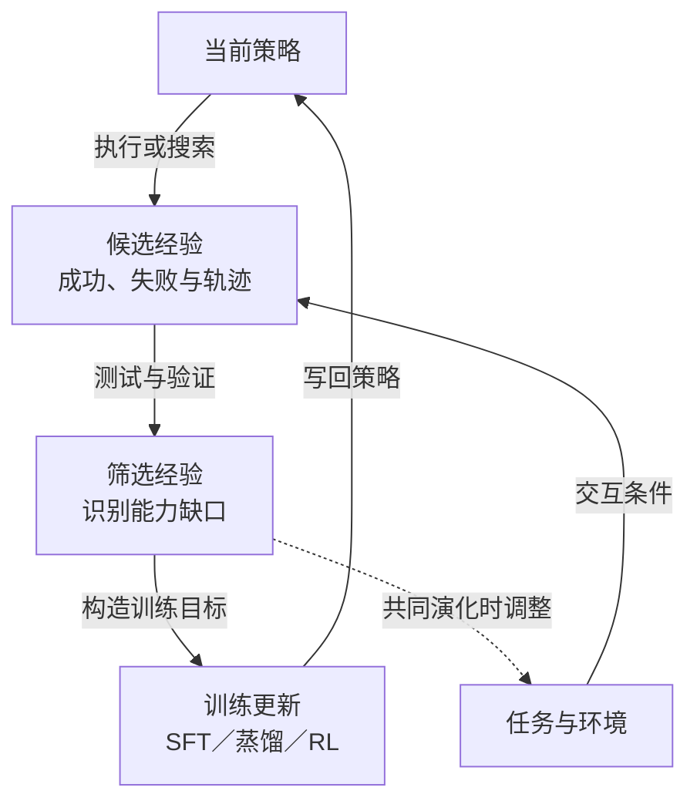

# 自我演化

**S001 第5章的训练式 self-evolution 把自身经验接回训练：当前策略产生尝试与反馈，系统筛选可学的经验、更新策略，再开始下一轮；任务与环境也可以随能力调整。** S001 将其作用概括为“跨任务经验积累”，目标是把本次执行中的成功、失败与恢复，内化为后续任务可用的能力。[[raw/surveys/Towards Long-Horizon Agents.pdf#page=38|S001 · Table 5 · p.38]] [[raw/surveys/Towards Long-Horizon Agents.pdf#page=53|§5.7 · pp.53–55]]

**固定权重也可以发生系统层的持久演化。** 新摄入的 [[wiki/papers/optimization/self-evolution/RRSI|S081 RRSI]] 更新提示、控制流、工具等外部 harness，模型 policy 保持冻结。本页保留上半部分的训练管线定位，并在原论文比较中加入这条外部更新轴；“自我演化”需要说明留下的是权重、任务分布还是程序修改，不能仅由名称推定训练发生。[[raw/papers/optimization/self-evolution/RRSI.pdf#page=3|S081 · §2–3 · pp.3–6]]

## 在 Model Optimization 中的位置

第 5 章以架构支撑长历史处理，以数据／环境合成提供经验，以预训练／中期训练建立基础能力，再讨论 SFT、RL、OPD 等学习方式。**§5.7 把这条训练管线闭合起来：模型的表现反过来影响下一轮经验生产。** 图 11 将它画在管线下方，回连数据与环境合成；它虽列在最后，却也适用于冷启动，不要求先依次完成前面所有训练环节。[[raw/surveys/Towards Long-Horizon Agents.pdf#page=37|S001 · §5 总览 · p.37]] [[raw/surveys/Towards Long-Horizon Agents.pdf#page=39|Fig.11 · p.39]] [[raw/surveys/Towards Long-Horizon Agents.pdf#page=54|§5.7.1 · p.54]]

**本库关系归纳：**[[wiki/optimization/data-environments|§5.2]] 解释经验怎样构造；[[wiki/optimization/finetuning|SFT]]、[[wiki/optimization/reinforcement-learning|RL]]、[[wiki/optimization/distillation|OPD]] 可承担每轮学习；自我演化组织这些环节跨轮衔接。不能把它们简单分成“静态数据／动态数据”：§5.2 已包含适应性课程，OPD 也会随学生轨迹生成监督；与 OPD 的交叉见[[wiki/optimization/self-evolution#OPD与自我演化可以处在同一个循环|后文原论文比较]]。[[raw/surveys/Towards Long-Horizon Agents.pdf#page=40|S001 · §5.2.1 · pp.40–41]] [[raw/surveys/Towards Long-Horizon Agents.pdf#page=53|§5.6.1–5.7 · pp.53–54]]

## 共同闭环：经验怎样变成能力

*本库依据 §5.7 与 Fig.13 重组的训练式机制示意；实线是经验回写循环，虚线是共同演化增加的调整路径，不规定具体更新频率。此图的训练更新节点不覆盖 RRSI 这类固定权重的 harness 搜索。验证可以使用外部测试、教师或奖励模型，“self”不代表正确性由模型独立保证。* [[raw/surveys/Towards Long-Horizon Agents.pdf#page=54|S001 · §5.7.1、Fig.13 · pp.54–55]]

## 三种形式：组织方式与更新对象

下表概括综述的三节；**前两项主要区分经验与更新怎样组织，第三项进一步扩展更新对象**，这一关系是本库归纳。它们可以组合，不是三个必经阶段。[[raw/surveys/Towards Long-Horizon Agents.pdf#page=54|S001 · §5.7.1–5.7.3 · pp.54–55]]

| 形式 | 核心机制与作用 | 主要限制 |
| --- | --- | --- |
| **§5.7.1 离线自演化**（Offline） | 生成 → 筛选 → 训练；先将经验整理为可审计、去噪、重标注的数据，再做更新。适合冷启动与能力巩固，也可迭代多轮。 | 候选仍受现有策略分布限制，可能反复强化已知行为。 |
| **§5.7.2 在线自演化**（Online） | 经验收集与策略更新交替，使训练接触当前策略自己走到的状态，包括工具副作用与恢复尝试。 | 长轨迹放大奖励延迟、信用误差、验证器漏洞和探索成本。 |
| **§5.7.3 Agent–环境共同演化**（Co-evolution） | 随能力调整任务、环境或交互伙伴，使下一轮挑战既有学习价值，又能提供可用反馈。 | 动态课程也可能强化错误能力；难度上升不等于能力进步。 |

三个小节内部又各有侧重：

- **离线：把搜索和失败变成训练资产。** 可保留成功轨迹、有信息量的失败和可修正片段，再转成 SFT、蒸馏、偏好优化或离线 RL 的目标。“利用失败”不等于把错误动作当正确示范；自举依赖尝试、筛选与学习共同作用。[[raw/surveys/Towards Long-Horizon Agents.pdf#page=54|S001 · §5.7.1 · p.54]]
- **在线：既可在环境中持续采样，也可自己制造挑战。** 前者由 rollout、反馈与 RL 衔接；后者通过 self-play、challenger–solver 等结构产生任务和训练信号。Agent0 被综述放在本节，同时更新课程与执行者，正说明它与共同演化有交叉。“在线”描述收集与更新的组织方式，不规定必须在服务用户时逐动作改权重。[[raw/surveys/Towards Long-Horizon Agents.pdf#page=55|S001 · §5.7.2 · p.55]]
- **共同演化：训练世界也能调整。** 可以调任务／环境难度和反馈、发现环境—任务组合；多 Agent 中还可共同更新其他策略，或学习课程设计策略。目标是跟随**可学习的能力边界**，而非一味出更难的题。[[raw/surveys/Towards Long-Horizon Agents.pdf#page=55|S001 · §5.7.3 · p.55]]

**教学例子：**代码 Agent 改错文件后出现的新报错，是它自身行为造成的困难状态，可成为在线训练经验；将失败与修复整理成训练对，是离线经验加工；根据这些薄弱点调整下一轮仓库任务，才是任务分布的适应性变化。一次任务内的状态转移，本身不等于环境共同演化。

## 总体意义与边界

对长程 Agent，这个闭环连接了**实际执行中的困难状态、跨任务的能力内化和不断移动的学习边界**。外部记忆、技能库与工作流记录可先保存经验；其中稳定模式经微调、蒸馏、RL 或可训练模块吸收后，才进入本节的训练式自我演化。更广义的外部演化见 [[wiki/frontier/Overview|Frontier]]。[[raw/surveys/Towards Long-Horizon Agents.pdf#page=55|S001 · §5.7 小结 · p.55]]

**闭环不保证持续进步。** 综述指出自生成数据可能收缩分布、弱验证器可能诱导奖励投机，因此主张结合离线审计、在线探索和过程反馈。下文保留原论文对真值锚点、更新对象和有限轮次收益的核查；这些条件决定“循环在运行”是否真的转化为能力增长。[[raw/surveys/Towards Long-Horizon Agents.pdf#page=55|S001 · §5.7 小结 · p.55]]

## 原论文比较与证据边界

### 循环中究竟更新了什么

“自己生成训练材料”与“自己确定正确性”是两条轴。下面比较已核读论文的更新对象及外部信息来源。

| 方法 | 循环改变什么 | 正确性或质量锚点 |
| --- | --- | --- |
| [[wiki/papers/optimization/self-evolution/STaR\|S061 STaR]] | 固定题目上重生成推理过程，再从初始base权重SFT | 已知正确答案筛选；失败题生成时额外提示答案；少量人工推理示例。[[raw/papers/optimization/self-evolution/STaR.pdf#page=4\|§3.2、Algorithm 1 · p.4]] |
| [[wiki/papers/optimization/self-evolution/rStar-Math\|S062 rStar-Math]] | 固定题库上更新MCTS数据、策略和PPM；难题追加搜索预算 | 带答案题库、代码执行、终局标签；GPT-4参与合成题，236B模型启动首轮。[[raw/papers/optimization/self-evolution/rStar-Math.pdf#page=5\|§3.2–3.3 · pp.5–6]] |
| [[wiki/papers/optimization/self-evolution/R-Zero\|S063 R-Zero]] | 交替更新Challenger和Solver，任务分布随能力变化 | Solver多数票生成伪标签；一致率用于难度和过滤；无独立训练真值。[[raw/papers/optimization/self-evolution/R-Zero.pdf#page=3\|§2.2–2.4 · pp.3–4]] |
| [[wiki/papers/optimization/self-evolution/Agent0\|S064 Agent0]] | 更新课程Agent及工具executor；ADPO依一致率调整更新 | 代码返回值提供外部计算反馈，最终训练标签仍是多数票；出题还奖励工具调用。[[raw/papers/optimization/self-evolution/Agent0.pdf#page=4\|§3.2–3.3 · pp.4–6]] |
| [[wiki/papers/optimization/self-evolution/Environment-Tuning\|S065 Environment-Tuning]] | 人工四阶段切换数据、反馈和奖励，同时更新agent；半自动改写错误提示 | 任务目标状态/期望返回值；人工提示样例；反馈Judge可见参考调用。[[raw/papers/optimization/self-evolution/Environment-Tuning.pdf#page=5\|§3.2–3.4 · pp.5–6]]、[[raw/papers/optimization/self-evolution/Environment-Tuning.pdf#page=17\|附录B–C · pp.17–19]] |
| [[wiki/papers/optimization/self-evolution/R-Quest\|S069 R-Quest，完成摄入]] | 用有效性和批内任务新颖度反馈更新Questioner，再用筛选后的众数伪标签训练Solver | 外部模型与人工复核初始化；每轮10%标注数据回放；循环内Solver判有效、冻结base判新颖。后续不新增强模型调用，不等于没有外部监督。[[raw/papers/optimization/self-evolution/R-Quest.pdf#page=14\|A.1–A.2 · pp.14–16]]、[[raw/papers/optimization/self-evolution/R-Quest.pdf#page=19\|C.2 · p.19]] |

**本库综合：**零新增训练题不等于零知识，自己生成轨迹不等于没有外部监督。STaR保留真实答案；rStar-Math摘要的“without distillation from superior models”必须和其大模型启动、合成题依赖一起理解。R-Zero撤去题库标签以后，匹配伪标签只证明自一致，不能当作真值正确；Agent0的Python反馈改善计算条件，但没有自动把众数变成独立oracle。[[raw/papers/optimization/self-evolution/STaR.pdf#page=3|§3.1 · pp.3–4]] [[raw/papers/optimization/self-evolution/rStar-Math.pdf#page=5|§3.3 · p.5]] [[raw/papers/optimization/self-evolution/R-Zero.pdf#page=4|§2.3–2.4 · p.4]] [[raw/papers/optimization/self-evolution/Agent0.pdf#page=5|§3.3.1 · p.5]]

[[wiki/papers/optimization/finetuning/Agent-R|S050 Agent-R，已完成摄入，应用未测]]提供已核读的迭代SFT实例：更新actor后重新采集MCTS轨迹，同时提高筛选门槛，再监督学习修复后续。它说明更新目标与经验刷新频率应分开登记；策略、采样数据、门槛和训练量同时变化，不能把结果只归因于“自我反思”。具体恢复条件和实现材料缺口见 [[wiki/optimization/finetuning#学到修订行为以后，环境是否能继续|微调的恢复边界]]。[[raw/papers/optimization/finetuning/Agent-R.pdf#page=7|§3.2–4.2 · pp.7–9]]

### 固定模型时，经验也可能写成外部程序

[[wiki/papers/optimization/self-evolution/RRSI|RRSI]] 让当前 harness 在固定 evolve 集上产生轨迹，提出源代码修改，再依据成绩与成本决定保留哪些修改。它与 STaR 的推理数据→参数学习、Agent0 的课程／执行者共同训练有相同的外层反馈结构，但持久更新对象不同。**本库比较：**任务内依据报错改变下一动作，只表明反馈适应；把测过的流程修改保存供后续任务使用，才进入这里讨论的跨轮外部演化。[[raw/papers/optimization/self-evolution/RRSI.pdf#page=3|S081 · §2–3 · pp.3–6]] [[raw/papers/optimization/self-evolution/STaR.pdf#page=3|S061 · §3 · pp.3–4]] [[raw/papers/optimization/self-evolution/Agent0.pdf#page=3|S064 · §3 · pp.3–5]]

这也补充了闭环失稳的另一来源：即便不产生伪标签、不改权重，反复复用同一批评分仍可能把 benchmark 特化、随机高分或资源膨胀写成永久状态。RRSI 对提案数量／方向、diff 筛查、准入底线／成本与剪枝做联合约束；办公场景消融中，去掉任一组约束出现 evolve 分上升而 OOD 平均下降。它支持在所测条件下控制搜索过程的价值，尚不能识别每个部件的独立因果贡献，也没有证明无限轮稳定。[[raw/papers/optimization/self-evolution/RRSI.pdf#page=5|S081 · §3.2–3.3 · pp.5–6]] [[raw/papers/optimization/self-evolution/RRSI.pdf#page=9|Table 2 · p.9]] [[raw/papers/optimization/self-evolution/RRSI.pdf#page=11|Limitations · p.11]]

完整机制、与 STaR／Agent0 的对照及报告歧义放在 [[wiki/papers/optimization/self-evolution/RRSI|唯一论文页]]。跨套件成绩不能与数学推理训练结果排列高低；最终 harness 的运行 token 与外层搜索成本也须分开。

### OPD与自我演化可以处在同一个循环

**修订S001分类边界。** S001 §5.6用“固定任务/环境、只加密监督”区别OPD与自我演化；这可描述某些单轮训练设置，不能作为互斥论文分类。[[wiki/papers/optimization/distillation/Pi-Play|S059 π-Play]]在内层学生rollout上做特权蒸馏，外层examiner又随学生能力更新题目课程，教师以EMA跟随学生，且学生保留GRPO终局奖励。因此应分别记录任务分布、学生策略和教师目标的更新频率。[[raw/surveys/Towards Long-Horizon Agents.pdf#page=52|S001 §5.6 · p.52]] [[raw/papers/optimization/distillation/Pi-Play.pdf#page=4|S059 §2.2–2.5 · pp.4–5]]

QCP来自检索支持的出题过程，仅教师可见；“无需外部训练数据”仍依赖预训练模型、Wikipedia和搜索接口，不等于没有外部知识。SD-Zero则展示固定题集上把改进学生同步成下一轮修订教师的另一种循环，尚未因此证明长期任务分布扩展。两者都提供更新对象的具体实例，不能由有限轮次结果宣布持续自我演化已解决。[[raw/papers/optimization/distillation/Pi-Play.pdf#page=6|S059 §3.1–3.3 · pp.6–7]] [[raw/papers/optimization/distillation/Self-Distillation-Zero.pdf#page=7|S060 §3.4 · pp.7–8]]

### 真实执行、训练辅助和循环轮数分别核对

STaR的长推理与rStar-Math的数学树搜索，不直接证明开放环境中的持续行动。rStar-Math还区分单轨迹策略与PPM选择后的搜索结果；同叫Pass@1也可能已经用了多条候选路径，训练轮次又伴随搜索预算扩大。Agent0确实把Python返回值接回上下文，但主要证据是数学/一般推理评测及三轮共演化，不能直接外推为跨会话工具任务或永久自改进。[[raw/papers/optimization/self-evolution/rStar-Math.pdf#page=6|S062 §4.1 · pp.6–7]] [[raw/papers/optimization/self-evolution/rStar-Math.pdf#page=14|Tables 9–10 · p.14]] [[raw/papers/optimization/self-evolution/Agent0.pdf#page=5|S064 §3.3.1 · p.5]] [[raw/papers/optimization/self-evolution/Agent0.pdf#page=8|Figure 4 · p.8]]

Environment-Tuning提供真实有状态API训练的另一轴：先让报错透露工具约束/前置依赖，末阶段再撤掉提示，对齐标准环境。它与AgentGym-RL改变可访问交互深度不同，也不是学习一个自主出题的环境策略。其进展奖励按**用户turn**检查目标状态与返回值，再聚合为轨迹奖励；比终局全对/全错更密，不等于工具步骤的独立因果信用。训练额外信息、原有奖励真值及撤除后的迁移必须一起登记。[[raw/papers/optimization/self-evolution/Environment-Tuning.pdf#page=5|S065 §3.2–3.4 · pp.5–6]] [[raw/papers/optimization/self-evolution/Environment-Tuning.pdf#page=18|附录C/D.2 · pp.18–20]] [[raw/papers/optimization/reinforcement-learning/AgentGym-RL.pdf#page=9|S041 §3.3 · p.9]]

### 持续进步是待检验属性，不是循环名称

R-Zero原文已经观察到多轮后性能回落；以外部模型作诊断参考时，伪标签质量也随迭代下降，但作者没有证明噪声是唯一原因。STaR的多数票标签消融明显弱于真实答案版本，而Agent0仅报告三轮收益；这些证据共同要求把**任务多样性、伪标签可靠性、外部成绩和计算预算**分开监测。不能用一致率提高、题目变难或工具次数变多替代真实能力改善。[[raw/papers/optimization/self-evolution/R-Zero.pdf#page=7|S063 §4.2–4.4、Figure 3 · pp.7–9]] [[raw/papers/optimization/self-evolution/R-Zero.pdf#page=17|附录E · pp.17–18]] [[raw/supplements/S061-STaR/STaR-supplement.pdf#page=15|S061 H.1 · PDF p.15 / 印刷p.28]] [[raw/papers/optimization/self-evolution/Agent0.pdf#page=8|S064 Figure 4、Table 5 · pp.8–9]]

定向补读[[wiki/papers/optimization/self-evolution/R-Quest|S069 R-Quest]]进一步把诊断推进到**题目是否有效、是否反复训练同一练习模式**：它比较保留无效题与替换为修复题的匹配训练，分析BLEU把同类题拆散，并给出有效性/新颖度门控消融。因而坏题和任务重复已有直接研究证据，不能只因原R-Zero未充分分离原因便视为未研究。K从8增至16虽进一步降低题型集中度，数学表现反而下降，说明最低重复率不等于最好课程。[[raw/papers/optimization/self-evolution/R-Quest.pdf#page=3|§2.2、Fig.3–4 · pp.3–4]] [[raw/papers/optimization/self-evolution/R-Quest.pdf#page=7|Table3、§4.3 · pp.7–9]]

其结论仍依赖具体信息来源与预算。validity标签把“无法可靠判断”也映射为INVALID，外部模型诊断不是全体题目的人工真值；初始化与10%标注回放持续提供锚点。每轮同候选题数之外，另有9次有效性回复、过关后10次求解和K次比较，未构成完整同计算量对照。五轮表格按领域分别选最佳checkpoint，十轮改善只在Qwen3-4B数学课程中验证；初始化、回放与门控的完整等预算归因仍未解决。[[raw/papers/optimization/self-evolution/R-Quest.pdf#page=14|A.2 · p.14]] [[raw/papers/optimization/self-evolution/R-Quest.pdf#page=19|C.2–D · pp.19–20]] [[raw/papers/optimization/self-evolution/R-Quest.pdf#page=5|§4.1–4.2、Fig.5 · pp.5–7]]

**当前证据边界：**“自生成即无监督”“代码执行通过即过程正确”“有限轮收益即持续演化”仍是需避免的概念误解。现有材料已经提供失稳诊断与干预，尚未在匹配完整预算、独立真值和长程环境条件下形成充分比较；具体问题状态在共同补充证据的第二轮审查后统一整理。Environment-Tuning的validation/test隔离、Agent0的筛选阈值及各文表文差异保留在唯一论文页，不用不一致数字作结论。

## 论文入口与交叉方向

- [[wiki/papers/optimization/finetuning/Agent-R|S050 · Agent-R]]：交叉关联；主归属为`optimization/finetuning`。
- [[wiki/papers/optimization/distillation/Pi-Play|S059 · Pi-Play]]：交叉关联；主归属为`optimization/distillation`。
- [[wiki/papers/optimization/self-evolution/STaR|S061 · STaR]]：主归属。
- [[wiki/papers/optimization/self-evolution/rStar-Math|S062 · rStar-Math]]：主归属。
- [[wiki/papers/optimization/self-evolution/R-Zero|S063 · R-Zero]]：主归属。
- [[wiki/papers/optimization/self-evolution/Agent0|S064 · Agent0]]：主归属。
- [[wiki/papers/optimization/self-evolution/Environment-Tuning|S065 · Environment-Tuning]]：主归属。
- [[wiki/papers/optimization/self-evolution/R-Quest|S069 · R-Quest]]：主归属。
- [[wiki/papers/optimization/self-evolution/RRSI|S081 · RRSI]]：主归属；固定权重的 harness 演化，交叉关联工作流与验证。

[[wiki/optimization/Overview|返回模块地图]] · [[maintenance/research/R001|本轮选读理由与维护记录]]。
