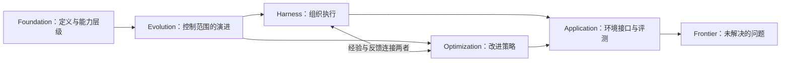

# Long-Horizon Agents：初始知识地图

长程 Agent 要在许多彼此依赖的决策中持续推进一个目标：行动会改变环境，观察会修正计划，先前的约束与状态还要在后续步骤中保持有效。S001 用这种依赖关系界定“长程”，而不是单看运行时间或 token 数。[[raw/surveys/Towards Long-Horizon Agents.pdf#page=7|S001 · §2.1 · pp.7,9]]

本页以 [[wiki/surveys/Towards Long-Horizon Agents|S001 综述]] 为导航起点；Harness 与 Optimization 已加入第一轮64篇核心论文和5篇定向补读的机制比较。下方六视角图仍是综述的组织关系，具体证据支持范围以两个模块及唯一论文页为准，不把全部来源视为支持同一个结论。

## 一条贯穿全库的主线

综述将能力来源分为两个相互耦合的部分：模型策略，以及围绕模型组织执行的运行机制（harness）。前者通过训练改变如何决策，后者安排模型何时调用、能看到哪些状态、能执行哪些动作、怎样验证和恢复。作者主张把二者及其交互作为研究单位。[[raw/surveys/Towards Long-Horizon Agents.pdf#page=9|S001 · §2.1 · Eq.1]]

此图是本库依据 S001 §1（p.6）与 Fig.1（p.4）重绘的阅读关系，不表示经过实验证明的因果链。

## 六个视角怎样互相连接

| 入口 | 当前保留的核心理解 | 与其他页的关系 |
| --- | --- | --- |
| [[wiki/foundations/Formalization\|Foundation]] | 依赖结构与 H1–H3 帮助描述任务要求 | 为技术和评测提供共同问题表述 |
| [[wiki/foundations/Evolution\|Evolution]] | 控制范围从提示、上下文扩展到运行轨迹 | 解释 Harness 与 Optimization 为什么一起讨论 |
| [[wiki/harness/Overview\|Harness]] | 把状态、工具、控制和验证外化到运行系统 | 为训练提供轨迹和反馈，也影响测得的能力 |
| [[wiki/optimization/Overview\|Optimization]] | 从架构、数据到策略更新组织内化路线 | 改变模型对运行机制的依赖及适配方式 |
| [[wiki/applications/Overview\|Application]] | 环境接口决定可观察状态、动作及反馈 | 检查方法在哪类真实任务与条件下成立 |
| [[wiki/frontier/Overview\|Frontier]] | 迁移、环境真实性、预算和可信性仍待研究 | 将分类转成可追问、可核验的问题 |

以上关系是对综述六个问题的归纳，出处为 [[raw/surveys/Towards Long-Horizon Agents.pdf#page=6|S001 · §1 · p.6]]；具体机制和限制在各主题页给出定位。

## 阅读新论文时带着哪些问题

以下是**本库的阅读框架**，依据 S001 的定义（§2.1–2.2）、双主线（§4–5）与评测讨论（§6.6）整理，不是新的实验结论：

1. 任务有哪些跨步骤依赖？是否需要跨上下文保留状态或跨任务复用经验？
2. 实际改变了模型、harness、数据/环境还是评测协议？多个部分同时变化时怎样归因？
3. 方法解决的具体失败是什么，在哪些条件下有对照证据，成本与失败案例是什么？
4. 它支持、限制或反驳了本库哪个已有判断？还有什么必须回到原论文核验？

当前未选定研究方向。候选问题与一处原文表述张力放在 [[wiki/frontier/Overview|前沿页]]；后续用新证据修订这张地图。

## 第一轮研究入口

本轮文献研究已结束。[[wiki/frontier/Overview#第一轮结果与亲读入口|研究结果与亲读路线]]保留问题和跨模块理解；[[maintenance/research/R001|范围、完整选读理由与Git检查点]]单独归档。当前仍未选定最终研究方向。

返回[[wiki/index|索引]]。
