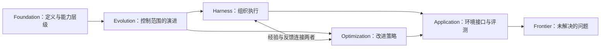

# Long-Horizon Agents：初始知识地图

长程 Agent 要在许多彼此依赖的决策中持续推进一个目标：行动会改变环境，观察会修正计划，先前的约束与状态还要在后续步骤中保持有效。S001 用这种依赖关系界定“长程”，而不是单看运行时间或 token 数。[[raw/papers/Towards Long-Horizon Agents.pdf#page=7|S001 · §2.1 · pp.7,9]]

本页是对 [[wiki/papers/Towards Long-Horizon Agents|S001 综述]] 的初步组织，尚不是多篇独立论文相互支持的共识。

## 一条贯穿全库的主线

综述将能力来源分为两个相互耦合的部分：模型策略，以及围绕模型组织执行的运行机制（harness）。前者通过训练改变如何决策，后者安排模型何时调用、能看到哪些状态、能执行哪些动作、怎样验证和恢复。作者主张把二者及其交互作为研究单位。[[raw/papers/Towards Long-Horizon Agents.pdf#page=9|S001 · §2.1 · Eq.1]]

此图是本库依据 S001 §1（p.6）与 Fig.1（p.4）重绘的阅读关系，不表示经过实验证明的因果链。

## 六个视角怎样互相连接

| 入口 | 当前保留的核心理解 | 与其他页的关系 |
| --- | --- | --- |
| [[wiki/foundations/Formalization\|Foundation]] | 依赖结构与 H1–H3 帮助描述任务要求 | 为技术和评测提供共同问题表述 |
| [[wiki/foundations/Evolution\|Evolution]] | 控制范围从提示、上下文扩展到运行轨迹 | 解释 Harness 与 Optimization 为什么一起讨论 |
| [[wiki/harness/Overview\|Harness]] | 把状态、工具、控制和验证外化到运行系统 | 为训练提供轨迹和反馈，也影响测得的能力 |
| [[wiki/optimization/Overview\|Optimization]] | 从架构、数据到策略更新组织内化路线 | 改变模型对运行机制的依赖及适配方式 |
| [[wiki/applications/Overview\|Application]] | 环境接口决定可观察状态、动作及反馈 | 检查方法在哪类真实任务与条件下成立 |
| [[wiki/frontier/Overview\|Frontier]] | 迁移、环境真实性、预算和可信性仍待研究 | 将分类转成可追问、可核验的问题 |

以上关系是对综述六个问题的归纳，出处为 [[raw/papers/Towards Long-Horizon Agents.pdf#page=6|S001 · §1 · p.6]]；具体机制和限制在各主题页给出定位。

## 阅读新论文时带着哪些问题

以下是**本库的阅读框架**，依据 S001 的定义（§2.1–2.2）、双主线（§4–5）与评测讨论（§6.6）整理，不是新的实验结论：

1. 任务有哪些跨步骤依赖？是否需要跨上下文保留状态或跨任务复用经验？
2. 实际改变了模型、harness、数据/环境还是评测协议？多个部分同时变化时怎样归因？
3. 方法解决的具体失败是什么，在哪些条件下有对照证据，成本与失败案例是什么？
4. 它支持、限制或反驳了本库哪个已有判断？还有什么必须回到原论文核验？

当前未选定研究方向。候选问题与一处原文表述张力放在 [[wiki/frontier/Overview|前沿页]]；后续用新证据修订这张地图。

## 第一轮自主研究

2026-10-25 用户启动，当前为**分批原文核读与整合中**。两个模块已完成综述引用与原始发布页身份初筛：65 个方向名额，去重后 64 篇独立候选，预留 S002–S065；AgentGym-RL 在两个方向复用。候选队列见 [[wiki/harness/Overview#第一轮选读队列|Harness]] 与 [[wiki/optimization/Overview#第一轮选读队列|Optimization]]。目标是建立直接原文支持的机制比较和候选问题，不预先认定研究缺口、不启动实验。

| 范围 | 核心选读 | 定向补读上限 | 组织方式 |
| --- | --- | --- | --- |
| Harness，6 个一级方向 | 每方向约 5 篇，最多 30 个方向名额 | 每方向最多 2 篇，共 12 个名额 | 先内部综合与独立讨论，再与 Optimization 核查联系 |
| Optimization，7 个一级方向 | 每方向约 5 篇，最多 35 个方向名额 | 每方向最多 2 篇，共 14 个名额 | 先内部综合与独立讨论，再与 Harness 核查联系 |

初筛上限每方向 12 篇，合计 156 个方向候选名额；核心最多 65 个、正文含补读最多 91 个名额，跨方向同篇只计一次。当前核心队列为 64 篇独立候选，最终纳入数取决于全文核读。每批候选讨论最多两轮，跨模块修订计入该上限。全文不可得或无足够合适论文时说明减少数量；不以摘要、博客或系统文档冒充论文凑数。

当前可用并发为 4（含总协调者），最多同时 3 个同模型子任务；共享主题、索引、日志与应用操作由主 Agent 安排串行时段。所有写入限本项目，临时材料存被忽略的 `.research-tmp/`。候选/已读待整合/待验收/完成分开记录，所有决定性问题可交独立 subagent 回原文核查。

检查点：`ab4a632` 保存规则与 Git/并发约定，`448bcd9` 保存第一轮范围。选文、验收通过的论文批次、模块综合及最终结果按必要节点本地提交；不自动 push。论文任务只负责所分配文件，不自行 Git 提交。

| 已验收批次 | 来源 | Git 检查点 | 结果 |
| --- | --- | --- | --- |
| Harness · 上下文与记忆 | S007–S011 | `8117bbc` | 5 篇完成摄入，已连接摘要接续与策略训练；Obsidian 应用未测 |
| Optimization · 架构基础 | S032–S036 | `f009c31` | 5 篇完成摄入，区分容量、访问信息、行为证据与效率；Obsidian 应用未测 |
| Harness · 循环与工作流 | S002–S006 | `5f594e4` | 5 篇完成摄入，比较反馈时点、状态保存与可回退前提；Obsidian 应用未测 |
| Harness · 工具、MCP 与技能 | S012–S016 | `32d37d7` | 5 篇完成摄入，区分发现、动作表示、程序复用与环境验收；Obsidian 应用未测 |
| Optimization · 数据与环境合成 | S037–S041 | `4c84f99` | 5 篇完成摄入，比较生成对象、真实执行、标签与训练分布；Obsidian 应用未测 |

本轮结束条件：各方向选读与综合完成，或相应预算/证据可用性达到边界；保留未完成项与原因。交付知识变化、关键机制差异、关闭与保留的问题、反对证据和建议用户亲读的原文位置。实际已纳入数量与阅读状态以 [[wiki/index|索引]] 为准，选文和待验收工作不升级完成状态。

返回 [[wiki/index|索引]]。
