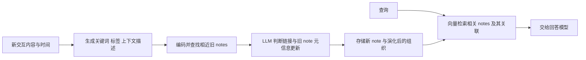

# A-MEM：新记忆如何改变已有记忆的组织

A-MEM 把交互保存成带原始内容、时间、关键词、标签、上下文描述、向量和链接的 note。新 note 不只追加进库，还触发与旧 note 的关联判断和元信息更新；查询时再取回相关 notes。它的直接实验证据主要是长对话问答，不能据名称推成已验证长程行动能力。[[raw/papers/A-MEM.pdf#page=3|S009 · Figure 2、§3 · pp.3–5]] [[raw/papers/A-MEM.pdf#page=6|§4 · pp.6–7]]

## 身份与阅读范围

| 项目 | 登记 |
| --- | --- |
| 标题 | A-MEM: Agentic Memory for LLM Agents |
| 作者 | Wujiang Xu、Zujie Liang、Kai Mei、Hang Gao、Juntao Tan、Yongfeng Zhang |
| 版本 | arXiv:2502.12110v11，2025-10-08；28 页；原始页面标注 NeurIPS 2025 |
| 原始来源 | [arXiv](https://arxiv.org/abs/2502.12110)；[v11 PDF](https://arxiv.org/pdf/2502.12110v11)，访问 2026-10-25 |
| Raw | [[raw/papers/A-MEM.pdf\|A-MEM.pdf]] |
| SHA-256 | `FEC32B521C4A1F793442BF1AEB26139C583078350D1CD4AB8F4ECCC54A0694F0` |
| 实际阅读 | 2026-10-25；正文 pp.2–9，身份/摘要 p.1，附录 pp.17–19 的补充结果、k配置与提示模板；实际查看 p.3 Figure 2、p.6 Table 1、p.7 Table 2/3；其余附录未完整核读，未复现 |
| 综述入口 | S001 §4.2.2 / Table 3，pp.25–26；参考文献 [731]（p.134） |

## 运行机制：组织也会被更新

本库示意，依据 Figure 2、§3。note 的原始内容与模型生成描述是不同字段；描述、关键词和标签参与向量编码，所以对这些字段的更新也可能改变后续检索。链接生成先用向量相似度缩小候选，再由 LLM 判断关系；memory evolution 利用新信息修订相关旧 notes 的描述等元信息。Figure 2 说明取回时也访问链接的相近记忆，而 §3.4 的公式着重描述 top-k 向量取回。[[raw/papers/A-MEM.pdf#page=3|Figure 2 · p.3]] [[raw/papers/A-MEM.pdf#page=4|§3.1–3.3 · pp.4–5]]

这里的 agentic 主要体现在模型参与存储组织与演化决策，仍有 note construction、link generation、memory evolution、retrieval 的既定流程；不能把作者“无需预定义操作”的表述理解为系统不存在预设处理阶段。提示模板明确要求生成 JSON 关键词、上下文与标签。[[raw/papers/A-MEM.pdf#page=19|附录 B.1–B.2 · p.19]]

## 实验条件与结果边界

LoCoMo 评测将长对话转为多跳、时间、开放域、单跳与对抗类问题，主表使用 F1、BLEU-1；DialSim 为更长的多人对话问答。六个主表模型包括 GPT-4o / GPT-4o-mini、Qwen2.5 1.5B/3B、Llama3.2 1B/3B，embedding 使用 all-mini-lm-l6-v2。它测试的是基于历史信息回答问题，不是持续执行外部动作。[[raw/papers/A-MEM.pdf#page=5|§4.1 · pp.5–6]]

必须保留检索预算差异：正文称通常 k=10，但附录 Table 8 对 GPT-4o 与 GPT-4o-mini 的各类问题采用 40 或 50，另一些模型也按类别调整。不能把主表所有结果解释成统一的 k=10 设定。[[raw/papers/A-MEM.pdf#page=6|§4.2 · p.6]] [[raw/papers/A-MEM.pdf#page=18|附录 A.5、Table 8 · p.18]]

Table 1 显示收益依模型与题型变化。例如 GPT-4o-mini 的多跳 F1 为 A-MEM 27.02、MemGPT 26.65；GPT-4o 的单跳 F1 为 A-MEM 48.43、MemGPT 60.16。因此不能采用正文笼统的“复杂多跳至少两倍”作为所有配置的结论，也不能把不同任务上的平均排名当作通用能力顺序。[[raw/papers/A-MEM.pdf#page=6|Table 1、§4.3 · p.6]]

Table 3 在 GPT-4o-mini 上比较去掉链接和演化、仅去掉演化、完整方法，支持这些模块在该问答设定贡献改善；它并未证明所有模型与规模都同样依赖这些模块。DialSim 的完整方法 F1 为 3.45，虽高于相应基线，绝对值仍低，不能由相对增幅声称问题已经解决。[[raw/papers/A-MEM.pdf#page=7|Table 2/3、§4.4 · p.7]]

## 前提、局限与比较问题

作者承认记忆质量依赖底层模型的语言理解与生成，并主要处理文本。t-SNE 展示组织结构差异，但结构看起来更集中本身不是后续任务提升的独立因果证据；后一判断为本库对可视化证据强度的限定。[[raw/papers/A-MEM.pdf#page=9|§5、Limitations · p.9]]

**本库推断：**与只保存完整历史相比，这种系统将模型生成的元信息加入未来检索的入口，错误不仅可能出现在最终回答，也可能出现在写入、关联或演化阶段。**待检验问题：**新交互触发的旧 note 更新，何时修正旧理解，何时扩散错误关联？本次原文没有提供按错误来源拆分的充分证据；不能把尚未查到的消融直接命名为新研究缺口。

## 主题联系与整合状态

已整合到 [[wiki/harness/Overview#上下文与记忆|Harness：上下文与记忆]]，与 [[wiki/papers/MemGPT|MemGPT]] 区分“可执行分层读写”和“notes 的语义组织演化”；比较机制，不直接比较跨版本实现的分数。主题与索引已同步，内容与结构验收通过；Obsidian 未测。
