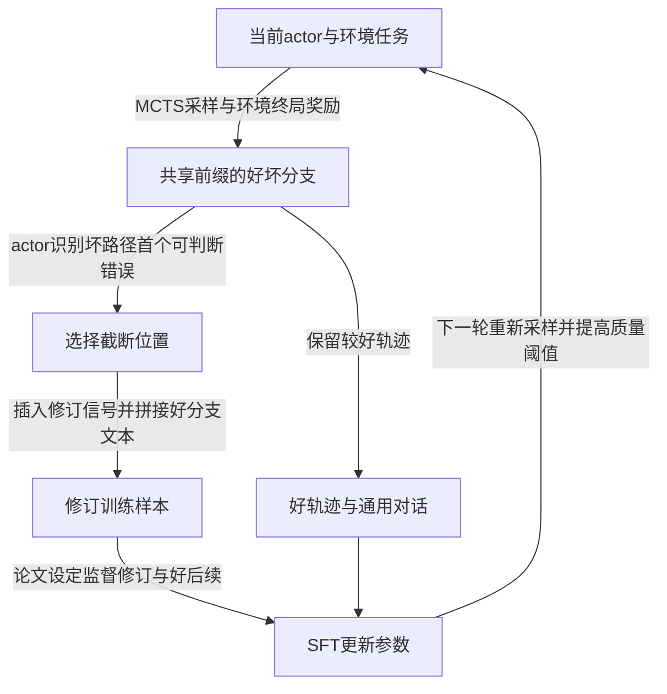

# Agent-R: Training Language Model Agents to Reflect via Iterative Self-Training

## 来源与阅读范围

| 项目 | 记录 |
| --- | --- |
| 来源 ID | S050 |
| 作者 | Siyu Yuan、Zehui Chen、Zhiheng Xi、Junjie Ye、Zhengyin Du、Jiecao Chen |
| 版本 | arXiv:2501.11425v3，提交版本日期2025-03-24；PDF封面另写March 25, 2025，保留差异 |
| 原始入口 | [arXiv固定版本](https://arxiv.org/abs/2501.11425v3)；访问2026-10-25；DOI 10.48550/arXiv.2501.11425 |
| Raw | [[raw/papers/Agent-R.pdf\|本地PDF，共26页]] |
| SHA-256 | `9c405f1e6405c84565af3b2d564121c5f37dcff0892edea674cfdc35850d72c1` |
| 实际阅读 | 2026-10-25；主体pp.1–14，附录A–C pp.21–26，包括提示、轨迹定义、训练设定、恢复/错误案例；看p.5 Fig.2/Eq.3–4、p.7 Eq.6、p.9 Table2、p.11 Table3、p.12 Figs.4–5、pp.21–22定义/提示原页。参考文献未逐条核读；追加核读下述公开代码，未执行代码、未复现实验。 |
| 综述定位 | S001引文789，§5.4.3，PDF p.47；书目p.139 |

以下区分作者方法、经验结果与本库推断。PDF页码与印刷页码相同。

## 问题：只学成功路径，未必会从错误状态恢复

作者关注互动中重复无效动作、偏离目标后继续失败，以及终局才反思太晚的问题。Agent-R 让当前actor通过MCTS生成好/坏路径，判断坏路径上何时需要反思，再构造“失败前缀—修订信号—较好后续”的训练样本；更新后的模型再采下一轮数据。**这是带当前策略采样的迭代SFT，不是固定教师离线蒸馏，也不是直接用奖励做策略梯度RL。** [[raw/papers/Agent-R.pdf#page=2|§1 · pp.2–3]]、[[raw/papers/Agent-R.pdf#page=6|§3.1–3.2 · pp.6–7]]

图为本库机制示意。原文Eq.3/10保留坏分支至截断点，再接好分支从共同前缀后的原后缀；Appendix B明确修订信号本身不改变环境。坏动作却可能已经改变状态，因此 **训练文本拼接不能直接保证好后缀在当前环境可执行**。下面的公开代码核查把采树、构造训练样本和实际恢复执行分开；这一疑点也不能反过来否定论文独立报告的恢复评测。[[raw/papers/Agent-R.pdf#page=5|§3.1、Eq.3–4 · p.5]]、[[raw/papers/Agent-R.pdf#page=21|Appendix B、Eq.10 · p.21]]

## 公开实现核查：三个阶段怎样处理环境状态

**代码观察。** 2026-10-25沿论文p.1官方链接核查，仓库已迁移到[ByteDance-Seed/Agent-R](https://github.com/ByteDance-Seed/Agent-R)，锁定[commit `82fcc1ca7873b460949ed49022146dd988c32e31`](https://github.com/ByteDance-Seed/Agent-R/commit/82fcc1ca7873b460949ed49022146dd988c32e31)。读取README与9个Python文件，重点核读revision构造、MCTS恢复节点和评测执行路径；源码未运行，外部AgentGym服务端、Xtuner训练配置与实际实验日志未核读。这是 **S050补充材料，不新增学术来源**；原始字节、URL与逐文件哈希见本页末尾归档清单。

| 阶段 | 公开代码实际做什么 | 能说明什么 |
| --- | --- | --- |
| MCTS采树 | 每次扩展前reset任务，逐个重放当前节点的既有动作，再执行新动作 | 搜索分支有状态重建路径；依赖reset/重放语义，尚未运行验证 |
| 离线训练样本 | 保留坏节点文本和观察，插入反思`Action: wait`与固定`ok.`，随后复制好节点动作和原观察 | 构造函数没有执行拼接后缀或比较新旧状态；原好分支的观察不是坏状态续做的自动证明 |
| 恢复执行函数 | 先真实执行传入前缀，读取环境观察，再由模型生成并执行后续动作 | 有从所得失败状态在线续做的代码路径；不能把训练拼接概括成全部评测只拼文本 |

采树证据：[[raw/papers/Agent-R-code-82fcc1c/mcts_utils/webshop/mcts_ws.py|WebShop快照]] [147–169行](https://github.com/ByteDance-Seed/Agent-R/blob/82fcc1ca7873b460949ed49022146dd988c32e31/mcts_utils/webshop/mcts_ws.py#L147-L169)、[[raw/papers/Agent-R-code-82fcc1c/mcts_utils/textcraft/mcts_tc.py|TextCraft快照]] [149–171行](https://github.com/ByteDance-Seed/Agent-R/blob/82fcc1ca7873b460949ed49022146dd988c32e31/mcts_utils/textcraft/mcts_tc.py#L149-L171)、[[raw/papers/Agent-R-code-82fcc1c/mcts_utils/sciworld/mcts_sci.py|SciWorld快照]] [145–170行](https://github.com/ByteDance-Seed/Agent-R/blob/82fcc1ca7873b460949ed49022146dd988c32e31/mcts_utils/sciworld/mcts_sci.py#L145-L170)。

训练构造证据：[[raw/papers/Agent-R-code-82fcc1c/path_collection.py|path_collection.py快照]] [65–106行](https://github.com/ByteDance-Seed/Agent-R/blob/82fcc1ca7873b460949ed49022146dd988c32e31/path_collection.py#L65-L106)按actor判断截坏路径，[139–166行](https://github.com/ByteDance-Seed/Agent-R/blob/82fcc1ca7873b460949ed49022146dd988c32e31/path_collection.py#L139-L166)拼日志并标记坏动作`loss=False`、反思与好动作`loss=True`。公共前缀去重只比较`llm_response`，没有环境状态等价检查；不能把文本重复消除理解为撤销了坏动作。

恢复执行证据：[[raw/papers/Agent-R-code-82fcc1c/mcts_utils/llm_server.py|llm_server.py快照]]中`perform_test_revise` [144–174行](https://github.com/ByteDance-Seed/Agent-R/blob/82fcc1ca7873b460949ed49022146dd988c32e31/mcts_utils/llm_server.py#L144-L174)真实执行传入的`content_ls`，再于[178–213行](https://github.com/ByteDance-Seed/Agent-R/blob/82fcc1ca7873b460949ed49022146dd988c32e31/mcts_utils/llm_server.py#L178-L213)在线续做。**所读文件未定位该函数的实验调用入口、失败轨迹筛选与随机截断过程**；[[raw/papers/Agent-R-code-82fcc1c/eval.py|eval.py快照]] [77–79行](https://github.com/ByteDance-Seed/Agent-R/blob/82fcc1ca7873b460949ed49022146dd988c32e31/eval.py#L77-L79)只调用普通`perform_test`。因此本次没有完整复核Table 3的运行流程。

**wait/OK仍需区分构造与执行。** 训练构造直接写入`wait`和`ok.`；推理层则把解析动作送入`env.step`并读真实观察，没有在这条调用路径中因wait而自动reset或回滚。[[raw/papers/Agent-R-code-82fcc1c/mcts_utils/llm_server.py|执行层快照]] [105–123行](https://github.com/ByteDance-Seed/Agent-R/blob/82fcc1ca7873b460949ed49022146dd988c32e31/mcts_utils/llm_server.py#L105-L123)。SciWorld辅助代码将wait/wait1列为合法动作，不能据此断言它绝对无环境影响。[[raw/papers/Agent-R-code-82fcc1c/mcts_utils/sciworld/eval_utils_sw.py|动作辅助快照]] [167–178行](https://github.com/ByteDance-Seed/Agent-R/blob/82fcc1ca7873b460949ed49022146dd988c32e31/mcts_utils/sciworld/eval_utils_sw.py#L167-L178)。底层AgentGym服务的wait/reset、不可逆操作和提交语义本次未核读，保留未知。

## 监督对象与反馈的职责

| 信息 | 由谁产生 | 怎样使用 |
| --- | --- | --- |
| 终局reward | benchmark环境 | 区分好/坏轨迹和筛选质量；不是每步可靠错误标签 |
| 转折点 | 当前actor看历史、当前动作/观察，判断Good/Bad/Uncertain | 按当前能力选首次识别的错误；判断可能错，不能当oracle |
| 修订信号 | 人工写的10个通用反思句随机抽取 | 提供反思/切换标记；不是10种任务专用纠错说明 |
| SFT目标 | 好轨迹＋修复轨迹＋ShareGPT | 修复样本以坏前缀作条件，监督修订与好后续；通用数据用于维持能力 |

依据：[[raw/papers/Agent-R.pdf#page=6|§3.1 · p.6]]、[[raw/papers/Agent-R.pdf#page=7|§3.2、Eq.6 · p.7]]、[[raw/papers/Agent-R.pdf#page=22|Appendix A、Table4 · p.22]]、[[raw/papers/Agent-R.pdf#page=23|Table5 · p.23]]。论文称无需人类或专家模型监督，须理解为不需逐任务人工/强教师纠错标签；仍依赖人工模板、已指令训练模型、通用对话和环境奖励。

## 实验支持到哪里

Llama-3.1-8B-Instruct在WebShop、SciWorld、TextCraft三环境共同训练。MCTS任务数300/200/200，每次Monte Carlo估值8 rollouts，树深20、每次扩展4动作、温度1、UCT常数0.25；3轮迭代，首轮3 epochs、后续各1 epoch。Agent数据与ShareGPT混合η=0.2，学习率2e-5，8张A100-80GB。首次较好轨迹门槛0.5，随后0.7和1.0；最后一轮以最优轨迹为目标。[[raw/papers/Agent-R.pdf#page=8|§4.1–4.2、Table1 · pp.8–9]]、[[raw/papers/Agent-R.pdf#page=21|Appendix C.1 · pp.21–22]]

一般评测WebShop/SciWorld各200题、TextCraft100题，最多100轮，前两者平均最终reward，后者成功率。Agent-R三项63.91/70.23/78.00，优于同骨干Direct-Revision的54.44/66.65/66.00；其平均70.71对ETO65.12的差值是5.59个平均分点，不是所有任务成功率提高5.59%。商业模型对照没有同样训练数据和few-shot/zero-shot条件，不能由排名直接证明算法普遍优越。[[raw/papers/Agent-R.pdf#page=9|Table2、评测设置 · p.9]]、[[raw/papers/Agent-R.pdf#page=22|Appendix C.1 · p.22]]

专门恢复评测取基础Llama-3.1-8B原本reward=0的测试失败轨迹，随机截断后让不同模型续做，最多50轮。第三轮Agent-R平均46.75，Direct-Revision35.67；这是给定特定基础模型失败状态的恢复能力测试，不代表任意模型、任意错误或不可逆动作均可修复。Figs.4–5还显示重复动作减少、识别修订位置变早，但更早判坏本身没有独立错误定位真值保证，需结合最终结果理解。[[raw/papers/Agent-R.pdf#page=11|§4.4 Finding2、Table3 · p.11]]、[[raw/papers/Agent-R.pdf#page=12|Figs.4–5 · pp.12–13]]

## 保留的实现与归因疑点

- p.5条件写 α < reward ≤ 1，而p.8第三轮设 α=1.0；按字面不存在合格轨迹。公开脚本也未消除这一矛盾，实际实验筛选版本仍未确认，细节见下方折叠说明。
- p.7写最小化正log-likelihood目标，符号未给负号；且Eq.6好后缀索引与p.5拼接定义不完全一致。本页按文字说明“监督修订与好后续”解释，不据此给出可直接复现的精确mask代码。
- 迭代同时改变actor、数据量、筛选门槛与训练轮数；各条件总采样/训练token未完全匹配。不能把最终收益只归因于“更早反思”一个因素。
- 样本构造中的`loss`字段已核读，但不能据此确认最终训练mask；公开转换函数未传递该字段，实际Xtuner配置未核读，见下方说明。

定位：[[raw/papers/Agent-R.pdf#page=5|Eq.3–4 · p.5]]、[[raw/papers/Agent-R.pdf#page=7|Eq.6 · p.7]]、[[raw/papers/Agent-R.pdf#page=8|§4.2 · pp.8–9]]、[[raw/papers/Agent-R.pdf#page=25|Appendix C.3、Table7 · p.25]]。这些是本库核读发现的未确认项，不意味着论文全部结果失效。

> [!note]- 公开脚本与实际训练版本尚待对齐
> [[raw/papers/Agent-R-code-82fcc1c/path_collection.py|path_collection.py快照]] [134、202、219行](https://github.com/ByteDance-Seed/Agent-R/blob/82fcc1ca7873b460949ed49022146dd988c32e31/path_collection.py#L127-L220)直接把数值与字符串环境变量BETA/ALPHA作比较；其中ALPHA过滤写成`<=`。本次未运行，不将这份脚本补全为论文实际运行配置。
>
> [[raw/papers/Agent-R-code-82fcc1c/mcts_utils/llm_server.py|llm_server.py快照]] [322–343行](https://github.com/ByteDance-Seed/Agent-R/blob/82fcc1ca7873b460949ed49022146dd988c32e31/mcts_utils/llm_server.py#L322-L343)的`rewrite`只保留system/input/output，未保留样本的loss字段。[[raw/papers/Agent-R-code-82fcc1c/README.md|README]]指向Xtuner训练配置名，但[[raw/papers/Agent-R-code-82fcc1c/_metadata/tree.json|锁定commit的文件树]]中未见该配置。只能确认中间构造标记，不能宣称训练mask已核验，也不能断言实验实际使用了这个转换函数。

## 当前知识的修订与主题联系

已整合至 [[wiki/optimization/Overview#微调|微调]]，联系 [[wiki/optimization/Overview#自我演化|自我演化]]。它说明“用SFT训练”不等于“数据永远来自固定教师”；必须同时记录状态生成者、反馈来源、数据更新频率和参数目标。[[wiki/papers/AgentTuning|AgentTuning]]提供固定教师与通用数据混合对照；[[wiki/papers/AgentGym-RL|AgentGym-RL]]提供当前策略在线RL对照，但任务与预算不同，不排分数优劣。

本库待检验问题：哪些失败动作允许好分支后缀在当前环境继续执行，哪些需要回滚或补偿动作？公开代码已缩小缺口：采树重建、训练拼接、在线恢复是三处不同操作。下一步证据应是实际实验入口、环境服务语义与拼接后执行验证记录，再考虑查新；尚不能确认为研究创新。

已回链 [[wiki/harness/Overview#分支能否撤回，评价能否被信任|Harness分支与恢复]]。原论文摄入已完成；2026-10-25代码证据补充已归档，主Agent已审通过，Harness、Optimization、索引与本次query日志同步完成；新增Raw前后哈希一致，内容与局部结构检查通过。Obsidian应用未测，未复现实验。

## 代码补充材料归档清单

以下13份文件均于2026-10-25获取并按原始字节归档，复制前后SHA-256一致。9份Python源码和README保留仓库子路径，3份GitHub API原始响应置于`_metadata/`。固定commit见上；API的repo/main响应是访问时快照，其内容锁定该commit，tree请求直接指定commit。源码作为资料读取，不执行。

> [!info]- 原始快照、获取URL与逐文件SHA-256
> - [[raw/papers/Agent-R-code-82fcc1c/README.md|README.md]]；[获取URL](https://raw.githubusercontent.com/ByteDance-Seed/Agent-R/82fcc1ca7873b460949ed49022146dd988c32e31/README.md)
>   - SHA-256：`8471a0761a94b1af84099a80efb6ac53f17e34491a196e82ca068a5113c0b8be`
> - [[raw/papers/Agent-R-code-82fcc1c/path_collection.py|path_collection.py]]；[获取URL](https://raw.githubusercontent.com/ByteDance-Seed/Agent-R/82fcc1ca7873b460949ed49022146dd988c32e31/path_collection.py)
>   - SHA-256：`240a03d31970e7401614867238b50ee8c3f980044484841b17877e9a8ceb37cc`
> - [[raw/papers/Agent-R-code-82fcc1c/eval.py|eval.py]]；[获取URL](https://raw.githubusercontent.com/ByteDance-Seed/Agent-R/82fcc1ca7873b460949ed49022146dd988c32e31/eval.py)
>   - SHA-256：`ce5be7a4b79ef6b75b05d71f64c933cef8bcbf62cfe7aa135d3d22426aa9451c`
> - [[raw/papers/Agent-R-code-82fcc1c/mcts_collection.py|mcts_collection.py]]；[获取URL](https://raw.githubusercontent.com/ByteDance-Seed/Agent-R/82fcc1ca7873b460949ed49022146dd988c32e31/mcts_collection.py)
>   - SHA-256：`358d5b0c0c4a854218d1da7ebc9c7626fb5e13e3ec2cd00eb12b4f85f664a60a`
> - [[raw/papers/Agent-R-code-82fcc1c/mcts_utils/mcts_raw.py|mcts_utils/mcts_raw.py]]；[获取URL](https://raw.githubusercontent.com/ByteDance-Seed/Agent-R/82fcc1ca7873b460949ed49022146dd988c32e31/mcts_utils/mcts_raw.py)
>   - SHA-256：`87f2b7d69b06474957b9ec256bf765671a6bf5256b8e2e797c7dc5939cf82e8b`
> - [[raw/papers/Agent-R-code-82fcc1c/mcts_utils/sciworld/mcts_sci.py|mcts_utils/sciworld/mcts_sci.py]]；[获取URL](https://raw.githubusercontent.com/ByteDance-Seed/Agent-R/82fcc1ca7873b460949ed49022146dd988c32e31/mcts_utils/sciworld/mcts_sci.py)
>   - SHA-256：`d5e74d999a7188970584449df09a84b5d438c9458028e8cb7735bf624ae352db`
> - [[raw/papers/Agent-R-code-82fcc1c/mcts_utils/sciworld/eval_utils_sw.py|mcts_utils/sciworld/eval_utils_sw.py]]；[获取URL](https://raw.githubusercontent.com/ByteDance-Seed/Agent-R/82fcc1ca7873b460949ed49022146dd988c32e31/mcts_utils/sciworld/eval_utils_sw.py)
>   - SHA-256：`b01d3775bff36de28f5c8b638e62598070c68bab23d88ee6c311192682e3d787`
> - [[raw/papers/Agent-R-code-82fcc1c/mcts_utils/webshop/mcts_ws.py|mcts_utils/webshop/mcts_ws.py]]；[获取URL](https://raw.githubusercontent.com/ByteDance-Seed/Agent-R/82fcc1ca7873b460949ed49022146dd988c32e31/mcts_utils/webshop/mcts_ws.py)
>   - SHA-256：`7a50e71f3e44603c5812cafed1560e36a1ad83d0062a01525feb95006b9b2df7`
> - [[raw/papers/Agent-R-code-82fcc1c/mcts_utils/textcraft/mcts_tc.py|mcts_utils/textcraft/mcts_tc.py]]；[获取URL](https://raw.githubusercontent.com/ByteDance-Seed/Agent-R/82fcc1ca7873b460949ed49022146dd988c32e31/mcts_utils/textcraft/mcts_tc.py)
>   - SHA-256：`e16db542f643a116b5b8767dc087d6f2fdb59e9342a7ea303dd286a1452d105c`
> - [[raw/papers/Agent-R-code-82fcc1c/mcts_utils/llm_server.py|mcts_utils/llm_server.py]]；[获取URL](https://raw.githubusercontent.com/ByteDance-Seed/Agent-R/82fcc1ca7873b460949ed49022146dd988c32e31/mcts_utils/llm_server.py)
>   - SHA-256：`e74587aeb85930836c9b09cac7b1ec0f4a74c5819193ac5fe6610f467f60e0de`
> - [[raw/papers/Agent-R-code-82fcc1c/_metadata/repo.json|_metadata/repo.json]]；[获取URL](https://api.github.com/repos/bytedance/Agent-R)
>   - SHA-256：`3fff7137bc4f39a3a757f3b820892fb330449044ef2721e9f9d7719d23ff2b98`
> - [[raw/papers/Agent-R-code-82fcc1c/_metadata/commit.json|_metadata/commit.json]]；[获取URL](https://api.github.com/repos/ByteDance-Seed/Agent-R/commits/main)
>   - SHA-256：`6d2894010454d4986f2ea171bba2f7ffd79648040804e1f51989ffb5a6bb81e5`
> - [[raw/papers/Agent-R-code-82fcc1c/_metadata/tree.json|_metadata/tree.json]]；[获取URL](https://api.github.com/repos/ByteDance-Seed/Agent-R/git/trees/82fcc1ca7873b460949ed49022146dd988c32e31?recursive=1)
>   - SHA-256：`e3c70b04094e8e77e249065b2b500ac197fc6fafee6e3275d78289b3790bf7ed`

本轮跨模块整合：[[wiki/frontier/Overview#保存证据与恢复环境是两个条件|Frontier · 保存证据与恢复环境是两个条件]]。该处保存与其他已读来源的条件比较，不增加本文的实证支持范围。
