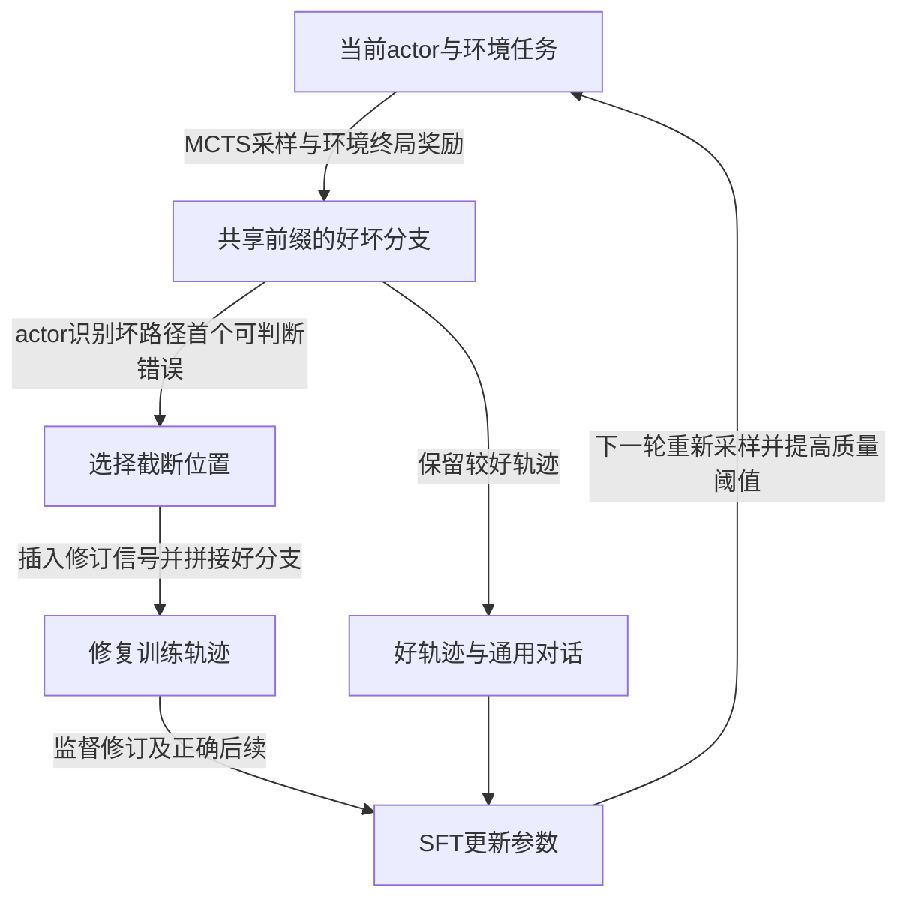

# Agent-R: Training Language Model Agents to Reflect via Iterative Self-Training

## 来源与阅读范围

| 项目 | 记录 |
| --- | --- |
| 来源 ID | S050 |
| 作者 | Siyu Yuan、Zehui Chen、Zhiheng Xi、Junjie Ye、Zhengyin Du、Jiecao Chen |
| 版本 | arXiv:2501.11425v3，提交版本日期2025-03-24；PDF封面另写March 25, 2025，保留差异 |
| 原始入口 | [arXiv固定版本](https://arxiv.org/abs/2501.11425v3)；访问2026-10-25；DOI 10.48550/arXiv.2501.11425 |
| Raw | [[raw/papers/Agent-R.pdf\|本地PDF，共26页]] |
| SHA-256 | `9c405f1e6405c84565af3b2d564121c5f37dcff0892edea674cfdc35850d72c1` |
| 实际阅读 | 2026-10-25；主体pp.1–14，附录A–C pp.21–26，包括提示、轨迹定义、训练设定、恢复/错误案例；看p.5 Fig.2/Eq.3–4、p.7 Eq.6、p.9 Table2、p.11 Table3、p.12 Figs.4–5、pp.21–22定义/提示原页。参考文献未逐条核读，代码未核读，未复现实验。 |
| 综述定位 | S001引文789，§5.4.3，PDF p.47；书目p.139 |

以下区分作者方法、经验结果与本库推断。PDF页码与印刷页码相同。

## 问题：只学成功路径，未必会从错误状态恢复

作者关注互动中重复无效动作、偏离目标后继续失败，以及终局才反思太晚的问题。Agent-R 让当前actor通过MCTS生成好/坏路径，判断坏路径上何时需要反思，再构造“失败前缀—修订信号—较好后续”的训练样本；更新后的模型再采下一轮数据。**这是带当前策略采样的迭代SFT，不是固定教师离线蒸馏，也不是直接用奖励做策略梯度RL。** [[raw/papers/Agent-R.pdf#page=2|§1 · pp.2–3]]、[[raw/papers/Agent-R.pdf#page=6|§3.1–3.2 · pp.6–7]]

图为本库机制示意；拼接是训练数据构造，不代表图中的箭头已证明环境状态可回退。好坏分支共享同一初始前缀，但坏分支走过的动作可能已经改变环境。原文Eq.3/10把其后接到好分支的原后缀，Appendix B还明确修订信号本身不改变环境。本次正文/附录未确认拼接后如何重放并核验环境状态一致性，因此 **不能把文本层修订直接写成任意不可逆环境中的实际恢复保证**。[[raw/papers/Agent-R.pdf#page=5|§3.1、Eq.3–4 · p.5]]、[[raw/papers/Agent-R.pdf#page=21|Appendix B、Eq.10 · p.21]]

## 监督对象与反馈的职责

| 信息 | 由谁产生 | 怎样使用 |
| --- | --- | --- |
| 终局reward | benchmark环境 | 区分好/坏轨迹和筛选质量；不是每步可靠错误标签 |
| 转折点 | 当前actor看历史、当前动作/观察，判断Good/Bad/Uncertain | 按当前能力选首次识别的错误；判断可能错，不能当oracle |
| 修订信号 | 人工写的10个通用反思句随机抽取 | 提供反思/切换标记；不是10种任务专用纠错说明 |
| SFT目标 | 好轨迹＋修复轨迹＋ShareGPT | 修复样本以坏前缀作条件，监督修订与好后续；通用数据用于维持能力 |

依据：[[raw/papers/Agent-R.pdf#page=6|§3.1 · p.6]]、[[raw/papers/Agent-R.pdf#page=7|§3.2、Eq.6 · p.7]]、[[raw/papers/Agent-R.pdf#page=22|Appendix A、Table4 · p.22]]、[[raw/papers/Agent-R.pdf#page=23|Table5 · p.23]]。论文称无需人类或专家模型监督，须理解为不需逐任务人工/强教师纠错标签；仍依赖人工模板、已指令训练模型、通用对话和环境奖励。

## 实验支持到哪里

Llama-3.1-8B-Instruct在WebShop、SciWorld、TextCraft三环境共同训练。MCTS任务数300/200/200，每次Monte Carlo估值8 rollouts，树深20、每次扩展4动作、温度1、UCT常数0.25；3轮迭代，首轮3 epochs、后续各1 epoch。Agent数据与ShareGPT混合η=0.2，学习率2e-5，8张A100-80GB。首次较好轨迹门槛0.5，随后0.7和1.0；最后一轮以最优轨迹为目标。[[raw/papers/Agent-R.pdf#page=8|§4.1–4.2、Table1 · pp.8–9]]、[[raw/papers/Agent-R.pdf#page=21|Appendix C.1 · pp.21–22]]

一般评测WebShop/SciWorld各200题、TextCraft100题，最多100轮，前两者平均最终reward，后者成功率。Agent-R三项63.91/70.23/78.00，优于同骨干Direct-Revision的54.44/66.65/66.00；其平均70.71对ETO65.12的差值是5.59个平均分点，不是所有任务成功率提高5.59%。商业模型对照没有同样训练数据和few-shot/zero-shot条件，不能由排名直接证明算法普遍优越。[[raw/papers/Agent-R.pdf#page=9|Table2、评测设置 · p.9]]、[[raw/papers/Agent-R.pdf#page=22|Appendix C.1 · p.22]]

专门恢复评测取基础Llama-3.1-8B原本reward=0的测试失败轨迹，随机截断后让不同模型续做，最多50轮。第三轮Agent-R平均46.75，Direct-Revision35.67；这是给定特定基础模型失败状态的恢复能力测试，不代表任意模型、任意错误或不可逆动作均可修复。Figs.4–5还显示重复动作减少、识别修订位置变早，但更早判坏本身没有独立错误定位真值保证，需结合最终结果理解。[[raw/papers/Agent-R.pdf#page=11|§4.4 Finding2、Table3 · p.11]]、[[raw/papers/Agent-R.pdf#page=12|Figs.4–5 · pp.12–13]]

## 保留的实现与归因疑点

- p.5条件写 α < reward ≤ 1，而p.8第三轮设 α=1.0；按字面不存在合格轨迹，作者意图显然是最终保留reward=1，但严格比较实现未核读，不替作者消除矛盾。
- p.7写最小化正log-likelihood目标，符号未给负号；且Eq.6好后缀索引与p.5拼接定义不完全一致。本页按文字说明“监督修订与好后续”解释，不据此给出可直接复现的精确mask代码。
- 迭代同时改变actor、数据量、筛选门槛与训练轮数；各条件总采样/训练token未完全匹配。不能把最终收益只归因于“更早反思”一个因素。
- 案例中的wait/OK是harness交互形式；本次未核读其处理实现。环境状态拼接、重置与提交语义仍需代码和执行记录，不能用漂亮轨迹替代。

定位：[[raw/papers/Agent-R.pdf#page=5|Eq.3–4 · p.5]]、[[raw/papers/Agent-R.pdf#page=7|Eq.6 · p.7]]、[[raw/papers/Agent-R.pdf#page=8|§4.2 · pp.8–9]]、[[raw/papers/Agent-R.pdf#page=25|Appendix C.3、Table7 · p.25]]。这些是本库核读发现的未确认项，不意味着论文全部结果失效。

## 当前知识的修订与主题联系

已整合至 [[wiki/optimization/Overview#微调|微调]]，联系 [[wiki/optimization/Overview#自我演化|自我演化]]。它说明“用SFT训练”不等于“数据永远来自固定教师”；必须同时记录状态生成者、反馈来源、数据更新频率和参数目标。[[wiki/papers/AgentTuning|AgentTuning]]提供固定教师与通用数据混合对照；[[wiki/papers/AgentGym-RL|AgentGym-RL]]提供当前策略在线RL对照，但任务与预算不同，不排分数优劣。

本库待检验问题：哪些失败动作允许好分支后缀在当前环境继续执行，哪些需要回滚或补偿动作？当前属于材料/实现核查缺口；下一步应优先核读代码和执行记录，再考虑查新，尚不能确认为研究创新。

已回链 [[wiki/harness/Overview#分支能否撤回，评价能否被信任|Harness分支与恢复]]。Optimization、Harness、索引、队列、互链与摄入日志已同步；主 Agent 内容与结构验收通过，Raw哈希匹配。Obsidian应用未测，未复现实验。
