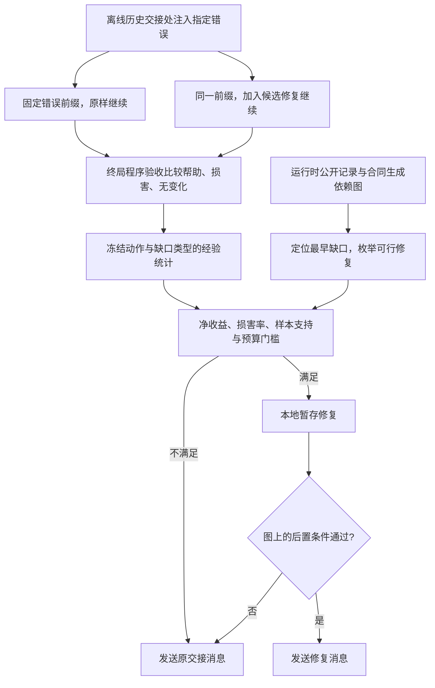

# BRIDGE：交接修复先看净收益，再检查局部后置条件

**原文机制：**BRIDGE把公开消息与工具记录组织成依赖图，区分信息缺失、送达但未使用、路由错误；用离线成对续跑估计修复的帮助、损害与成本，再在运行时选择干预。修复只有满足图上的局部后置条件才发给接收者，否则恢复原消息。**回滚限于本地图与尚未发送的消息缓冲区；局部交接通过不保证后续任务成功。**[[raw/papers/BRIDGE.pdf#page=4|§3.1–3.2 · pp.4–5]] [[raw/papers/BRIDGE.pdf#page=6|§3.3–3.5、Algorithm1 · pp.5–6]] [[raw/papers/BRIDGE.pdf#page=18|Appendix E、Table13 · p.18]]

> [!info] 当前状态与使用边界
> 已完成共享主题和索引整合，主 Agent 内容/结构验收通过，摄入收尾已完成；未复现实验、未审计补充实现，Obsidian未测。原文的token成本、部分实现描述与个别数值存在内部张力，下文保留；不要把摘要“仅2%开销”当完整系统成本。

## 交接失败被表示成什么

输入不是任何一段自由对话，而是公开执行历史与共同执行合同：义务 $O$、角色 $R$、操作约束 $V$。合同要求的事实带有标识、描述和生产角色；图的节点包含消息、工具观察、义务，边记录产生、路由和使用关系。控制器在图的依赖顺序上选最早未满足的前沿，再生成可行修复。**本库限定：**能否正确形成这些事实标识和消费边，是形式图能否代表真实语义依赖的前提。[[raw/papers/BRIDGE.pdf#page=4|§3.1–3.2 · pp.4–5]] [[raw/papers/BRIDGE.pdf#page=13|Appendix A、Table5 · p.13]]

| 可观察缺口 | 定义与候选修复 | 不应误读为 |
| --- | --- | --- |
| 未使用的送达信息 $F_{use}$ | 已在delivered集合却不在consumed集合；INTEGRATE将现有证据接入消息 | 直接读取Agent脑内是否理解；这里只处理公开图中可登记的消费关系 |
| 信息缺失 $F_{abs}$ | 所需事实不在observed集合；有owner时可ASK，若在可访问状态中可RETRIEVE | 访问任意上游私人状态；仅在私人内部的信息不能直接RETRIEVE |
| 路由错误 $F_{scope}$ | 信息给了其他角色而非合同确定的接收者 | 单纯增加广播即可解决所有协作问题 |

分类可以重叠，修复还要满足前置条件和执行者能力。作者列出ASK、INTEGRATE、VERIFY、DECOMPOSE、RETRIEVE五个原语；当前证据只支持这些受合同与可见状态限制的运行机制。[[raw/papers/BRIDGE.pdf#page=5|§3.2、Eqs.1–2、Table1 · p.5]]

## 离线估计与在线提交是两个阶段

本库依原文重绘，实线表示证据生成或控制顺序；离线paired rollouts会继续到任务终局，在线门控只读冻结统计，不提前拿到当前任务成败。HandoffProbe用程序测试/退出码等验收，分别标记“修后成功原样失败”“修后失败原样成功”和结果不变；neutral把两边都成功与都失败归为同类。[[raw/papers/BRIDGE.pdf#page=3|Fig.1 · p.3]] [[raw/papers/BRIDGE.pdf#page=5|§3.3、Eqs.3–4 · p.5]]

经验效用为 $u=w_h r_{help}-w_n r_{neu}-w_x r_{harm}-w_c\bar c$。除 $u>0$ 外，须满足损害率阈值、最少样本与运行预算。附录的基础配置为权重1、0.25、2、0.25，损害阈值0.05、最少样本5；校准库200例，clean及三种故障各50，按160/20/20划分。**本库限定：**经验损害率门槛不是部署风险概率上界；少量样本零损害也不构成安全保证。[[raw/papers/BRIDGE.pdf#page=6|§3.4、Eqs.5–6 · p.6]] [[raw/papers/BRIDGE.pdf#page=14|Appendix B.1、Table6 · pp.14–15]]

局部Check要求目标缺口消除、消息仅引用可访问证据、目的角色正确、已有依赖边未被破坏；特定任务另检查命令退出、测试或数学证书。论文四项命题的保证对象是给定合同/事件下的确定性图、有限枚举、原样放行和未验证消息不提交，**不是依赖抽取永远正确或真实环境可无损撤销**。ASK格式无法解析时允许一次确定的重新提示，再失败就退回原消息。[[raw/papers/BRIDGE.pdf#page=13|Appendix A.1–A.2 · pp.13–14]]

## 实验支持到哪里

作者使用DeepSeek-V4.1-flash与GPT-5.6-Terra，保留benchmark原生团队拓扑、角色、通信和验收。SILO-BENCH有90个任务实例：DeepSeek每题一次，GPT同90题每题三次；TeamBench固定90任务，每题一次。TeamBench按论文说明不进入校准，冻结合成语料校准先验与阈值，但先验仍依赖模型，不能跨backbone直接搬用。本文未更新任务LLM参数。[[raw/papers/BRIDGE.pdf#page=7|§4.1–4.2 · p.7]] [[raw/papers/BRIDGE.pdf#page=16|Appendix D.1–D.3 · pp.16–17]]

| 证据 | 可以采用的条件性判断 | 必须保留的限制 |
| --- | --- | --- |
| SILO-BENCH / TeamBench完整任务验收 | Table2中BRIDGE在两backbone均比Native更高；SILO-BENCH的DeepSeek从63.3到75.6，GPT从68.9到77.8；Full Success与Partial分开 | 这是所报harness/模型/校准配置下的作者结果，不是本库复现；外部benchmark原文与测试实现未独立核读。[[raw/papers/BRIDGE.pdf#page=8\|Table2 · p.8]] |
| DeepSeek/SILO-BENCH组件消融 | 去graph、替换gate、移除gate或局部验证分别降低所报成功率；全系统75.6，always-intervene与no-rollback均56.7 | 单一模型/配置结果；不能从合并组件消融证明所有任务每项都必不可少；具体差额按表核算。[[raw/papers/BRIDGE.pdf#page=9\|Table4 · p.9]] |
| MAST派生诊断子集 | 562条=281个handoff正例+281控制；控制中224条有非handoff错误，能检查是否把一般错误误判成交接故障 | 是事后故障诊断，不是562条全部在线修复完成。类别子集/模型与S021原文不同，不能作为同条件复现。[[raw/papers/BRIDGE.pdf#page=15\|Appendix C.1–C.2、Tables8–9 · p.15]] |
| 已核验修复的失败案例 | CR6 review checklist局部RETRIEVE验证成功，但整任务仍失败；CR1另例局部与终局都成功 | 两例仅说明局部条件与全任务不同，不提供一般失败比例。[[raw/papers/BRIDGE.pdf#page=18\|Appendix E、Table13 · p.18]] |

诊断GPT的F1为69.8%、8664 tokens/trace，Direct Prompting为67.5%、6488；DeepSeek的MOC F1略高于BRIDGE。故“节省32%–42%”针对表中适配的两阶段比较方法，不是对所有基线均更省，也不是所有backbone都最高准确率。[[raw/papers/BRIDGE.pdf#page=8|§4.3、Table3 · p.8]] [[raw/papers/BRIDGE.pdf#page=15|Appendix C.2、Table9 · p.15]]

## 精确成本与实现归因仍需核对

> [!warning] 保留原文内部张力，不用宣传性总体数字覆盖明细
> 下列差异不抹去论文已经描述的机制，但限制了精确效率和机制归因。当前未获得并审计作者所称补充实现/manifest，不能替作者补齐解释。

- **2%不是Table14的完整账。**§4.1声称记录全部Agent和controller token，§4.2以25693对25198报告+2.0%；Appendix F的Table14却把30352对25198列为完整累计+20.4%，DeepSeek为33791对22460、+50.5%；另列“Official Agent Evaluation Margin”为+2.0%/+24.5%，与Agent Communication Channel subtotal也不相同。本库区分这几行，不宣布全系统仅2%开销。[[raw/papers/BRIDGE.pdf#page=7|§4.1–4.2 · p.7]] [[raw/papers/BRIDGE.pdf#page=18|Appendix F、Table14 · pp.18–19]]
- **结构性INTEGRATE是否调用LLM，正文与附录不一致。**§3.5称INTEGRATE/RETRIEVE程序执行、零LLM推理，仅ASK调用辅助模型；F.2却描述DeepSeek执行41次完整消息重构，每次约4900 prompt tokens，并在Table14列4260 tokens/task的active INTEGRATE。可能有不同操作口径，但文本未充分对应，不能任选一种写成统一实现。[[raw/papers/BRIDGE.pdf#page=6|§3.5 · p.6]] [[raw/papers/BRIDGE.pdf#page=18|Table14、Appendix F.2 · pp.18–19]]
- **局部确定性图与文本诊断不是同一成本条件。**A.2的给定标准事件确定性构图，与C.2的MAST单次LLM图提取/诊断，以及F中的boundary diagnostic tokens须分开。论文未在本次所读内容中充分给出从任意自由文本判定“已消费事实”的可执行规则；不能将所有语义诊断都写成零LLM或无误。[[raw/papers/BRIDGE.pdf#page=13|Appendix A、Table5 · pp.13–14]] [[raw/papers/BRIDGE.pdf#page=15|Appendix C.2 · p.15]] [[raw/papers/BRIDGE.pdf#page=18|Table14 · p.18]]
- **消融算术与控制集文字。**C.3把75.6→56.7称23.3个百分点，按所列端点实际为18.9；p.9另报告56.7相对Native 63.3低6.6，两个对照应分开。D.1又把281控制称为“successful controls”，但C.1明确其中224条含其他执行错误。因此本页用清楚的表格分母，不把控制全称成功。[[raw/papers/BRIDGE.pdf#page=9|Table4 · p.9]] [[raw/papers/BRIDGE.pdf#page=15|Appendix C.1–D.1 · pp.15–16]]
- **干预与收益来源的待确认项。**F.1称GPT在429个监测交接处全部跳过昂贵修复生成，F.2又将相较DeepSeek的GPT边界数写165；完整配置仍有成功率提升。没有运行清单无法把收益单独分给“修复生成”、图信息带入或其他上下文变化。它不自动证明实验失效，但需要核对实际runner、边界分母与状态修改。[[raw/papers/BRIDGE.pdf#page=18|Appendix F.1–F.2 · pp.18–19]]

## 它如何改变已有问题

与[[wiki/papers/Multi-Agent-Failures|S021 MAST]]相比，BRIDGE并非只重新命名信息没传/没用，而是增加了成对故障续跑、动作—缺口经验效用、图后置条件和在线放行。这直接覆盖首轮“用受控交接干预区分错误并选择修复”的宽泛构思。**关闭的是宽泛创新表述，不能说所有语义因果归因已解决。**[[raw/papers/Multi-Agent-Failures.pdf#page=6|S021 Fig.3 · p.6]] [[raw/papers/BRIDGE.pdf#page=5|S067 §3.2–3.3 · pp.5–6]]

**本库推断：**接下来若继续追问，应先核对合同/消费边如何从可见信息获得、局部条件是否对应真实依赖，以及完整预算下收益是否仍在，而非再提出“依赖图+verifier”的组合。论文明确依赖公开可观察痕迹，对完全发生在黑箱Agent内部的失败不适用；局部合法消息也可能被能力不足的接收者错误使用。这里是本文证据边界，尚不是完成查新的新研究缺口。[[raw/papers/BRIDGE.pdf#page=9|Limitations · p.9]] [[raw/papers/BRIDGE.pdf#page=18|Appendix E · p.18]]

AgentAsk、MOC、VeriMAP及SILO-BENCH/TeamBench等原文未在本次独立读取；本文对它们的描述和适配结果只能作为BRIDGE作者的比较。与[[wiki/papers/CRITIC|CRITIC]]/[[wiki/papers/CorrectBench|CorrectBench]]的联系是同样区分修好与改坏，但这里的标签来自校准成对任务终局，而在线提交检查仍只覆盖局部后置条件。[[raw/papers/BRIDGE.pdf#page=5|§3.3 · p.5]] [[raw/papers/BRIDGE.pdf#page=17|Appendix D.3 · p.17]]

## 来源身份与实际阅读

| 项目 | 记录 |
| --- | --- |
| 来源ID / 标题 | S067 / BRIDGE: Selective Boundary Repair with Dependency Graph Evidence in Multi-Agent Systems |
| 作者 | Encheng Su、Pengze Li、Ziheng Hua、Qiucheng Yu、Jianyu Wu、Chen Tang、Yizhou Wang、Lintao Wang、Junjia Xiang、Xinzhu Ma、Xi Chen（East China Normal University）、Shixiang Tang、Houqiang Li、Xi Chen（Fudan University）、Aoran Wang；原文有两位同名Xi Chen，保留各自机构 |
| 锁定版本 | arXiv:2610.17805v1，2026-10-13，19页；本次未确认正式会议版本 |
| 原始来源 | [版本页](https://arxiv.org/abs/2610.17805v1)；[锁定PDF](https://arxiv.org/pdf/2610.17805v1)，访问2026-10-25 |
| 原件 | [[raw/papers/BRIDGE.pdf\|BRIDGE.pdf]] |
| SHA-256 | `C756F308E51549A522C0345265E090220F0E12D8948EC9C1EA647A5A6A98025B` |
| 选读入口 | 首轮Brainstorm交接归因定向查新；综述外补读，H4预算1/2。非S001核心引用，无S001引用编号 |
| 实际读取 | 2026-10-25：正文pp.1–9，p.10伦理/复现说明，附录A–F pp.13–19；实际看p.3 Fig.1、p.5公式/Table1、p.6 Algorithm1/效用与门控、p.8 Tables2–3、p.13形式后置条件、pp.18–19案例与完整成本原页 |
| 未核读 | pp.10–12参考文献未逐篇追读；作者称随附的代码/manifest未获取或审计；未执行benchmark、复算原始轨迹或独立形式验证命题 |

本页页码从所存PDF第一页计，PDF正文未逐页印出页脚页码。原件以不覆盖方式归档并核对哈希；临时提取、原页渲染与发布页快照位于本轮临时区。

已整合到[[wiki/harness/Overview#从故障分类到选择性交接修复|Harness · 选择性交接修复]]及[[wiki/harness/Overview#选择误差与纠错净收益要分别测量|验证]]，索引同步，主 Agent 内容/结构验收通过，摄入收尾已完成。与[[wiki/papers/TRACE|TRACE]]共同强调局部证据条件与后续使用分离：TRACE控制返回上下文，BRIDGE控制交接消息，两者均不能用局部通过代替全任务成功。
