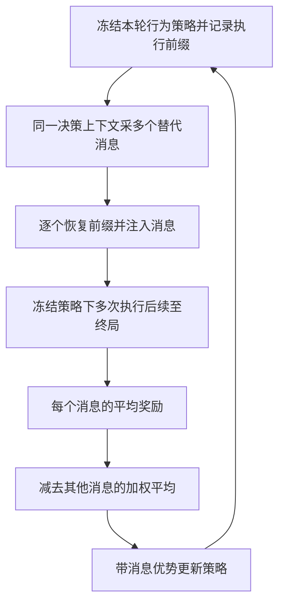

# C3：恢复同一状态，再执行不同消息的后续

## 身份与实际阅读

| 项目 | 记录 |
| --- | --- |
| 标题 | The Trace Is the State: Exact Credit Assignment for LLM Agent Teams |
| 来源 ID | S068 |
| 作者 | Yanjun Chen、Yirong Sun、Hanlin Wang、Jinghan Wang、Xinming Zhang、Xiaoyu Shen、Wenjie Li、Wei Zhang |
| 版本 | arXiv:2603.06859v4，2026-10-07；PDF标注Preprint / Under review，正式发表未确认 |
| 原始入口 | [版本页](https://arxiv.org/abs/2603.06859v4)；[版本PDF](https://arxiv.org/pdf/2603.06859v4)；访问2026-10-25 |
| 标识 | DOI 10.48550/arXiv.2603.06859（arXiv标识） |
| Raw | [[raw/papers/C3.pdf\|本地原件，共30页]] |
| SHA-256 | `56F98F5470AF91EF80FC7E968B8D3E46CA701E490E172016DA0C342DFE59F92F` |
| 读取 | 2026-10-25；主体pp.1–10，附录A/B pp.14–30；重点条件、无偏/方差推导、训练配置、工作流、独立参照与预算。实际看p.2 Fig.1，p.4 Eq.2，p.5 Algorithm1/Eq.3–4，p.7 Table1，p.8 Table2及p.25 Tables7–8。参考文献未逐条核验；未审实现、未复现；数学推导未作独立形式验证。 |
| 选读来源 | Brainstorm定向查新补读，O5 Agentic RL 补读1/2；不来自S001引用，不补造综述定位 |

页码从PDF第一页起，与本文印刷页码一致。以下“原文”是本篇的直接核读；跨篇比较及证据限制另标本库判断。

## Exact指哪件事

**原文定义：**在固定行为策略下，比较某条消息与同一决策点可采样的其他消息，各自继续执行后带来的期望终局奖励。这里的动作是一整条消息，工作流只有2–10个决策点；“长”主要体现在多个角色的消息依赖，不能由此当作数百步外部环境执行证据。[[raw/papers/C3.pdf#page=3|§2.1–2.2、Eq.1 · p.3]]

“精确”要求恢复记录前缀后注入消息所得的**下游消息与奖励分布**，等于恢复真实完整状态再注入同一消息的分布。它不是每次重跑得到同一答案，也不是有限样本没有误差；只固定干预前前缀，干预后的上下文必须允许自然分叉。[[raw/papers/C3.pdf#page=4|§2.3、Definition1/Eq.2 · p.4]]

| 情况 | 为什么可用或不可用 |
| --- | --- |
| Recorded | 因果相关变量、工具返回、记忆和路由都被记录，且重置时真正恢复。 |
| Resampled | 随机部分可按给定记录前缀的正确条件分布重新采样；保留无偏前提，但增加方差。 |
| Hidden state | 有影响后续的状态既未恢复、也未按正确条件分布重采样；保证不适用。不能证明属于前两类时，作者要求按此类处理。 |

表依据 [[raw/papers/C3.pdf#page=4|§2.3 · p.4]]。**本库限定：**把工具的文字返回写进日志，不等于恢复数据库、文件或外部副作用；“记录”必须和“恢复/重采样”连在一起。作者的工具输入/输出/版本/副作用要求见 [[raw/papers/C3.pdf#page=8|§6 · p.8]]。本文实际工作流由题目、上游文本和固定模板组装，状态充分性在该构造中成立；并未验证任意开放工具系统。

## 从反事实接续到参数更新

本库机制示意，依据 [[raw/papers/C3.pdf#page=5|Algorithm1、Eq.3–4 · p.5]]。行为策略是在每轮开始冻结的学生快照，不是KL项的初始参考模型；更新完成后下一轮再取新快照。

每个替代消息$a_j$执行$c_j$次，得到平均终局奖励$\hat Q_j$；基线$b_{-j}$是其他替代消息按接续次数加权的均值，优势为$\hat A_j=\hat Q_j-b_{-j}$。无偏结论要求替代动作独立来自行为策略、不同替代的rollout独立、接续次数不根据所采动作或奖励自适应变化。**这不是任意搜索筛选之后仍自动无偏的结论。** [[raw/papers/C3.pdf#page=5|Proposition2 · p.5]] [[raw/papers/C3.pdf#page=15|A.2 · pp.15–16]]

训练把整条消息的同一个优势分配给所有输出token，使用token级PPO ratio、clip与KL；不除以消息长度，prompt/padding被mask。两角色共享参数。因而“消息级信用”不等于识别了每个token的独立贡献。[[raw/papers/C3.pdf#page=22|B.2、Eq.10 · pp.22–23]]

## 三类证据须分开看

| 证据 | 实际条件 | 支持与限制 |
| --- | --- | --- |
| 估计器噪声与可靠性 | 冻结Qwen3-4B，部分Qwen3-8B；六工作流，2–10决策点；均检查开头决策点；每候选4接续 | 固定每决策点预算时，噪声符合作者方差式；不等于深工作流信用可靠。10点链split-half可靠性约0.01，2点链约0.64。[[raw/papers/C3.pdf#page=7\|Table1 · p.7]]、[[raw/papers/C3.pdf#page=25\|B.5 · pp.25–26]] |
| 独立参照的排序 | 2角色冻结工作流；500决策点，400训练小型mmBERT critic、100留出；参照每候选另采16次，独立随机种子 | 可排序的79/100点上C3用4次接续相关0.69，critic为0.29；critic推理不付接续成本。0.73的两份参照一致性来自88点，统一75点对照另为0.70/0.76，不能把不同分母混为一组。[[raw/papers/C3.pdf#page=28\|B.7 · pp.28–29]] |
| 训练后的任务结果 | 共享Qwen3-4B，数学训练，2角色主实验；512输出上限，5训练seed；另有3角色和2048上限设置 | 主实验MATH500相对MAGRPO差异显著；其余三个benchmark的校正检验未显著。2048设置是一个训练模型做5次采样评测，不是5个训练seed。[[raw/papers/C3.pdf#page=8\|§5/Table2 · p.8]]、[[raw/papers/C3.pdf#page=25\|Tables7–8 · p.25]]、[[raw/papers/C3.pdf#page=29\|B.8/Table10 · p.29]] |

**深度不出现在方差式里，不等于深度免费。** 在同方差、均匀分配条件下，固定决策点预算$B_u$的噪声为$\sigma^2n^2/[B_u(n-1)]$；固定全实例预算分给$K$个决策点时，$B_u$随深度下降，信号也可能变小。可靠性统计还排除两半无法排序的组；不能将该相关性当全任务失败率。预算诊断中的B计替代数，统计另给每个替代4次接续，区别于训练共享叶子的8条终局rollout。[[raw/papers/C3.pdf#page=17|A.3/A.5 · pp.17–19]] [[raw/papers/C3.pdf#page=26|B.5 · p.26]]

## 哪些比较不能被总分掩盖

**采样与信用共同变化。** 训练C3每题2条Reasoner消息，各接4条Actor消息；基线8条独立完整运行。相同8次终局回报，分别生成10与16条消息，故token节省有共享前缀机制；它不是在完全相同训练样本上仅替换优势。MAPPO还用全batch标准化并除消息长度，C3不这样做。整体结果不能全部归因于“无偏信用”。[[raw/papers/C3.pdf#page=8|§5–6 · p.8]] [[raw/papers/C3.pdf#page=23|B.2 · p.23]]

**Agent删除与消息替换问的问题不同。** 空消息基线衡量角色存在的价值；相对行为策略的消息优势衡量同上下文中的替代。作者证明删除可改变下游观察分布，但也明确最大分布变化可以有零奖励偏差；同决策点的删除偏移不会改变候选排序，跨决策点偏移才可能不同。因此不能将本文写成“所有删除消融无效”。[[raw/papers/C3.pdf#page=4|§2.2 · p.4]] [[raw/papers/C3.pdf#page=15|A.1 Remark · p.15]] [[raw/papers/C3.pdf#page=27|B.6 · pp.27–28]]

**精确针对所给奖励。** 数学最终答案验收是该实验的任务信号；若judge有随机性会增加方差，若任务奖励本身遗漏目标，本库推断：无偏估计该奖励不修复目标错配。论文没有给出开放环境的通用正确性oracle。[[raw/papers/C3.pdf#page=8|§6 Tasks and rewards · p.8]]

## 对现有问题的影响

与已核读[[wiki/papers/GiGPO|S053 GiGPO]]、[[wiki/papers/Tree-GRPO|S054 Tree-GRPO]]比较：C3提供同前缀干预可识别性的明确条件、冻结策略和独立接续参照；GiGPO是原rollout事后聚合重复环境状态，Tree-GRPO主动共享前缀采样并比较分支。**本库综合：**“局部信用没有反事实执行参照”已不成立；“相似观察是否足以合并”的具体问题仍未由本篇实验回答，也不能因此称为新研究空白。C3相关工作列出的其他方法大多未在本库读原文，仅属作者比较。[[raw/papers/C3.pdf#page=4|§2.3–2.4 · pp.4–5]] [[raw/papers/C3.pdf#page=9|§7 · p.9]] [[raw/papers/C3.pdf#page=30|B.9/Table11 · p.30]]

已整合至 [[wiki/optimization/Overview#局部比较组从哪里来，决定了什么可被区分|Optimization · 局部比较组]]，与 [[wiki/harness/Overview#分支能否撤回，评价能否被信任|Harness · 分支恢复]] 相关；已完成摄入，主题、索引和日志同步，主Agent内容/结构验收通过、Raw哈希匹配。应用未测，未运行代码或实验。

本轮跨模块整合：[[wiki/frontier/Overview#保存证据与恢复环境是两个条件|Frontier · 保存证据与恢复环境是两个条件]]。该处保存与其他已读来源的条件比较，不增加本文的实证支持范围。
