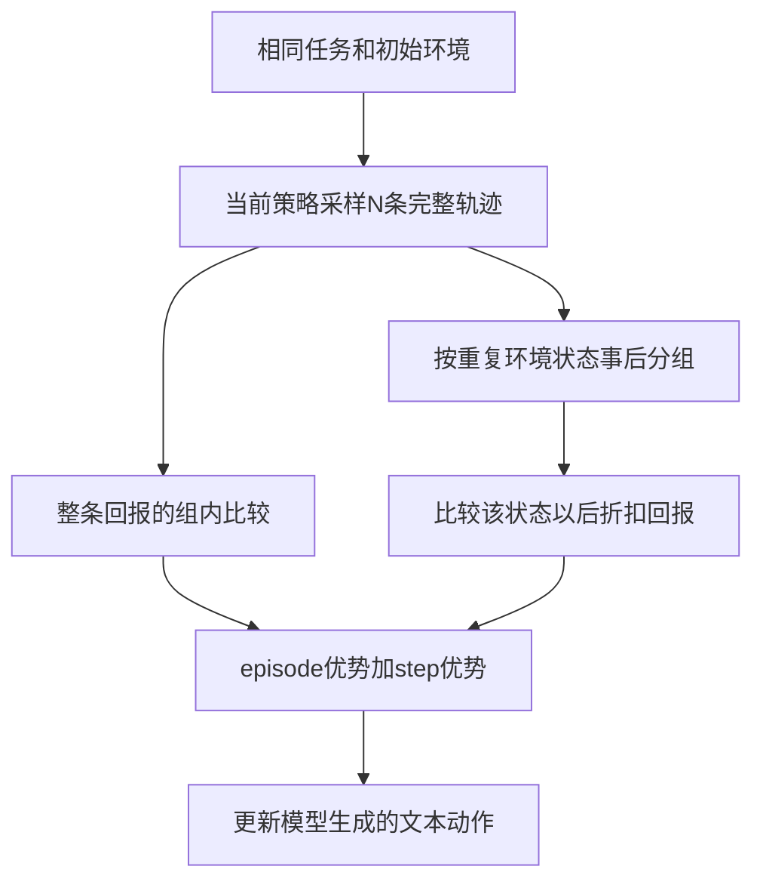

# GiGPO：在重复状态后比较动作回报

## 身份与实际阅读

| 项目 | 记录 |
| --- | --- |
| 来源 ID | S053 |
| 原文标题 | Group-in-Group Policy Optimization for LLM Agent Training |
| 作者 | Lang Feng、Zhenghai Xue、Tingcong Liu、Bo An |
| 版本 | arXiv:2505.10978v3，2025-10-28；PDF标记NeurIPS 2025 |
| 原始来源 | [锁定 PDF](https://arxiv.org/pdf/2505.10978v3)；访问 2026-10-25；发布页与 PDF 首页身份已核对 |
| Raw | [[raw/papers/GiGPO.pdf\|本地原件，共 27 页]] |
| SHA-256 | `F6A4D4559C41048BE67A0E4A062F9957996FC79E6A80F65FE66F1140FAC82DCD` |
| 实际阅读 | 2026-10-25；正文pp.1–10；附录A–E pp.16–20（框架、推导、伪代码、配置与补充实验）；实际看p.5 Fig.2/Eq.5、p.6 Fig.3/Eq.7–9、p.8 Tables1–2、p.10 Fig.6。附录F pp.21–27逐条轨迹未完整核读，引用文献未逐条读 |
| S001 入口 | 引文156，§5.5.2，综述p.50；书目p.88；本页按实际下载版本解释，不能假定与综述所引版本完全相同 |

以下主张来自原论文直接核读，另标本库推断；未复现实验、未核读实现代码。PDF 页码从首页起算。

## 问题不是缺少结局分数，而是结局分数分不清局部选择

同一成功轨迹可能包含绕路；同一失败轨迹也可能有正确步骤。GiGPO保留整条轨迹相对好坏的信号，又从已采样轨迹中找重复环境状态，将这些状态后采取的动作放在一起比较。它不为每个状态重新采一组分支，而是复用原rollout中自然出现的重复。[[raw/papers/GiGPO.pdf#page=4|§4、Fig.1 · p.4]]

本库示意。环境返回观察和reward；策略生成含思考与动作的文本。两种分组比较不同对象，不是为环境返回token赋予策略动作身份。[[raw/papers/GiGPO.pdf#page=3|§3 · p.3]] [[raw/papers/GiGPO.pdf#page=5|Fig.2 · p.5]]

## 两级优势如何工作

1. **Episode组：**同任务、相同初态采N条轨迹，比较总回报$R(\tau_i)=\sum_t r_t^{(i)}$，得到$A_E$。分母可为组内std或常数1。[[raw/papers/GiGPO.pdf#page=4|§4.1、Eq.2–3 · pp.4–5]]
2. **Anchor-state组：**扫描这批轨迹，跨episode、也跨同一episode时间步收集相同状态后的动作。对每次动作计算$R_t=\sum_{k=t}^{T}\gamma^{k-t}r_k$，在同状态组中中心化得到$A_S$。因此同一成功轨迹里，较早绕路动作因折扣获得较低回报。[[raw/papers/GiGPO.pdf#page=5|§4.2、Eq.4–7 · pp.5–6]]
3. **合成：**$A(a_t)=A_E(\tau_i)+\omega A_S(a_t)$，再用于clipped policy objective与KL。它无需额外critic和rollout，但step优势仍来自采样后续的回报，不是直接观测动作的独立因果价值。最后一句为本库解释。[[raw/papers/GiGPO.pdf#page=6|§4.3、Eq.8–9 · p.6]]

环境状态分组不必等于完整模型输入相同。ALFWorld/WebShop prompt还含步数、最近两步观察/动作和可行动作；QA保留全历史，并用最长匹配子序列相似度超过0.9来分组。**本库推断：**相同页面/观察可能对应不同历史或未显露状态，分组是否保持决策相关信息是成立前提，不能把相似度匹配当成状态等价证明。[[raw/papers/GiGPO.pdf#page=7|§5.1 · p.7]] [[raw/papers/GiGPO.pdf#page=18|Appendix E.2 · pp.18–19]]

## 奖励和训练预算保留到环境层

| 设置 | 奖励与上下文 | 采样/训练条件 |
| --- | --- | --- |
| ALFWorld | 成功10、失败0、非法动作-0.1；prompt2048、单步response512；最近2步历史 | 上限50步；16组×8环境；150 iterations；1.5B用2×H100、7B用4×H100 |
| WebShop | 成功10、失败0、非法动作-0.1；prompt4096、单步response512；最近2步历史 | 上限15步；16组×8；150 iterations；设备同上 |
| 搜索QA | 成功1、失败0、非法动作-0.01；prompt4096、response512；全历史 | 4轮、group5；200 iterations；3B用4×H100、7B用8×H100 |

主算法$\omega=1,\gamma=0.95$；前两环境actor学习率1e-6、KL0.01、rollout温度1/验证0.4，QA KL0.001、验证温度0。QA附录“train data size=256”与正文NQ/HotpotQA训练集的关系未明确，本页不把256解释为训练语料总数。[[raw/papers/GiGPO.pdf#page=17|Appendix E.1 · pp.17–18]]

同一初态多次rollout需要环境可初始化、任务可重试；这与 [[wiki/papers/AgentGym-RL|AgentGym-RL]] 的环境隔离/重置接口有关。GiGPO没有为每个中间状态额外回滚分叉，不能与 [[wiki/papers/Tree-GRPO|Tree-GRPO]] 的主动前缀扩展混为一谈。

## 结果、适用条件和疑点

Table1按3个seed报告；Qwen2.5-7B上GRPO→GiGPO无std，ALFWorld成功率77.6→90.2，WebShop成功率66.1→75.2。删除episode或step优势均降低所测1.5B表现，支持两级信号在这组环境中的价值。标准差归一化没有普遍最优：7B ALFWorld有std略高，WebShop无std更高。[[raw/papers/GiGPO.pdf#page=8|Table1 · p.8]] [[raw/papers/GiGPO.pdf#page=9|§5.4、Fig.4 · p.9]]

ALFWorld分析中重复状态较多，支撑事后分组有足够材料；论文明确承认复杂/噪声环境难匹配。没有重复时step信号为零，只保留episode级目标；这是一种算法退化关系，不能写成对所有环境的性能下界保证。[[raw/papers/GiGPO.pdf#page=9|§5.5、Fig.5 · pp.9–10]] [[raw/papers/GiGPO.pdf#page=10|§6 Limitations · p.10]]

> [!note]- 实现前需复核的细节
> §5.6给出hash分组0.01s、step优势0.53s、主要开销362.83s，同时写“<0.002%”。按所列数字直接换算约0.15%，计时/百分比口径需查原记录，不能照搬该百分比；这不否认额外算术开销较小。[[raw/papers/GiGPO.pdf#page=10|Fig.6、§5.6 · p.10]]
> Appendix C证明常数分母的episode优势与RLOO相差$N/(N-1)$缩放；不能由此推出完整混合step目标、clip/KL下的更新都无偏。[[raw/papers/GiGPO.pdf#page=16|Appendix C · pp.16–17]]

**待检验问题：**在固定采样预算下，状态分组的覆盖率与错误合并率如何影响收益，尤其当策略上下文不同却观察相似？作者已有state-matching局限，本库尚未查新，不能命名为新缺口。

## 主题联系与状态

已整合 [[wiki/optimization/Overview#Agentic Reinforcement Learning|Optimization：Agentic RL]] 的状态分布、反馈与信用比较。与 [[wiki/harness/Overview|Harness]] 的状态和反馈接口保持交叉联系。本篇内容与结构验收通过，已完成摄入；主题、队列、索引及摄入日志已同步。按用户要求本轮不做Obsidian应用检查，应用未测；未复现实验。
