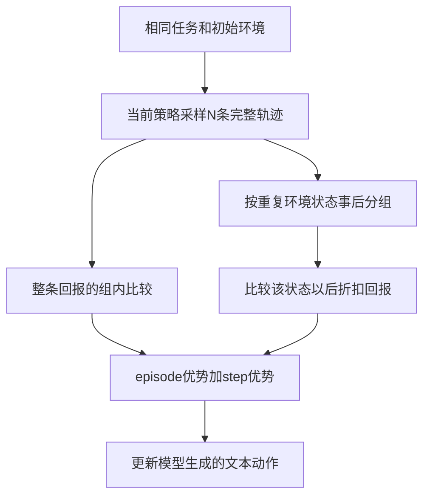

# GiGPO：在重复状态后比较动作回报

## 身份与实际阅读

| 项目 | 记录 |
| --- | --- |
| 来源 ID | S053 |
| 原文标题 | Group-in-Group Policy Optimization for LLM Agent Training |
| 作者 | Lang Feng、Zhenghai Xue、Tingcong Liu、Bo An |
| 版本 | arXiv:2505.10978v3，2025-10-28；PDF标记NeurIPS 2025 |
| 原始来源 | [锁定 PDF](https://arxiv.org/pdf/2505.10978v3)；访问 2026-10-25；发布页与 PDF 首页身份已核对 |
| Raw | [[raw/papers/GiGPO.pdf\|本地原件，共 27 页]] |
| SHA-256 | `F6A4D4559C41048BE67A0E4A062F9957996FC79E6A80F65FE66F1140FAC82DCD` |
| 实际阅读 | 2026-10-25；正文pp.1–10；附录A–E pp.16–20（框架、推导、伪代码、配置与补充实验）；实际看p.5 Fig.2/Eq.5、p.6 Fig.3/Eq.7–9、p.8 Tables1–2、p.10 Fig.6。附录F pp.21–27逐条轨迹未完整核读，引用文献未逐条读 |
| S001 入口 | 引文156，§5.5.2，综述p.50；书目p.88；本页按实际下载版本解释，不能假定与综述所引版本完全相同 |

以下区分原论文陈述、公开代码观察与本库推断；未复现实验。2026-10-25追加核读的8个代码/配置文件和2份API元数据见下节，其他实现未核验。PDF页码从首页起算。

## 问题不是缺少结局分数，而是结局分数分不清局部选择

同一成功轨迹可能包含绕路；同一失败轨迹也可能有正确步骤。GiGPO保留整条轨迹相对好坏的信号，又从已采样轨迹中找重复环境状态，将这些状态后采取的动作放在一起比较。它不为每个状态重新采一组分支，而是复用原rollout中自然出现的重复。[[raw/papers/GiGPO.pdf#page=4|§4、Fig.1 · p.4]]

本库示意。环境返回观察和reward；策略生成含思考与动作的文本。两种分组比较不同对象，不是为环境返回token赋予策略动作身份。[[raw/papers/GiGPO.pdf#page=3|§3 · p.3]] [[raw/papers/GiGPO.pdf#page=5|Fig.2 · p.5]]

## 两级优势如何工作

1. **Episode组：**同任务、相同初态采N条轨迹，比较总回报$R(\tau_i)=\sum_t r_t^{(i)}$，得到$A_E$。分母可为组内std或常数1。[[raw/papers/GiGPO.pdf#page=4|§4.1、Eq.2–3 · pp.4–5]]
2. **Anchor-state组：**扫描这批轨迹，跨episode、也跨同一episode时间步收集相同状态后的动作。对每次动作计算$R_t=\sum_{k=t}^{T}\gamma^{k-t}r_k$，在同状态组中中心化得到$A_S$。因此同一成功轨迹里，较早绕路动作因折扣获得较低回报。[[raw/papers/GiGPO.pdf#page=5|§4.2、Eq.4–7 · pp.5–6]]
3. **合成：**$A(a_t)=A_E(\tau_i)+\omega A_S(a_t)$，再用于clipped policy objective与KL。它无需额外critic和rollout，但step优势仍来自采样后续的回报，不是直接观测动作的独立因果价值。最后一句为本库解释。[[raw/papers/GiGPO.pdf#page=6|§4.3、Eq.8–9 · p.6]]

环境状态分组不必等于完整模型输入相同。论文中ALFWorld/WebShop prompt还含步数、最近两步观察/动作和可行动作；QA保留全历史，§5.1将分组描述为最长匹配子序列相似度超过0.9。此处是**论文描述**，当前公开实现的SequenceMatcher与贪心聚类另见下节，不能视为两者已完全对齐。**本库限定：**若要把局部回报排序解释为同一决策条件下的动作差异，需要核对组内决策相关信息是否一致；这不意味着完整历史不同就令算法不成立，也不能把相似度匹配当成状态等价证明。[[raw/papers/GiGPO.pdf#page=7|§5.1 · p.7]] [[raw/papers/GiGPO.pdf#page=18|Appendix E.2 · pp.18–19]]

## 公开实现核查：分组观察与策略输入分别保存

**代码证据，限定版本。** 2026-10-25沿论文PDF p.1的官方链接读取[langfengQ/verl-agent](https://github.com/langfengQ/verl-agent)，锁定[commit `20bd331`](https://github.com/langfengQ/verl-agent/commit/20bd331bdbc9026a5668e11362178e10ab7400c8)（提交日期2026-06-09）。核查8个代码/配置文件的anchor、rollout、return、advantage和actor loss路径，并保存commit/tree原始API响应。**这是访问时的公开实现，未证明等于论文实验版本；代码观察不能直接改写上文的论文实验结论。** 未运行仓库代码、安装依赖或复现实验；来源仍归S053，不新增学术来源。

### 哪些信息参与分组，哪些只提供给策略

`rollout_loop`把环境提供的`anchor`单独存为`anchor_obs`，完整文本另作模型输入。核心函数先按本次环境组`uid`分桶，再比较anchor；不是按完整prompt分组。环境组由每连续`env.rollout.n`个环境共享UUID实现，是否确实同任务/同初态仍依赖未核读的底层初始化。证据：[[raw/papers/GiGPO-code-20bd331/agent_system/multi_turn_rollout/rollout_loop.py|rollout本地快照]] [L65–L75](https://github.com/langfengQ/verl-agent/blob/20bd331bdbc9026a5668e11362178e10ab7400c8/agent_system/multi_turn_rollout/rollout_loop.py#L65-L75)、[L174–183](https://github.com/langfengQ/verl-agent/blob/20bd331bdbc9026a5668e11362178e10ab7400c8/agent_system/multi_turn_rollout/rollout_loop.py#L174-L183)、[L308–325](https://github.com/langfengQ/verl-agent/blob/20bd331bdbc9026a5668e11362178e10ab7400c8/agent_system/multi_turn_rollout/rollout_loop.py#L308-L325)；[[raw/papers/GiGPO-code-20bd331/verl/trainer/ppo/ray_trainer.py|trainer本地快照]] [L345–L356](https://github.com/langfengQ/verl-agent/blob/20bd331bdbc9026a5668e11362178e10ab7400c8/verl/trainer/ppo/ray_trainer.py#L345-L356)。

| 环境 | 用于分组的anchor | 完整策略输入另行加入的信息 |
| --- | --- | --- |
| ALFWorld | 环境返回的当前`text_obs` | 后续步加入任务、步数、最近历史、current_step及可行动作 |
| WebShop | 当前obs经`format_obs`处理的页面文本；通常去掉已识别的任务前段，识别失败则原样保留 | 任务、步数、最近历史、current_step及infos中的可行动作 |
| Search QA | reset时obs；step后本次`next_obs.copy()` | 搜索/信息历史和step_count；所读Search脚本设置history_length=4、max_steps=4 |

表据[[raw/papers/GiGPO-code-20bd331/agent_system/environments/env_manager.py|环境管理器本地快照]] [L53–L112](https://github.com/langfengQ/verl-agent/blob/20bd331bdbc9026a5668e11362178e10ab7400c8/agent_system/environments/env_manager.py#L53-L112)、[ALFWorld L138–208](https://github.com/langfengQ/verl-agent/blob/20bd331bdbc9026a5668e11362178e10ab7400c8/agent_system/environments/env_manager.py#L138-L208)、[WebShop L390–505](https://github.com/langfengQ/verl-agent/blob/20bd331bdbc9026a5668e11362178e10ab7400c8/agent_system/environments/env_manager.py#L390-L505)；[[raw/papers/GiGPO-code-20bd331/examples/gigpo_trainer/run_search.sh|Search配置本地快照]] [L58–L62](https://github.com/langfengQ/verl-agent/blob/20bd331bdbc9026a5668e11362178e10ab7400c8/examples/gigpo_trainer/run_search.sh#L58-L62)。这些manager不向anchor另加历史、步数或剩余预算；底层观察串本身是否包含某些状态/预算信息仍未核读，不能一概排除。

**本库解释：**现在可以直接确认“分组anchor不等于完整policy输入”，但尚未取得实际组样本，不能据此声称组内存在多少错误合并、噪声，或已经造成性能伤害。输入差异也不自动证明策略梯度有偏；收益还可能涉及减少循环、时间效率或估计方差。下一条关键证据是实际分组样本及决策相关条件，而不是只将匹配算法换名。

### 自包含均值、重复访问与clip的位置

同一环境组内，相同anchor的所有batch行一起统计，不以`traj_uid`排除同轨迹重复访问。step组均值**包括当前样本自身**，没有leave-one-out；单样本组均值等于自己，step优势为0。`mean_norm`只减均值，`mean_std_norm`再除以std+1e-6；标量优势复制到该步response token并乘mask。证据：[[raw/papers/GiGPO-code-20bd331/gigpo/core_gigpo.py|核心算法本地快照]] [L243–L296](https://github.com/langfengQ/verl-agent/blob/20bd331bdbc9026a5668e11362178e10ab7400c8/gigpo/core_gigpo.py#L243-L296)、[归一化 L334–384](https://github.com/langfengQ/verl-agent/blob/20bd331bdbc9026a5668e11362178e10ab7400c8/gigpo/core_gigpo.py#L334-L384)。这里描述送入核心函数的batch行，批调整是否复制/删除样本尚未完整核查。

随后才合成`episode_advantages + weight * step_advantages`；核心函数不单独clip局部return或step优势。actor的`vanilla`分支再对token概率比做PPO clipping，并对负优势另做dual-clip处理，之后可添加KL loss；另有gspo分支。完整默认配置未核读，不能把vanilla描述成所有运行的唯一分支。证据：[[raw/papers/GiGPO-code-20bd331/gigpo/core_gigpo.py|优势合成本地快照]] [L153–L171](https://github.com/langfengQ/verl-agent/blob/20bd331bdbc9026a5668e11362178e10ab7400c8/gigpo/core_gigpo.py#L153-L171)；[[raw/papers/GiGPO-code-20bd331/verl/workers/actor/dp_actor.py|actor本地快照]] [L365–L424](https://github.com/langfengQ/verl-agent/blob/20bd331bdbc9026a5668e11362178e10ab7400c8/verl/workers/actor/dp_actor.py#L365-L424)；[[raw/papers/GiGPO-code-20bd331/verl/trainer/ppo/core_algos.py|PPO loss本地快照]] [L431–L492](https://github.com/langfengQ/verl-agent/blob/20bd331bdbc9026a5668e11362178e10ab7400c8/verl/trainer/ppo/core_algos.py#L431-L492)。

> [!note]- 当前公开实现的进一步细节：不等同论文实验配方
> **Episode跨步统计。** `episode_norm_reward`默认`compute_mean_std_cross_steps=True`，上层调用未覆盖；此时不填充seen_pairs，故同轨迹多步行会重复参与episode均值/std。若reward manager把同一总episode reward赋到各步，则相当于按保留步数加权；reward映射未读，后半仅为条件推断。不是已证论文实验使用了该加权。[[raw/papers/GiGPO-code-20bd331/gigpo/core_gigpo.py|episode归一化本地快照]] [L174–L238](https://github.com/langfengQ/verl-agent/blob/20bd331bdbc9026a5668e11362178e10ab7400c8/gigpo/core_gigpo.py#L174-L238)；调用见L161。
>
> **相似分组。** 使用`difflib.SequenceMatcher(None,a,b).ratio() >= threshold`，按输入顺序放入第一个与代表串相似的簇；代表不更新，也不检查簇内全部成员两两相似。应称对代表的贪心聚类，不把它写成严格最长公共子序列等价分组。Search脚本显式启用阈值0.9；WebShop脚本未显式覆盖enable_similarity，不能跳过配置文件默认值推断实际所有运行。[[raw/papers/GiGPO-code-20bd331/gigpo/core_gigpo.py|相似度本地快照]] [L72–L85](https://github.com/langfengQ/verl-agent/blob/20bd331bdbc9026a5668e11362178e10ab7400c8/gigpo/core_gigpo.py#L72-L85)、[L297–321](https://github.com/langfengQ/verl-agent/blob/20bd331bdbc9026a5668e11362178e10ab7400c8/gigpo/core_gigpo.py#L297-L321)；[[raw/papers/GiGPO-code-20bd331/examples/gigpo_trainer/run_search.sh|Search配置本地快照]] [L9–L12](https://github.com/langfengQ/verl-agent/blob/20bd331bdbc9026a5668e11362178e10ab7400c8/examples/gigpo_trainer/run_search.sh#L9-L12)、[L55–57](https://github.com/langfengQ/verl-agent/blob/20bd331bdbc9026a5668e11362178e10ab7400c8/examples/gigpo_trainer/run_search.sh#L55-L57)。
>
> **Return与非法动作惩罚。** 先按traj_uid、现有时间行序从后向前算`r + gamma * next_return`，发生在adjust_batch/balance之前；trainer随后对当前无效动作的该行已算step return另减penalty，没有把这一新增项重新折扣传给更早步骤。底层reward是否已有惩罚未核，不能据此断言双重惩罚或总惩罚语义。[[raw/papers/GiGPO-code-20bd331/gigpo/core_gigpo.py|return计算本地快照]] [L87–L131](https://github.com/langfengQ/verl-agent/blob/20bd331bdbc9026a5668e11362178e10ab7400c8/gigpo/core_gigpo.py#L87-L131)；[[raw/papers/GiGPO-code-20bd331/verl/trainer/ppo/ray_trainer.py|计算顺序本地快照]] [L1111–L1125](https://github.com/langfengQ/verl-agent/blob/20bd331bdbc9026a5668e11362178e10ab7400c8/verl/trainer/ppo/ray_trainer.py#L1111-L1125)、[L200–220](https://github.com/langfengQ/verl-agent/blob/20bd331bdbc9026a5668e11362178e10ab7400c8/verl/trainer/ppo/ray_trainer.py#L200-L220)。
>
> **未核范围。** reward_fn到token_level_scores的映射、adjust_batch的复制/删减、底层环境观察/初始化语义、完整默认配置及实际实验日志、论文时间版本未核验。固定提交tree未截断；限定文件名筛查未定位分组样本，但未搜外部平台或历史版本，不据此声称作者没有公开样本。

## 奖励和训练预算保留到环境层

| 设置 | 奖励与上下文 | 采样/训练条件 |
| --- | --- | --- |
| ALFWorld | 成功10、失败0、非法动作-0.1；prompt2048、单步response512；最近2步历史 | 上限50步；16组×8环境；150 iterations；1.5B用2×H100、7B用4×H100 |
| WebShop | 成功10、失败0、非法动作-0.1；prompt4096、单步response512；最近2步历史 | 上限15步；16组×8；150 iterations；设备同上 |
| 搜索QA | 成功1、失败0、非法动作-0.01；prompt4096、response512；全历史 | 4轮、group5；200 iterations；3B用4×H100、7B用8×H100 |

主算法$\omega=1,\gamma=0.95$；前两环境actor学习率1e-6、KL0.01、rollout温度1/验证0.4，QA KL0.001、验证温度0。QA附录“train data size=256”与正文NQ/HotpotQA训练集的关系未明确，本页不把256解释为训练语料总数。[[raw/papers/GiGPO.pdf#page=17|Appendix E.1 · pp.17–18]]

同一初态多次rollout需要环境可初始化、任务可重试；这与 [[wiki/papers/AgentGym-RL|AgentGym-RL]] 的环境隔离/重置接口有关。GiGPO没有为每个中间状态额外回滚分叉，不能与 [[wiki/papers/Tree-GRPO|Tree-GRPO]] 的主动前缀扩展混为一谈。

## 结果、适用条件和疑点

Table1按3个seed报告；Qwen2.5-7B上GRPO→GiGPO无std，ALFWorld成功率77.6→90.2，WebShop成功率66.1→75.2。删除episode或step优势均降低所测1.5B表现，支持两级信号在这组环境中的价值。标准差归一化没有普遍最优：7B ALFWorld有std略高，WebShop无std更高。[[raw/papers/GiGPO.pdf#page=8|Table1 · p.8]] [[raw/papers/GiGPO.pdf#page=9|§5.4、Fig.4 · p.9]]

ALFWorld分析中重复状态较多，支撑事后分组有足够材料；论文明确承认复杂/噪声环境难匹配。没有重复时step信号为零，只保留episode级目标；这是一种算法退化关系，不能写成对所有环境的性能下界保证。[[raw/papers/GiGPO.pdf#page=9|§5.5、Fig.5 · pp.9–10]] [[raw/papers/GiGPO.pdf#page=10|§6 Limitations · p.10]]

> [!note]- 实现前需复核的细节
> §5.6给出hash分组0.01s、step优势0.53s、主要开销362.83s，同时写“<0.002%”。按所列数字直接换算约0.15%，计时/百分比口径需查原记录，不能照搬该百分比；这不否认额外算术开销较小。[[raw/papers/GiGPO.pdf#page=10|Fig.6、§5.6 · p.10]]
> Appendix C证明常数分母的episode优势与RLOO相差$N/(N-1)$缩放；不能由此推出完整混合step目标、clip/KL下的更新都无偏。[[raw/papers/GiGPO.pdf#page=16|Appendix C · pp.16–17]]

**待检验问题：**在固定采样预算下，分组覆盖、组规模及决策相关条件如何影响收益，尤其当策略上下文不同却观察相似？公开代码已确认anchor与policy输入分离、自包含均值及重复访问路径；实际组差异、错误合并率与性能影响仍需样本证据。作者已有state-matching局限，本库尚未查新，不能命名为新缺口。

## 主题联系与状态

已整合 [[wiki/optimization/Overview#Agentic Reinforcement Learning|Optimization：Agentic RL]] 的状态分布、反馈与信用比较。与 [[wiki/harness/Overview|Harness]] 的状态和反馈接口保持交叉联系。本篇内容与结构验收通过，已完成摄入；主题、队列、索引及摄入日志已同步。按用户要求本轮不做Obsidian应用检查，应用未测；未复现实验。

## 代码补充原件清单

以下10份文件于2026-10-25按原字节另存，归档前后SHA-256一致；保留仓库子路径，API响应放`_metadata/`。原名为各路径末段文件名，不覆盖已有Raw。完整精读范围为上节标出的函数和调用路径，未将整个仓库当作已核读。

> [!info]- 原件、获取URL与SHA-256
> - [[raw/papers/GiGPO-code-20bd331/_metadata/commit.json|_metadata/commit.json]]；[原始获取URL](https://api.github.com/repos/langfengQ/verl-agent/commits/20bd331bdbc9026a5668e11362178e10ab7400c8)
>   - SHA-256：`3459593c9ce8ae4603b18f35d4a9269b3557c55cd1d30596fc898ce45646b0f3`
> - [[raw/papers/GiGPO-code-20bd331/_metadata/tree.json|_metadata/tree.json]]；[原始获取URL](https://api.github.com/repos/langfengQ/verl-agent/git/trees/20bd331bdbc9026a5668e11362178e10ab7400c8?recursive=1)
>   - SHA-256：`c1b89ad529b47318821ca96abda45206e67412657687de38a4876c22145a66a6`
> - [[raw/papers/GiGPO-code-20bd331/gigpo/core_gigpo.py|gigpo/core_gigpo.py]]；[原始获取URL](https://raw.githubusercontent.com/langfengQ/verl-agent/20bd331bdbc9026a5668e11362178e10ab7400c8/gigpo/core_gigpo.py)
>   - SHA-256：`fa709b91baf2331c4857fee32a249c4ca8d8d69e864d1e71f08730cc8c5cc456`
> - [[raw/papers/GiGPO-code-20bd331/agent_system/environments/env_manager.py|agent_system/environments/env_manager.py]]；[原始获取URL](https://raw.githubusercontent.com/langfengQ/verl-agent/20bd331bdbc9026a5668e11362178e10ab7400c8/agent_system/environments/env_manager.py)
>   - SHA-256：`6294aef97cf12775222b8c189273f990065ecca13d1308650311ebe0ab1c64f5`
> - [[raw/papers/GiGPO-code-20bd331/agent_system/multi_turn_rollout/rollout_loop.py|agent_system/multi_turn_rollout/rollout_loop.py]]；[原始获取URL](https://raw.githubusercontent.com/langfengQ/verl-agent/20bd331bdbc9026a5668e11362178e10ab7400c8/agent_system/multi_turn_rollout/rollout_loop.py)
>   - SHA-256：`5488502c788a841266bb1e5e04b5c6c9d4e01e871962e83aa86cd4a1cf1858f0`
> - [[raw/papers/GiGPO-code-20bd331/verl/trainer/ppo/ray_trainer.py|verl/trainer/ppo/ray_trainer.py]]；[原始获取URL](https://raw.githubusercontent.com/langfengQ/verl-agent/20bd331bdbc9026a5668e11362178e10ab7400c8/verl/trainer/ppo/ray_trainer.py)
>   - SHA-256：`52e240dd12838be2585497074b9f764f1e36a09def8b6c2e1282a7b55baf8493`
> - [[raw/papers/GiGPO-code-20bd331/verl/trainer/ppo/core_algos.py|verl/trainer/ppo/core_algos.py]]；[原始获取URL](https://raw.githubusercontent.com/langfengQ/verl-agent/20bd331bdbc9026a5668e11362178e10ab7400c8/verl/trainer/ppo/core_algos.py)
>   - SHA-256：`5043f97b87b00ab5c5d907022ea6cf148b935fdb71c37222a3f9c33ccfaf1dc6`
> - [[raw/papers/GiGPO-code-20bd331/verl/workers/actor/dp_actor.py|verl/workers/actor/dp_actor.py]]；[原始获取URL](https://raw.githubusercontent.com/langfengQ/verl-agent/20bd331bdbc9026a5668e11362178e10ab7400c8/verl/workers/actor/dp_actor.py)
>   - SHA-256：`38cdd5545a62aeb8e17364ec24b245f4cc449aedce99d9b78f1e4be497504918`
> - [[raw/papers/GiGPO-code-20bd331/examples/gigpo_trainer/run_webshop.sh|examples/gigpo_trainer/run_webshop.sh]]；[原始获取URL](https://raw.githubusercontent.com/langfengQ/verl-agent/20bd331bdbc9026a5668e11362178e10ab7400c8/examples/gigpo_trainer/run_webshop.sh)
>   - SHA-256：`179ec9f2d64b572e9362a49ce90f030a9d0c1ed66435eb23ae3aa0fbbab3e7a4`
> - [[raw/papers/GiGPO-code-20bd331/examples/gigpo_trainer/run_search.sh|examples/gigpo_trainer/run_search.sh]]；[原始获取URL](https://raw.githubusercontent.com/langfengQ/verl-agent/20bd331bdbc9026a5668e11362178e10ab7400c8/examples/gigpo_trainer/run_search.sh)
>   - SHA-256：`6ff12a5ce26aea27076b99df85fcbbc73a62e1ab5a81c12d5cc46b58c0fb33e6`

2026-10-25代码补充已完成原件归档、唯一页及Optimization主题、索引与追加日志同步；源码归S053，不新增学术来源。原件哈希一致，内容与结构检查通过；当前公开commit与论文实验版本的关系仍未确认。Obsidian应用未测，未复现实验。
