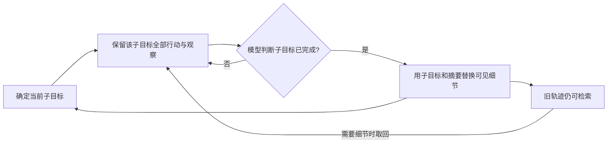

# HiAgent：按子目标组织工作记忆

HiAgent 将**当前子目标的完整行动历史**与**已结束子目标的摘要**分开呈现；需要细节时仍可取回旧轨迹。它改变的是一次任务执行时模型看到的工作记忆，不是跨任务训练出的技能，也不以删除原始轨迹换取压缩。[[raw/papers/HiAgent.pdf#page=3|S007 · §3.1–3.2 · PDF p.3 / 印刷 p.32781]]

## 身份与实际阅读

| 项目 | 登记 |
| --- | --- |
| 标题 | HiAgent: Hierarchical Working Memory Management for Solving Long-Horizon Agent Tasks with Large Language Model |
| 作者 | Mengkang Hu、Tianxing Chen、Qiguang Chen、Yao Mu、Wenqi Shao、Ping Luo |
| 版本与标识 | ACL 2025 long paper；ACL Anthology 2025.acl-long.1575；20 页，印刷 pp.32779–32798 |
| 原始来源 | [ACL 论文页](https://aclanthology.org/2025.acl-long.1575/)；[锁定 PDF](https://aclanthology.org/2025.acl-long.1575.pdf)，访问 2026-10-25 |
| Raw | [[raw/papers/HiAgent.pdf\|HiAgent.pdf]] |
| SHA-256 | `879DE3BA16E6FB26F5B6B741EDC7B5CC6EAAE6E78D3DC60875AF56442CC899A2` |
| 阅读 | 2026-10-25；PDF pp.1–8 正文，pp.13–14 任务说明选读；实际查看 p.3 Figure 2、p.5 Table 1、p.7 Table 2、p.8 Table 3 渲染；其余附录未完整核读，未复现实验 |
| 选读依据 | S001 §4.2.1 / Table 3，PDF pp.24–25，参考文献 [224]（p.93）；工作记忆方向 |

## 长程压力与机制

论文关注多步行动中历史不断增长、当前相关信息被旧行动细节淹没的问题。这里的“长”首先是单次任务的行动序列：其五个 AgentBoard 环境通常需要超过 20 个行动；不是数月持续运行或跨任务终身学习的证据。[[raw/papers/HiAgent.pdf#page=4|§4.1 · PDF p.4 / 印刷 p.32782]]

本库机制示意，依据 §3、Figure 2；箭头表示执行与记忆更新，不表示完成判断一定正确。LLM 同时决定继续当前子目标还是开始下一子目标。摘要器读取子目标与相应轨迹，概括结果并评估完成情况；检索操作可以把某个旧摘要替换成详细行动—观察序列。因此它同时使用压缩和恢复，而非只向下压缩。[[raw/papers/HiAgent.pdf#page=3|§3.1–3.2、Figure 2 · PDF p.3 / 印刷 p.32781]] [[raw/papers/HiAgent.pdf#page=4|§3.3–3.4 · PDF p.4 / 印刷 p.32782]]

成立前提是模型能形成可执行子目标、合理判断何时结束，并在旧摘要不足时提出合适检索；环境须返回可用于行动的观察。本文没有给出“摘要足以恢复一切后续决策”的保证。最后一句是本库对机制适用范围的判断，不是论文证明的失败定理。

## 实验究竟支持什么

主要对照在 Blocksworld、Gripper、Tyreworld、Barman、Jericho 上进行：策略与摘要使用 GPT-4 `gpt-4-turbo`，每个任务至多 30 步、一个上下文示例、temperature 0。Table 1 汇报成功率、进度率、行动步数以及相对于基线的上下文与运行时间。五任务平均成功率由 21% 到 42%，平均上下文为基线的 64.98%；这些数值限定在该模型、任务与执行预算。Gripper 成功率仍为 50%，进度率由 87.75% 降为 86.25%，因此不能写成每项任务每个指标都提升。[[raw/papers/HiAgent.pdf#page=4|§4.1 · PDF p.4 / 印刷 p.32782]] [[raw/papers/HiAgent.pdf#page=5|§4.2、Table 1 · PDF p.5 / 印刷 p.32783]]

Tyreworld 消融表支持摘要与检索在该设定有用，但去掉检索时进度率略升、成功率下降，指标并非总一致。额外的任务分解对照保留旧子目标所有细节；Table 3 中成功率为 Standard 10%、仅分解 40%、HiAgent 60%，有助于区分“分解任务”与“按子目标管理可见记忆”。这仍是单环境消融，不是所有环境的独立因果结论。[[raw/papers/HiAgent.pdf#page=7|§5.1、Table 2 · PDF p.7 / 印刷 p.32785]] [[raw/papers/HiAgent.pdf#page=8|Table 3 · PDF p.8 / 印刷 p.32786]]

> [!note] 原文数值口径
> §5.1 的部分变化量叙述与 Table 2 不一致，例如移除检索的步数增量文字与表格不同。本文不引用这些文字增量，保留表中条件与方向供回查；需要复现时须核对实现及原始结果。[[raw/papers/HiAgent.pdf#page=6|PDF p.6 / 印刷 p.32784]] [[raw/papers/HiAgent.pdf#page=7|Table 2 · PDF p.7 / 印刷 p.32785]]

## 对现有知识的影响与未解决问题

**本库推断：**工作记忆的关键比较轴可以是“按什么边界压缩，以及压缩后是否有恢复通道”。HiAgent 以子目标边界压缩且保留轨迹检索；这与固定窗口截断或只传递全局摘要的机制应分开讨论。该比较尚未构成不同论文间性能排序。

**待检验问题：**子目标完成判断错误时，摘要和取回能否纠正后续行动所需的前提状态？本文的 Tyreworld 描述提供有前提约束的具体任务，但本次阅读没有找到专门操控“错误完成判断”的实验。当前是需补证据的问题，不登记为已确立研究缺口。[[raw/papers/HiAgent.pdf#page=13|附录任务说明 · PDF pp.13–14 / 印刷 pp.32791–32792]]

作者明确承认极长任务仍受记忆约束，且基准以外的真实任务泛化需验证。[[raw/papers/HiAgent.pdf#page=8|Limitation · PDF p.8 / 印刷 p.32786]]

## 主题联系与整合状态

已整合到 [[wiki/harness/Overview#上下文与记忆|Harness：上下文与记忆]]，区分单任务工作记忆、子目标压缩和按需恢复；相关工作中本次未另行核读的论文不计为直接证据。主题与索引已同步，内容与结构验收通过；Obsidian 应用未测。
