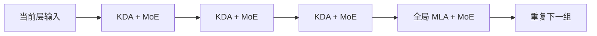

# Kimi Linear：压缩状态与全局访问分层配合

> [!abstract] 核心理解
> Kimi Linear 每三层 Kimi Delta Attention（KDA）插入一层全局 MLA。KDA 用细粒度遗忘与 delta 修正更新有限矩阵状态；全局层保留对历史的直接访问路径。因此它是混合架构：只有 KDA 的状态与序列长度无关，不能把全模型写成固定内存、没有 KV cache 或整体严格线性。[[raw/papers/Kimi-Linear.pdf#page=4|S034 · §3、Eq.1 · p.4]] [[raw/papers/Kimi-Linear.pdf#page=6|§4、Fig.3 · p.6]] [[raw/papers/Kimi-Linear.pdf#page=15|§6.3 · pp.15–16]]

## 身份与读取范围

| 项目 | 记录 |
| --- | --- |
| 标题 | Kimi Linear: An Expressive, Efficient Attention Architecture |
| 作者 | Kimi Team；贡献列表包含 Yu Zhang、Zongyu Lin、Xingcheng Yao、Jiaxi Hu 等，完整名单见 PDF p.24 Appendix A |
| 版本 | arXiv:2510.26692v2，2025-11-01；技术报告，本地 PDF 28 页 |
| 原始来源 | [arXiv 版本页](https://arxiv.org/abs/2510.26692v2)；[本次 PDF](https://arxiv.org/pdf/2510.26692v2)，访问 2026-10-25 |
| 原件 | [[raw/papers/Kimi-Linear.pdf\|Kimi-Linear.pdf]] |
| SHA-256 | `E2E23A449FC9BB27E34E783D20B2E6CD0F1AC67D58EFDC0479C03C54DB956A17` |
| 读取日期与范围 | 2026-10-25；正文 pp.1–18；Appendix A–D pp.24–28，包括贡献、分块推导、伪码和 5.7T 结果；参考文献未逐篇读取；未复现实验或执行代码 |
| 图表核验 | 实际渲染查看 p.1 Fig.1、p.4 Eq.1/状态图、p.6 Fig.3、p.12 Table 5/Fig.6、p.13 Fig.7、p.28 Tables 8–9 |
| 综述来源 | [[wiki/papers/Towards Long-Horizon Agents\|S001]] ref.[842]，§5.1.3 PDF p.40；参考文献 p.143 |
| 整合状态 | 已整合至 [[wiki/optimization/Overview#架构基础\|Optimization 架构基础]]；内容与结构已验收，应用未测 |

## 问题：压缩能降低成本，但细节可能难以找回

作者以 Agent 长轨迹和 RL 生成成本作为动机：全注意力的 KV 随历史增长，而纯线性注意力的有限状态难以承担精确复制与长距离检索。本文选择同时改进压缩状态本身、保留少量全局注意力层。动机提到 agentic tool use，不代表实验已覆盖持续交互任务。[[raw/papers/Kimi-Linear.pdf#page=2|S034 · §1 · p.2]] [[raw/papers/Kimi-Linear.pdf#page=18|§7.2 · p.18]]

## KDA 怎样更新记忆

把每个头的状态记为 $S_t\in\mathbb R^{d_k\times d_v}$。论文 Eq.1 为：

$$
S_t=(I-\beta_t k_tk_t^\top)\operatorname{Diag}(\alpha_t)S_{t-1}
    +\beta_t k_tv_t^\top,\qquad o_t=S_t^\top q_t.
$$

其操作顺序很重要：先按通道衰减旧状态，再修正当前 key 对应的关联，最后写入当前 value。等价地，令 $\widetilde S=\operatorname{Diag}(\alpha_t)S_{t-1}$，更新可理解为 $\widetilde S+\beta_t k_t(v_t-\widetilde S^\top k_t)^\top$：写入的是当前关联的残差，而非只不断累加 KV。GDN 的遗忘率在一个头内为标量；KDA 为 key 通道提供不同遗忘率。[[raw/papers/Kimi-Linear.pdf#page=3|S034 · §2.2 · p.3]] [[raw/papers/Kimi-Linear.pdf#page=4|§3、Eq.1 · p.4]]

这里的在线更新对象是矩阵状态，不是每个 token 都通过反向传播修改模型全部权重。作者以 online learning / fast weights 解释它；本页的残差形式是对 Eq.1 的代数展开。分块训练将块内计算并行化、块间携带状态；推理可使用递归形式。细粒度门控需配套数值稳定与 kernel 设计，不能只凭公式复杂度保证实际速度。[[raw/papers/Kimi-Linear.pdf#page=4|S034 · §3.1–3.2 · pp.4–5]] [[raw/papers/Kimi-Linear.pdf#page=14|§6.2–6.3 · pp.14–16]] [[raw/papers/Kimi-Linear.pdf#page=27|Appendix C · p.27]]

## 为什么还保留全局层

本库示意图表示深度方向的层顺序，不是四个时间阶段。KDA 层使用固定矩阵状态；MLA 层保留历史访问，其 KV 仍随序列增长。作者在全局 MLA 使用 NoPE，将位置与近因倾向交给 KDA；并不等于整个模型完全没有位置信息。[[raw/papers/Kimi-Linear.pdf#page=6|S034 · §4、Fig.3 · pp.6–7]]

Table 1 在较小规模、相同 FLOPs 与超参数下比较混合比例，3:1 的 validation PPL 为 5.65，1:1 为 5.66，7:1 为 5.70，15:1 为 5.82。它支持作者在该设置选择 3:1 的折中，不能推出任何规模、任务和部署都适用一个最优比例；该表不含纯 KDA 条目，不能把它当作纯 KDA 对混合模型的完整直接消融。[[raw/papers/Kimi-Linear.pdf#page=8|S034 · §5.2、Table 1 · p.8]]

## 需要分开的三组质量结果

| 设置 | 关键条件 | 证据界限 |
| --- | --- | --- |
| 合成机制测试 | 两层、两头、每头维度 128；训练最长 20,000 steps，搜索学习率；Palindrome、MQAR、64 栈状态跟踪 | Fig.4 展示最好训练准确率与收敛，不能冒充独立测试集泛化或现实工具任务 |
| 主对照 1.4T | MoE 总参数 48B、激活约 3B；共同训练数据/配方；MLA、GDN-H、Kimi Linear 等 | 长上下文 Table 5 在 128k；能比较这组架构/配方，但不是所有任务都胜出 |
| 发布模型 5.7T | 另一个训练更久的 checkpoint，支持 1M；与 Moonlight 比较 | Moonlight 总参数 16B vs Kimi 48B，虽激活同为 3B，不能把差异全部归于注意力 |

定位分别为 [[raw/papers/Kimi-Linear.pdf#page=7|S034 · §5.1、Fig.4 · pp.7–8]]、[[raw/papers/Kimi-Linear.pdf#page=9|§5.4–5.5 · pp.9–12]]、[[raw/papers/Kimi-Linear.pdf#page=28|Appendix D、Tables 8–9 · p.28]]。

主长上下文表中 Kimi Linear 的平均分 54.5，高于 MLA 的 52.2；但 LongBench V2、Frames、Long Code Arena Commit 这些列并非最佳。平均数汇合不同任务，不能作为统一成功概率。5.7T 模型的 RULER@1M=94.8 来自另一个版本，不能拼到 1.4T /128k 公平比较中。[[raw/papers/Kimi-Linear.pdf#page=12|S034 · §5.5、Table 5 · p.12]] [[raw/papers/Kimi-Linear.pdf#page=28|Appendix D、Table 9 · p.28]]

RL 比较使用内部数学数据做 RLVR，并在 AIME/MATH500 等测试集观察学习曲线；没有展示多工具环境中的长期行动成功或恢复。论文报告相同算法和超参数，不足以证明所有训练信号与 harness 组合都保持该排序。[[raw/papers/Kimi-Linear.pdf#page=10|S034 · §5.4.2 · p.10]] [[raw/papers/Kimi-Linear.pdf#page=12|§5.5、Fig.6 · p.12]]

## 速度结论的可核对边界

Fig.7 明确 batch=1：1M 时图中 prefill 标为 2.9×，decoding 标为约 2.2×；§6.3 正文对 decoding 写 2.3×，存在小幅数值标注差异。Fig.1 的 6.3× 与省下缓存后使用更大 batch 有关，§6.3 又称其为 theoretical decoding speedup。本页将其保留为作者的条件性吞吐论述，**不写成固定 batch 下实测每请求快 6.3 倍**。已读报告没有确认这组端到端计时的硬件和完整 batch 配置，因此不提供可直接迁移的速度承诺。[[raw/papers/Kimi-Linear.pdf#page=1|S034 · Fig.1 · p.1]] [[raw/papers/Kimi-Linear.pdf#page=13|§5.6、Fig.7 · p.13]] [[raw/papers/Kimi-Linear.pdf#page=16|§6.3 · p.16]]

“KV cache 最多减 75%”来自大部分层改成 KDA 的架构条件，不是整个模型权重、所有训练激活、服务内存都缩小 75%。全局层仍存在，整体成本仍包含全注意力项。[[raw/papers/Kimi-Linear.pdf#page=2|S034 · §1 · p.2]] [[raw/papers/Kimi-Linear.pdf#page=15|§6.3、Eqs.13–14 · pp.15–16]]

## 与其他已读工作的关系及问题

**本库比较：**[[wiki/papers/Mamba|Mamba]] 说明输入选择如何更新有限状态；Kimi Linear 另用 delta 关联修正并插入全局层，不能将二者视作同一方法。[[wiki/papers/Longformer|Longformer]] 保留 token 但稀疏连接；Kimi 的全局层是深度上周期插入，不是同一层中挑若干全局 token。不同数据、规模、训练和基准不支持跨论文直接排名。

最近方法 GDN、GLA、MLA 与 DPLR 相关背景依然是本文作者的比较，本页未逐篇原文核读。本文也未独立验证所有理论上限论述，因此不沿用“压缩因此更智能”作为成立的学术结论。[[raw/papers/Kimi-Linear.pdf#page=16|S034 · §7 · pp.16–18]]

**待检验阅读问题：**对于同样计算预算，压缩层保留的关联与全局层恢复的细节各承担什么任务？本文已有比例和门控消融，若继续追问需寻找分布、错误类型与层作用的证据；当前没有完成查新，不宣称尚无人研究。

相关入口为 [[wiki/optimization/Overview#架构基础|Optimization：Architecture Design / hybrid memory]]，另可作为 RL 与架构相互制约的跨方向证据。共享整合完成、内容与结构已验收；Obsidian 应用渲染及跳转未测。
