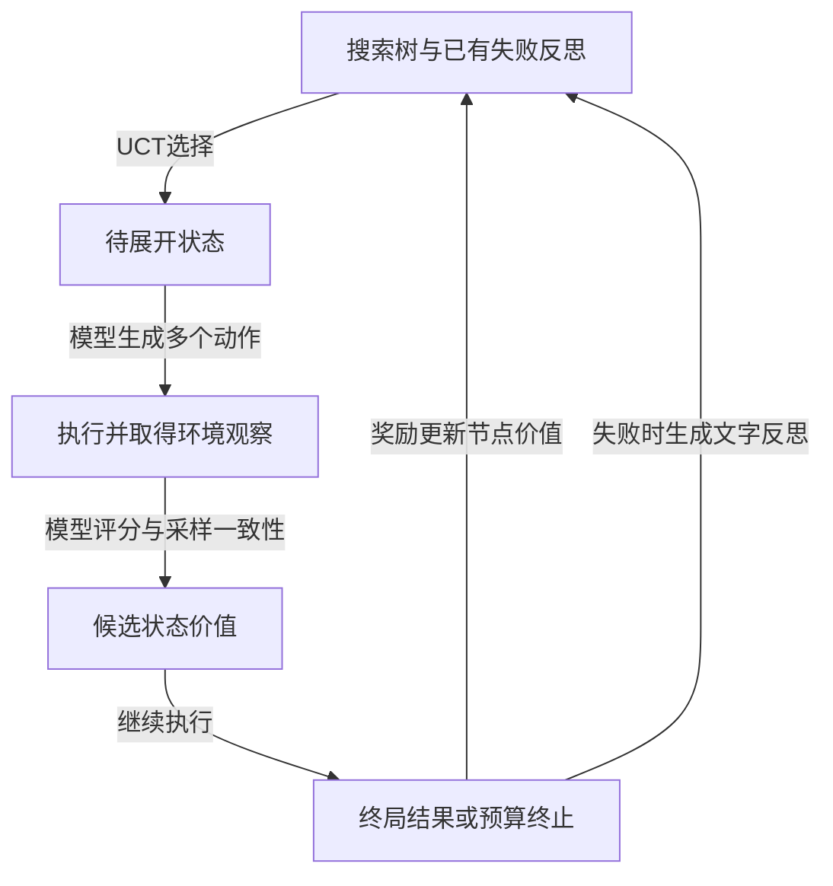

# Language Agent Tree Search Unifies Reasoning, Acting, and Planning in Language Models

LATS 把 ReAct 式思考与行动放进 MCTS 搜索：每个节点保存行动和观察，模型评价带有实际反馈的状态；终局奖励沿路径更新数值，失败轨迹再生成自然语言反思，供后续尝试使用。**环境观察、终局奖励、模型自评和反思是四种不同信号，不能统称为可靠反馈。**[[raw/papers/LATS.pdf#page=4|S006 · §4 · pp.4–6]]

> [!important] 适用前提
> 本文面向能够回到先前状态或重新尝试的任务。HotpotQA 实验还使用回答后告知对错的 oracle 环境；编程实验则用内部生成测试搜索，再用真正测试集评价最终选出的程序。离开这些条件，不能直接搬用其准确率。[[raw/papers/LATS.pdf#page=6|§5.1 · p.6]] [[raw/papers/LATS.pdf#page=7|§5.2 · p.7]] [[raw/papers/LATS.pdf#page=14|Appendix B · p.14]]

## 身份与读取范围

| 项目 | 记录 |
| --- | --- |
| 来源 ID | S006 |
| 作者 | Andy Zhou, Kai Yan, Michal Shlapentokh-Rothman, Haohan Wang, Yu-Xiong Wang |
| 版本 | ICML 2024 / PMLR 235 正式会议 PDF；本地原件不标注未经核实的 arXiv 版本 |
| 原始来源 | [PMLR 正式页面](https://proceedings.mlr.press/v235/zhou24r.html) 所列 [固定 proceedings PDF](https://raw.githubusercontent.com/mlresearch/v235/main/assets/zhou24r/zhou24r.pdf)，访问 2026-10-25 |
| 本地原件 | [[raw/papers/LATS.pdf\|LATS.pdf]]，23 页 |
| SHA-256 | `A6B84613EEEAA3BEB979AC3E34CBB3575BCEB7CCF6050A2C2FC677D5E3A3AB19` |
| 实际读取 | 2026-10-25；主体 pp.1–10、Appendix A–D pp.14–17、E.1–E.3 pp.17–18、F.3–F.4 与提示例 p.20；实际查看 pp.4–5 公式/Fig.2、pp.6–9 主结果/消融/成本表、p.15 Algorithm1、p.16 Table11/Fig.3 的渲染原页 |
| 未核读范围 | 参考文献未逐篇追索；p.19 和 pp.21–23 的完整提示/轨迹未系统核读；未审计代码、执行环境或复现实验 |
| 综述入口 | [[raw/papers/Towards Long-Horizon Agents.pdf#page=22\|S001 · §4.1.3 · p.22]]；[[raw/papers/Towards Long-Horizon Agents.pdf#page=37\|S001 · §4.6.3 · p.37]]，参考文献 [875] |
| 摄入状态 | 完成摄入，主 Agent 内容/结构验收通过；Obsidian 应用未测 |

## 从单条轨迹到带环境反馈的搜索

本文的出发点是：逐步调用工具虽能取得观察，却可能在一条差路径上坚持；只搜索模型内部推理，又可能缺少新的外部依据。LATS 在多个候选动作之间搜索，并将执行后的观察加入节点，再进行模型价值判断。原文将 planning 定义为使用搜索算法，所以它在相关工作表中写 ReAct 无 planning，**不应翻译成 ReAct 完全不会规划或动态调整行动**。[[raw/papers/LATS.pdf#page=2|S006 · §1–2 · pp.2–3、Table1注释]] [[raw/papers/ReAct.pdf#page=3|S002 · §2 · pp.3–4]]

**本库分析：**它直接处理同一任务多次尝试间的分支、失败记忆和重选。论文称树与历史为 external memory，但这里主要服务当前任务搜索；没有直接证明跨任务通用经验或跨窗口恢复协议。[[raw/papers/LATS.pdf#page=3|S006 · Table1注释 · p.3]] [[raw/papers/LATS.pdf#page=5|S006 · §4.2 · pp.5–6]]

## 六步循环与两类回传

1. **选择：**从根向下按 UCT 选路径，在已有价值和较少探索的分支间取舍。
2. **展开：**模型生成 n 个动作，环境分别返回观察，形成子节点。
3. **评价：**模型根据最新 thought/action/observation 判断状态；再与同状态下动作被重复采样的 self-consistency 启发式加权。
4. **继续探索：**沿较好候选执行到终止或预算上限；成功判据由任务环境给定。
5. **数值回传：**把终局 reward 更新到路径上的节点价值，影响后续 UCT。
6. **语义反思：**对失败轨迹和终局反馈生成文字解释，存入上下文供后续 agent 与评价器使用；不训练模型权重。

步骤及公式依据：[[raw/papers/LATS.pdf#page=4|S006 · §3.2–4.2 · pp.4–6、Eqs.1–2、Fig.2]]；[[raw/papers/LATS.pdf#page=15|S006 · Appendix A · Algorithm1 · p.15]]。

本库重绘，突出数值与语义两条回路。反思的“为何失败”仍是模型解释；从执行器得到一个分数，不等于这段因果解释已被验证。

Eq.2 的状态价值为 `λ × LM评分 + (1−λ) × self-consistency`。它是搜索启发式，重复采样的动作可能重复犯错；该设计没有正确性保证。默认 λ 随任务改变：HotpotQA/24点为0.5，编程/WebShop为0.8。[[raw/papers/LATS.pdf#page=5|S006 · Eq.2 · p.5]] [[raw/papers/LATS.pdf#page=14|S006 · Appendix A · p.14]]

## 不同实验拿到的反馈并不相同

| 设置 | 搜索时可用什么 | 最终测量与主要边界 |
| --- | --- | --- |
| HotpotQA：100题、GPT-3.5、每方法3示范；默认n=5、最多k=50条尝试 | Wikipedia搜索/查找观察；提交答案后 oracle 告知对错，失败可重试 | ReAct版LATS EM0.63，本文ReAct0.32、best-of-k0.38；CoT后失败再切ReAct的组合0.71。不能视为无正确性oracle的普通网页问答成绩 |
| HumanEval / MBPP：动作是一份完整程序；n=5、k=8 | 内部合成单元测试和编译器输出；程序通过内部测试的比例作奖励；不做通常的多步simulation | 选出一份最佳程序后，在真正测试集上报告pass@1。GPT-4 HumanEval92.7%是经过搜索后的单份提交，不是一次生成调用成功率 |
| WebShop：50条指令、GPT-3.5、n=5、k=30；最大深度15 | 搜索/点击页面观察，购买模拟终局的属性奖励及失败反思 | Score75.9、严格SR38%；属于可重新尝试的购物环境，不是实际购买行为可靠率 |

定位：[[raw/papers/LATS.pdf#page=6|S006 · §5.1 · pp.6–7、Tables2–3]]；[[raw/papers/LATS.pdf#page=7|S006 · §5.2 · p.7、Tables4–5]]；[[raw/papers/LATS.pdf#page=8|S006 · §5.3 · p.8、Table6]]；[[raw/papers/LATS.pdf#page=16|S006 · Appendix D.2–D.3 · pp.16–17]]。

WebShop 的两指标尤须分开：Table6 中某 Fine-tuning 对照 Score67.5、SR45%，因此 LATS 的属性匹配平均分更高，却没有更高的严格成功率；不同训练方法的表内数字也来自相关工作，不是本库复核过的同模型同预算比较。[[raw/papers/LATS.pdf#page=8|S006 · Table6 · p.8]]

## 消融支持哪些组件，成本还缺什么口径

HotpotQA 的作者消融在 n=5、k=50 下，完整方法 EM0.63；去模型启发式0.37，改DFS0.42，去反思0.58。它支持这个 oracle 设置中模型状态评价、搜索控制和反思都影响结果，但不能外推为“反思对所有环境都同样有用”或“MCTS普遍优于DFS”。原文在 WebShop 反而观察到反思常过于泛泛、帮助有限。[[raw/papers/LATS.pdf#page=8|S006 · §5.3–5.4 · Table8 · p.8]]

相同的 k 只对齐尝试轮数，LATS 每步还展开多个节点、调用评价器并生成反思。Tables9–10 的成本统计强调**成功搜索时**的平均节点与 token，不应当作包括所有失败的整套工作负载平均成本。作者也明确承认比简单 ReAct/Reflexion 更昂贵。[[raw/papers/LATS.pdf#page=9|S006 · Tables9–10、§6 · p.9]] [[raw/papers/LATS.pdf#page=14|S006 · Appendix B · p.14]]

论文的具体配置有待复现前核查：Appendix C/Table11 使用 HotpotQA深度7，D.1却写6；主体编程设置写4个内部测试，D.2细分为GPT-3.5六个、GPT-4四个；Tables3/8与9/10的ToT及LATS成绩也有不同。**本库保留各表的局部条件，不把这些值合成一个完全统一的配置。**[[raw/papers/LATS.pdf#page=7|S006 · §5.2 · p.7]] [[raw/papers/LATS.pdf#page=9|S006 · Tables9–10 · p.9]] [[raw/papers/LATS.pdf#page=14|S006 · Appendix C–D · pp.14–16、Table11]]

## 对长期 Agent 最有价值的限制：恢复文本不等于恢复环境

LATS 在很多语言任务中可以复制已有上下文再试一个候选；对外部交互，必须连环境状态一起支持回退、重置或无副作用重放。作者明确把环境可回退列为局限，并承认当前基准比现实交互简单。**本库推断：**工具调用一旦产生不可撤销的副作用，不能靠把旧 observation 放回提示就假装世界已恢复。[[raw/papers/LATS.pdf#page=4|S006 · §3.2 · p.4]] [[raw/papers/LATS.pdf#page=14|S006 · Appendix B · p.14]]

另一个前提是终局反馈质量。HotpotQA oracle、合成测试和属性匹配奖励各有不同的可得性与盲区；直接观察只告诉系统执行结果，模型价值和反思仍可能误判。本文没有评估任意错误奖励、缺失奖励或难以验证的开放式研究问题。此句是对本次读取实验范围的概括，不是方法已被证明在那些条件下失效。[[raw/papers/LATS.pdf#page=6|S006 · §5.1–5.3 · pp.6–8]]

## 与本库已有论文的关系

已整合到 [[wiki/harness/Overview#循环与工作流|Harness · 循环与工作流]] 的树状搜索与反馈比较，主题与论文页已互链，内容与结构已验收；Obsidian 应用未测。它连接了 [[wiki/papers/ReAct|ReAct]] 的行动观察回路与 [[wiki/papers/Tree-of-Thoughts|ToT]] 的分支选择，但额外引入 MCTS 数值回传、环境执行和失败反思。原文 ReAct/ToT 与本篇对照的模型、任务子集、反馈权限不同，跨论文分数不能直接比较。[[raw/papers/LATS.pdf#page=5|S006 · §4.2 · pp.5–6]]

与 [[wiki/papers/Arbor|Arbor]] 比较，LATS 回传的数值用于估计当前问题路径价值，Arbor 还将跨实验认识归纳成方向级约束；两者都用文本，但学习对象和持久化目的不同。

**待检验问题：**能够回放的任务中，搜索收益有多少来自更多候选、多少来自更可靠的反馈？作者已有相关消融，本库尚未完成更广查新；当前先将“反馈权限、可回退性、总调用预算”作为跨论文比较的必要条件，不宣布新研究缺口。

原件与关键图表已核对；代码、环境行为、配置冲突及复现结果未验证，Obsidian 中图表渲染和 PDF 跳转未实测。
