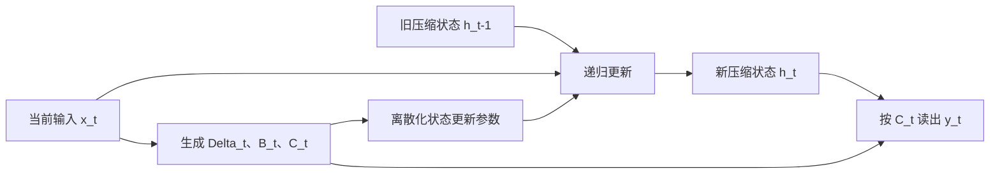

# Mamba：让输入决定如何更新压缩状态

> [!abstract] 核心理解
> Mamba 通过输入相关的状态更新，选择哪些信息进入、保留于或影响有限维递归状态，再用适合 GPU 的 scan 实现高效计算。它用压缩历史换取不随历史长度增长的逐步推理状态；“能处理百万长度序列”没有被证明等于任意百万 token 文档的无损检索或长期 Agent 成功。[[raw/papers/Mamba.pdf#page=5|S033 · §3.1–3.3 · pp.5–7]] [[raw/papers/Mamba.pdf#page=10|§4 · pp.10–15]]

## 身份与读取范围

| 项目 | 记录 |
| --- | --- |
| 标题 | Mamba: Linear-Time Sequence Modeling with Selective State Spaces |
| 作者 | Albert Gu、Tri Dao |
| 版本 | arXiv:2312.00752v2，2024-05-31；本地 PDF 36 页 |
| 原始来源 | [arXiv 版本页](https://arxiv.org/abs/2312.00752v2)；[本次 PDF](https://arxiv.org/pdf/2312.00752v2)，访问 2026-10-25 |
| 原件 | [[raw/papers/Mamba.pdf\|Mamba.pdf]] |
| SHA-256 | `ADF70ED1803C85B1899DEC3E21F3AF0B124411439E8654B840EA65F7B9F52B2E` |
| 读取日期与范围 | 2026-10-25；正文 pp.1–17；补读 pp.26–29、34–36 的相关工作、门控推导、scan、合成任务和效率/音频细节；其余附录与参考文献未完整核读；未复现 |
| 图表核验 | 渲染查看 p.6 Fig.2 / Algorithm 1–2；p.8 Fig.3 / Eq.5；p.15 Fig.8；p.16 Tables 6–8 |
| 综述来源 | [[wiki/papers/Towards Long-Horizon Agents\|S001]] ref.[186]，§5.1.2 PDF p.39；参考文献 p.90 |
| 整合状态 | 已整合至 [[wiki/optimization/Overview#架构基础\|Optimization 架构基础]]；内容与结构已验收，应用未测 |

## 长程困难：小状态应当留下什么

作者把序列建模视为上下文压缩问题。固定大小递归状态提供低成本，但如果更新规律不随内容变化，就难以跳过不相关 token、保留真正需要的信息。Selective Copying 将要记忆的 token 随机放在噪声之间，使单纯记住固定间隔不足以完成任务；Induction Heads 要在再次出现某个线索时找回之前关联的后继 token。它们用来隔离内容选择能力，不能等同于全部自然语言推理。[[raw/papers/Mamba.pdf#page=5|S033 · §3.1、Fig.2 · pp.5–6]] [[raw/papers/Mamba.pdf#page=10|§4.1 · p.10]]

## 从固定动力学到输入相关的选择

为便于理解，将论文的离散递归写为：

$$
h_t=\bar A_t h_{t-1}+\bar B_t x_t,\qquad y_t=C_t h_t.
$$

$h_t$ 是当前压缩状态；$\bar A_t$ 控制旧状态如何延续，$\bar B_t$ 控制输入如何写入，$C_t$ 控制如何读出。Mamba 令 $\Delta_t,B_t,C_t$ 由输入产生，连续参数 $A$ 保持可学习但不按 token 重新生成；$\bar A_t,\bar B_t$ 通过离散化得到。这里的“选择”是学习到的数值运算，不是显式保存/删除文本条目的工具调用。[[raw/papers/Mamba.pdf#page=3|S033 · §2、Eqs.2/4 · pp.3–4]] [[raw/papers/Mamba.pdf#page=6|§3.2、Algorithm 2 · p.6]]

本库示意图表示单步计算依赖，不是作者原图。状态大小由模型维度决定，不逐项积累历史 token；因此旧信息能否恢复取决于状态更新保留了什么。作者在一个受限特例中把递归化为 $h_t=(1-g_t)h_{t-1}+g_tx_t$，说明它与 RNN 门控的关系；这个简式不是整个多维 Mamba block 的完整公式。[[raw/papers/Mamba.pdf#page=8|S033 · §3.5.1、Theorem 1 / Eq.5 · p.8]] [[raw/papers/Mamba.pdf#page=27|Appendix C · pp.27–28]]

Mamba block 还包含投影、短卷积、激活、门控与输出投影。输入相关更新破坏了原来固定 SSM 与全局卷积的等价计算路径；作者用融合 kernel、parallel scan 和反向重计算，减少在 HBM 中保存巨大中间状态。理论递归形式和实际 GPU 吞吐是两个贡献，后者依赖实现与硬件。[[raw/papers/Mamba.pdf#page=7|S033 · §3.3–3.4 · pp.7–8、Fig.3]] [[raw/papers/Mamba.pdf#page=28|Appendix D · pp.28–29]]

## 四类证据不要互相替代

| 证据 | 本文实际设置 | 能支持什么 |
| --- | --- | --- |
| 内容选择 | 两层合成模型；Induction Heads 在长度 256 训练，测试到 1,048,576；词表 16 | 该合成关联任务的长度外推；不是开放词表长文任意事实召回 |
| 语言建模与零样本任务 | Pile；scaling 实验约 125M–1.3B；下游最大模型约 2.8B、300B token，context 2048 | 本文训练范围内的 perplexity 与常识/阅读基准质量 |
| 很长真实序列 | DNA 与音频预训练/分类；DNA 长度可到 1M，音频约一分钟采样点 | 这些模态的长上下文收益；不能直接换成百万自然语言 token 证据 |
| 吞吐 | A100 80GB PCIe；prompt 2048，生成 128；改变 batch | 此实现下的生成资源效率，不含环境交互成本或任务完成指标 |

分别见 [[raw/papers/Mamba.pdf#page=10|S033 · §4.1、Tables 1–2 · pp.10–11]]、[[raw/papers/Mamba.pdf#page=29|Appendix E.1、Table 11 · p.29]]、[[raw/papers/Mamba.pdf#page=11|§4.2 · pp.11–12、Table 3]]、[[raw/papers/Mamba.pdf#page=13|§4.3–4.4 · pp.13–15]]、[[raw/papers/Mamba.pdf#page=36|Appendix E.5 · p.36]]。

**选择机制的消融。** Table 6 在约 350M 语言模型设置下，将 Mamba block 的 S4(real) 换成 S6，perplexity 从 10.56 到 8.69；Table 7 显示同时让 $\Delta,B,C$ 输入相关优于只启用其中一个。它支持该设置下选择机制的贡献，不证明增加选择性对所有模态都更好；音频附录恰好报告部分设置偏好不带选择性的 LTI 层。[[raw/papers/Mamba.pdf#page=15|S033 · §4.6 · pp.15–16、Tables 6–7]] [[raw/papers/Mamba.pdf#page=34|Appendix E.4.1、Fig.10 · pp.34–35]]

**4–5 倍吞吐的边界。** 正文把这项优势与不用保存逐 token KV、能使用更大 batch 联系起来。附录使用标准 Hugging Face GPT-3 式 Transformer 比较端到端生成，并包含一个**未训练**的 6.9B Mamba；它可用于性能测试，不能用于 6.9B 模型质量结论。Fig.8 左图的 scan kernel 比较不含全部投影等运算，不能当成整个模型快同样倍数。[[raw/papers/Mamba.pdf#page=15|S033 · §4.5、Fig.8 · p.15]] [[raw/papers/Mamba.pdf#page=35|Appendix E.5 · pp.35–36]]

## 前提与未知

作者明确把更大模型规模、instruction tuning/RLHF 等使用方式列为待探索项；连续/离散模态对选择性有不同偏好。论文没有提供开放式长期工具执行、动态环境恢复或跨任务经验积累的结果。[[raw/papers/Mamba.pdf#page=17|S033 · §5–6 · p.17]]

**本库推断：**Mamba 给出了“有限状态如何随内容变化”的具体机制，但没有说明任意未来任务所需的信息都被保存。Agent 轨迹中的信息可能直到后续目标变化才显得重要，因此“当时可忽略”与“未来可丢弃”不能混为一谈。这是应用到 Agent 时需要检验的假设，不是论文证明的缺陷。

**待检验阅读问题：**固定状态在关联数量、干扰密度、目标后置条件变化时怎样失效？本文已经包含合成选择任务和状态维度消融，后续查新必须以这些近邻为起点，不能把“研究有限记忆”本身当作新贡献。作者对 S4/H3/Hyena/RetNet/RWKV 的背景比较尚未由本页逐篇原文复核。[[raw/papers/Mamba.pdf#page=17|S033 · Table 10 · p.17]]

## 主题联系

相关入口为 [[wiki/optimization/Overview#架构基础|Optimization：Architecture Design / compressed memory]]。与 [[wiki/papers/Longformer|Longformer]] 的机制区别是有限递归状态对显式 token 稀疏访问；与 [[wiki/papers/GQA|GQA]] 的区别是压缩时间历史对共享 KV 头。这些是本库根据已读机制作的比较，不构成跨论文分数排名。共享整合完成、内容与结构已验收；Obsidian 应用检查未完成。
