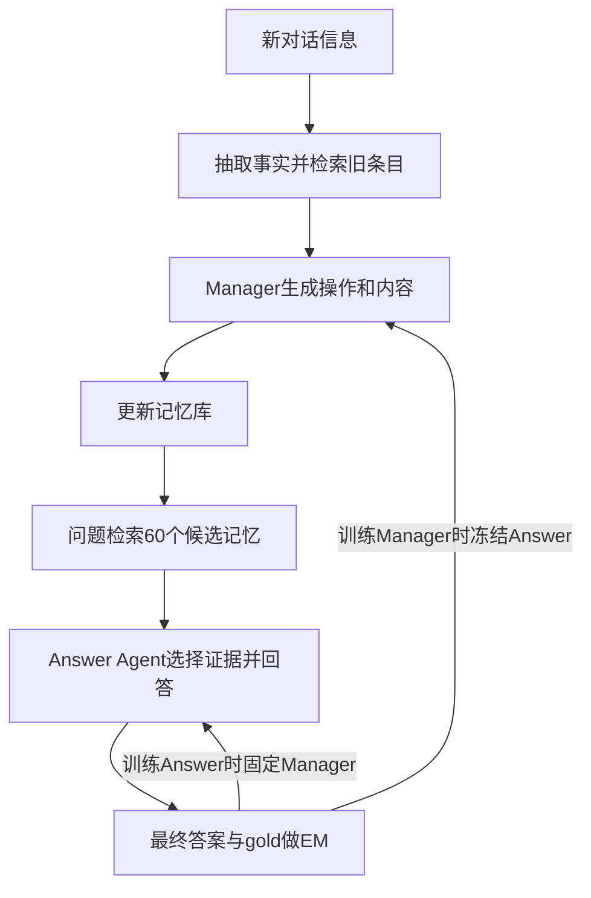

# Memory-R1：用回答结果训练记忆写入与使用

## 身份与实际阅读

| 项目 | 记录 |
| --- | --- |
| 来源 ID | S055 |
| 原文标题 | Memory-R1: Enhancing Large Language Model Agents to Manage and Utilize Memories via Reinforcement Learning |
| 作者 | Sikuan Yan、Xiufeng Yang、Zuchao Huang、Ercong Nie、Zifeng Ding、Zonggen Li、Xiaowen Ma、Jinhe Bi、Kristian Kersting、Jeff Z. Pan、Hinrich Schuetze、Volker Tresp、Yunpu Ma |
| 版本 | ACL 2026正式版，2026-07；DOI 10.18653/v1/2026.acl-long.583；印刷pp.12805–12825 |
| 原始来源 | [锁定 PDF](https://aclanthology.org/2026.acl-long.583.pdf)；访问 2026-10-25；发布页与 PDF 首页身份已核对 |
| Raw | [[raw/papers/Memory-R1.pdf\|本地原件，共 21 页]] |
| SHA-256 | `35F4F543501F2E2D1C8CC95503BAE81A31B87C550E84C8977380B5AD3985A80E` |
| 实际阅读 | 2026-10-25；正文PDF pp.1–9；附录B–G pp.13–21的训练构造、prompt、配置、算法及结果/时延；实际看PDF p.4 Fig.2/Eq.1–4、p.6 Table1、p.20 Algorithms3–5、p.14数据构造、p.16配置。案例pp.12–13未完整核读，参考文献未逐条核读；未验证所有附录结果单元格 |
| S001 入口 | 引文743，§5.5.4，综述p.52；书目p.135；本页按实际下载版本解释，不能假定与综述所引版本完全相同 |

以下主张来自原论文直接核读，另标本库推断；未复现实验、未核读实现代码。PDF 页码从首页起算。

## 核心判断：学习什么进入记忆，也学习如何从记忆回答

Memory Manager根据新抽取的信息和检索到的旧条目生成ADD、UPDATE、DELETE、NOOP及更新内容；Answer Agent从检索候选中先输出相关记忆，再回答。二者都用最终QA正确性训练，**训练一个组件时另一个固定**。这不是运行时遇到新记忆就实时更新参数，也不是已实现联合多agent RL。[[raw/papers/Memory-R1.pdf#page=3|§3–3.1 · PDF pp.3–4 / 印刷pp.12807–12808]] [[raw/papers/Memory-R1.pdf#page=18|Appendix E · PDF p.18 / 印刷p.12822]]

> [!important] 直接证据范围
> 主要是多会话对话问答；跨集测试的LongMemEval使用 **oracle版本**。因此其迁移结果不等于在完整、海量干扰记忆下端到端检索成功；也不等于长期自主执行任务的可靠性。[[raw/papers/Memory-R1.pdf#page=14|Appendix B.1 · PDF p.14 / 印刷p.12818]]

本库示意，描述两个训练阶段共用的反馈接口，两个回边不是同步联合更新。运行时记忆可以持续变化，参数训练则在论文的离线数据与RL阶段完成。[[raw/papers/Memory-R1.pdf#page=4|Fig.2、§3.1 · PDF p.4 / 印刷p.12808]] [[raw/papers/Memory-R1.pdf#page=5|§3.2 · PDF p.5 / 印刷p.12809]]

## 状态、动作、奖励怎样连接

**Manager状态**是新信息x和相关旧记忆；动作是操作及文本内容(o,m′)。执行后让冻结回答器根据更新库作答，以EM提供reward。PPO用value/advantage；GRPO对同状态多个候选操作的答案奖励组内归一化，不要求人工标每个操作对错。gold QA和预构造记忆仍是监督/基础设施，不能写成“无标签”。[[raw/papers/Memory-R1.pdf#page=4|§3.1、Eq.1–4 · PDF p.4 / 印刷p.12808]]

**Answer状态**是问题q与检索集合Mret；输出包含筛选出的记忆及简短答案。每个参与者取top30，共60；“Memory Distillation”是生成中挑选证据，不是把大模型参数蒸馏到小模型。最终EM指导整个生成过程，没有为所选每条记忆分别提供正确性标签。[[raw/papers/Memory-R1.pdf#page=5|§3.2 · PDF p.5 / 印刷p.12809]] [[raw/papers/Memory-R1.pdf#page=16|Algorithm2 · PDF p.16 / 印刷p.12820]] [[raw/papers/Memory-R1.pdf#page=17|Fig.11 · PDF p.17 / 印刷p.12821]]

**本库推断：**写入策略改变未来可检索到的状态，回答策略能力又决定写入动作获得什么reward。冻结另一方减少更新期间漂移，但不消除归因依赖：一个保存正确事实的动作也可能因回答器不会使用而得零；某操作对眼前QA有益，也未证明对未来未知问题有益。论文自己的Limitations承认分开训练与联合协调的差距。[[raw/papers/Memory-R1.pdf#page=9|Limitations · PDF p.9 / 印刷p.12813]]

## 训练状态如何构造，规模意味着什么

训练只用LoCoMo；报告152/81/1307 QA的train/validation/test划分，排除adversarial。“152训练样本”说的是QA数，不包括预训练、GPT-4o-mini构造临时记忆、检索和多次RL采样成本；是否严格按对话而非问题划分，本次材料未确认。MSC和LongMemEval不再训练。[[raw/papers/Memory-R1.pdf#page=5|§4.1 · PDF p.5 / 印刷p.12809]] [[raw/papers/Memory-R1.pdf#page=14|Appendix B.2 · PDF p.14 / 印刷p.12818]]

Manager的训练输入是部分构造的记忆快照＋新turn＋相关QA。文本说快照取前24 turns，Algorithm1却写前50；Algorithm5另以每tuple空库开始、顺序处理多turn描述训练。它们对重置/初态分布的描述未完全一致，不能替作者确定唯一实现。使用训练过的Manager构库后再产生Answer训练集，说明后者分布依赖前者。[[raw/papers/Memory-R1.pdf#page=14|Appendix B.2、Algorithm1 · PDF p.14 / 印刷p.12818]] [[raw/papers/Memory-R1.pdf#page=16|Algorithm2 · PDF p.16 / 印刷p.12820]] [[raw/papers/Memory-R1.pdf#page=20|Algorithm5 · PDF p.20 / 印刷p.12824]]

主体模型Llama3.1-8B、Qwen2.5-3B/7B/14B Instruct；常规4×H100 80GB，14B用8卡；batch128、microbatch2/GPU，prompt4096/response2048，actor/critic学习率1e-6/1e-5，训练温度1、测试0。总epoch/steps、GRPO组大小和完整阶段交替日程在已核读配置中未确认；不能仅凭“152 QA”推算训练预算。[[raw/papers/Memory-R1.pdf#page=16|Appendix D · PDF p.16 / 印刷p.12820]]

## 结果支持模块贡献，但没有统一的最佳算法

主表Llama8B的Memory-R1-GRPO总体F1/B1/J为45.02/37.51/62.74，Memory-SFT为42.81/32.98/58.76，PPO为41.05/32.91/57.54。所以GRPO优于此SFT对照，但PPO并非全胜；Qwen7B temporal上PPO也优于GRPO。正文“所有非RL基线均胜出”需按表收窄。[[raw/papers/Memory-R1.pdf#page=6|Table1 · PDF p.6 / 印刷p.12810]]

移除Manager训练、Answer训练、distillation等消融整体支持各环节有用，不过指标未全部同向：PPO去掉训练Answer时J=59.4高于全流程57.5。改变reward也改变答案风格：J-based PPO得到更高J、较低F1/B1，说明词面重合与语义judge不是同一测量对象。不能把所有变化解释为记忆保真度。[[raw/papers/Memory-R1.pdf#page=7|§4.4、Fig.5 · PDF p.7 / 印刷p.12811]] [[raw/papers/Memory-R1.pdf#page=8|Table2 · PDF p.8 / 印刷p.12812]]

> [!note]- 原文内部的复现待核查项
> §4.1称1:1:8划分，却列152/81/1307；正文对LoCoMo约600turns/26k tokens，附录B.1写平均300turns/9k；主表与附录Table3的Qwen7B总体结果不同。不同版本/设置的解释未给全，本页不混拼数字。Algorithm3的UPDATE先删旧条目再加合并项，Algorithm5只并入新项，库状态是否保留旧条目需核实现。[[raw/papers/Memory-R1.pdf#page=5|§4.1 · PDF p.5 / 印刷p.12809]] [[raw/papers/Memory-R1.pdf#page=13|Appendix B.1 · PDF p.13 / 印刷p.12817]] [[raw/papers/Memory-R1.pdf#page=19|Table3 · PDF p.19 / 印刷p.12823]] [[raw/papers/Memory-R1.pdf#page=20|Algorithms3/5 · PDF p.20 / 印刷p.12824]]

与 [[wiki/papers/ReSum|ReSum]] 相接的是真实的harness—训练接口：压缩或编辑存储决定以后输入，训练决定如何使用；但本篇为长期对话记忆，ReSum为搜索历史摘要，不能直接排名。A-MEM等基线的版本实现差异未独立审计；不由本篇作者比较宣告领域最优。待检验的具体问题是固定回答器能力与检索预算后，当前QA reward对未知未来问题的记忆保留是否仍有利；尚未做完整查新。

## 主题联系与状态

已整合 [[wiki/optimization/Overview#Agentic Reinforcement Learning|Optimization：Agentic RL]] 的状态分布、反馈与信用比较。同时整合 [[wiki/harness/Overview#上下文与记忆|Harness：上下文与记忆]]，以同一来源连接运行时编辑和分阶段参数学习。本篇内容与结构验收通过，已完成摄入；主题、队列、索引及摄入日志已同步。按用户要求本轮不做Obsidian应用检查，应用未测；未复现实验。
