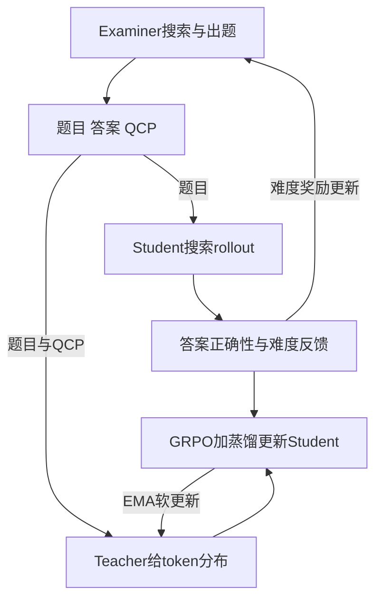

# π-Play: Multi-Agent Self-Play via Privileged Self-Distillation without External Data

## 来源身份与读取范围

| 项目 | 记录 |
| --- | --- |
| 来源 ID | S059 |
| 作者 | Yaocheng Zhang、Yuanheng Zhu、Wenyue Chong、Songjun Tu、Qichao Zhang、Jiajun Chai、Xiaohan Wang、Wei Lin、Guojun Yin、Dongbin Zhao |
| 版本 | arXiv:2604.14054v2；预印本，正式发表状态未确认 |
| 原始页面 | [arXiv版本页](https://arxiv.org/abs/2604.14054v2)；[版本PDF](https://arxiv.org/pdf/2604.14054v2)；访问2026-10-25 |
| DOI | 10.48550/arXiv.2604.14054（arXiv标识） |
| 原件 | [[raw/papers/Pi-Play.pdf\|本地PDF · 23页]] |
| SHA-256 | `107532D4125A0177229149081D962086F96C23FF71F48C62AF96B3C72667D75E` |
| S001引用 | 引文838；§5.6.2，PDF pp.53；书目p.143 |
| 读取日期与范围 | 2026-10-25；正文pp.1–9；附录A–D（pp.12–19），其中案例pp.16–18作机制核查；看图核对p.3 Figure 2、p.5目标/EMA、p.13预算、p.19 top-K公式。E完整提示pp.20–23未逐项核读；未复现实验。 |

## 核心理解：出题过程既改变课程，也给教师额外线索

**原文陈述。** π-Play为搜索问答设计三个同底座角色：examiner从文档和搜索构造问题、答案及Question Construction Path（QCP）；学生只看到题目进行搜索；教师额外看到QCP，在学生rollout前缀上产生监督。QCP是“题目如何由证据构造”的路径，不能简单当作学生必须逐步复制的正向解题轨迹。[[raw/papers/Pi-Play.pdf#page=2|§1–2.1、Figures 1–2 · pp.2–3]]

本库机制示意；箭头标出训练信息流。QCP只在训练教师侧可见，测试学生不依赖examiner临时出具答案路径。依据 [[raw/papers/Pi-Play.pdf#page=3|§2.1–2.5 · pp.3–5]]。

## 三种更新不是同一个目标

| 角色 | 接收的信息与更新 | 关键边界 |
| --- | --- | --- |
| Examiner | 按学生5次解答成功数给难度/格式奖励，按hop组归一化 | 全对和全错受抑制；学生成功率只是可解性代理 |
| Student | 终局答案匹配的GRPO＋KL(学生‖特权教师) | 不是纯蒸馏，不是删除可验证奖励 |
| Teacher | 每步EMA：ψ←(1−τ)ψ+τθ，τ=0.05 | Eq.2是理想目标，实际并未单独用该目标RL训练教师 |

依据 [[raw/papers/Pi-Play.pdf#page=4|§2.2–2.3、Eqs.4–9 · p.4]] [[raw/papers/Pi-Play.pdf#page=5|§2.4、Eq.11 · p.5]] [[raw/papers/Pi-Play.pdf#page=13|Tables 6–8 · p.13]]。

蒸馏Eq.10沿学生rollout算token均值reverse KL，教师停止梯度。附录D实际按**学生top-K**保留词项并把剩余概率压为一个tail桶，K消融选择约50；不能写成逐词完整KL精确计算，也不是直接丢弃尾部。蒸馏权重λ随轮次衰减，教师EMA系数τ与KL正则β是另外的参数。[[raw/papers/Pi-Play.pdf#page=5|§2.3、Eq.10 · p.5]] [[raw/papers/Pi-Play.pdf#page=13|B、C.1 · p.13]] [[raw/papers/Pi-Play.pdf#page=19|D、Eq.12 · p.19]]

## 经验结果限定在什么任务和预算

Qwen3-4B、4B-Instruct、8B；相同E5-base检索器和English Wikipedia语料，评三项单跳与四项多跳QA的EM。每次examiner50步、学生50步，共三次迭代；生成问题1–4 hop默认4:3:2:1。学生rollout上限**5轮**、8192 token，不能将deep search名称外推为数百轮或跨上下文自主研究能力。Table 1的Total是七项分数求和，非单一任务成功率。[[raw/papers/Pi-Play.pdf#page=5|§3.1–3.2、Table 1 · pp.5–6]] [[raw/papers/Pi-Play.pdf#page=12|B、Tables 6–8 · pp.12–13]]

QCP、半截QCP、最终答案、答案+hop数及去掉蒸馏的对照支持：在4B-Instruct配方里，完整构造路径比仅最终答案提供更有用监督；并非所有基准单项都优于自对弈。Table 4以固定solver评不同轮examiner题目，显示后期题目更难，直接说明任务分布随训练改变。[[raw/papers/Pi-Play.pdf#page=8|§4.1–4.2、Tables 3–4 · p.8]]

“data-free”指不用外部人工QA/示范，仍依赖基础模型、Wikipedia、搜索工具和出题格式奖励。QCP基于检索并不自动保证合成答案或问题无误；作者用学生命中率作可解性代理，非独立人工真值审计。[[raw/papers/Pi-Play.pdf#page=4|§2.1–2.2 · p.4]] [[raw/papers/Pi-Play.pdf#page=6|§3.1 · p.6]]

作者以达到某表现所需迭代数报告2–3倍“演化效率”；这不等于硬件无关的训练加速。附录C.2在8×H20下分开计examiner、学生rollout、教师forward和更新，平均每步725.9秒对Dr.Zero695.9秒（约4.3%开销）。最优checkpoint由训练期间表现选择，正文未明确独立验证集选择细节；不声称严格等总计算、预注册测试的优势。[[raw/papers/Pi-Play.pdf#page=6|§3.1–3.3 · pp.6–7]] [[raw/papers/Pi-Play.pdf#page=13|C.2、Table 11 · pp.13–15]]

## 怎样改变本库分类

**本库综合。** π-Play横跨OPD、自我演化及任务/环境合成：内层是在学生前缀上蒸馏，外层examiner更新课程，另有稀疏奖励RL。因此S001若以“OPD固定任务、自我演化改变任务”作导航，本文提示这些是可同时出现的机制轴，不是互斥论文类别。与GKD相比它增加特权QCP及课程；与SD-Zero相比它无需外部QA但需要检索支撑出题，且teacher以EMA更新。未核读Dr.Zero、SQLM原文，相关优劣仅限本论文对照；尚未复现。优先保留方法边界，不凭三次迭代宣布持续自我演化已解决。

## 主题联系与维护状态

已整合到 [[wiki/optimization/Overview#On-Policy Distillation|Optimization · OPD]]及 [[wiki/optimization/Overview#自我演化|自我演化]]；当前已完成摄入，内容与结构已验收。原件存在与哈希已核对；Obsidian渲染、公式、Mermaid及跳转未测（本轮已停用Computer Use）。

返回 [[wiki/index|索引]]。
