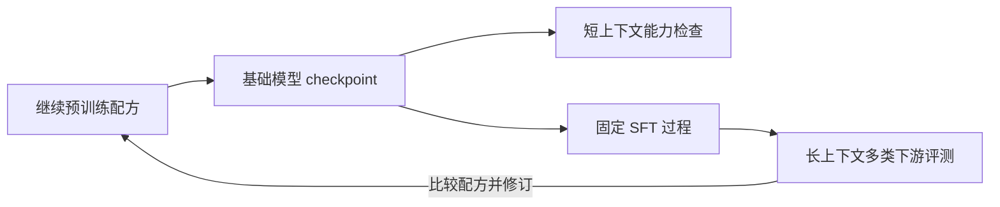

# How to Train Long-Context Language Models (Effectively)

**核心判断：**长上下文训练不能只由“困惑度更低、找针成功”指导。ProLong 用多类下游任务、SFT 后表现和短上下文保持来选择数据/长度配方，显示这些判断可能与单指标相反。这是长输入使用能力的证据，尚未直接测长程 Agent 的环境交互和恢复。[[raw/papers/ProLong.pdf#page=2|§2 · PDF pp.2–3 / 印刷 pp.7377–7378]]

## 来源身份与阅读范围

| 项目 | 记录 |
| --- | --- |
| 来源 ID | S044 |
| 作者 | Tianyu Gao、Alexander Wettig、Howard Yen、Danqi Chen |
| 版本 | ACL 2025 正式论文；DOI 10.18653/v1/2025.acl-long.366；印刷 pp.7376–7399 |
| 原始渠道 | [原始发布页](https://aclanthology.org/2025.acl-long.366/)；[固定 PDF](https://aclanthology.org/2025.acl-long.366.pdf)；访问 2026-10-25 |
| 本地原件 | [[raw/papers/ProLong.pdf\|ProLong.pdf，共 24 页]] |
| SHA-256 | `6AB4EAD61ED0DE9366143F1752CB2D95AF3B0D45C9B4380D4F5EDDB51E4B85BC` |
| 阅读日期与范围 | 2026-10-25；正文 pp.1–9；附录 A–D 的 pp.15–22（配方/评测/数据/主要消融）；图像重点 pp.4–6、15；未系统读取参考文献 pp.9–14、扩展成绩及案例 pp.23–24 |
| S001 选择依据 | 引文 [171]，§5.3.2，PDF pp.44；参考文献 PDF p.89；正文角色和书目已回读核对 |

本页按本地 PDF 第一页起计页码。网页只用于身份核对，学术主张以已归档 PDF 为依据；未复现实验。原始下载文件为 `.research-tmp/S044-download.pdf`，归档前后字节与哈希一致。主题、索引、互链与摄入日志已同步；主 Agent 已完成内容与结构验收，Raw 哈希匹配。Obsidian 应用未测。

## 先决定评测什么，再决定训练什么

本库重绘训练选择流程；箭头表示处理/反馈顺序。核心是每个消融也做SFT，而非只给最终模型补SFT。HELMET子集包含JSON KV recall、RAG、re-ranking、ICL、书籍QA、法律摘要；短任务在SFT前比较以匹配初始化模型。QA/摘要采用GPT-4o评分，不是全由确定性判据核验。[[raw/papers/ProLong.pdf#page=2|§2.1–2.2、Fig.1 · PDF pp.2–3 / 印刷 pp.7377–7378]] [[raw/papers/ProLong.pdf#page=15|Appendix B、Table10 · PDF pp.15–16 / 印刷 pp.7390–7391]]

## 数据、长度、SFT 的相互作用

| 控制问题 | 直接观察 | 不能推出什么 |
| --- | --- | --- |
| 长文本来自哪里 | Llama-3-8B-Base，5B tokens、64K 消融中，books/repos混合综合表现较好；代码更利recall、书籍覆盖其他任务 | 不证明所有Agent都应使用该比例。[[raw/papers/ProLong.pdf#page=3\|§3.1、Table2 · PDF p.3 / 印刷 p.7378]] |
| 是否只用长数据 | 100%长数据可继续改善PG19困惑度，却降低SFT后多类长任务与短任务；60/40在该消融综合较好 | 不等于长数据本身无益，也不等于40%是跨模型定律。[[raw/papers/ProLong.pdf#page=4\|§3.2、Fig.2 · PDF p.4 / 印刷 p.7379]]；[[raw/papers/ProLong.pdf#page=16\|Appendix B、Fig.4 · PDF pp.16–17 / 印刷 pp.7391–7392]] |
| 训练长度是否只需匹配测试 | 从20B/64K checkpoint再训同样4B tokens，512K训练在64K评测优于继续64K | tokens相同不等于FLOPs或时间相同，作者明确更长训练更贵。[[raw/papers/ProLong.pdf#page=5\|§4、Table5 · PDF p.5 / 印刷 p.7380]] |
| 是否必须加入长SFT数据 | 充分长上下文训练后，仅UltraChat短指令有强长任务表现；所测合成长QA/RAG/摘要混入未改善总体 | 不能否定其他生成质量/任务/初始化下的长SFT；作者保留训练不足或SFT规模差异解释。[[raw/papers/ProLong.pdf#page=6\|§5、Table6 · PDF p.6 / 印刷 p.7381]] |

长度优势的解释是作者的简化假设：更长文档可包含更多给定距离的依赖。作者明确这些假设现实中不完全成立，因此它是直觉，不是证明训练越长总越好。[[raw/papers/ProLong.pdf#page=5|§4 · PDF pp.5–6 / 印刷 pp.7380–7381]]

## 最终配方与消融配方分开登记

最终ProLong从 **Llama-3-8B-Instruct** 初始化：64K、20B tokens后再512K、20B，随后UltraChat SFT 1B。继续训练混合为30%代码仓库、30%书籍、3%教材、37%ShortMix；5B消融通常从Base初始化，且无教材。教材增加未做消融，不能把最终模型收益归给3%教材。[[raw/papers/ProLong.pdf#page=15|Appendix A、Table9 · PDF p.15 / 印刷 p.7390]] [[raw/papers/ProLong.pdf#page=18|Appendix C.1–C.3 · PDF pp.18–19 / 印刷 pp.7393–7394]]

训练使用full attention、document mask，512K阶段同时保留64K长文；调整RoPE base及阶段学习率。虽然§6.1正文把原始base简写为10^5，Table9和附录D.1明确Llama-3原始值为5×10^5，本页以配方表为准并保留这一文字差异。[[raw/papers/ProLong.pdf#page=7|§6.1 · PDF p.7 / 印刷 p.7382]] [[raw/papers/ProLong.pdf#page=15|Table9 · PDF p.15 / 印刷 p.7390]] [[raw/papers/ProLong.pdf#page=19|Appendix D.1 · PDF p.19 / 印刷 p.7394]]

## 结果支持范围与本库修订

Table7的128K综合比较、Table8的NoCha提供任务表现；NoCha按所有实例平均，超过某模型窗口的实例不被排除，窗口限制会影响分数。更高综合分也掩盖分项弱点，例如citation表现很低。作者承认只研究Llama-3、约10B尺度及有限配方，有开发集过拟合风险。[[raw/papers/ProLong.pdf#page=7|§6.2、Table7–8 · PDF pp.7–8 / 印刷 pp.7382–7383]] [[raw/papers/ProLong.pdf#page=9|Limitations · PDF p.9 / 印刷 p.7384]]

与 [[wiki/papers/YaRN|YaRN]] 共同形成的本库判断是：位置延展、长程依赖学习、指令表达和完整交互任务要分别举证。短指令能表达长文本能力不等于短轨迹足以训练长程Agent；下一条所需证据应是固定harness的多轮状态跟踪/恢复测试。本轮不把此证据缺口宣布为领域研究空白。

## 本库落点与下一条证据

已整合到 [[wiki/optimization/Overview#预训练与中期训练|预训练与中期训练]]，主题与本页双向关联。相关方法的比较以本文实际实验为限，未核读的引用不成为独立来源。返回 [[wiki/index|索引]]。
