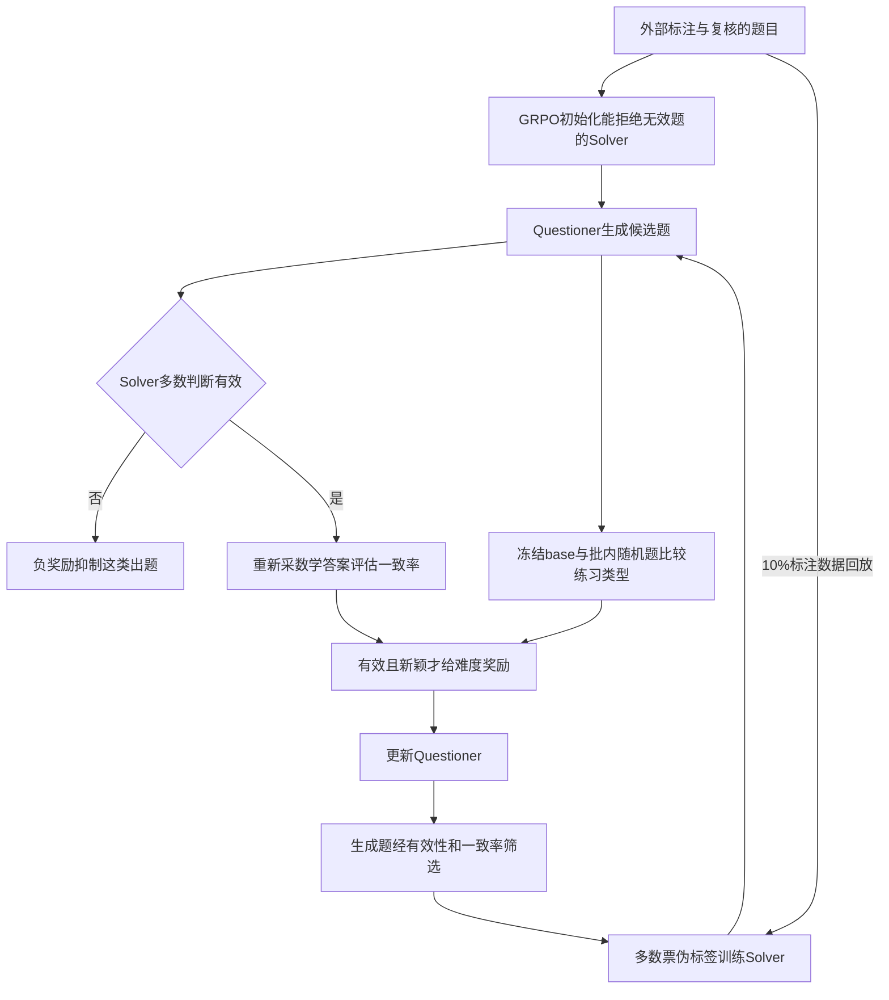

# R-Quest：先检查生成题目，再用它训练求解者

## 身份与实际阅读

| 项目 | 记录 |
| --- | --- |
| 标题 | Questioning the Questions: Sustaining Self-Evolution in Reasoning Models |
| 来源 ID | S069 |
| 作者 | Jinyuan Li、Chengsong Huang、Langlin Huang、Donghong Cai、Shiping Gao、Yuyi Yang、Jiaxin Huang |
| 版本 | arXiv:2610.04299v2，2026-10-06；预印本，正式发表未确认 |
| 原始入口 | [版本页](https://arxiv.org/abs/2610.04299v2)；[版本PDF](https://arxiv.org/pdf/2610.04299v2)；访问2026-10-25 |
| 标识 | DOI 10.48550/arXiv.2610.04299（arXiv标识） |
| Raw | [[raw/papers/R-Quest.pdf\|本地原件，共22页]] |
| SHA-256 | `6FCA765F6B0314B6781E6DC60141B5C1CAADEDC8F685875F374CC310A3469ABE` |
| 读取 | 2026-10-25；主体pp.1–10，附录A–F pp.14–22；重点标注/人工复核、双门控、replay、训练预算、评测和消融。实际看p.3 Fig.3/4，p.5奖励公式，p.6 Table1/Fig.5，p.8 Fig.6，p.14 Table4/标注定义，p.17 Eq.2–3/Fig.8。参考文献未逐条核读、未审代码或复现实验，未逐条核验标注数据。 |
| 选读来源 | Brainstorm定向查新，O7自我演化补读1/2；综述外新来源，无S001引用编号 |

PDF与印刷页码一致。正文将模型名称写作GPT-5.6-Sol，以下按原文记录其标注角色，不用模型名推断标注绝对可靠。

## 低一致率不一定来自值得学习的难题

原文针对[[wiki/papers/R-Zero|S063 R-Zero]]的数学出题—求解循环：同一题的答案不一致，可能是题难，也可能是条件缺失、矛盾或无法客观判分；改变数字和措辞也可能重复同一练习。仅以一致率选题、BLEU惩罚重复，会把题目质量和能力边界混在一起。[[raw/papers/R-Quest.pdf#page=2|§1–2 · pp.2–4]]

作者每轮抽200题，用GPT-5.6-Sol判有效性；五轮样本中有效题减少，一致率筛选后比例更低。进一步用1,273题的匹配训练对照，保留相同766道有效题，把507道无效题替换为外部模型修复版，训练后数学均分更好。这支持“无效题是一个影响因素”，不是证明所有失稳只由坏题造成；修复需尽量保留领域/难度，但并非严格只切换一个二元属性，完整标签与难度等价核查尚未在本次证据中建立。[[raw/papers/R-Quest.pdf#page=3|§2.2.1、Fig.3 · p.3]]

重复诊断另外抽第五轮过滤后的200题，由GPT-5.6-Sol按任务结构分组；前三类占59.5%，最大一类被BLEU分成22簇。它是模型判定的练习类型集中度，不是全体问题的数学等价证明，也不证明重复一概没有学习价值。[[raw/papers/R-Quest.pdf#page=3|Fig.4、§2.2.2 · pp.3–4]]

## 两种反馈怎样进入循环

本库示意，箭头表示数据、反馈和更新。依据 [[raw/papers/R-Quest.pdf#page=4|§3.1–3.3 · pp.4–5]]、[[raw/papers/R-Quest.pdf#page=19|C.2 · pp.19–20]]。新颖度用于Questioner奖励；Solver训练数据明写有效性检查与一致率过滤，不能据图或标题擅自增加“所有Solver题另做全局去重”。

**有效性判断和普通解题分开采样。** 对每个候选先采9个带拒答指令的回复，超过一半输出INVALID即判无效；有效题再用普通解题指令新采10个答案，求众数比例$s(q)$。Questioner对无效题给$0.5-u(q)<0$；有效题只有通过新颖度门控才给$\min(s,1-s)$。Solver使用一致率$[0.3,0.8]$且非空众数答案作伪标签。判为有效不等于众数答案已经被外部oracle验证。[[raw/papers/R-Quest.pdf#page=5|§3.3 · p.5]] [[raw/papers/R-Quest.pdf#page=19|C.2 · pp.19–20]]

**新颖度是批内概率抑制。** 冻结同一基础模型，对每题随机抽K=8个批内其他题比较；任何一对判同类型就不给难度奖励。无放回抽样的通过概率是组合比，K远小于批量时近似$(1-p)^K$。这依赖模型“同类型”判断且没有保证跨轮去重，也没有穷举所有题对。K=16更强抑制重复，但作者实验数学表现反而低于K=8，故不能将最低集中度当最佳课程。[[raw/papers/R-Quest.pdf#page=5|§3.2 · p.5]] [[raw/papers/R-Quest.pdf#page=17|B.1–B.2、Eq.2–3 · pp.17–18]] [[raw/papers/R-Quest.pdf#page=9|§4.3.3、Fig.7 · p.9]]

## 外部信息没有在初始化后消失

| 信息环节 | 来源与用途 | 关键限制 |
| --- | --- | --- |
| 初始有效性/答案监督 | 五轮R-Zero题去重抽样；GPT-5.6-Sol先判断，再独立求有效题答案，追加审核；HUMAN_REVIEW项人工复核，未解决者剔除 | 1,943训练题、297验证题。无效标签包括B–F，F是“无法可靠判断”；操作定义不等于已证实数学无解。[[raw/papers/R-Quest.pdf#page=14\|A.1–A.2、Table4 · pp.14–15]] |
| 循环训练反馈 | Solver多数有效性判断；冻结base的新颖度判断；新题众数伪标签 | 不再调用更强外部模型来生成每轮反馈，但每轮10%混入已有标注数据及其真实标签奖励。[[raw/papers/R-Quest.pdf#page=19\|C.2 · p.19]] |
| 有效性诊断 | 固定297题用greedy输出测balanced accuracy/invalid recall；每轮另抽200题由GPT-5.6-Sol检查有效性 | 不能把模型判定率当全数据人工验收。[[raw/papers/R-Quest.pdf#page=8\|§4.3.2、Fig.6 · p.8]] |
| 多数标签质量诊断 | 只在抽样中判有效且参考答案可核验的题上，对照外部模型独立推导参考 | 条件分母；不是全部新题的标签准确率，也不是训练时逐题oracle。[[raw/papers/R-Quest.pdf#page=8\|§4.3.2 · p.8]] |
| 最终任务评价 | 数学参考答案由Qwen3-32B判断等价；一般推理EM；代码EvalPlus执行测试 | 数学judge、代码测试和生成题validity judge是三个不同评价层。[[raw/papers/R-Quest.pdf#page=21\|Appendix E · p.21]] |

**本库综合：**“后续循环无需新的强模型调用”可以成立；“零外部监督”不成立。初始化阶段已用模型和人工审核，标签通过replay持续进入训练。它解决的是如何利用这些锚点改善自主循环，不是去掉一切外部锚点。[[raw/papers/R-Quest.pdf#page=4|§3.1 · p.4]] [[raw/papers/R-Quest.pdf#page=15|A.2 · p.15]] [[raw/papers/R-Quest.pdf#page=19|C.2 · p.19]]

## 什么结果能够改变现有判断

原文在Qwen3-4B-Base、OctoThinker-3B-Hybrid-Base上做数学出题训练，评七项数学、三项一般推理、两项代码任务；表格按每个领域在已评轮次上选最高均分checkpoint。五轮主比较与十轮扩展是两组结果：前者Qwen数学51.64，后者第十轮51.92；摘要17.32分是第十轮相对已明显下跌的R-Zero，不是相对R-Zero峰值的差。**不能将三个领域的各自最佳成绩当作同一个部署checkpoint。** [[raw/papers/R-Quest.pdf#page=5|§4.1 · p.5]] [[raw/papers/R-Quest.pdf#page=6|Table1/Fig.5 · pp.6–7]]

去掉有效性或新颖度反馈，领域均分均下降；十轮中去掉有效性会后期下跌，去掉新颖度较温和。冻结有效性judge的变体也低于完整方案。它们支持所测组合中这两类反馈有用，但不是已独立分离初始化、10%回放、门控和额外计算的全部贡献。正文/附录没有给出这些组件的完整等预算析因实验，本次未核实现来补足。[[raw/papers/R-Quest.pdf#page=7|§4.3.1、Table3 · pp.7–8]] [[raw/papers/R-Quest.pdf#page=22|F.1、Table9 · p.22]]

**每轮同候选题数不等于同计算预算。** 默认每轮10,000候选；OCNR按其设计20,000；本方法另付9次有效性、通过后10次解题、K=8对比较，且有初始化与回放。Questioner每轮5步、Solver15步，生成上限4096；所读正文未提供匹配总推理token或墙钟成本的对照。方法优越的总分不能被翻译为同资源效率优势。[[raw/papers/R-Quest.pdf#page=6|Training Settings · p.6]] [[raw/papers/R-Quest.pdf#page=16|Table6 · p.16]] [[raw/papers/R-Quest.pdf#page=19|C.2/D、Tables7–8 · pp.19–20]]

> [!note]- 需要保留的统计和范围边界
> 多样性诊断每方法/轮200条，按外部模型顺序归类，三种随机排列后平均top-five share；它不是重复三次独立训练。Fig.6(c)的Wilson带是抽样有效率区间；不能借此说主性能表已经报告多seed训练方差。297验证题来自既有R-Zero题，不证明有效性判断可迁移到任意领域。[[raw/papers/R-Quest.pdf#page=8|§4.3.2–4.3.3 · pp.8–9]] [[raw/papers/R-Quest.pdf#page=18|B.3 · p.18]]

## 对本库自演化问题的影响

**可关闭的宽泛问题：**“尚无人区分坏题和重复导致的自演化失稳”已经被本篇原文直接挑战；原有[[wiki/papers/R-Zero|R-Zero]]问题应从“是否存在这些因素”推进到各诊断的定义、信息锚点、范围及干预证据。R-Quest已经提供题目修复对照、双门控消融、有效性与答案质量诊断和多样性强度对照，不能再将简单“加入题目验证＋去重”视为新idea。[[raw/papers/R-Quest.pdf#page=3|§2.2 · pp.3–4]] [[raw/papers/R-Quest.pdf#page=7|§4.3 · pp.7–9]]

**仍未确认：**特定诊断是否在控制初始化/replay和总预算后保持解释力，是否能迁移到有状态多轮工具任务。前者是材料/归因缺口，后者只是未测范围；都不能从本篇未做直接推出领域新颖性。十轮持续收益也不是无限自演化保证。作者与OCNR/R-Diverse的区别目前属于本篇转述，本库未独立读那两篇，不据此宣布全面优于相关工作。

已整合至 [[wiki/optimization/Overview#持续进步是待检验属性，不是循环名称|Optimization · 持续进步]]。已完成摄入，主题、索引和日志同步，主Agent内容/结构验收通过、Raw哈希匹配；Obsidian未测，未运行代码或实验。
