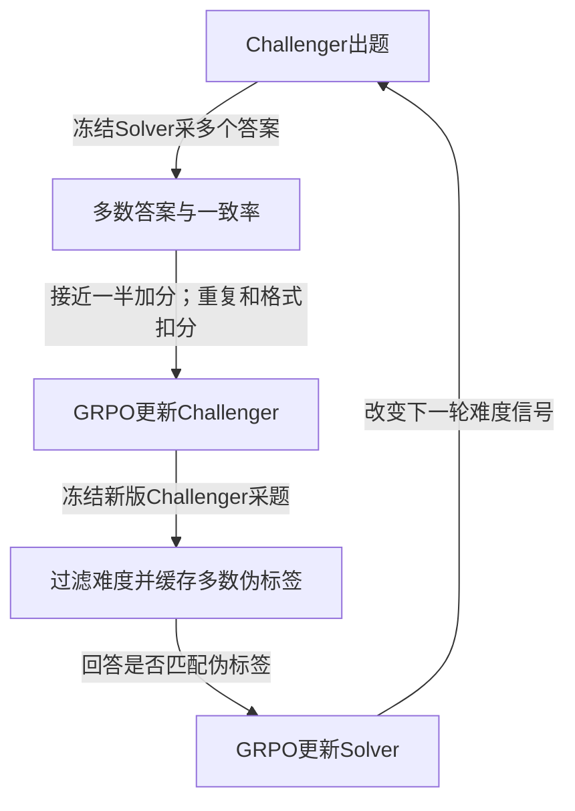

# R-Zero: Self-Evolving Reasoning LLM from Zero Data

## 来源与实际阅读

| 项目 | 记录 |
| --- | --- |
| 来源 ID | S063 |
| 作者 | Chengsong Huang、Wenhao Yu、Xiaoyang Wang、Hongming Zhang、Zongxia Li、Ruosen Li、Jiaxin Huang、Haitao Mi、Dong Yu |
| 版本 | arXiv:2508.05004v4，2026-02-13；PDF标注ICLR 2026；DOI 10.48550/arXiv.2508.05004 |
| 原始入口 | [R-Zero](https://arxiv.org/abs/2508.05004v4)；访问2026-10-25 |
| 原件 | [[raw/papers/R-Zero.pdf\|本地PDF，共21页]] |
| SHA-256 | `5E577E627E4D6501544955922257313CA2CD94FBC3C7715CFA0DD200CFE9D139` |
| 实际阅读 | 2026-10-25；正文pp.1–10；附录B/C pp.14–16，E/F pp.17–18；H/I pp.19–21选读去数学提示和GRPO。看p.3 Figure 2/奖励、p.5 Table 1、p.7 Figure 3、p.8 Table 5原页。 |
| S001定位 | 引文233，§5.7.2，PDF p.55；书目 pp.94 |

正文PDF页码与印刷页码一致。未逐项核读参考文献，未审查代码或复现实验。

## 零数据省掉当前题库，没有省掉先验

R-Zero从同一已有基础模型复制Challenger与Solver，交替冻结、训练。除Solver参数，还学习出题者参数，从而更新**任务分布**。主要实验仍依赖预训练知识、人工数学出题提示、格式与奖励规则；“零数据”指不提供预存训练任务/人工答案，不是从随机参数或零知识开始。[[raw/papers/R-Zero.pdf#page=2|§2.1–2.2 · pp.2–3]] [[raw/papers/R-Zero.pdf#page=15|附录B.2 · p.15]]

本库示意依据Figure 2与§2。一致率是和自身众数匹配的比例，**不是真实正确率**；训练没有独立真值oracle，二值“可验证”只指是否匹配伪标签。[[raw/papers/R-Zero.pdf#page=3|Figure 2、§2.2 · pp.3–4]]

## 一个信号同时承担难度与质量判断

出题奖励使用 $1-2|\hat p-0.5|$，其中 $\hat p$ 是多数答案比例；再减批内BLEU聚类重复惩罚，格式失败则零分。每轮候选池8,000题，每题10个Solver答案，保留3–7个答案与众数一致的题。低一致率可能来自难度、歧义、坏题或答案比较问题，不能直接称真实能力边界。[[raw/papers/R-Zero.pdf#page=3|§2.2–3.1 · pp.3–4]]

附录F借二值奖励方差在概率1/2处最大提供动机，未证明多数票等于真值，也不保证外部成绩无限提高。附录H另试移除数学限定的出题提示；不能把主要数学出题实验说成已验证任意开放任务生成。[[raw/papers/R-Zero.pdf#page=18|附录F · p.18]] [[raw/papers/R-Zero.pdf#page=19|附录H · pp.19–20]]

## 正结果与失稳证据同时存在

Qwen3-4B/8B-Base、OctoThinker-3B/8B的多项数学及一般推理分数改善；与未训练Challenger比较，并消融重复惩罚、过滤。AMC/AIME采用mean@32，其他数学多为greedy accuracy，一般推理为EM。**评测另有外部监督**：数学答案对照benchmark ground truth，由GPT-4o作语义裁判；这不代表GPT-4o参与了训练标签生成。[[raw/papers/R-Zero.pdf#page=5|§3、Tables 1–3 · pp.5–7]] [[raw/papers/R-Zero.pdf#page=15|附录B.3/C · pp.15–16]]

原文已观察循环失稳：Figure 3中0.6B较早到顶，4B在45步后于60步回落。§4.4每轮抽200题，以**假定完美的GPT-4o**提供诊断参考，伪标签匹配率79%→63%；它是模型oracle条件下的估计，不是独立确证的真实准确率。附录E另用Gemini观察标签质量下降，作者提出多样性损失/偏差放大作为可能解释，未证明唯一原因。[[raw/papers/R-Zero.pdf#page=7|§4.2、Figure 3 · p.7]] [[raw/papers/R-Zero.pdf#page=8|§4.4、Table 5 · pp.8–9]] [[raw/papers/R-Zero.pdf#page=17|附录E、Table 7 · pp.17–18]]

## 原文差异与外推边界

- v4表与正文平均分不一致：Table 1 Qwen3-8B为48.64→53.72，§3.2写49.18→54.69；4B在Table 1为49.93、Table 3为49.07。不能合并成统一提升或用于跨论文排行。[[raw/papers/R-Zero.pdf#page=5|Table 1、§3.2 · p.5]] [[raw/papers/R-Zero.pdf#page=6|Table 3 · p.6]]
- 原文称表格采用45步及held-out test，不等于排除了预训练记忆/生成题重叠；本次未审数据级去重。结果不是实际多轮工具执行。[[raw/papers/R-Zero.pdf#page=5|§3.1.1 · p.5]]
- §4.3称与“supervised fine-tuning”结合，又明确有标签训练也用GRPO；应保留为**有标签奖励的后续RL**，不擅改为交叉熵SFT。[[raw/papers/R-Zero.pdf#page=7|§4.3 · pp.7–8]]

**本库综合：**与[[wiki/papers/STaR|STaR]]真实答案筛选相比，本篇撤掉当前题库标签锚点；与[[wiki/papers/Agent0|Agent0]]可比较加入代码反馈后的可靠性。有限轮失稳已有直接研究，“让自训练永远提升”不能直接当新idea。下一条证据宜分别测伪标签正确性、任务多样性、难度和预算，当前只是候选诊断问题，尚无额外查新。

## 主题联系与验收

已整合至 [[wiki/optimization/Overview#自我演化|Optimization · 自我演化]]，论文与主题互链、队列及索引已同步；内容与结构经主Agent验收通过，Raw哈希匹配，已完成摄入。Obsidian渲染、操作与来源跳转未测。

返回 [[wiki/index|索引]]。
