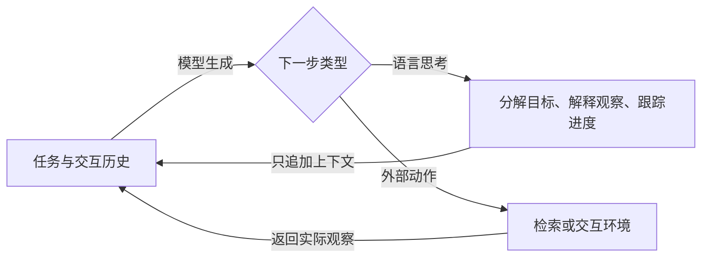

# ReAct: Synergizing Reasoning and Acting in Language Models

ReAct 的基本改动是：让同一个语言模型在执行外部动作之前或之间，写出用于规划、解释观察和跟踪进度的自然语言思考；动作产生的真实观察再进入下一步上下文。**思考改变模型接下来看到的历史，动作才改变环境或取得新观察。** 这是理解其能力与限制的关键：它让规划参与交互，却没有给每一段思考配上正确性证明。[[raw/papers/ReAct.pdf#page=3|S002 · §2 · p.3]]

> [!info] 阅读与摄入状态
> 已实际核读原文主体和支撑下述判断的图表；已整合共享主题与索引并通过主 Agent 内容/结构验收，完成摄入；Obsidian 应用未测。下面的性能是作者报告的实验结果，本库未复现。

## 身份与读取范围

| 项目 | 记录 |
| --- | --- |
| 来源 ID | S002 |
| 作者 | Shunyu Yao, Jeffrey Zhao, Dian Yu, Nan Du, Izhak Shafran, Karthik Narasimhan, Yuan Cao |
| 版本 | arXiv:2210.03629v3，2023-03-10；ICLR 2023 |
| 原始来源 | [固定版本 PDF](https://arxiv.org/pdf/2210.03629v3)；访问 2026-10-25 |
| 本地原件 | [[raw/papers/ReAct.pdf\|ReAct.pdf]]，33 页 |
| SHA-256 | `F285B0971AE4A790E402FB93966BED3ADDE2CF0A04977D08B2B40D6AB0CACE69` |
| 实际读取 | 2026-10-25；正文 pp.1–10；附录 pp.14–15（A.1–A.3、B.1–B.2）及 p.16 提示样例开头。实际查看 Fig.1（p.2）、§2 形式定义（p.3）、Table 1 / Fig.2（p.5）、Tables 3–4（p.8）的渲染原页 |
| 未系统核读 | pp.11–13 参考文献未逐项追索；pp.16–33 的全部提示、完整轨迹与附录样例未逐项核读；没有运行代码或复现实验 |
| 综述入口 | [[raw/papers/Towards Long-Horizon Agents.pdf#page=21\|S001 · §4.1.1 · p.21]]，参考文献 [761] |

## 它解决的困难：知道怎样想，不等于能在环境中继续做

作者区分了两种不足：只生成推理链，可能依据自身知识编造中间事实；只生成动作，又难以显式分解目标、跟踪状态和在异常后调整。ReAct 把两者放进同一条轨迹，使新观察可以纠正下一步的计划，也使思考可以选择下一次行动。这里的“纠正”是模型据观察调整行为，不代表所有错误都会被检测或恢复。[[raw/papers/ReAct.pdf#page=2|S002 · §1 · pp.2–3、Fig.1]]

**本库分析：**其直接面对的是同一任务内部的多步依赖：前面的检索结果、已完成子目标和失败动作影响后续决策。原文没有建立跨上下文窗口的持久状态协议，也没有给出跨任务经验记忆机制，不能仅因其用了历史，就把它算作跨窗口或跨任务记忆的直接证据。[[raw/papers/ReAct.pdf#page=3|S002 · §2 · pp.3–4]]

## 机制：把思考作为会写回上下文的动作

原文将环境交互历史写作上下文 $c_t$，策略根据 $c_t$ 生成下一动作；再将动作空间从外部动作集合扩展为“外部动作 + 语言思考”。语言思考不会触发环境反馈，只追加到上下文；搜索、查看、移动等外部动作才会返回观察。[[raw/papers/ReAct.pdf#page=3|S002 · §2 · p.3]]

这是本库依据 §2 重绘的信息流示意。两条回路的反馈性质不同；图中的思考节点不是独立验证器。

知识问答中，作者使用较密集的 Thought–Action–Observation 交替；ALFWorld 和 WebShop 中，动作可能连续执行，模型按需要插入稀疏思考。因此 ReAct 不是必须每个动作前写一段固定格式长推理，也不是先制定不可变计划再机械执行。[[raw/papers/ReAct.pdf#page=4|S002 · §2 · p.4]] [[raw/papers/ReAct.pdf#page=7|S002 · §4.1 · p.7]]

例如在 ALFWorld 中，思考可把“把物体放到指定位置”拆成找物体、拿取、到达目标位置和放置；找不到物体时，模型可利用观察重新选择搜索位置。状态主要存在于文本轨迹中，论文未另设一个强制一致的外部任务状态对象。后一句是对实现结构的本库概括，依据 Fig.1 与 §2。[[raw/papers/ReAct.pdf#page=2|S002 · Fig.1(b) · p.2]]

## 证据：有帮助的交互结构，效果仍依赖任务与检索

主体实验主要使用冻结的 PaLM-540B 和少量人工示范；附录另有 GPT-3，正文还探索了小模型微调，不能把这些结果混为一种设置。[[raw/papers/ReAct.pdf#page=4|S002 · §3.2 · pp.4–5]] [[raw/papers/ReAct.pdf#page=14|S002 · Appendix A.1 · p.14]]

| 任务与评测条件 | 原文直接支持的认识 | 证据 |
| --- | --- | --- |
| HotpotQA 多跳问答、FEVER 事实核验；受限 Wikipedia `search` / `lookup` / `finish` 接口，PaLM-540B few-shot | ReAct 优于只行动的 Act，但并非处处优于 CoT：HotpotQA EM 为 27.4，CoT 为 29.4；FEVER 的趋势不同。检索接地并不自动带来更高答案准确率 | [[raw/papers/ReAct.pdf#page=4\|§3.1–3.3 · pp.4–6、Table 1]] |
| ALFWorld：134 个未见任务，六类家务任务；每类选两条示范并尝试六种提示组合 | ReAct 的平均成功率 57%，最佳组合 71%；Act 最佳组合 45%。71% 不能写成平均表现，最佳提示选择本身是评测条件 | [[raw/papers/ReAct.pdf#page=7\|§4.1–4.2 · pp.7–8、Table 3]] |
| WebShop：500 条指令，单条示范；指标含商品属性匹配分数和严格成功率 | ReAct 成功率 40.0%，Act 30.1%，支持推理对这个文本购物交互设置有用；没有发生真实购买 | [[raw/papers/ReAct.pdf#page=8\|§4.2 · p.8、Table 4]] [[raw/papers/ReAct.pdf#page=10\|Ethics · p.10]] |

Table 1 中表现更好的 ReAct / CoT-SC 组合，额外使用了最多步数、投票置信度和切换规则；CoT-SC 还用了 21 次采样。它们体现外部检索与内部知识可能互补，但不是纯 ReAct 在相同调用预算下必然获胜的证据。[[raw/papers/ReAct.pdf#page=4|S002 · §3.2 · pp.4–5、Table 1]]

作者还人工检查 ReAct 与 CoT 的成功和失败样例，指出 ReAct 会重复行动，也会被无信息的搜索结果牵制。这些是有限样本的失败分析，不是对任意环境的错误率估计。[[raw/papers/ReAct.pdf#page=6|S002 · §3.3 · p.6、Table 2]]

## 前提、局限与比较边界

- **反馈必须有用。** 检索接口返回错误或无关信息时，历史会增加而有效依据未必增加；自然语言思考可能继续围绕错误线索展开。论文自己的失败样例支持这个限制。[[raw/papers/ReAct.pdf#page=6|S002 · §3.3 · p.6]]
- **轨迹受上下文与示范覆盖约束。** 作者明确指出，复杂或很大的动作空间需要更多示范，长轨迹也受上下文长度影响；本文没有解决任意长度任务。[[raw/papers/ReAct.pdf#page=10|S002 · §6 · p.10]]
- **不同基线的来源不同。** Act 是较直接的提示结构消融；Table 3 的 BUTLER、Table 4 的 IL / RL 结果来自其他工作。原论文未在本次读取，不能把表中数字当作本库独立复核过的同预算系统比较。[[raw/papers/ReAct.pdf#page=8|S002 · Tables 3–4 · p.8]]
- **微调是另一个干预。** PaLM-8B / 62B 上的训练结果使用生成的正确轨迹，且各格式训练步数不相同；它们不能单独证明“只换 harness”就获得同样改善。[[raw/papers/ReAct.pdf#page=7|S002 · §3.3、Fig.3 · p.7]] [[raw/papers/ReAct.pdf#page=15|S002 · Appendix B.1 · p.15]]
- **不等于不可逆场景的可靠执行。** 论文中的 Wikipedia / WebShop 接口限制了副作用；原文没有验证真实支付、真实网页修改或物理执行的安全性。[[raw/papers/ReAct.pdf#page=10|S002 · Ethics · p.10]]

## 对本库的作用

已整合到 [[wiki/harness/Overview#循环与工作流|Harness · 循环与工作流]]：线性轨迹也可以动态规划和利用反馈；区分“模型写出的思考”和“环境提供的观察”，才能进一步比较显式计划、分支搜索与验证。主题与论文页已互链，内容与结构已验收；Obsidian 应用未测。

**待检验问题：**对连续失败的交互，增加思考究竟补充了新的任务状态，还是只重复已有判断？这里暂时只有 ReAct 的失败观察，尚未形成领域缺口或新颖性结论；后续需要在相同模型、动作预算和反馈条件下比较具体机制。[[raw/papers/ReAct.pdf#page=6|S002 · §3.3 · p.6]]

文件级链接、原件身份与关键图表已核对；Obsidian 中的 Mermaid、表格、PDF 跳转及窄分栏尚未实测。
