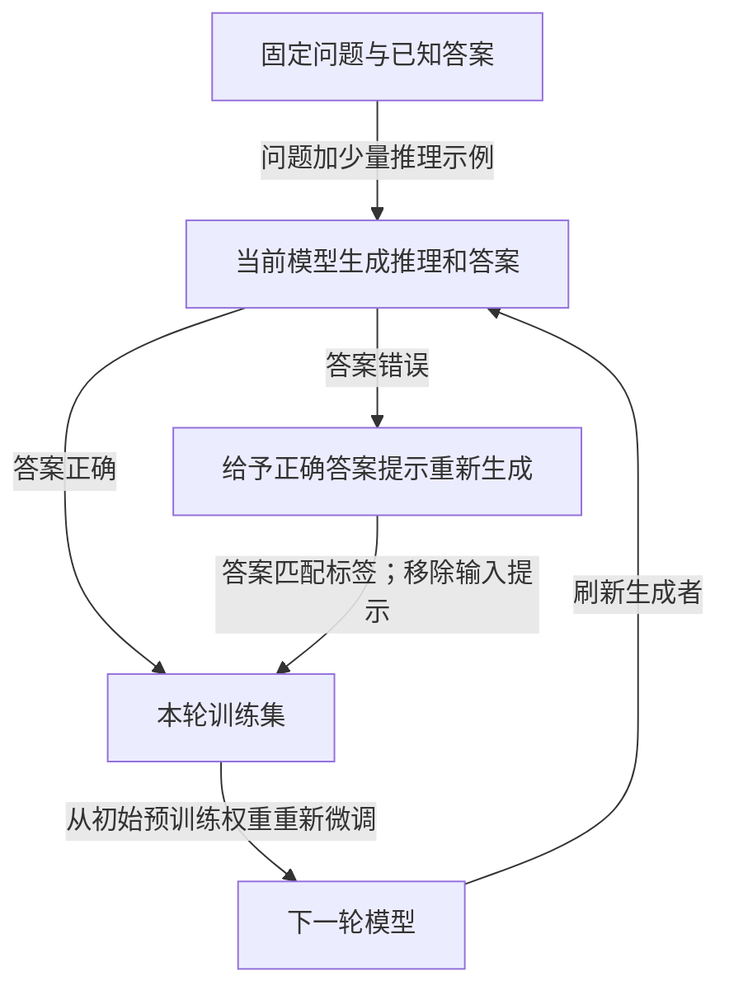

# STaR: Bootstrapping Reasoning With Reasoning

## 来源与实际阅读

| 项目 | 记录 |
| --- | --- |
| 来源 ID | S061 |
| 作者 | Eric Zelikman、Yuhuai Wu、Jesse Mu、Noah D. Goodman |
| 版本 | NeurIPS 2022 正式版；PDF标题另含Self-Taught Reasoner；DOI 10.52202/068431-1126 |
| 原始入口 | [STaR](https://papers.nips.cc/paper_files/paper/2022/hash/639a9a172c044fbb64175b5fad42e9a5-Abstract-Conference.html)；访问2026-10-25 |
| 原件 | [[raw/papers/STaR.pdf\|本地PDF，共13页]] |
| SHA-256 | `15CAF0D752DEA660CCE54A877C0BE792C51E5B8484F56FCC467225457B09AF79` |
| 实际阅读 | 2026-10-25；正文pp.1–10的问题、方法、实验、讨论及局限；实际查看p.4 Algorithm 1/公式、pp.7–8 Tables 1–2。 |
| S001定位 | 引文793，§5.7.1，PDF p.54；书目 pp.139 |

正文PDF页码与印刷页码一致。未逐项核读参考文献，未审查代码或复现实验。

同源官方附件 [[raw/papers/STaR-supplement.pdf|Supplemental，共18页]]，SHA-256 `1C9773A546547E372D3C0B5FE6985DF1023119A56F69821B6DCE88640DC87478`；[原始PDF](https://papers.nips.cc/paper_files/paper/2022/file/639a9a172c044fbb64175b5fad42e9a5-Supplemental-Conference.pdf)。本次核读 G/H（附件PDF p.15，印刷p.28）的超参数、重初始化、多数票与test消融；其他附录未完整核读。附件页码单独计数。

## 自举的是解释，不是题目或答案

STaR希望把少量推理示例转成可训练的更多推理过程。输入包括**预训练模型、固定问题及其正确最终答案、少量人工rationale示例**；更新对象是生成的训练数据与模型参数，没有学习任务生成器、环境或独立验证器。任务为加法、CommonsenseQA与GSM8K，不能直接充当长程交互的恢复/记忆证据。[[raw/papers/STaR.pdf#page=3|§3.1 · pp.3–4]] [[raw/papers/STaR.pdf#page=5|§4.1–4.2 · pp.5–6]]

本库示意依据Figure 1与Algorithm 1。rationalization给失败题的答案提示，扩大可学习覆盖；训练输入中再去掉提示。**每轮从原始预训练模型重训**，不是不断在上一轮权重上追加SFT，作者用此减少过拟合。[[raw/papers/STaR.pdf#page=2|Figure 1 · p.2]] [[raw/papers/STaR.pdf#page=4|§3.2、Algorithm 1 · p.4]]

## 答案正确仍可能学入错误理由

筛选只核对最终答案。作者用指标奖励的policy-gradient形式解释筛选，但贪心生成、多步重复使用同批数据属于近似；不能直接称标准无偏在线RL。多选题可蒙对，答案提示也可诱发不成立的解释；作者明确讨论错误理由配正确答案、偏见放大和解释忠实性。[[raw/papers/STaR.pdf#page=4|§3.1 · Eq.1–3]] [[raw/papers/STaR.pdf#page=7|§4.4 · p.7]] [[raw/papers/STaR.pdf#page=9|§5–6 · pp.9–10]]

启动仍依赖模型已有能力：作者报告GPT-2不能在其算术设定自举，要求初始推理能力高于偶然水平。持续保留few-shot提示还影响推理风格漂移，不能把提示视作无后果的一次性初始化。[[raw/papers/STaR.pdf#page=9|§5 · p.9]] [[raw/papers/STaR.pdf#page=10|§6 Scale · p.10]]

## 实验支持范围

模型为GPT-J 6B；CQA训练9,741题，GSM8K训练7,473题，均有最终答案。CQA主表是**dev accuracy**：直接答案微调60.0%，无/有rationalization为68.8%/72.5%；附件H.2的test为64.9%。主文说明迭代至饱和并报告最佳结果，因此72.5%不能称未用于选择的独立test成绩。[[raw/papers/STaR.pdf#page=5|§4.1–4.2 · pp.5–6]] [[raw/papers/STaR.pdf#page=7|Table 1 · p.7]] [[raw/papers/STaR-supplement.pdf#page=15|H.2 · PDF p.15 / 印刷p.28]]

GSM8K test无/有rationalization为10.1%/10.7%，收益明显依赖任务；训练多轮且步数随轮次增长，不能从最终分数推出等成本优势。附件H.1中CQA多数票筛选45.5%、无筛选42.1%，均低于真实标签版本；这直接限制从“少推理标注”外推到“无答案标注”。[[raw/papers/STaR.pdf#page=8|Table 2、§4.5 · p.8]] [[raw/papers/STaR-supplement.pdf#page=15|G/H.1 · PDF p.15 / 印刷p.28]]

**本库综合：**与本轮[[wiki/papers/R-Zero|R-Zero]]比较时必须分开“谁生成推理”与“谁定义正确”；STaR保留真实标签锚点。与已摄入[[wiki/papers/Agent-R|Agent-R]]同属刷新训练轨迹的循环，但本篇不处理错误动作后的环境状态恢复。正确答案并不保障过程质量是本篇已有明确限制，不能包装成新发现的研究空白。

## 主题联系与验收

已整合至 [[wiki/optimization/Overview#自我演化|Optimization · 自我演化]]，论文与主题互链、队列及索引已同步；内容与结构经主Agent验收通过，Raw哈希匹配，已完成摄入。Obsidian渲染、操作与来源跳转未测。

返回 [[wiki/index|索引]]。
