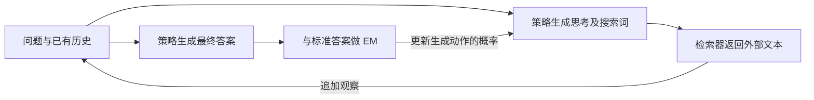

# Search-R1：把检索环境纳入策略训练

## 身份与实际阅读

| 项目 | 记录 |
| --- | --- |
| 来源 ID | S051 |
| 原文标题 | Search-R1: Training LLMs to Reason and Leverage Search Engines with Reinforcement Learning |
| 作者 | Bowen Jin、Hansi Zeng、Zhenrui Yue、Jinsung Yoon、Sercan Ö. Arık、Dong Wang、Hamed Zamani、Jiawei Han |
| 版本 | arXiv:2503.09516v5，2025-08-05；PDF 标记 COLM 2025 |
| 原始来源 | [锁定 PDF](https://arxiv.org/pdf/2503.09516v5)；访问 2026-10-25；发布页与 PDF 首页身份已核对 |
| Raw | [[raw/papers/Search-R1.pdf\|本地原件，共 31 页]] |
| SHA-256 | `524306DE91F80D7755C43F8DAAD11EB463832762BA1DEBE0F37788BDBB3A6A0D` |
| 实际阅读 | 2026-10-25；正文 pp.1–10（p.10 结论部分）；附录 A–H pp.15–20，重点训练配置、mask、检索数与组大小；实际看 p.4 Fig.1/Eq.2、p.8 Tables2–3、p.9 Fig.2/Table4 原页。案例 pp.20–31 未完整核读；参考文献未逐条读 |
| S001 入口 | 引文261，§5.5.1/5.5.3，综述 pp.48、51；书目 p.97；本页按实际下载版本解释，不能假定与综述所引版本完全相同 |

以下主张来自原论文直接核读，另标本库推断；未复现实验、未核读实现代码。PDF 页码从首页起算。

## 具体问题：策略必须学会基于自己搜到的结果继续决策

普通 RAG 在问题后固定检索；Search-R1 让策略生成搜索词，检索器把返回文本接到历史中，策略再决定搜什么或作答。训练样本因此由当前策略和检索环境共同产生。论文的主要环境是 **2018 Wikipedia＋E5 检索器**，这里的实时 retrieval 指 rollout 时实际检索，并不等于实时开放网页。[[raw/papers/Search-R1.pdf#page=5|§3.2 · p.5]] [[raw/papers/Search-R1.pdf#page=7|§4.3 · p.7]]

本库示意。搜索返回进入下一步输入，却不是策略生成的动作。`<search>` 触发调用，`<information>` 装返回，`<answer>` 结束；非法动作会加入固定的 rethink 提示，达到动作预算也停止。这个 harness 的格式与停止条件决定能访问的状态。[[raw/papers/Search-R1.pdf#page=6|Algorithm1 · p.6]]

## 奖励、优势和 token 损失各管什么

- **奖励来源：**最终答案与 gold answer 的 Exact Match，没有单独格式奖励，也没有训练的神经 reward model。它评估最终答对，未逐次评价搜索词质量。[[raw/papers/Search-R1.pdf#page=6|§3.4、Eq.4 · p.6]]
- **PPO：**critic 预测价值、GAE 得到 token 优势；**GRPO：**同题多条 rollout 的结果做组内相对优势，无额外 critic。正式采样公式使用旧策略 πold，参考模型 πref 用于 KL 锚定。正文若干文字把采样写作 πref，与 Eq.2/3 不一致，本页采用公式含义。[[raw/papers/Search-R1.pdf#page=4|§3.1、Eq.2 · p.4]] [[raw/papers/Search-R1.pdf#page=5|Eq.3 · p.5]]
- **mask：**只对 LLM 生成 token 计算策略梯度，检索返回 token 被排除；GRPO 的 KL 同样 mask。观察仍影响后续动作分布，mask 不是把观察从上下文删除。[[raw/papers/Search-R1.pdf#page=4|Loss Masking · pp.4–5]]

**本库推断：**终局 EM 能给多步搜索提供学习信号，但不能据此认定每个中间查询都必要，或把一条成功轨迹内所有步骤解释为独立正确的决策。回答正确、检索证据正确、搜索成本合理是不同要求。

## 证据与预算

训练合并 NQ 与 HotpotQA，测试七个 QA 集；Qwen2.5-3B/7B Base/Instruct 是主体，附录另有14B。所有检索基线共享语料、E5 和 top-3，指标为 EM。默认方法是 PPO，不能把 Search-R1 简写为一个 GRPO 算法。[[raw/papers/Search-R1.pdf#page=7|§4.1–4.4 · pp.6–7]]

附录 B.2：8×H100、500 steps、batch512；PPO actor/critic 学习率 1e-6/1e-5，GAE λ=γ=1；GRPO 每题5条；温度/top-p均1，KL0.001，clip0.2。序列上限4096，response与retrieval各500 token，最大动作预算4。每100步保存，若崩溃按训练奖励选最后稳定 checkpoint，否则用最终模型，因此不是所有方法固定评测第500步。[[raw/papers/Search-R1.pdf#page=16|Appendix B.2 · p.16]]

Table4 的 7B-base/PPO 平均 EM 从无 mask 的0.343到有 mask 的0.431，支持所测设置中排除外部 token 的必要性；并非所有尺度/数据集逐项一致：附录 Table6 的3B在 Musique、Bamboogle 上有 mask 反而略低。PPO/GRPO表现与初始化相关，Table3不支持普遍“PPO最好”；作者主要用训练稳定性说明默认选择。[[raw/papers/Search-R1.pdf#page=9|§5、Table4 · p.9]] [[raw/papers/Search-R1.pdf#page=18|Table6 · p.18]] [[raw/papers/Search-R1.pdf#page=8|Table3 · p.8]]

增加检索文档不保证更好：7B-base/PPO 的 top-3 平均优于 top-1/top-5；作者将后者解释为噪声/召回折中，尚未独立隔离因果。它直接说明工具返回分布既影响推理，也影响学习。[[raw/papers/Search-R1.pdf#page=18|Appendix G · pp.18–19、Table7]]

## 保留的文本张力与理解边界

首页与 §4.4 写7B改善24%，引言 p.2仍写41%，表中不同基线作分母会产生不同相对值；本页不沿用宣传式百分比。附录 H说group=1退化REINFORCE，但标准组内中心化在单样本时无法直接产生该优势，具体 special case 未查代码，不能当作一般恒等式。[[raw/papers/Search-R1.pdf#page=1|摘要 · p.1]] [[raw/papers/Search-R1.pdf#page=2|贡献 · p.2]] [[raw/papers/Search-R1.pdf#page=19|Appendix H · p.19]]

与 [[wiki/papers/ReSum|ReSum]] 的直接比较是状态接口：本篇在有限窗口持续拼接检索历史，ReSum 在摘要点刷新输入。本篇有限4动作实验不证明跨上下文持久探索；两者不做跨基准分数排名。下一步有价值的核查是固定总搜索/token预算后区分信息获取、信用分配和状态表示收益；这是本库归因问题，未完成查新。

## 主题联系与状态

已整合 [[wiki/optimization/Overview#Agentic Reinforcement Learning|Optimization：Agentic RL]] 的状态分布、反馈与信用比较。与 [[wiki/harness/Overview|Harness]] 的状态和反馈接口保持交叉联系。本篇内容与结构验收通过，已完成摄入；主题、队列、索引及摄入日志已同步。按用户要求本轮不做Obsidian应用检查，应用未测；未复现实验。
