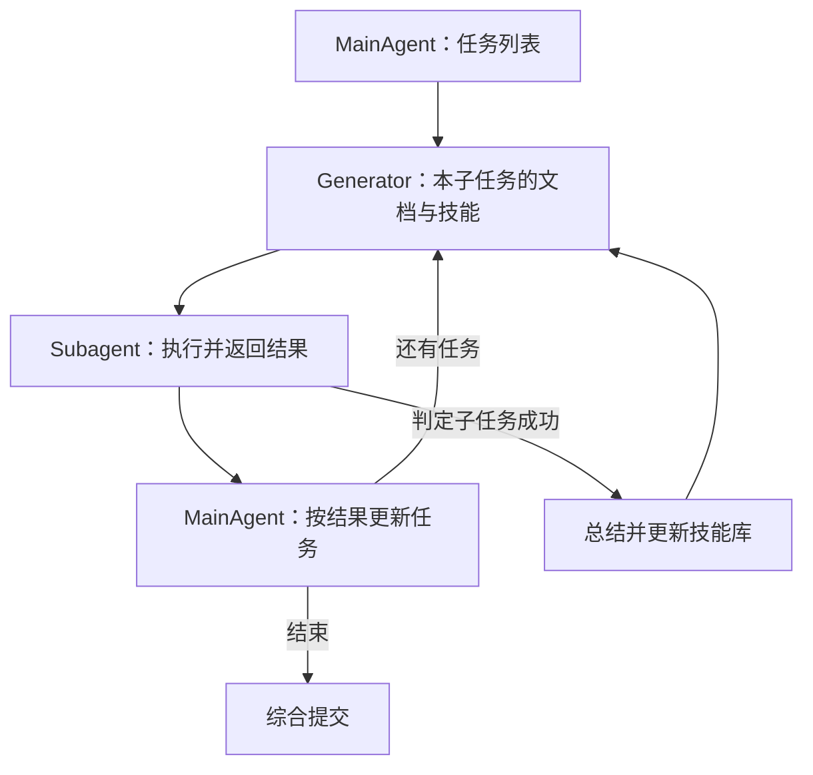

# TDAG: A Multi-Agent Framework based on Dynamic Task Decomposition and Agent Generation

> [!info] 状态
> 原文核读、主题整合与主 Agent 内容/结构验收已完成；未复现实验，Obsidian 应用未测。

## 来源身份与实际阅读范围

| 项目 | 记录 |
| --- | --- |
| 来源 ID | S020 |
| 作者 | Yaoxiang Wang、Zhiyong Wu、Junfeng Yao、Jinsong Su |
| 锁定版本 | arXiv:2402.10178v2，2025-01-21；发布页注明 Accepted by Neural Networks，期刊正式版未比对 |
| 原始发布页 | [TDAG](https://arxiv.org/abs/2402.10178) |
| 下载原件 | [原始 PDF](https://arxiv.org/pdf/2402.10178v2)；访问 2026-10-25 |
| Raw | [[raw/papers/TDAG.pdf\|TDAG.pdf，12 页]] |
| SHA-256 | `B10AD4F06D4F59ACB1E99B02C72B97C6266BF48E375132ACEE843C3D76BC617B` |
| 阅读日期与范围 | 2026-10-25；正文 §§1–6（pp.1–9）与 Appendix B（p.12）；实际查看 p.4 Eqs.1–3、p.6 Fig.2、p.8 Tables2–4/Fig.3。未逐项核读参考文献与 Appendix A完整统计。 |
| S001 引用路线 | 引文 660，§4.4.1，PDF pp.29；书目 pp.128,129 |

本页页码均按所存 PDF 第一页计数；除 GPTSwarm 的会议卷页码外，引用采用 PDF 内页码。下载后验证标题与哈希，以不覆盖方式归档。作者/版本按实际原件登记，不沿用综述的不同署名。

## 动态拆任务怎样减少前序失败的影响

**原文陈述：**TDAG 指出预先固定全部子任务会让一个早期失败使后续计划不可执行。MainAgent 先拆任务，每个子任务由定制 subagent 执行，接收前面任务与结果；完成后 MainAgent 基于实际结果更新后续任务，而非强制沿初始清单走到底。[[raw/papers/TDAG.pdf#page=5|§4.1、Eqs.4–6 · pp.5–6]]

本库按 Fig.2、Algorithm1 重绘；箭头表示调度、反馈或技能供给，未表示基础模型训练。[[raw/papers/TDAG.pdf#page=6|§4.2、Fig.2 · pp.6–7]]

## Agent 生成具体生成什么

生成通过 LLM prompting 完成，包含重新组织/澄清工具文档，以及检索、积累与修改技能。技能是 Name、Detail、Solution 三字段的文本，不等于已验证可执行程序。算法只在子任务被判成功后写总结，但作者明确环境不能保证技能正确；成功判定本身的可靠性须与技能存储分开。[[raw/papers/TDAG.pdf#page=6|§4.2 · p.6]] [[raw/papers/TDAG.pdf#page=7|Algorithm1 · p.7]]

Appendix B 用 `all-mpnet-base-v2` 检索，重复阈值0.7、k=2；候选技能比较与送入 subagent 都影响可见上下文。**本库推断：**“动态生成”同时改变文档表达与经验供给，不只是增加一个临时角色；若解释实验优势，不能只归于 Agent 数量。[[raw/papers/TDAG.pdf#page=12|Appendix B.1 · p.12]]

## ItineraryBench 测量的不是单一成功率

旅行场景有城市/景点、交通时刻与预算等依赖，364个样本被保留为测试集。模拟器首先给可执行性60分，再给约束满足20分、时间/费用效率20分；只有较低层满分才进入高层。因此49.08是细粒度得分，不是49.08%的任务完成率。论文二元对照甚至仅要求 Level1 满分，并非同时满足全部任务约束。[[raw/papers/TDAG.pdf#page=3|§3.2 · p.3]] [[raw/papers/TDAG.pdf#page=4|§3.3、Eqs.1–3 · pp.4–5]] [[raw/papers/TDAG.pdf#page=9|§5.4 · p.9]]

主实验以 GPT-3.5-turbo-16k、温度0进行；Table2 移除动态拆解或 Agent 定制后分数下降，支持这两个复合组件在该测试中的价值。没有由这张表单独隔离文档生成、技能记忆、额外调用的贡献；跨测试任务的技能库初始化/重置与遍历顺序本次未确认，若用它判断经验迁移需进一步检查实现。[[raw/papers/TDAG.pdf#page=7|§§5.1–5.2、Table2 · pp.7–8]] [[raw/papers/TDAG.pdf#page=12|Appendix B · p.12]]

**特别注意错误表的分母：**Table3 每列按“所有方法该类错误总数”归一化，是方法在该类错误中的份额，不是该方法自身失败概率；不能说 TDAG 的级联失败率就是4.35%。[[raw/papers/TDAG.pdf#page=8|§5.3、Table3 · p.8]]

WebShop 100条指令、TextCraft 200条测试进一步考察动态拆解，但作者明确两者不启用 Agent Generation，直接使用 ADAPT 的预定义 Agent。因此 Table4 的收益不能证明动态角色生成的泛化。[[raw/papers/TDAG.pdf#page=9|§5.5 · p.9]]

## 对本库的改变

TDAG 与 Magentic-One 都利用反馈调整，但前者更新后续子任务并定制执行者，后者固定团队、按进展账本选择执行者。与固定 SOP 的差异应落在任务依赖和更新点，而非“动态一定胜过静态”。ADAPT 等相关方法本次未独立核读，其机制比较仍以作者描述为界。待检验的是子任务成功标签是否足以支撑可复用技能；当前属于验证与记忆的接口问题，未完成领域查新。

## 主题联系与验收状态

已整合到 [[wiki/harness/Overview#编排|Harness · 编排]]；涉及反馈检查时联系 [[wiki/harness/Overview#验证|验证]]。共享主题与索引已同步，已通过主 Agent 内容/结构验收并完成摄入。关键页码和 Raw 哈希已检查，Obsidian 应用渲染与来源跳转未测。

返回 [[wiki/index|索引]]。
