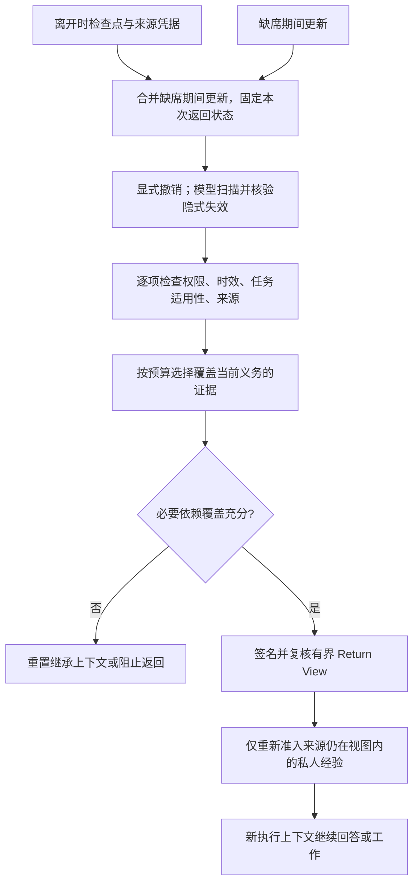

# TRACE：旧记忆仍然真实，返回时也可能不再适用

**原文机制：**TRACE在执行者离开后重新加入团队的时点，决定哪些历史记忆可以进入新的执行上下文。它将来源绑定、现时有效性、任务适用性与信息覆盖分开检查；这是不更新模型参数的运行时准入层。**原始记录真实、准入通过、后续回答正确仍是三个不同条件。**[[raw/papers/TRACE.pdf#page=3|§2 · pp.3–4]] [[raw/papers/TRACE.pdf#page=5|§3.2–3.5 · p.5]] [[raw/papers/TRACE.pdf#page=24|Appendix C.8 · p.24]]

> [!info] 当前状态
> 已完成问题驱动原文阅读、共享主题与索引整合；主 Agent 内容/结构验收通过，摄入收尾已完成。未复现实验，Obsidian 应用未测。

## 返回时，哪些旧信息还能参与决策

论文把长期压力具体化为一个生命周期边界：一个 Agent 在时刻 $t_d$ 离开，团队继续更新共享状态，原身份和角色在 $t_r$ 返回，但启动新的 workload。保存的旧记录可能仍与问题相关，却已经不适用于当前任务；比如原酒店的确认单仍真实，但酒店已取消，依赖旧酒店位置的接送建议也随之失效。作者区分有显式撤销/替代边的失效，与需要推断依赖的**隐式失效**。这个区分直接覆盖“检索正确但行动前提过期”的宽泛问题。[[raw/papers/TRACE.pdf#page=3|§2.1–2.2 · p.3]] [[raw/papers/TRACE.pdf#page=18|Appendix C.1–C.2 · pp.18–19]]

来源关系只说明记录来自哪里，失效关系说明后续事件怎样改变它的适用性，支持关系说明它满足哪项信息需求。不能用一条可追溯引用同时证明这三件事。TRACE也不声称来源凭据能证明来源内容为真。[[raw/papers/TRACE.pdf#page=18|Appendix C.1 · p.18]]

本库依原文重绘；箭头表示状态构造、筛选与准入，不表示自动保证判断正确。Return View提供的是状态，**不直接提供工具或行动计划**。签名绑定返回事件、身份、角色、任务、epoch和内容摘要，并不为自然语言事实真实性背书。被排除的记忆仍可保存在审计存储中，只是不能通过该受控检索入口继续进入上下文。[[raw/papers/TRACE.pdf#page=4|Fig.2、§3.1 · p.4]] [[raw/papers/TRACE.pdf#page=5|§3.2–3.5 · p.5]] [[raw/papers/TRACE.pdf#page=19|Appendix C.4 · p.19]]

## 准入既检查单条记录，也检查整组证据

隐式失效分两步：scanner广泛提出“旧记录—后续事件”候选依赖，verifier回到原始观察和时间顺序判断是否真的失效；同话题不等于矛盾。两步都是模型判断，因此漏检依赖仍可能留下旧前提，过度判定也会损失有效信息。新记录即使否定旧记录，也仍需单独通过权限与来源等检查。[[raw/papers/TRACE.pdf#page=5|§3.2–3.3 · p.5]] [[raw/papers/TRACE.pdf#page=18|Appendix C.2 · pp.18–19]]

**义务（obligation）在此指返回角色继续工作需要满足的信息要求。**task adapter提供义务、未完成进度以及到候选证据的依赖关系。选择器先放入必要义务/进度，再按新增依赖覆盖与字符成本选证据，同时受记录数和字符预算约束。覆盖充分只说明所需证据在上下文内，不等于义务已经执行完成；作者明确不给这种受约束贪心算法套用经典集合覆盖近似保证。[[raw/papers/TRACE.pdf#page=5|§3.4、Eq.3 · p.5]] [[raw/papers/TRACE.pdf#page=19|Appendix C.3、Eqs.4–5 · p.19]]

私人经验必须绑定到被准入的work-state来源，否则旧前提可能绕过公共视图从私人记忆重新进入。**本库限定：**这是受控可见上下文路径的约束，不是删除模型参数中的知识，也不是对任意隐藏状态和旁路的保证；其有效性依赖可信身份、来源关联和adapter。原文亦将任意记忆投毒、伪造证据排除在已验证范围外。[[raw/papers/TRACE.pdf#page=19|Appendix C.4 · p.19]] [[raw/papers/TRACE.pdf#page=20|Appendix C.5 · p.20]]

## 评测测的是不同层面的“有效”

主实验统一为一个返回Agent与四个顺序工作的活跃Agent，返回发生在其余工作完成后。模型为论文所列Qwen3.5-122B-A10B、Gemini-3-flash、DeepSeek-v4-flash-0731。不同方法看到同一返回后检查点，但保持独立记忆上下文；MemStrata/MemTX为共同harness中的机制重实现。Memora与STALE的评分另用gpt-5.6-terra，ManBench-Return使用源答案标签；任务模型不见答案、相关session标注或评分rubric。[[raw/papers/TRACE.pdf#page=6|§4.2–4.3 · p.6]] [[raw/papers/TRACE.pdf#page=26|Appendix D.2–D.5 · pp.26–27]]

| 设置及问题 | 指标实际如何产生 | 证据边界 |
| --- | --- | --- |
| Memora：30个人格—时段cluster的137题，在25%、50%、75%时离开，末尾返回 | 对回答中应记住/应忘记的条件打分；Overall、VIA、IIR、FAMA的权重不同 | TRACE没有稳定胜过已有机制；这里明确替代信息较多。[[raw/papers/TRACE.pdf#page=25\|Appendix D.1 · pp.25–27]]、[[raw/papers/TRACE.pdf#page=6\|§4.4 · p.6]] |
| STALE Type II：200个50-session历史，每例三个probe | State Resolution识别旧信念失效；Premise Resistance拒绝过期前提；Implicit Policy Adaptation把更新用于新问题。VIA在此映射到IPA，IIR要求前两项同时通过，LS要求三项同时通过 | 这些是问答probe，不是实际对外工具执行的安全完成率；VIA不能统一理解为纯检索召回。[[raw/papers/TRACE.pdf#page=25\|Eqs.9–10 · p.25]]、[[raw/papers/TRACE.pdf#page=27\|Appendix D.4 · p.27]] |
| ManBench-Return：从20任务4838个计划样本构造Old-Valid与Old-Stale | 前者旧答案仍有效但团队传播误导；后者改成同任务下一题。VIA/IIR分别测候选是否进入视图，Overall另测最终答案 | 样本筛选要求初始答案正确；Old-Stale还要求四个活跃Agent至少三个同意正确新答案，分母随模型/条件改变。这是派生设置，不是原ManBench全量无条件表现。[[raw/papers/TRACE.pdf#page=27\|Appendix D.5 · p.27]] |

Qwen在STALE的LS由最强比较方法18.00%到TRACE 39.00%，但其消融与总体比较没有匹配所有额外核验计算。单独的Qwen子集每个离开时段20例，共60例，TRACE为58.89% Overall、499659 tokens/episode；CUPMem为80.56%、1994815 tokens/episode，**更准也更贵**。成本包括记忆维护、回答与TRACE准入，排除外部评分调用；CUPMem一个上下文溢出样本按失败计入完整分母，其重试费用也计入。这个对照支持代价—准确率取舍，不支持“TRACE最准确”或墙钟加速。[[raw/papers/TRACE.pdf#page=7|§4.4、Table2 · p.7]] [[raw/papers/TRACE.pdf#page=30|Appendix E.3、Table7 · pp.30–31]]

四种消融分别去掉隐式失效、义务覆盖选择、完整视图门控、私人经验来源绑定。Qwen/STALE中去掉隐式失效下降最大；选择消融在相同上下文预算下换成相关性排序，完整视图门控仍保留，因而比泛泛“有记忆/没记忆”更具体。但作者仍把**匹配预算的核验对照**列为后续工作，不能将所有改善唯一归因于一个门控结构。[[raw/papers/TRACE.pdf#page=39|Appendix H、Table15 · p.39]] [[raw/papers/TRACE.pdf#page=9|§6 · p.9]]

ManBench-Return中RESET可以有很高的最终答案正确率而VIA为零；TRACE保留与拒绝两项更均衡，却未总有最高Overall。四种backend的移植也均提高IIR、同时降低VIA，FAMA有升有降；接口可移植不等于每种存储都提高回答质量。[[raw/papers/TRACE.pdf#page=8|§4.5–4.6 · pp.8–9]] [[raw/papers/TRACE.pdf#page=40|Appendix I.2、Table17 · pp.40–41]]

## 两种失败决定了问题应怎样收窄

原文的两个已运行案例很有辨别力：一个案例已取回旧偏好与新变化，却没确认隐式失效，三个probe全错；另一个已排除旧设备习惯、准入借用设备的新事实，回答仍以信息不足为由回避单机绑定许可问题，前两probe通过但IPA失败。**前者是准入错误，后者是准入后的使用错误。**这提供了首轮问题所需的直接反例，但单例不构成两种错误的普遍占比或独立因果估计。[[raw/papers/TRACE.pdf#page=24|Appendix C.8 · p.24]]

> [!warning] 时段解释不能直接当作缺席时长规律
> §6将Early到Late的下降解释为缺席加长；但Appendix D.2/D.4将Early、Middle、Late定义为离开session分别0–4、5–9、10–14，均在第50个session后返回，E.3又说明这不是固定记忆年龄阈值。仅据这些定义，Late不自然等于更长缺席。保留Table7的分桶结果，但不采“缺席越久性能越差”为已识别规律；各bucket内容也不同。[[raw/papers/TRACE.pdf#page=9|§6 · p.9]] [[raw/papers/TRACE.pdf#page=26|Table4、Appendix D.4 · pp.26–27]] [[raw/papers/TRACE.pdf#page=30|Appendix E.3 · pp.30–31]]

**对本库的改变：**与[[wiki/papers/HiAgent|HiAgent]]的历史压缩/取回相比，TRACE明确处理返回时的当前准入；与[[wiki/papers/InfrastructureSentinel|InfrastructureSentinel]]的执行前状态重查相比，它选择进入上下文的证据集合。首轮“来源真实但已过期怎么办”的宽泛候选已有直接机制与诊断覆盖，应关闭其创新表述。下一步若继续，需要限定为可观察的准入/使用错误或证据生成前提，并与预算匹配核查；当前不宣称这些剩余问题没人做过。TRACE有关CUPMem、STALE、ManBench等的原工作比较仍是作者转述，本库未因引用而将其视为独立已读来源。[[raw/papers/HiAgent.pdf#page=3|S007 §3 · pp.3–4]] [[raw/papers/InfrastructureSentinel.pdf#page=4|S025 §4.4 · p.4]] [[raw/papers/TRACE.pdf#page=9|S066 §5–6 · p.9]]

## 来源身份与实际阅读

| 项目 | 记录 |
| --- | --- |
| 来源ID / 标题 | S066 / TRACE: Governing Memory Validity in Evolving Multi-Agent Systems |
| 作者 | Wenjun Xiong、Shengtao Zhang、Shangding Gu、Bo Tang、Zhiyu Li、Feiyu Xiong、Ying Wen、Muning Wen |
| 锁定版本 | arXiv:2609.33517v1，2026-09-27，Preprint，41页 |
| 原始来源 | [版本页](https://arxiv.org/abs/2609.33517v1)；[锁定PDF](https://arxiv.org/pdf/2609.33517v1)，访问2026-10-25 |
| 原件 | [[raw/papers/TRACE.pdf\|TRACE.pdf]] |
| SHA-256 | `A685B0406D8E13945DFE93A1D3B48CFA4FD47CC8245D8CDB599B3087C9B17669` |
| 选读入口 | 首轮Brainstorm六次定向查新中的记忆有效性查询；综述外补读，H2预算1/2。非S001核心引用，无S001引用编号 |
| 实际读取 | 2026-10-25：正文pp.1–9；Appendix A–D pp.17–27、E.1 p.28、E.3–E.4 pp.30–32、H–I pp.39–41；看图核对p.4 Fig.2、p.5 Eqs.2–3、p.7 Table2/Fig.3、p.25指标、p.31 Table7、p.39消融 |
| 未核读 | 参考文献pp.10–16未逐项追读；E.2 p.29、F–G pp.33–38全部分桶数值未逐项检查；未审计代码或重新统计实验；理论仅核读定义与保证边界，未独立形式验证 |

PDF页码与正文页脚页码一致。PDF以不覆盖方式归档并核对字节哈希；网页身份快照与提取/渲染位于本轮临时区，不是新增学术来源。

已整合到[[wiki/harness/Overview#来源真实、当前准入与后续使用是三个条件|Harness · 来源、准入与使用]]及[[wiki/harness/Overview#选择误差与纠错净收益要分别测量|验证]]，索引同步，主 Agent 内容/结构验收通过，摄入收尾已完成。与[[wiki/papers/BRIDGE|BRIDGE]]的接口比较是证据准入、局部消息提交和最终使用各有检查对象；两篇的任务与指标不同，不能互排效果。
