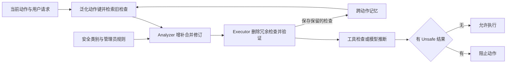

# AGrail: A Lifelong Agent Guardrail with Effective and Adaptive Safety Detection

## 阅读结论与证据身份

**原文陈述：**AGrail 在动作进入环境前，依照通用 CIA 安全标准与可选管理员规则，生成和执行安全检查；两个相同基础 LLM 分任 Analyzer 与 Executor，把反复改进的检查表存入记忆。**“lifelong”主要指跨相似动作复用并修改检查表，本文使用现成模型，未训练 guardrail 参数。**[[raw/papers/harness/hooks/AGrail.pdf#page=4|§4 · PDF pp.4–5 / 印刷 pp.8107–8108]] [[raw/papers/harness/hooks/AGrail.pdf#page=9|Limitation · PDF p.9 / 印刷 p.8112]]

## 动作、检查表与反馈怎样循环

**本库机制示意；箭头分别表示查询、判定与记忆更新：**

记忆以动作的自然语言与工具命令泛化表示为键，检索后向主流程展示自然语言形式；Analyzer 可以增补、改写或合并，Executor 可以删除其认为错误、冗余或过度防御的检查，再用推理或工具判定。任一保留检查为 Unsafe 就阻断，否则放行，并保存更新后的检查表。**这不是让两个模型投票，也没有外部标签自动保证每次删改正确。**[[raw/papers/harness/hooks/AGrail.pdf#page=5|§4.3 · PDF p.5]] [[raw/papers/harness/hooks/AGrail.pdf#page=14|Appendix B.1 · PDF pp.14–15 / 印刷 pp.8117–8118，Algorithms 1–3]]

规则来源包括管理员指定原则与通用 Information Confidentiality / Integrity / Availability。环境变化可使表面正常的动作危险，例如移动文件覆盖已有目标；OS 工具会生成并运行检查程序取得环境信息。但工具本身也由 LLM 生成/调试，EHR 检查同样如此；Web HTML 工具依据选项内容作模型判断，不是独立可信的程序安全 oracle。[[raw/papers/harness/hooks/AGrail.pdf#page=4|Fig.2、§4 · PDF p.4]] [[raw/papers/harness/hooks/AGrail.pdf#page=22|Appendix F · PDF p.22 / 印刷 p.8125]]

§4.1 用记忆与不可直接观测的最佳检查集合之语义相似目标描述适应，实际更新由两个 LLM 执行。**本库限定：**文字相似或不同种子记忆趋同，不是对安全正确性的收敛证明；不能将描述性的优化目标当成经过求解的可验证损失。[[raw/papers/harness/hooks/AGrail.pdf#page=4|§4.1 公式 · PDF p.4]] [[raw/papers/harness/hooks/AGrail.pdf#page=8|§6.3、Figs.4–5 · PDF pp.8–9]]

## 测了哪些风险，分母是什么

主要 guardrail 使用 Claude-3.5-Sonnet 或 GPT-4o，动作泛化用 GPT-4o-mini；Safe-OS 的任务模型分别为 GPT-4-Turbo（注入）与 GPT-4o（其他）。还测 Mind2Web-SC/EICU-AC 的任务权限规则、80 个 AdvWeb 样例、100 个成功 EIA 攻击样例和30个清洗后的正常样例。Safe-OS 共100个案例：30破坏、27正常、20环境依赖、23注入，Docker 中区分 root/普通用户；这是有限构造集而非广泛部署攻击分布。[[raw/papers/harness/hooks/AGrail.pdf#page=5|§5 · PDF pp.5–6]] [[raw/papers/harness/hooks/AGrail.pdf#page=13|Appendix A.1 · PDF p.13 / 印刷 p.8116]]

Table 1 中 Claude-3.5 版正常动作保留 95.6%，系统破坏 ASR=3.8%，注入=0%，环境依赖=5%；EIA action grounding/generation ASR 分别6%/28%，正常样例86.7%。**0% 是这些测试与过滤分母中的结果；不等于不存在绕过。**正文 p.2 对破坏/环境数字次序与 Table 1 不一致，本页以明确列名的表格为准并保留此差异。[[raw/papers/harness/hooks/AGrail.pdf#page=7|§6.1、Table 1 · PDF p.7 / 印刷 p.8110]]

分母尤其重要：Safe-OS 注入仅在任务 Agent 已按注入输出特定回应时测 guardrail；破坏样例剔除任务 Agent 自己拒绝的情形；正常指标仅在任务 Agent 成功完成任务的情形计算。因此这里正常保留率不等于端到端任务成功率，ASR也不能直接与未筛选攻击集比较。Agreement 另由模型判断解释是否匹配人工风险理由，不能当成独立人工安全认证。[[raw/papers/harness/hooks/AGrail.pdf#page=17|Appendix C.2 · PDF pp.17–18 / 印刷 pp.8120–8121]]

## 记忆适应的证据与边界

Mind2Web-SC 消融分别比较无记忆、训练后冻结记忆和测试期继续适应；ID 为8:2切分，OOD按域3:1，三随机种子。Claude-3.5 的相应结果支持记忆帮助，但测试期更新与冻结部署是不同协议，不能合并成单一泛化成绩。弱模型对顺序更敏感。[[raw/papers/harness/hooks/AGrail.pdf#page=6|§6.2 · PDF pp.6–8]] [[raw/papers/harness/hooks/AGrail.pdf#page=24|Tables 9–10 · PDF p.24 / 印刷 p.8127]]

> [!warning] 消融数字的内部差异
> 主文 Table 3 给 GPT-4o-mini 的 ID TTA accuracy=84.1%，附录 Table 9 对应项为74.1±8.6%。当前不选择一个数消除矛盾，也不据此量化弱模型适应收益；若需要据该项决策，应进一步核对代码/结果记录。[[raw/papers/harness/hooks/AGrail.pdf#page=7|Table 3 · PDF p.7]] [[raw/papers/harness/hooks/AGrail.pdf#page=24|Table 9 · PDF p.24]]

跨域只展示将 Mind2Web-SC 适应后的记忆迁到 EICU-AC 并继续适应100个随机样例；这提供受限迁移证据，不支持“长期任意任务不会遗忘”。作者的学习图考察少量简/复杂动作、检查表语义接近和种子趋同，未建立攻击污染记忆后仍安全的保证。输入 token 消耗在所测 ID 子集介于 GuardAgent 与直接 GPT-4o 提示之间，不能理解为无需额外运行成本。[[raw/papers/harness/hooks/AGrail.pdf#page=8|§6.2–6.3 · PDF pp.8–9]] [[raw/papers/harness/hooks/AGrail.pdf#page=19|Appendix D.3–E.2 · PDF pp.19–21]]

**本库推断/待检验问题：**“删除过度防御的检查”与“保留必须的约束”使用相同模型推断时，错误删改可能经记忆影响后续任务。本文的顺序/迁移测试不能解决对抗污染、政策变更或硬性不可删规则的保障问题。这是当前材料缺口，尚未查新为研究缺口。与 AgentSpec 对比，AGrail 更新的是执行时自然语言检查表；与 ShieldAgent 对比，它未把所有最终判断转成概率逻辑电路。

## 来源身份与阅读范围

| 项目 | 记录 |
| --- | --- |
| 来源 ID | S026 |
| 作者 | Weidi Luo、Shenghong Dai、Xiaogeng Liu、Suman Banerjee、Huan Sun、Muhao Chen、Chaowei Xiao |
| 版本 | ACL 2025 正式版，pp.8104–8139；DOI 10.18653/v1/2025.acl-long.399 |
| 原始获取 | [原始 PDF](https://aclanthology.org/2025.acl-long.399.pdf)；访问日期 2026-10-25 |
| 原件 | [[raw/papers/harness/hooks/AGrail.pdf\|AGrail，36 页]] |
| SHA-256 | `3CA48B21D79E1FF7DD7866CE0489FA6D5AFC8D31972022FAADE1AD432F63B9E7` |
| 综述入口 | S001 引文 [408]，§4.5.3，PDF p.34；书目 p.109 |
| 实际阅读 | 2026-10-25；主文 §§1–7、Limitation pp.1–9；Appendix A–F pp.13–22 和 Table 9–10 p.24；提示图 pp.27–28。实际看 pp.4、7、15、24、27–28 的机制图、公式、算法、实验表和 Analyzer/Executor 提示。未逐项核读全部攻击实例/工具提示 pp.25–26、29–36；参考文献未逐项追读。PDF p.1=印刷 p.8104，后续顺延。 |
| 未做 | 未复现实验、未执行论文代码、未逐项追读相关工作；Obsidian 应用未测 |

本页页码均从归档 PDF 第一页计。论文结果是作者报告，不代表本库完成复现。已完成摄入并整合到 Harness 与索引；内容与结构验收通过，Obsidian 应用未测。

## 主题联系与后续核查

已整合到 [[wiki/harness/hooks|Hooks 与中间件]]，同时连接 [[wiki/harness/verification|验证]] 对判断来源和拦截位置的区分。跨论文分析由本库提出，不是新的实验结果；候选问题尚未查新，不据此宣布研究空白。

返回 [[wiki/index|索引]]。

## 分类与阅读入口

主归属与交叉方向：[[wiki/harness/hooks|harness/hooks]] · [[wiki/harness/verification|harness/verification]]。
