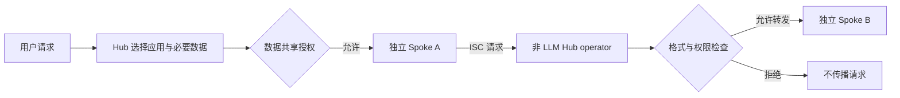

# IsolateGPT: An Execution Isolation Architecture for LLM-Based Agentic Systems

## 阅读结论与证据身份

**原文陈述：**问题是多应用共用 LLM 上下文时，一段恶意或含混的应用指令能读取其他应用数据、改变其他应用行为。IsolateGPT 将应用分别放进有独立 LLM 实例和记忆的 spoke，用可信 hub 中介跨应用通信。它保护跨边界传播，**单一应用内部被注入攻击不在防护范围内**。[[raw/papers/harness/hooks/IsolateGPT.pdf#page=5|§III.C–D、§IV · p.5]]

## 隔离改变了哪些状态和权限

| 组件 | 能看到与能控制什么 | 不能据此推出什么 |
| --- | --- | --- |
| Hub planner / memory | 根据用户请求与系统记忆选择主、辅应用；需要的数据经同意交给 spoke | planner 仍用 LLM，资源选择不自动正确 |
| Spoke | 独立 LLM、应用、长短期记忆；只能在自身执行空间直接行动 | 已获授权的数据或单应用内部操作不因隔离而自动安全 |
| 非 LLM operator 与 ISC | 固定消息格式、临时 spoke ID、hub 转发与权限检查；畸形消息丢弃 | 合法字符串中的语义风险不能仅靠类型检查消除 |
| 进程与系统控制 | 分进程；seccomp / setrlimit 限制系统调用和资源；应用网络请求限根域，外发受权限调节 | 论文没有证明整个操作系统或模型可信性 |

以上是原文机制，见 [[raw/papers/harness/hooks/IsolateGPT.pdf#page=6|§IV.A–C · pp.6–9]]、[[raw/papers/harness/hooks/IsolateGPT.pdf#page=17|Appendix A.A–C · p.17]]。Hub 保存全局交互与摘要，spoke 保存自身历史；长期任务里的信息重用因此还受到“应否跨应用共享”的边界约束，而不只是检索相关性。

**本库机制示意，箭头表示请求/授权流程：**

ISC 只向 spoke 广播功能，不直接暴露已安装应用；LLM 不直接跨 spoke 发消息。普通字符串仍可能需要用户审查，hub 通过与初始计划对照提示异常。权限可一次、会话或永久授予，但论文不允许对发送邮件、购买等不可逆操作设永久许可。**该设计依赖可信 hub、应用功能/格式审查和用户授权质量。**[[raw/papers/harness/hooks/IsolateGPT.pdf#page=8|§IV.C · Fig.3–4 · pp.8–9]] [[raw/papers/harness/hooks/IsolateGPT.pdf#page=18|Appendix A.D · p.18]]

## 实验说明了什么

在 GPT-4（artifact 指定 0613）、Ubuntu 20.04.6、LangChain 原型上，与同作者实现的无隔离 VanillaGPT 比较。扩展攻击集共 1,598 条；Table I 的 VanillaGPT 平均攻击成功率是 20.2%，IsolateGPT 报的是权限对话出现率 PA=7.6%，及出现对话时的警告率 WR=100%。**后者不是攻击成功率为零，也不是自动拦截率 100%；攻击能否成功仍取决于用户是否准许恶意流。**[[raw/papers/harness/hooks/IsolateGPT.pdf#page=9|§V.A · pp.9–10、Table I]] [[raw/papers/harness/hooks/IsolateGPT.pdf#page=19|Appendix B · p.19]]

功能测试包括单应用打字、多应用字母工具、关系数据协作和无应用邮件提取；Table II 中应用协作最终正确性两者同为 0.95，说明所测用例没有额外功能损失，不是所有工作负载功能等价的证明。没有将误拒/漏过作为统一二分类问题报告。[[raw/papers/harness/hooks/IsolateGPT.pdf#page=13|§VI、Table II–III · p.13]] [[raw/papers/harness/hooks/IsolateGPT.pdf#page=18|Appendix A.E · p.18]]

延迟测试自动批准所需权限，并采用冷启动，**未计真实用户审查时间**。Table IV 中多应用与协作的平均时间有明显增长，因此摘要“约四分之三查询开销低于 30%”不能替代重协作用例的成本分析。[[raw/papers/harness/hooks/IsolateGPT.pdf#page=14|§VII、Table IV · pp.14–15]]

## 对当前理解的修订

**本库推断：**隔离先减少谁能直接看到和影响谁，再由显式中介恢复必要协作；它与内容分类式 guardrail 是不同层次，可组合而不应互相替代。长期运行中授权复用、hub 记忆来源可信性和人工审查负担仍需核查，本文也未做统一长跨度鲁棒性曲线。

## 来源身份与阅读范围

| 项目 | 记录 |
| --- | --- |
| 来源 ID | S022 |
| 作者 | Yuhao Wu、Franziska Roesner、Tadayoshi Kohno、Ning Zhang、Umar Iqbal |
| 版本 | NDSS 2025 正式 PDF；DOI 10.14722/ndss.2025.241131 |
| 原始获取 | [原始 PDF](https://www.ndss-symposium.org/wp-content/uploads/2025-1131-paper.pdf)；访问日期 2026-10-25 |
| 原件 | [[raw/papers/harness/hooks/IsolateGPT.pdf\|IsolateGPT，20 页]] |
| SHA-256 | `98C28E6D68AB378348FB8A1AEA311C39533384FD7BDC15A4782A5BBF1EA057C0` |
| 综述入口 | S001 引文 [698]，§4.5.1，PDF p.32；书目 p.132 |
| 实际阅读 | 2026-10-25；主文 §§I–VIII（pp.1–15）；Appendix A pp.17–18；Appendix B pp.19–20 浏览复现要求。实际看 Fig.2–4、Table I 的 pp.5、8、10；其他表按原页文本核读。参考文献未逐项核验。 |
| 未做 | 未复现实验、未执行论文代码、未逐项追读相关工作；Obsidian 应用未测 |

本页页码均从归档 PDF 第一页计。论文结果是作者报告，不代表本库完成复现。已完成摄入并整合到 Harness 与索引；内容与结构验收通过，Obsidian 应用未测。

## 主题联系与后续核查

已整合到 [[wiki/harness/hooks|Hooks 与中间件]]，同时连接 [[wiki/harness/verification|验证]] 对判断来源和拦截位置的区分。跨论文分析由本库提出，不是新的实验结果；候选问题尚未查新，不据此宣布研究空白。

返回 [[wiki/index|索引]]。

## 分类与阅读入口

主归属与交叉方向：[[wiki/harness/hooks|harness/hooks]] · [[wiki/harness/verification|harness/verification]]。
