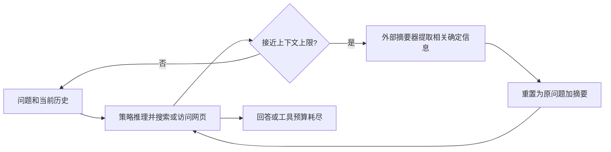

# ReSum：从摘要继续搜索，以及训练模型适应这种接续

ReSum 在上下文接近上限时，把搜索历史压成摘要，以“原问题＋摘要”重新启动工作上下文，继续调用搜索和网页访问工具。论文同时研究两件不同的事：**运行时怎样接续**，以及 **ReSum-GRPO 怎样训练策略去适应摘要后的输入**。两者共享一套任务状态接口，是 Harness 与 Optimization 的实际连接点。[[raw/papers/harness/memory/ReSum.pdf#page=3|S011 · §3.1 · p.3]] [[raw/papers/harness/memory/ReSum.pdf#page=4|§3.3 · pp.4–5]]

## 身份、版本与实际阅读

| 项目 | 登记 |
| --- | --- |
| 标题 | ReSum: Unlocking Long-Horizon Search Intelligence via Context Summarization；正文页眉使用 A Plug-and-Play Paradigm for Long-Horizon Search Intelligence via Context Summarization，同一份 PDF |
| 作者 | Xixi Wu、Kuan Li 等 16 位，完整作者见 PDF p.1 |
| 版本 | arXiv:2509.13313v3，arXiv 标记 2026-03-26；PDF 首页 Preprint 日期 2026-03-27；29 页 |
| 原始来源 | [arXiv](https://arxiv.org/abs/2509.13313)；[v3 PDF](https://arxiv.org/pdf/2509.13313v3)，访问 2026-10-25 |
| Raw | [[raw/papers/harness/memory/ReSum.pdf\|ReSum.pdf]] |
| SHA-256 | `FF58187F496FB96575DA3639F6137A6D3A9C1E8B32C810318B703A4D3E0C6E9D` |
| 实际阅读 | 2026-10-25；正文 pp.1–9，附录 A–D pp.12–15、F.1–F.2 p.18；实际查看 p.2 Figure 1、p.5 Figure 3、p.6 Table 1、p.7 Table 2；其余案例/摘要器训练细节未完整核读，未复现 |
| 综述入口 | S001 §4.2.1 / Table 3，pp.24–25；参考文献 [693]（p.131）；本次主张以锁定 v3 为准，不假定与综述所引早期版完全相同 |

## 运行时：压缩的是继续探索所依赖的历史

本库示意，据 §3.1、Algorithm 1。本文实际采用系统阈值触发，未使用策略自己决定何时压缩。搜索工具返回 Google 的 top-10 结果，网页访问由 Jina 获取并经 Qwen2.5-72B-Instruct 提取目标相关证据；因此被压缩的历史本身已包含工具链处理结果。[[raw/papers/harness/memory/ReSum.pdf#page=3|§2–3.1 · p.3]] [[raw/papers/harness/memory/ReSum.pdf#page=13|附录 B、Algorithm 1 · p.13]]

摘要提示要求只保留对问题有用、在历史中明确且确定的信息，不主动填补不确定信息；附录明确没有强制输出信息缺口或行动计划，以避免反复自我核验。正文关于摘要器会提炼线索、识别缺口和建议下一步的描述，应理解为能力目标及观察，不能改写成模板强制保证。[[raw/papers/harness/memory/ReSum.pdf#page=4|§3.2 · p.4]] [[raw/papers/harness/memory/ReSum.pdf#page=14|附录 C · p.14]]

“可无限探索”表示可以反复刷新上下文的运行形式，实际轨迹仍有工具预算，超预算即失败；不代表无限长依赖被证明保真。作者将长程依赖保留的质量控制列为未来工作。[[raw/papers/harness/memory/ReSum.pdf#page=3|§3.1 · p.3]] [[raw/papers/harness/memory/ReSum.pdf#page=8|§5 · pp.8–9]]

## 三个训练口径不能混在一起

| 对象 | 论文中的处理 | 对结论的影响 |
| --- | --- | --- |
| 现成搜索策略＋ReSum | 策略不再训练，运行时改用摘要接续 | 文中 training-free 指这一使用方式 |
| 摘要工具 ReSumTool-30B | 从 GPT-OSS-120B 教师获得逾 9000 个会话—摘要对，蒸馏到 Qwen3-30B-A3B-Thinking | 默认摘要器自身是训练产物，不能说整个系统没有训练 |
| ReSum-GRPO 策略 | 摘要点分段，以最终答案奖励形成组内优势并广播到同一轨迹各段 | 训练策略适应压缩后的输入，改变参数 |

表据 §3.2–3.3。GRPO 使用最终答案相对标准答案的 LLM judge 二值奖励，格式错误也置零；先按整条 rollout 在组内归一化得到 advantage，再赋给各段，工具返回 token 不计入策略损失。这里不是为每次摘要准确性或每段贡献分别获得真实标签；“解决信用分配”是作者对机制的表述，不是已识别每段因果贡献的证明。[[raw/papers/harness/memory/ReSum.pdf#page=4|§3.2–3.3 · pp.4–5、Figure 3]]

## 实验支持与归因边界

主要任务为 GAIA 的 103 个纯文本验证样本、BrowseComp 与 BrowseComp-zh，使用 Qwen2.5-72B-Instruct 判分，报告 Pass@1/Pass@3。WebSailor 3B、7B、30B 主实验均为 32k 上下文，推理工具预算通常统一为 60，temperature 0.6、top-p 0.95。ReAct 超过上下文就判失败，Recent History 则保留最近 22k；对照确实比较了不同接续机制。[[raw/papers/harness/memory/ReSum.pdf#page=5|§4.1 · p.5]] [[raw/papers/harness/memory/ReSum.pdf#page=15|附录 D.1 · p.15]]

Table 1 中默认摘要器带来多个模型/基准组合的改善，但更换摘要器会改变结果。例如 WebSailor-3B 使用普通 Qwen3-30B 摘要器时，BrowseComp-zh Pass@1 为 6.9%，低于 ReAct 的 8.2%；不能说任意摘要均稳定有益。表中带 † 的商业模型结果取自另一论文，只是背景，不当作严格同设置优势证明。[[raw/papers/harness/memory/ReSum.pdf#page=6|§4.2、Table 1 · p.6]]

> [!important] RL 比较不是完全相同探索预算
> 附录 D.2 的普通 GRPO 训练最多 40 次工具调用，ReSum-GRPO 为 60 次，且后者可跨段继续探索。两者虽共享 batch、group size、学习率与 4 个 epoch，仍同时改变 rollout 机会及训练数据分布。因此 Table 2 的提升不能全部归给 advantage broadcasting。Table 2 也不是所有配置都优于普通 GRPO 后再用 ReSum，例如 3B 的 GAIA Pass@1 为 37.9 对 38.5。[[raw/papers/harness/memory/ReSum.pdf#page=15|附录 D.2 · p.15]] [[raw/papers/harness/memory/ReSum.pdf#page=7|Table 2 · p.7]]

训练数据为 SailorFog-QA 抽取的 1K 样本；基础 WebSailor 已做过 RFT，因此“只需 1K”不含基础策略和摘要器先前训练。成本图只统计最终回答正确的轨迹，其平均 token/工具调用不能直接代表所有尝试的部署总成本。更长上下文实验还同步改变工具预算，不能将不同窗口之间差异仅归于窗口大小。[[raw/papers/harness/memory/ReSum.pdf#page=7|§4.3 · p.7]] [[raw/papers/harness/memory/ReSum.pdf#page=18|附录 F.1–F.2 · p.18]] [[raw/papers/harness/memory/ReSum.pdf#page=8|§4.4、Table 3 · p.8]]

## 可继续追问的问题

**本库推断：**摘要器决定传给下一段的证据，策略训练决定怎样使用这些证据；二者不能视为完全独立模块。固定摘要器时，观察到的适应可能同时来自更长探索、更好的摘要使用及不同失败样本分布。

**待检验问题：**在匹配探索预算与摘要质量后，专门适应摘要输入的训练还能带来多少增益？另一个理解问题是只保留确定信息时，未确认但值得后续查证的候选线索如何跨段保留。原文未给出这些问题的充分分解，本轮只登记候选核查问题，未宣称新颖研究缺口。

## 主题联系与整合状态

已整合 [[wiki/harness/memory|Harness：上下文与记忆]] 及 [[wiki/optimization/reinforcement-learning#摘要接续怎样进入策略训练|Optimization：摘要接续与策略训练]]，连接 rollout 分段、终局反馈与训练—运行接口；同一来源只计一次。与 [[wiki/papers/harness/memory/HiAgent|HiAgent]] 的子目标摘要/旧轨迹取回机制可以比较，但不跨任务排名。主题与索引已同步，内容与结构验收通过；Obsidian 未测。

## 分类与阅读入口

主归属与交叉方向：[[wiki/harness/memory|harness/memory]] · [[wiki/optimization/reinforcement-learning|optimization/reinforcement-learning]]。
