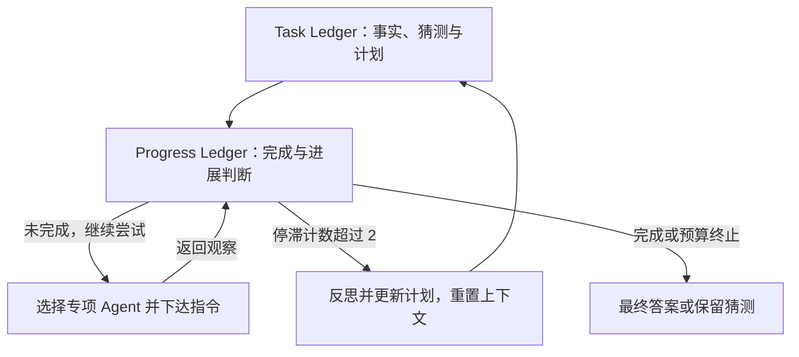

# Magentic-One: A Generalist Multi-Agent System for Solving Complex Tasks

> [!info] 状态
> 原文核读、主题整合与主 Agent 内容/结构验收已完成；未复现实验，Obsidian 应用未测。

## 来源身份与实际阅读范围

| 项目 | 记录 |
| --- | --- |
| 来源 ID | S018 |
| 作者 | Adam Fourney、Gagan Bansal、Hussein Mozannar、Cheng Tan 等，完整 19 人名单见 PDF p.1 |
| 锁定版本 | arXiv:2411.04468v1，2024-11-07 |
| 原始发布页 | [Magentic-One](https://arxiv.org/abs/2411.04468) |
| 下载原件 | [原始 PDF](https://arxiv.org/pdf/2411.04468v1)；访问 2026-10-25 |
| Raw | [[raw/papers/harness/orchestration/Magentic-One.pdf\|Magentic-One.pdf，31 页]] |
| SHA-256 | `E6620F66CE54A7460C90C854AC5B4DC26200F6F8D9C3B3F969E26AB8774338E9` |
| 阅读日期与范围 | 2026-10-25；正文 §§1–7（pp.1–20）的问题、方法、实验与局限；附录 A–B（p.26）及 C 的主要类别（pp.27、29、31）；实际查看 p.5 Fig.2、p.12 Table1、p.14 Fig.3。未逐条核查参考文献与 pp.28、30 的全部错误示例，未运行系统。 |
| S001 引用路线 | 引文 157，§4.4.2，PDF pp.30；书目 pp.88 |

本页页码均按所存 PDF 第一页计数；除 GPTSwarm 的会议卷页码外，引用采用 PDF 内页码。下载后验证标题与哈希，以不覆盖方式归档。作者/版本按实际原件登记，不沿用综述的不同署名。

## 双层协调，而不是固定执行清单

**原文陈述：**Magentic-One 用一个 Orchestrator 调度 WebSurfer、FileSurfer、Coder 与 ComputerTerminal，解决需要浏览、文件处理、代码执行相互衔接的任务。分工依据工具能力；ComputerTerminal 可以是确定性执行器，不必包含 LLM。团队成员固定，运行中动态改变的是调度与计划。[[raw/papers/harness/orchestration/Magentic-One.pdf#page=5|§4、Fig.2 · pp.5–8]] [[raw/papers/harness/orchestration/Magentic-One.pdf#page=19|§6.2 · p.19]]

## 两份账本各自改变什么

| 状态与控制者 | 写入内容及触发 |
| --- | --- |
| Orchestrator 的 Task Ledger | 区分给定/已核实事实、待查事实、待推导事实、educated guesses 和自然语言计划；初始建立，停滞触发外循环后更新 |
| Orchestrator 的 Progress Ledger | 每步判断任务是否完成、是否循环、是否前进、下一个执行者及给它的指令 |
| 专项 Agent 上下文与实际工具环境 | 执行并返回观察；计划更新会清除 Agent 上下文并重置其状态，不能据此推定所有外部副作用可撤销 |

来源：[[raw/papers/harness/orchestration/Magentic-One.pdf#page=6|§4.1 · pp.6–7]]。下图是本库机制示意，箭头为控制转移。

计划在提示中起指导作用，执行不必严格照计划列表；“完成”也是 Orchestrator 判断，最终还可能提交最佳猜测。**本库推断：**账本有助于把事实身份和执行进展显式区分，但并未把核实和完成判断变成外部保证。[[raw/papers/harness/orchestration/Magentic-One.pdf#page=6|§4.1 · pp.6–7]]

## 实验与归因

默认 GPT-4o 为 `gpt-4o-2024-05-13`；混合配置仅在外循环和 Coder 使用 o1-preview。GAIA 和 AssistantBench 报 test 结果，WebArena 主表报全部 812 项，另自行按模板划分验证/测试并报告两者差异；核心系统不变，但存在基准答案格式、登录和网站身份说明。不能把“跨三个基准”写成完全无设置适配。[[raw/papers/harness/orchestration/Magentic-One.pdf#page=9|§5.1 · pp.9–10]] [[raw/papers/harness/orchestration/Magentic-One.pdf#page=11|§5.2 · pp.11–12]]

Table1 的 AssistantBench 同时给 EM 与可部分计分 accuracy；27.7 是混合模型的 accuracy，不是全部任务精确完成率。WebArena 没有报告混合配置结果，因为部分任务遭模型拒绝。作者的“统计可比”采用 α=0.05 的比例 z-test，未显著不同不等于已经证明性能等价；附录解释只能拿到汇总成绩，无法做配对检验。[[raw/papers/harness/orchestration/Magentic-One.pdf#page=12|Table1 · p.12]] [[raw/papers/harness/orchestration/Magentic-One.pdf#page=26|Appendix A · p.26]]

GAIA validation 消融把完整 Orchestrator 换成仅选下一发言者的 GroupChat：一次移除账本、规划、进展追踪、循环检测和明确指令。因此下降支持这组协调机制的整体价值，不能单独归于“存了一份 ledger”。删 Agent 也改变了能力和工具供给，不是匹配能力/预算下的单 Agent 对照。[[raw/papers/harness/orchestration/Magentic-One.pdf#page=12|§5.3 · pp.12–14、Fig.3]]

## 恢复能力仍在哪里失败

作者用 GPT-4o 对日志做 postmortem、开放编码与归并；200 条随机日志建立类别，再应用于验证集。持续低效行动、缺少验证和导航问题是主要模式。这是模型辅助分析，不能把每一“root cause”标签直接当作干预证明。[[raw/papers/harness/orchestration/Magentic-One.pdf#page=15|§5.4 · pp.15–16]]

局限包括高调用成本与延迟、FileSurfer 转 Markdown 丢失版面/图像信息、有限动作空间、固定团队，以及任务间丢弃经验。**原文明确：**任务内的 trial-and-error 不是跨任务学习。[[raw/papers/harness/orchestration/Magentic-One.pdf#page=18|§6.2 · pp.18–19]]

与 MetaGPT 相比，本库可把“固定团队”和“固定执行流程”拆开：本系统团队固定，调度可变。待检验问题是重规划时哪些事实和外部状态需要保留、账本错误怎样被纠正；本篇不能单独证明这已是未解决的领域新问题。

## 主题联系与验收状态

已整合到 [[wiki/harness/orchestration|Harness · 编排]]；涉及反馈检查时联系 [[wiki/harness/verification|验证]]。共享主题与索引已同步，已通过主 Agent 内容/结构验收并完成摄入。关键页码和 Raw 哈希已检查，Obsidian 应用渲染与来源跳转未测。

返回 [[wiki/index|索引]]。

## 分类与阅读入口

主归属与交叉方向：[[wiki/harness/orchestration|harness/orchestration]] · [[wiki/harness/verification|harness/verification]]。
