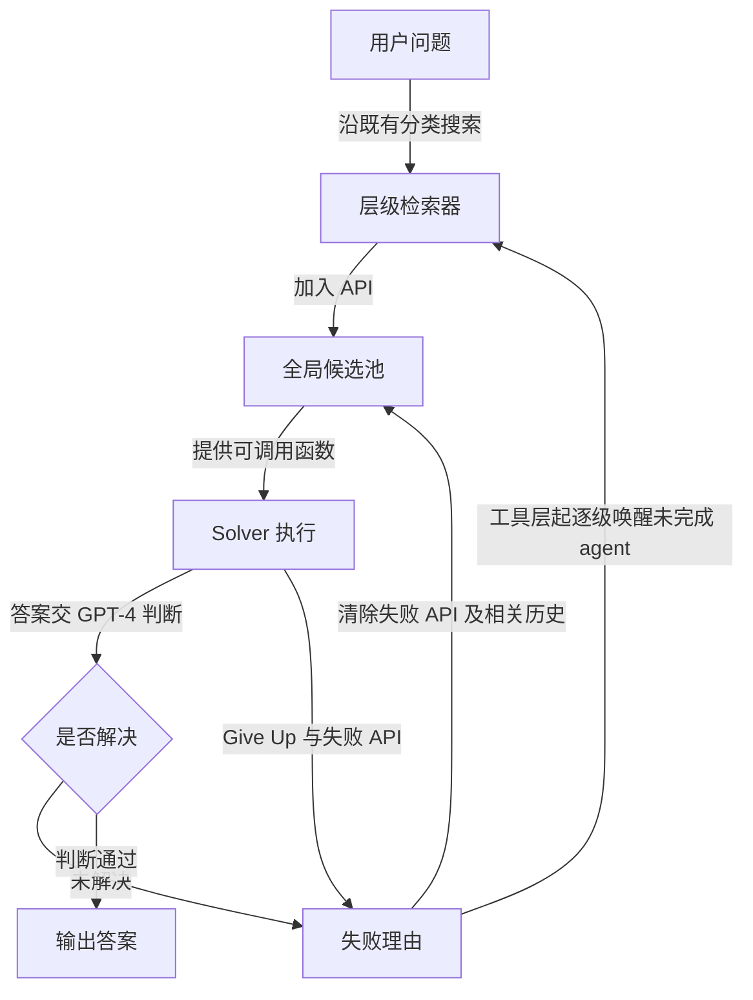

# AnyTool：让执行失败反过来改变工具发现

AnyTool 的关键困难是：16K+ API 的说明放不进一次上下文，第一次检索又可能漏掉真正有用的接口。它把工具发现分成层级搜索，并让执行失败的理由重新启动检索。系统没有额外训练模块，但需要多个 GPT-4 调用、历史状态和反思预算；它不是一次检索后就可靠执行的工具路由器。[[raw/papers/harness/tools/AnyTool.pdf#page=5|§4 · pp.5–6]]

## 来源与读取

| 项目 | 记录 |
| --- | --- |
| ID / 标题 | S013 / AnyTool: Self-Reflective, Hierarchical Agents for Large-Scale API Calls |
| 作者 | Yu Du, Fangyun Wei, Hongyang Zhang |
| 版本 | ICML 2024，PMLR 235:11812–11829；归档发布渠道正式 PDF，共 18 页 |
| 原始 URL / 访问日 | [PMLR 发布页](https://proceedings.mlr.press/v235/du24h.html)；[PDF](https://raw.githubusercontent.com/mlresearch/v235/main/assets/du24h/du24h.pdf)；2026-10-25 |
| 原件 / SHA-256 | [[raw/papers/harness/tools/AnyTool.pdf\|AnyTool.pdf]]；`ECA0A23752C2ED8C653191527692B00D4C5446A510C00568740584068DC51686` |
| 归档 | 下载文件原名 du24h.pdf，原字节归档为 AnyTool.pdf，无版本合并 |
| 阅读范围 | 2026-10-25；正文 §§1–6、Impact Statement（pp.1–9）；附录 A–C（pp.12–18），含函数列表、成本、筛选/生成数据、prompt 与案例；未逐条核读参考文献 |
| 原页检查 | 已查看 Fig.2、Fig.4 / Eqs.1–2、Tables 2–3、Table 14 图像；PDF 页脚采用 1–18，与引用页码一致，PMLR 卷内页码另见上行 |
| S001 | [[raw/surveys/Towards Long-Horizon Agents.pdf#page=27\|§4.3.2 · p.27 · 引文140]]；书目 p.87 |

## 工具发现是可以被执行结果修订的状态

RapidAPI 提供 category → tool → API 的现有结构。meta-agent 分派类别，category-agent 分派工具，tool-agent 查看 API 详情并加入全局候选池。每个 agent 保留自己的历史和是否完成搜索的状态。solver 随后用候选 API 执行，产生答案、放弃或 DFSDT 回溯。[[raw/papers/harness/tools/AnyTool.pdf#page=2|Fig.2 · p.2]] [[raw/papers/harness/tools/AnyTool.pdf#page=5|§4.1–4.2 · p.5]]

本库按原文绘制；“判断通过”是系统评价器的决定，不等于独立环境验证。反思时按 tool、category、meta 的顺序扩大搜索，仅唤醒未标记 Finished 的 agent；solver 的上下文会删除被判无效 API 对应的历史。因而反思实际改的是**候选工具集合与后续可见状态**，并非只加一句“再想一遍”。[[raw/papers/harness/tools/AnyTool.pdf#page=6|§4.3 · p.6]]

## 评价协议的修订比单一领先数字更有用

作者指出，所分析的 ToolBench 旧协议把“当前候选 API 无法解决”的 non-solvable 也计入 pass；检索失败因此可能反而抬高分数。AnyTool 将分母保留全部被评任务，仅 solved 进入分子，并人工过滤 ToolBench 中无法用 API 池解决的问题。本文对旧协议的诊断属于 **AnyTool 作者核验结果**，本次没有独立复跑旧评测。[[raw/papers/harness/tools/AnyTool.pdf#page=4|§3.2 · Fig.4、Eqs.1–2 · p.4]]

主结果使用过滤后六个 ToolBench 子集和 400 条 AnyToolBench。AnyToolBench 是 GPT-4 探索 API、实际调用后生成问题与解答，再检查参考解答的构造，不能直接等同于自然用户分布。最终答案由 GPT-4-32K 判断；人机 96.5% 一致率仅在 G1-I 的 AnyTool 输出上检验，不能扩大成所有环境下评价器可靠。[[raw/papers/harness/tools/AnyTool.pdf#page=6|§5.1 · p.6]] [[raw/papers/harness/tools/AnyTool.pdf#page=14|附录 A.8 · p.14]]

| 核查对象 | 原文证据与应保留条件 |
| --- | --- |
| 整体性能 | Table 1 六子集平均 58.2%，对比采用不同检索器/solver 的多种系统；须同时保留 GPT-4、DFSDT、反思和候选池条件。[[raw/papers/harness/tools/AnyTool.pdf#page=6\|Table 1 · p.6]] |
| 层级与反思 | G2-I/G3-I 的移除消融均下降，支持这套系统中两组件有用；未匹配总 token/调用预算，不能归结为抽象“反思能力”独自带来全部收益。[[raw/papers/harness/tools/AnyTool.pdf#page=7\|Table 3、§5.3 · pp.7–8]] |
| 推理预算 | DFSDT solver 最大 API 调用数设为 10；整个 AnyTool 上限 200,000 tokens，覆盖检索、solver、反思。上限不是实耗。[[raw/papers/harness/tools/AnyTool.pdf#page=12\|附录 A.1 · p.12]] |
| 实耗与表述张力 | 附录 A.6 说平均 13.5×10⁴ tokens，Table 14 的 Avg 为 13.6×10⁴，保留此小差异，不自行统一；表中模型调用平均 43.3 次、反思 4.6 次。[[raw/papers/harness/tools/AnyTool.pdf#page=13\|A.6、Table 14 · pp.13–14]] |

## 前提、比较与待检验问题

已有工具分类、可理解的 API 文档、可调用服务和可靠失败理由都是机制能工作的条件。作者承认极复杂任务缺少合适数据验证，并受 GPT-4 能力限制；本文未提供跨天、跨会话状态维护或真实写入副作用一致性的系统评测。[[raw/papers/harness/tools/AnyTool.pdf#page=9|Impact Statement · p.9]]

与 [[wiki/papers/optimization/finetuning/Toolformer|Toolformer]] 的本库比较：Toolformer 改训练数据与参数，AnyTool 改推理期工具发现和恢复路径；二者任务、模型和预算不同，不能以结果数字直接比较。AnyTool 最直接的实验对照是作者复现的 ToolLLM 变体，本次未核读 ToolLLM 原论文，只保留本文给出的对照条件。[[raw/papers/harness/tools/AnyTool.pdf#page=7|§5.2 · p.7]]

**本库推断：**动态工具发现应视为行动空间维护，而不只是静态向量检索。**待检验问题：**在匹配调用/成本预算后，失败驱动扩展候选池的收益能否与单纯增加尝试次数分开？判断“API 不相关”与“暂时失效”是否需要不同状态保留策略？仅为当前证据问题，尚未形成查新后研究缺口。

## 整合与验收状态

已整合至 [[wiki/harness/tools|工具、MCP 与技能]]，覆盖工具发现和成功判据的比较，内容与结构验收通过；[[wiki/applications/Overview|应用与评测]] 仅为相关入口，本批未写入该页。未复现实验，Obsidian 渲染与跳转尚未实测。

## 分类与阅读入口

主归属与交叉方向：[[wiki/harness/tools|harness/tools]]。
