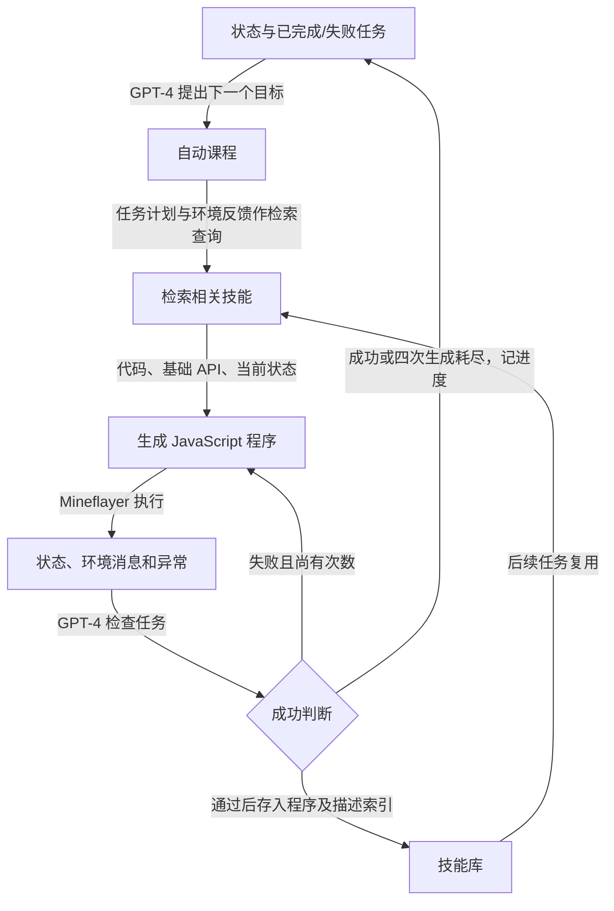

# Voyager：把成功程序存成可复用技能

Voyager 在 Minecraft 中反复提出任务、生成并修复控制代码，把被判断完成任务的程序放入技能库供后续组合。持续改变的是**任务进度和可检索程序库**，不是 GPT-4 参数。它是程序性经验复用的直接证据，但依赖高层控制 API、结构化状态和模型成功判断，不能外推为像素感知或真实机器人已解决。[[raw/papers/harness/tools/Voyager.pdf#page=2|§1–2 · Fig.2 · pp.2–6]]

## 来源身份与阅读范围

| 项目 | 记录 |
| --- | --- |
| ID / 标题 | S015 / Voyager: An Open-Ended Embodied Agent with Large Language Models |
| 作者 | Guanzhi Wang, Yuqi Xie, Yunfan Jiang, Ajay Mandlekar, Chaowei Xiao, Yuke Zhu, Linxi “Jim” Fan, Anima Anandkumar |
| 锁定版本 | arXiv:2305.16291v2，2023-10-19，共 42 页；S001 书目记 TMLR 2024，本库证据限定所下载 v2，未假定与期刊版逐字相同 |
| 原始 URL / 访问 | [版本页](https://arxiv.org/abs/2305.16291v2)；[PDF](https://arxiv.org/pdf/2305.16291v2)；2026-10-25 |
| 原件 / SHA-256 | [[raw/papers/harness/tools/Voyager.pdf\|Voyager.pdf]]；`769A4E33DDEEB73870849232EECE49AFE882C2D146362E33917CCB432BA0EFB8` |
| 归档与页码 | 从带版本 PDF URL 原样归档；PDF 与页脚页码一致 |
| 阅读范围 | 2026-10-25；正文 §§1–7（pp.2–11）；A.1–A.3.3（pp.19–21）、A.4 的接口/提示结构与代码生成约束（pp.24–26、29–32）、A.5 的验证结构及示例（pp.35、37）、B.1–B.4（pp.38–42）。A.3 完整提示、部分 API 实现及技能示例未逐行核读，参考文献未逐项核验 |
| 原页图表 | 已看 Fig.2、Fig.4、Tables 1–2、Fig.9、Table A.4 图像；核心机制没有单独数学推导 |
| S001 | [[raw/surveys/Towards Long-Horizon Agents.pdf#page=28\|§4.3.3 · p.28 · 引文630]]；另见 §4.2.2 pp.25–26，书目 p.126 |

## 一次任务怎样变成下一次可用的技能

本库按 Fig.2 和附录伪代码重绘。四次是每个任务最多代码生成轮数，不是全系统总调用数；失败后允许换任务，未来再尝试。[[raw/papers/harness/tools/Voyager.pdf#page=6|§2.3 · p.6]] [[raw/papers/harness/tools/Voyager.pdf#page=19|A.1 · Pseudocode 1 · p.19]]

技能库的 value 是可执行程序，key 来自 GPT-3.5 生成的程序描述 embedding。检索以 GPT-3.5 给出的任务建议加环境反馈作为查询，取 top-5 技能。这里有两个需分开的可靠性环节：程序是否完成当前任务，以及描述是否让未来相似任务取回正确程序。附录另有 309 个样本的技能检索检查，Table A.4 报 top-5 accuracy 为 96.5±0.3；该数字是检索准确率，不是重用程序后的任务成功率，也不覆盖其他环境。[[raw/papers/harness/tools/Voyager.pdf#page=4|§2.2 · Fig.4 · pp.4–5]] [[raw/papers/harness/tools/Voyager.pdf#page=42|B.4.4 · Table A.4 · p.42]]

运行反馈也有三类：API 内 `bot.chat()` 产生的环境消息、解释器异常、GPT-4 根据当前状态做的任务成功判断。无执行异常不能替代完成任务；模型 critic 也会误判。作者例举误认蜘蛛战斗掉落物，课程还会提出不存在的物品。[[raw/papers/harness/tools/Voyager.pdf#page=5|§2.3 · pp.5–6]] [[raw/papers/harness/tools/Voyager.pdf#page=10|§4 · p.10]]

## 实验与环境条件

主要组件使用 GPT-4-0314，辅助文本任务用 GPT-3.5-turbo-0301，embedding 用 text-embedding-ada-002。环境为 MineDojo 加 Mineflayer JavaScript 高层控制；没有像素视觉输入。附录 B.1 还给出死亡后在附近复活、保留物品以及执行后回收工作台和熔炉等设置。持续探索的证据必须保留这些恢复便利条件。[[raw/papers/harness/tools/Voyager.pdf#page=6|§3.1–3.2 · p.6]] [[raw/papers/harness/tools/Voyager.pdf#page=38|B.1 · p.38]]

| 评测问题 | 原文支持与边界 |
| --- | --- |
| 开放探索 | 三次运行、最多 160 次 prompting iterations，比较新物品、技术树、地图探索；这是有限预算探索实验，不是无限终身运行证明。[[raw/papers/harness/tools/Voyager.pdf#page=7\|§3.3、Table 1 · p.7]]、[[raw/papers/harness/tools/Voyager.pdf#page=39\|B.4.1 · pp.39–40]] |
| 技术树 | 木、石、铁级为 3/3；钻石级为 1/3。不能把“唯一达到钻石”写成稳定全部成功。[[raw/papers/harness/tools/Voyager.pdf#page=7\|Table 1 · p.7]] |
| 跨新世界复用 | 清空物品并重置新世界，保留技能库，四个新任务各三次、最多 50 轮；表中 Voyager 四项均 3/3，去库版本也常能成功但所需迭代更多；并非从零经验开始。[[raw/papers/harness/tools/Voyager.pdf#page=8\|Table 2、§3.3 · p.8]] |
| 消融 | 课程、技能库、反馈和 GPT-4 的消融支持组合机制贡献；GPT-3.5 消融仅替换代码生成，课程与验证仍用 GPT-4。[[raw/papers/harness/tools/Voyager.pdf#page=9\|Fig.9 · p.9]]、[[raw/papers/harness/tools/Voyager.pdf#page=39\|B.3 · p.39]] |
| 建筑展示 | 房屋与传送门示例使用人类视觉批评或任务分解，不能当作无人视觉规划证据。[[raw/papers/harness/tools/Voyager.pdf#page=9\|§3.5 · Fig.10 · p.9]] |

基线 ReAct、Reflexion、AutoGPT 是作者为 Minecraft 重解释/实现的版本。作者明确不直接比较像素输入、低层控制的方法。因此这里记录的是该系统设置下的比较，不能据此宣称抽象算法在所有 embodied 环境的排名。[[raw/papers/harness/tools/Voyager.pdf#page=6|§3.2 · pp.6–7]] [[raw/papers/harness/tools/Voyager.pdf#page=38|B.2 · pp.38–39]]

## 与代码动作、记忆的联系

**本库综合：**[[wiki/papers/harness/tools/CodeAct|CodeAct]] 与 Voyager 都使用执行反馈修订代码。CodeAct 主要统一可交互动作表示，Voyager 额外将成功程序持续入库并检索组合；后者保存的是“以后怎样做”的程序性经验，而不是完整环境事实。技能的可执行性使它能直接影响后续行动，但并不等于前提条件在新状态中仍成立。[[raw/papers/harness/tools/CodeAct.pdf#page=3|S014 §2.1 · pp.3–4]] [[raw/papers/harness/tools/Voyager.pdf#page=4|S015 §2.2 · pp.4–5]]

**交叉来源纠正：**CodeAct 附录 A 在解释 Voyager 动作粒度时称其为 Python function；Voyager 原文 §3.1 / A.4.2 明确使用 Mineflayer JavaScript。这里以 Voyager 自身为准。这个细节不推翻其程序粒度比较，但不应沿用错误语言标签。[[raw/papers/harness/tools/CodeAct.pdf#page=15|S014 附录 A · p.15]] [[raw/papers/harness/tools/Voyager.pdf#page=26|S015 A.4.2 · p.26]]

**待检验问题：**一次被 critic 判成功的程序在什么前提下可复用，什么时候应失效、修订或再次验证？当前原文足以提出该可靠性问题，但尚未完成技能验证文献查新，不能记作无人研究的空白。

## 整合与验收

已整合至 [[wiki/harness/tools|工具与技能]]，其中说明与 [[wiki/harness/memory|持久经验]] 的接口，内容与结构验收通过。未复现实验；Obsidian 图与来源跳转尚未实测。

## 分类与阅读入口

主归属与交叉方向：[[wiki/harness/tools|harness/tools]] · [[wiki/harness/memory|harness/memory]]。
