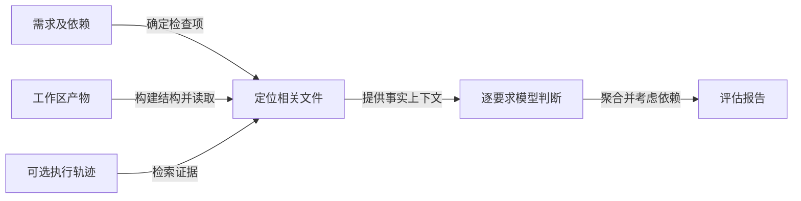

# Agent-as-a-Judge: Evaluate Agents with Agents

## 先找到工作产物，再判断要求有没有实现

**原文贡献：**Agent-as-a-Judge 评估开发 Agent 留下的文件、代码、图像和过程记录，以需求为单位形成判定。相比只把一段输出交给 LLM 打分，关键增加的是定位与读取证据的动作；它是评估框架和 DevAI 基准，不是本文已实证的在线自我纠错控制器。作者在结论明确说，**把反馈交回被评估 Agent、让其实时修复，本研究尚未利用**。[[raw/papers/harness/verification/Agent-as-a-Judge.pdf#page=6|§4.1 · pp.6–7]] [[raw/papers/harness/verification/Agent-as-a-Judge.pdf#page=9|§6 Discussion · p.9]]

本库重绘，箭头为证据流；没有画回执行者的修复箭头，因为本文未实测该闭环。图据 [[raw/papers/harness/verification/Agent-as-a-Judge.pdf#page=17|Appendix C、Fig.8 · p.17]]。

八个初始模块中，graph/locate/read/ask，及需要轨迹时的retrieve构成有效配置。planning、memory、search不自动增加准确性：OpenHands消融中加入这些模块未获益，作者将记忆下降解释为之前判定影响后续要求判断，但这是机制假说，不是已隔离的因果结论。[[raw/papers/harness/verification/Agent-as-a-Judge.pdf#page=7|§4.1 · p.7]] [[raw/papers/harness/verification/Agent-as-a-Judge.pdf#page=32|Appendix K、Table 5/6 · pp.32–33]]

## 需求达标、整任务成功、与人一致是三种指标

DevAI含55个AI开发任务、365条有依赖关系的要求，以及125条可选偏好。任务要求构成DAG，完成一项下游要求还需其前置条件成立。MetaGPT/GPT-Pilot/OpenHands使用gpt-4o-2024-05-13，每题最多1800秒，结果是该模型、版本与预算下的产物。[[raw/papers/harness/verification/Agent-as-a-Judge.pdf#page=3|§2.2–2.3 · p.3]]

| 指标 | 回答的问题 | 不能替代什么 |
| --- | --- | --- |
| Requirements Met (I) | 单条要求是否独立满足 | 忽略依赖会高估整体可用性 |
| Requirements Met (D) | 结合前置要求后满足多少 | 部分达标不等于整任务完成 |
| Task Solve Rate | 是否满足任务全部要求 | 不刻画评估者判错多少 |
| Alignment Rate | 每条判断与人工共识是否相同 | 不是实际执行成功率，负例多时可虚高 |
| Judge Shift | 汇总达标率与人工结果偏差 | 假阳性与假阴性可能抵消 |

定义与限制见 [[raw/papers/harness/verification/Agent-as-a-Judge.pdf#page=5|§3、Table 2 · pp.5–6]] [[raw/papers/harness/verification/Agent-as-a-Judge.pdf#page=7|Table 3、§4.2 · pp.7–8]]。例如人工评估GPT-Pilot/OpenHands的依赖达标率约29%，但各仅完成55题中的1题；不能把29%当整任务成功率。

人工参照由三位作者中的专家先独立判断、再讨论形成共识；它是有检查过程的参照，不是绝对真值。另10名独立专家只复核7个OpenHands任务，支持的是这个有限子集的一致性。black-box可读工作产物，gray-box额外拥有定制收集轨迹；不能把该术语误读成前者完全不看文件。[[raw/papers/harness/verification/Agent-as-a-Judge.pdf#page=6|§3.2 · p.6]] [[raw/papers/harness/verification/Agent-as-a-Judge.pdf#page=7|Table 3 注释 · p.7]] [[raw/papers/harness/verification/Agent-as-a-Judge.pdf#page=25|Appendix H · p.25]] [[raw/papers/harness/verification/Agent-as-a-Judge.pdf#page=39|Appendix P · p.39]]

## 证据强度与原文内部差异

以Table 3为准，OpenHands black-box 的Agent判定与人工共识一致率90.44%，gray-box90.16%；人工多数票94.26%。作者也使用PR曲线处理类不平衡，因此不宜只用90%左右的一致率宣称“替代人工”。[[raw/papers/harness/verification/Agent-as-a-Judge.pdf#page=7|Table 3 · p.7]] [[raw/papers/harness/verification/Agent-as-a-Judge.pdf#page=8|§4.2、Fig.6 · p.8]]

> [!warning] 原文表述张力，保留待核查
> p.8举OpenHands例时写92.07%，但Table 3的92.07%位于MetaGPT gray-box；这里采用表格相应列。p.38 Table 9第1例把Agent/Human写作False/True，而紧随分析描述Agent被合成数据误导为真、人工识别问题，方向相反。本库不据该例确认误判方向。[[raw/papers/harness/verification/Agent-as-a-Judge.pdf#page=8|§4.2 · p.8]] [[raw/papers/harness/verification/Agent-as-a-Judge.pdf#page=38|Appendix N、Table 9 · p.38]]

§4.4报告的人力86.5小时依赖自报工时及15美元时薪假设；API成本与当时模型价格、上下文读取策略有关，不能视为今日采购或运行成本。该工作主要检查相对小的AI开发工作区；广泛领域迁移、错误判定反馈后的连锁效应与大规模仓库适用性仍需证据。[[raw/papers/harness/verification/Agent-as-a-Judge.pdf#page=8|§4.4 · p.8]] [[raw/papers/harness/verification/Agent-as-a-Judge.pdf#page=32|Appendix K · p.32]]

## 对当前知识的更新

**本库推断：**与已读 [[wiki/papers/harness/tools/MCPMark|MCPMark]] 的程序验收相比，本文提高了检查要求与多模态产物的灵活性，也保留模型判定误差；与 [[wiki/papers/optimization/data-environments/SWE-Gym|SWE-Gym]] 的学习验证器相比，本文主要通过运行时取证而非训练一个结果分类器。不能因它叫Agent，就把多模块或多次判断算成新增独立证据。

待检验的接口问题是：相同可访问产物、过程日志与调用预算下，额外取证能改善哪类漏检？本批只把它作为后续证据需求，没有完成查新或提出已成立研究缺口。

## 来源身份与实际阅读范围

| 项目 | 记录 |
| --- | --- |
| 来源 ID | S029 |
| 作者 | Mingchen Zhuge、Changsheng Zhao、Dylan R. Ashley、Wenyi Wang、Dmitrii Khizbullin、Yunyang Xiong、Zechun Liu、Ernie Chang、Raghuraman Krishnamoorthi、Yuandong Tian、Yangyang Shi、Vikas Chandra、Jürgen Schmidhuber |
| 版本 | ICML 2025，PMLR 267 会议版（正式条目 pp.80569–80611）；PDF内部页码1–43 |
| 标识符 | PMLR v267/zhuge25a；本次未确认独立 DOI |
| 原始入口 | [发布页](https://proceedings.mlr.press/v267/zhuge25a.html)；[本次 PDF](https://raw.githubusercontent.com/mlresearch/v267/main/assets/zhuge25a/zhuge25a.pdf) |
| 原件 | [[raw/papers/harness/verification/Agent-as-a-Judge.pdf\|Agent-as-a-Judge.pdf · 43 页]] |
| SHA-256 | `10C479CDC343B9916C3FC994CDEDF6FD040462D85CE00A57F2A6654B231BDE00` |
| 获取与阅读日期 | 2026-10-25；下载原字节以不覆盖方式归档，身份按该 PDF 首页核对 |
| S001 追索 | [[raw/surveys/Towards Long-Horizon Agents.pdf#page=35\|§4.6.2；Table 4 · PDF pp.35,36 · 引文 898]]；参考文献 PDF pp.148 |

核读正文 PDF pp.1–9，附录 A–C pp.15–17、H/I/J pp.25–27与轨迹示例pp.29–30、K pp.32–33、N/O/P pp.38–39；查看 p.7 Table 3、p.17 Fig.8、p.38 Table 9 页面图像。其他任务示例及全部多模态产物未逐项核验，代码未审查。下文页码均为PDF内部页，不以PMLR卷页替代。

**主题整合：**已整合至 [[wiki/harness/verification|Harness · 验证]]，内容与结构已验收。尚未复现实验；按本轮要求不进行ComputerUse，Obsidian公式、表格、折叠、来源跳转及宽窄窗口均未实测。

## 分类与阅读入口

主归属与交叉方向：[[wiki/harness/verification|harness/verification]]。
