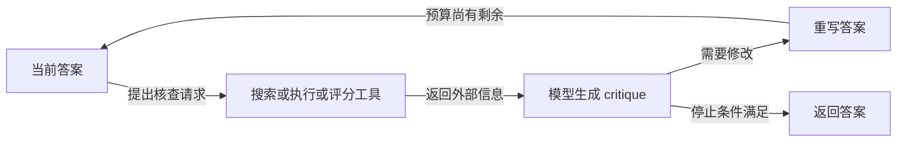

# CRITIC: Large Language Models Can Self-Correct with Tool-Interactive Critiquing

## 工具给出证据，模型仍要解释并决定是否修改

**原文机制：**CRITIC 让冻结的黑箱 LLM 先产生答案，再调用任务对应工具形成 critique，最后依据 critique 重写答案。更新的是当前输出和上下文，没有参数训练；验证与修订是两个步骤，工具结果只是 critique 的组成部分，最终解释仍可能错误。[[raw/papers/harness/verification/CRITIC.pdf#page=4|§3、Algorithm 1 · pp.4–5]]

本库重绘的机制示意；箭头表示信息流与控制分支。**停止只是运行规则，不是正确性保证。**通用算法用 critique 判断正确与迭代上限，实验还采用答案不再改变或分数阈值。[[raw/papers/harness/verification/CRITIC.pdf#page=4|Algorithm 1 · p.4]] [[raw/papers/harness/verification/CRITIC.pdf#page=6|§4.1 · p.6]]

| 判断对象 | 新信息如何进入 | 实验中的停止与预算 |
| --- | --- | --- |
| 问答的事实与合理性 | Google 查询，抓取 top-1 页面并提取至多400字符；搜索缓存固定实验期信息 | 至多7次工具交互、3轮纠正；连续两次答案相同提前停 |
| 数学程序 | Python 异常与执行所得 answer，模型再检查语义/数值合理性 | 至多4轮；连续两次执行结果相同停 |
| 文本毒性 | Perspective API 总分与属性分，最高属性作为反馈 | 至多4轮，整体毒性低于10%停 |

证据：[[raw/papers/harness/verification/CRITIC.pdf#page=5|§4.1 · pp.5–6]] [[raw/papers/harness/verification/CRITIC.pdf#page=7|§4.2 · pp.7–8]] [[raw/papers/harness/verification/CRITIC.pdf#page=8|§4.3 · pp.8–9]]。这些工具不是同等强度的真值源：程序能正常执行仍可能算错问题，网页也可能缺失或被误解。

## 结果支持什么，哪些比较有额外权限

QA 在每个验证集随机抽500例，用 EM/F1；数学以执行结果对答案的数值匹配评估。作者的无工具消融经常降低收益，但不是每个条件都正向：Table 2 的 text-davinci-003 在 SVAMP 上由 PoT 84.0 降为 CRITIC 80.7，不能照搬正文的全面提升措辞。[[raw/papers/harness/verification/CRITIC.pdf#page=6|§4.1、Table 1 · p.6]] [[raw/papers/harness/verification/CRITIC.pdf#page=7|Table 2 · p.7]]

- **CRITIC\*** 已知哪些初答错误，只纠正这些样本，是 oracle 设置；不能当成部署时可用的错误检测器。论文的 rejection sampling 对照也按最高真实指标挑答案，比较时要保留该权限。[[raw/papers/harness/verification/CRITIC.pdf#page=5|§4 · p.5]] [[raw/papers/harness/verification/CRITIC.pdf#page=9|§4.4 · p.9]]
- GSM8K 的非 oracle 错误分析中，初始363个错误有32.2%被修正，同时41个原本正确样本被误改。表中14.3%是最终错误中误改所占比例，4.3%是原正确样本的损失；二者分母不同。[[raw/papers/harness/verification/CRITIC.pdf#page=26|Appendix D.2.2、Table 7 · p.26]]
- 幻觉检测实验把 F1>0.6 作为正确标签，以 AUROC/accuracy 衡量判断；这与主要 QA 的连续 F1 不是同一评价口径。工具增强判断也未达到完美。[[raw/papers/harness/verification/CRITIC.pdf#page=24|Appendix D.1、Table 5 · pp.24–25]]
- 毒性反馈与最终毒性评估都使用 Perspective API；因此结果首先证明降低该评分器的指标，不能直接推出所有人类安全偏好都改善。历史训练方法还使用 GPT-2，不能直接视作同模型公平比较。[[raw/papers/harness/verification/CRITIC.pdf#page=9|§4.3 · p.9]]

作者承认延迟、手工 demonstrations 和任务/模型可迁移性限制；工具免收费不等于推理免费，额外模型调用与迭代成本仍存在。[[raw/papers/harness/verification/CRITIC.pdf#page=21|Appendix A · p.21]] [[raw/papers/harness/verification/CRITIC.pdf#page=26|Appendix D.3 · p.26]]

## 对长程验证的含义

**本库推断：**长程系统需分别记录“新增外部证据—判断质量—修订收益—误改损失—停止成本”。本文已经覆盖工具增强纠错这条路线，不能把“让模型再反思一次”当新问题。论文主要实验围绕答案、数学程序和文本毒性，并未直接验证持续改变外部世界的长程 Agent 能安全回滚。与已读 [[wiki/papers/harness/workflows/ReAct|ReAct]] 的联系是工具信息进入时机不同：CRITIC明确先有待核查输出再纠正；其 ReAct 基线还改用本文搜索工具，不能据不同论文分数互排。[[raw/papers/harness/verification/CRITIC.pdf#page=6|§4.1 Baselines · p.6]]

## 来源身份与实际阅读范围

| 项目 | 记录 |
| --- | --- |
| 来源 ID | S027 |
| 作者 | Zhibin Gou、Zhihong Shao、Yeyun Gong、Yelong Shen、Yujiu Yang、Nan Duan、Weizhu Chen |
| 版本 | arXiv v4，2024-02-21；PDF 标注 ICLR 2024 |
| 标识符 | arXiv:2305.11738v4；DOI:10.48550/arXiv.2305.11738 |
| 原始入口 | [发布页](https://arxiv.org/abs/2305.11738)；[本次 PDF](https://arxiv.org/pdf/2305.11738v4) |
| 原件 | [[raw/papers/harness/verification/CRITIC.pdf\|CRITIC.pdf · 78 页]] |
| SHA-256 | `ED5CBFF53C8FF550B72D6ABBA0D7E4D83C5D214D61D0FAFDE10CBE4BBFC31A5B` |
| 获取与阅读日期 | 2026-10-25；下载原字节以不覆盖方式归档，身份按该 PDF 首页核对 |
| S001 追索 | [[raw/surveys/Towards Long-Horizon Agents.pdf#page=35\|§4.6.2；Table 4 · PDF pp.35,36 · 引文 182]]；参考文献 PDF pp.90 |

核读正文 PDF pp.1–9，附录 A/B p.21、D.1–D.4 pp.24–26；查看 p.4 Algorithm 1、p.6 Table 1/Fig.3、p.7 Table 2/Fig.4、p.26 Table 7 页面图像。其余附录的完整提示、大规模案例和所有 LLaMA 分项结果未逐项核验。PDF 与印刷页码相同。

**主题整合：**已整合至 [[wiki/harness/verification|Harness · 验证]]，内容与结构已验收。尚未复现实验；按本轮要求不进行ComputerUse，Obsidian公式、表格、折叠、来源跳转及宽窄窗口均未实测。

## 分类与阅读入口

主归属与交叉方向：[[wiki/harness/verification|harness/verification]]。
