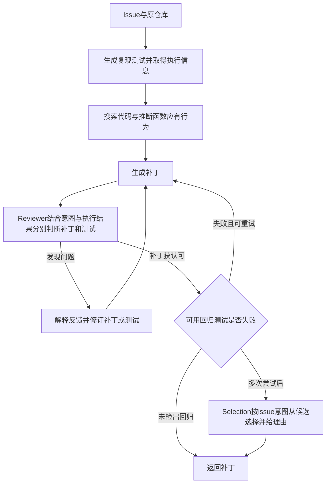

# SpecRover：修补代码时，测试与意图也需要互相核对

**原文机制：**SpecRover从issue、代码结构与执行结果推断函数应有的行为，再生成、审查和选择补丁。它不仅问“补丁过测试了吗”，还让reviewer同时判断**补丁和生成的复现测试是否正确**；既有回归测试可以触发重试，但也可能因新需求改变而过时。它实现了在线修复闭环，不能据此声称模型判断或测试已经证明完整正确性。[[raw/papers/harness/verification/SpecRover.pdf#page=3|S070 §III.A · pp.3–5]]

## 身份、版本与阅读范围

| 项目 | 登记 |
| --- | --- |
| 来源ID / 标题 | S070 / SpecRover: Code Intent Extraction via LLMs |
| 作者 | Haifeng Ruan、Yuntong Zhang、Abhik Roychoudhury；前两人为共同第一作者，首页注明按字母排序 |
| 锁定版本 | 作者公开站点下载的12页PDF，以本页SHA-256锁定；正文p.11提到2024年11月接收时的后续系统成绩。PDF未直接给正式出版DOI、卷页或版本编号，本库不由文件名推断这些元数据 |
| 原始获取 | [作者站原件](https://abhikrc.com/pdf/ICSE25.pdf)，访问2026-10-25；原文件名ICSE25.pdf |
| Raw | [[raw/papers/harness/verification/SpecRover.pdf\|SpecRover.pdf]] |
| SHA-256 | `C7FF57093BAA41A22F8C822DA76975CF0D03AB24B33004DD0AAF9B05D35AB919` |
| 读取 | 2026-10-25；正文pp.1–11的问题、方法、实验、案例、Related Work/Perspectives；p.12参考文献仅定位，不计独立核读。实际看p.1身份、p.4 Figs.2–3/规格表示、p.5 Fig.4/选择条件、p.7 Table I、p.8 Table II/Fig.6、p.9 Figs.7–8；没有附录 |
| 未做 | 未审计公开实现/逐条实验轨迹，未执行补丁或复现实验；未逐项追读参考文献。Obsidian应用未测 |
| 选读路线 | 第一轮Harness验证方向H6的综述外定向补读1/2；用于核查局部修复、回归检查和需求变更的已有覆盖，无S001引文编号 |

本文页码从归档PDF第一页计，和页脚1–12一致；正式出版卷页与该作者版本的逐字关系未确认。当前已完成原文核读、主题整合、主Agent内容/结构验收与摄入收尾；Obsidian应用未测。

**关联身份核对：**会议官方页面确认同题同作者属于ICSE 2025 Research Track；arXiv身份页确认`2408.02232`，页面当前版本v4、修订日期2024-12-11。作者站PDF与该v4未做字节/逐字对齐，故不把Raw直接标成arXiv v4。两份身份HTML已按授权精简；以下为核对结果、原始URL及访问日期登记，当前仓库不再保留其网页原件。它们不另计学术来源。删除前哈希与恢复提交见[[maintenance/migrations/2026-10-25-directory-migration|迁移记录]]。

| 核实项目 | 原始URL、访问日期 | 保留状态 |
| --- | --- | --- |
| ICSE 2025 Research Track，同题同作者 | [会议官方条目](https://conf.researchr.org/details/icse-2025/icse-2025-research-track/68/SpecRover-Code-Intent-Extraction-via-LLMs)，2026-10-25 | 元数据登记；HTML已删除 |
| arXiv 2408.02232，v4，修订于2024-12-11 | [arXiv身份页](https://arxiv.org/abs/2408.02232)，2026-10-25 | 元数据登记；HTML已删除 |

## 高层需求怎样变成局部修改约束

仓库issue通常描述整个系统应如何表现，却不直接给出每个函数的规范。SpecRover在搜索类/方法时，不只返回代码和可疑位置，还为接触到的函数生成与当前issue相关的“应有行为”。交给patching agent的是位置与局部规格的配对，而非单纯位置列表。它是模型对用户意图的推断，不是从buggy代码读出无误真值。[[raw/papers/harness/verification/SpecRover.pdf#page=4|§III.B、Fig.3 · p.4]]

本库分析：这里的长程压力来自仓库理解、定位、测试生成与修复的多步骤依赖；论文没有验证跨会话持续运行或跨任务学习。主要更新对象是运行时规格、候选补丁、测试及反馈，没有提出基础模型参数训练。[[raw/papers/harness/verification/SpecRover.pdf#page=3|§III · pp.3–5]]

本库重绘，箭头表示控制/反馈关系，依据§III.A、Fig.2和§III.D；省略了重试中重新定位的内部过程。**返回或获认可都不是正确性保证**；回归测试是可选输入，图中“未检出回归”不能读作不存在回归。[[raw/papers/harness/verification/SpecRover.pdf#page=3|§III.A · pp.3–4]] [[raw/papers/harness/verification/SpecRover.pdf#page=5|§III.D · p.5]]

## 四种判断不能合并为一个“通过”

| 判断 | 信息与作用 | 保证边界 |
| --- | --- | --- |
| 生成的复现测试 | 在原程序和补丁程序上运行，返回输出与退出码，试图暴露issue中的错误 | 测试本身可能写错，也可能只覆盖部分意图 |
| Reviewer判断 | 联合issue、复现测试、补丁和前后执行结果；分别决定测试/补丁是否正确，并解释原因 | 是LLM判断，可以误拒和误收；测试失败不自动判补丁错 |
| 既有回归测试 | reviewer认可补丁后检查旧功能；失败可触发有限重试 | 旧测试可能不符合合法的新行为；通过也受覆盖限制 |
| SWE-bench最终acceptance tests | 评测系统判断最终单个补丁是否解决issue，生成过程中不开放开发者新增测试 | 测试通过仍不等于与开发者补丁语义等价，也不是所有需求的形式证明 |

前3行依据[[raw/papers/harness/verification/SpecRover.pdf#page=5|§III.C–D、Fig.4 · p.5]]；末行及信息隔离依据[[raw/papers/harness/verification/SpecRover.pdf#page=6|§IV · p.6]]。回归测试来自原buggy程序，不能与评测端开发者新增的acceptance tests混称为同一反馈权限。

**测试错误的具体例子。** SymPy案例中生成的测试把kind对象与字符串比较，导致断言总为假；reviewer指出测试错误，同时认为补丁正确。这说明联合审查能够识别一个错误测试案例，不证明它普遍能正确推翻测试。[[raw/papers/harness/verification/SpecRover.pdf#page=9|Fig.8 · pp.9–10]]

**旧测试失效的不同原因。** §III.D指出，新需求可能合法修改函数签名，使调用旧签名的回归测试失败。因此系统保留selection agent，结合最新issue从被测试拒绝的候选里选择。这里不是证明所有回归失败都可忽略，而是把“旧测试是否仍代表当前意图”纳入判断；选择器也可能误判。[[raw/papers/harness/verification/SpecRover.pdf#page=5|§III.D · p.5]]

## 实验支持系统效果，尚不能隔离各组件贡献

主实验为SWE-bench 2,294个issue及其中Lite 300个；主模型Claude 3.5 Sonnet，遇该模型API错误时才为该任务切换GPT-4o；temperature为0，回归失败最多重试3次。对照使用其他工具已报告的最好配置，模型、预算和工具不同，因此不能把表格差异全部归给局部规格、reviewer或回归检查中的一项。[[raw/papers/harness/verification/SpecRover.pdf#page=6|§IV、§V.A · p.6]]

Table I中SpecRover的最终单补丁acceptance-test通过率为全量443/2,294（19.31%）、Lite 93/300（31%）。这是作者当时的系统结果，不是当前排行榜；Lite平均309秒、0.65美元包含作者当时执行与服务条件，不能作为今天预算保证。p.11另报后续AutoCodeRover-v2成绩，未沿用为本表同配置实验证据。[[raw/papers/harness/verification/SpecRover.pdf#page=7|Table I、§V.A · p.7]] [[raw/papers/harness/verification/SpecRover.pdf#page=11|Data Availability · p.11]]

更重要的是**评价层级之间的落差**：作者对Lite的93个测试通过补丁作人工比较，仅56/93（60.2%）被认为与开发者补丁语义等价，其他37个被记作overfitting；其中29个改对了方法位置，也不能因此把它们计成完整正确修复。人工核查由两位作者独立检查，有分歧时与第三位讨论；语义等价是本研究的人工参照，不是本库独立证明。[[raw/papers/harness/verification/SpecRover.pdf#page=6|§IV.e · p.6]] [[raw/papers/harness/verification/SpecRover.pdf#page=7|§V.A Patch Correctness · p.7]]

> [!note] reviewer的分母与“correct”标签仍需谨慎
> Table II只统计**生成过复现测试的119个Lite任务**：TP=26、TN=51、FP=26、FN=16，precision=50%、recall=61.9%、accuracy=64.7%。它不是300个任务上的成功率，也不是逐需求回归率。正文将“accepted”定义为reviewer同时认可补丁和测试，但本次原文阅读未充分确认Table II的correct标签究竟如何衔接p.7人工语义等价与最终acceptance tests；Fig.6又另述加入/移除回归测试的precision差异。未审计轨迹前，不把这些口径合并成一个可靠性概率。[[raw/papers/harness/verification/SpecRover.pdf#page=8|§V.B、Table II、Fig.6 · p.8]]

Fig.6将选择后precision与其他工具不筛选地提交所有补丁时的pass@1比较，体现的是选择/弃答与人工检查负担的关系，不能当成同覆盖率下的精度优势。作者没有通过用户实验直接测得认知负担下降。[[raw/papers/harness/verification/SpecRover.pdf#page=8|§V.B · p.8]]

函数规格的质量检查也有筛选：只看定位到与开发者相同方法、且PR标题不太简短的101个issue；72个规格被认为覆盖了与PR标题相似的意图。PR标题只是意图的近似参照，这不是全仓库规格正确率。Reviewer解释质量没有量化真值评估，采用两个示例说明。[[raw/papers/harness/verification/SpecRover.pdf#page=8|§V.C · pp.8–10]]

## 对局部修复与回归问题的更新

与本库已读[[wiki/papers/harness/verification/CRITIC|CRITIC]]、[[wiki/papers/harness/verification/CorrectBench|CorrectBench]]比较，SpecRover给出了仓库修复中的**生成测试、模型审查、旧测试检查与候选选择**的具体闭环。与[[wiki/papers/harness/verification/Agent-as-a-Judge|Agent-as-a-Judge]]的需求取证框架相比，它实际把反馈送回补丁生成。此比较是机制范围比较，不以不同实验分数判优劣。[[raw/papers/harness/verification/SpecRover.pdf#page=3|§III.A · pp.3–5]]

**本库推断：**“修复目标同时保留既有功能”“回归失败后再修订”已被直接覆盖，不能再作为新构思；而“此前通过的项一律不能变”也过强，因为任务意图可能合法改变。真正需要分别问：产物是否退化、测试是否过时、reviewer是否误判，以及最终判断依据是哪一层。

本次完整正文未看到**同一任务每次修订的逐需求满足向量、非目标要求1→0转移计数，或按改动影响范围选择重验证的固定预算对照**。这只界定本文证据范围，不证明领域缺口。p.2–3的例子是初始补丁漏修第二处转换，不能把“仍有错误”写成“修订破坏了原本正确功能”；p.7的终局失败与overfitting也不单独证明连续修订回归。[[raw/papers/harness/verification/SpecRover.pdf#page=2|§II、Fig.1 · pp.2–3]] [[raw/papers/harness/verification/SpecRover.pdf#page=7|§V.A · pp.7–8]]

其他实质边界：未报告完整独立组件消融来区分规格、reviewer、重试和模型更换；只统计与标准补丁字面一致的比例，不足以排除更广泛训练污染；Linux漏洞修复是单个示范案例，不能扩大为跨语言可靠性结论。原文没有单列Limitations节，上述边界由本库依据实验设置和讨论提出。[[raw/papers/harness/verification/SpecRover.pdf#page=7|§V.A Data Memorization · p.7]] [[raw/papers/harness/verification/SpecRover.pdf#page=10|§VI · pp.10–11]]

作者把AutoCodeRover列为最近相关工作，并区别于只做函数级规格生成的方法；本轮没有核读这些被引原论文，不接受其新颖性措辞为本库查新结论。[[raw/papers/harness/verification/SpecRover.pdf#page=11|§VII · p.11]]

## 亲读路线与主题落点

- 先看[[raw/papers/harness/verification/SpecRover.pdf#page=4|Fig.2–3 · p.4]]，分清局部规格、reviewer和selection各在哪个阶段改变决策。
- 再读[[raw/papers/harness/verification/SpecRover.pdf#page=5|§III.C–D · p.5]]，回答“为什么补丁错、复现测试错、旧测试过时不能用同一条失败信号判断”。
- 最后对照[[raw/papers/harness/verification/SpecRover.pdf#page=7|§V.A Patch Correctness · p.7]]和[[raw/papers/harness/verification/SpecRover.pdf#page=8|Table II · p.8]]，区分测试通过、人工语义参照、选择后precision与覆盖分母。

已整合到[[wiki/harness/verification#修复时，测试也可能需要重新核对|Harness · 修复与测试]]，与“选择误差与纠错净收益要分别测量”衔接；索引、补读表与摄入日志已同步，主Agent内容/结构验收通过并计入完成数。Obsidian图表、来源跳转与窄分栏阅读均未实测。

本轮跨模块整合：[[wiki/frontier/Overview#检查结果如何成为训练材料|Frontier · 检查结果如何成为训练材料]]。该处保存与其他已读来源的条件比较，不增加本文的实证支持范围。

## 分类与阅读入口

主归属与交叉方向：[[wiki/harness/verification|harness/verification]]。
