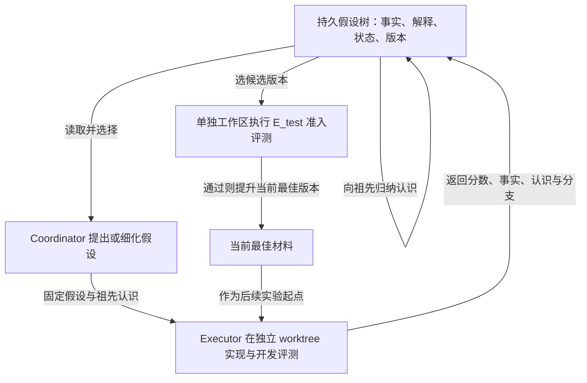

# Toward Generalist Autonomous Research via Hypothesis-Tree Refinement

Arbor 把“这一轮科研已经知道了什么”做成持久的 hypothesis tree：节点绑定假设、实现版本、实验结果与提炼后的认识；长期 Coordinator 根据树决定下一次探索，短期 Executor 只检验被分配的一条假设。**树边表示假设的细化关系，不是环境动作的时间顺序；信息向上归纳也不是数值 MCTS 回传。**[[raw/papers/harness/workflows/Arbor.pdf#page=6|S004 · §4.2–4.3 · pp.6–8]] [[raw/papers/harness/workflows/Arbor.pdf#page=25|S004 · Appendix B.3 · pp.25–26]]

> [!important] 与当前探索阶段的距离
> 论文实验针对给定代码、固定目标和可执行评测器的 Autonomous Optimization。它对状态保留和证据归位有借鉴意义，但没有证明“只读文献的 Agent 可以自主找到有新颖性的研究问题”。作者也承认高层问题重构和新机制发现仍有限。[[raw/papers/harness/workflows/Arbor.pdf#page=16|§6.3 · p.16]] [[raw/papers/harness/workflows/Arbor.pdf#page=22|Appendix A · pp.22–23]]

## 身份与读取范围

| 项目 | 记录 |
| --- | --- |
| 来源 ID | S004 |
| 作者 | Jiajie Jin, Yuyang Hu, Kai Qiu, Qi Dai, Chong Luo, Guanting Dong, Xiaoxi Li, Tong Zhao, Xiaolong Ma, Gongrui Zhang, Zhirong Wu, Bei Liu, Zhengyuan Yang, Linjie Li, Lijuan Wang, Hongjin Qian, Yutao Zhu, Zhicheng Dou |
| 版本 | arXiv:2606.11926v1，2026-06-10；作者注明持续更新的 technical report，本页只分析归档 v1 |
| 原始来源 | [固定版本 PDF](https://arxiv.org/pdf/2606.11926v1)，访问 2026-10-25 |
| 本地原件 | [[raw/papers/harness/workflows/Arbor.pdf\|Arbor.pdf]]，36 页 |
| SHA-256 | `C80931A404F5F0E0ADC90D689FBEDCC947FA986E4CFE9FA869238C85A7DEB276` |
| 实际读取 | 2026-10-25；正文 pp.1–17；Appendix A、B pp.22–31；C.4 BrowseComp p.34。实际查看 Fig.2（p.4）、Algorithm1（p.7）、Table2（p.10）、Fig.3 / Tables4–5（p.12）、Table7（p.29）、评测工具说明（p.30）渲染原页 |
| 未核读范围 | 参考文献未逐项追索；Appendix C 其余任务细节未完整核读；没有审计代码实现、原始运行日志或复现实验 |
| 综述入口 | [[raw/surveys/Towards Long-Horizon Agents.pdf#page=21\|S001 · §4.1.2 · pp.21–22]]，参考文献 [262] |
| 摄入状态 | 完成摄入，主 Agent 内容/结构验收通过；Obsidian 应用未测 |

## “长”来自反复试验后仍要保留有效的研究状态

AO 的输入包含初始材料 $M_0$、目标 $O$、开发评测 $E_{dev}$ 与作者称为 held-out 的 $E_{test}$。任务要求反复改材料、做实验、根据结果继续改善。失效不只表现为代码跑不通，还包括忘记已经失败的方向、分数与版本脱节、只保存“得了几分”却丢失结果的适用条件。后几项是作者对系统需求的论证，不是分别测量过的失败率。[[raw/papers/harness/workflows/Arbor.pdf#page=5|S004 · §3–4.1 · pp.5–6]]

**本库分析：**它直接处理同一优化任务中的长期证据积累，也用落盘树承接上下文压缩后的恢复，因此涉及任务内和跨窗口状态。它不是自动把一个任务的所有经验迁移为下一任务的通用记忆；跨任务实验主要测试优化后的 harness 能否迁移。[[raw/papers/harness/workflows/Arbor.pdf#page=7|S004 · §4.3.1 · p.7]] [[raw/papers/harness/workflows/Arbor.pdf#page=12|S004 · §5.6 · p.12]] [[raw/papers/harness/workflows/Arbor.pdf#page=27|S004 · Appendix B.3 · p.27]]

## 方法：把假设、事实和解释分开保存，再用于下一轮选择

| 树中的对象 | 保存什么 | 为什么与下一步有关 |
| --- | --- | --- |
| Hypothesis | 执行前确定的可检验改动假设；节点深度区分方向与具体干预 | 约束 Executor，避免做着做着改题后仍将分数归给原假设 |
| Result / score | 实验事实与开发评测分数分别保存 | 失败、超时、未激活代码路径不能只压缩成一个差分数 |
| Insight | 对结果的解释与适用条件；父节点综合子节点认识 | 为下一次提案保留支持、限制与负面证据 |
| Metadata / code reference | 状态、分支或提交引用 | 将结论指回实际执行过的材料版本，而不在树中复制整份代码 |

上述结构来自 §4.2 与 Table9；“解释”仍由模型生成，记录为 insight 不会自动使其成为已验证的因果结论。[[raw/papers/harness/workflows/Arbor.pdf#page=6|S004 · §4.2 · p.6]] [[raw/papers/harness/workflows/Arbor.pdf#page=31|S004 · Table9 · p.31]]

本库依据 Fig.2 与 Algorithm1 重绘。Executor 可修实现错误、重跑开发评测，但不能擅自换假设；Coordinator 拥有共享树，并负责剪枝、继续、合并和停机。独立 worktree 提供代码与结果的隔离，树提供研究含义上的归属，两者用途不同。[[raw/papers/harness/workflows/Arbor.pdf#page=7|S004 · Algorithm1、§4.3 · pp.7–8]]

持久化也有具体契约：每次受控更新写入 JSON 并生成 Markdown；上下文压缩后重新读树；祖先 insight 是对子节点认识的短文本归纳。这里的“backpropagate”并不更新模型权重，也不证明归纳保留了所有反例。[[raw/papers/harness/workflows/Arbor.pdf#page=25|S004 · Appendix B.3 · pp.25–27]] [[raw/papers/harness/workflows/Arbor.pdf#page=30|S004 · Appendix B.5 · pp.30–31]]

## 实验证据：树和认识回传有用，但不能照抄为通用科研能力

六项 AO 任务涵盖优化器/架构、Terminal-Bench 与 BrowseComp harness、搜索和数学数据生成。作者为真实研究任务设置 48 小时上限，Arbor 默认使用 Claude Opus 4.6；Codex 对照使用 GPT-5.5、Claude Code 使用 Opus 4.6。相同任务接口与时长不等于模型完全相同或每一种资源使用完全相同；成本分析另统计 Coordinator 和 Executor 的总 token。[[raw/papers/harness/workflows/Arbor.pdf#page=8|S004 · §5.1–5.2 · pp.8–10]] [[raw/papers/harness/workflows/Arbor.pdf#page=13|S004 · §5.8 · p.13]]

| 原文检查 | 支持什么 | 保留条件 |
| --- | --- | --- |
| Table2：六个任务上 Arbor 的报告 test 指标均为表内最好；例如 BrowseComp 45.33 → 67.67 | 在作者所定义的 AO 协议中，系统可产生改善材料的候选 | 不是六个独立科研领域；指标、初始材料和准入反馈的选择塑造了可找到的改进。test 使用边界见下文 |
| Table4：MLE-Bench Lite，固定 Opus4.6；完整系统 Any Medal81.82，去树63.64，去向上 insight 回传54.54；三者有效提交均100% | 可运行并不足够；该设置下结构化记忆和认识回传影响最终解的质量 | 去树保留扁平实验队列；这不是无任何记忆的基线，也不是树必然胜过所有其他记忆表示 |
| Fig.3(b)：优化 BrowseComp 的 harness 冻结后迁移到 HLE、DeepSearchQA | 有一定未参与该优化的任务迁移证据 | 迁移的是成品 harness；不是证明研究树本身已学会任意任务的科学发现 |

定位：[[raw/papers/harness/workflows/Arbor.pdf#page=10|S004 · Table2、§5.3 · pp.10–11]]；[[raw/papers/harness/workflows/Arbor.pdf#page=12|S004 · Fig.3、Table4、§5.6–5.7 · pp.12–13]]。

两类额外比较要分开：MLE-Bench Lite 大表混合了多种模型，且对照数字来自 leaderboard / 其他论文；本次未逐篇核读那些系统。数据合成的核心指标是 `pass@4 − pass@1`，衡量“首尝不易但多尝试可解”的区间，不直接测量训练这些数据后模型能力是否提高。[[raw/papers/harness/workflows/Arbor.pdf#page=8|S004 · §5.1 · p.8]] [[raw/papers/harness/workflows/Arbor.pdf#page=9|S004 · §5.2 · pp.9–11、Table3]]

## v1 中需要明确留下的核查点

**1. `E_test` 兼任选择门槛与最终评分。** Algorithm1 的循环、Algorithm2 及工具说明都让候选在合并时运行 `E_test`，其结果影响后续当前最佳材料；而 §3 强调不将它当探索 oracle，Appendix C.4 又称 test 保留到最终验证。**本库推断：**即便 Executor 看不到测试题，反复用于准入的反馈仍可能参与自适应选择，不能据“在另一个工作区执行”就断言最终评估完全独立。当前原文未足够说明每次准入是否使用新样本、反馈暴露多少、是否另有从未用于选择的最终测试集。此处是协议解释待核查，不能直接指控实际运行泄漏。[[raw/papers/harness/workflows/Arbor.pdf#page=5|S004 · §3 · p.5]] [[raw/papers/harness/workflows/Arbor.pdf#page=7|S004 · Algorithm1 · p.7]] [[raw/papers/harness/workflows/Arbor.pdf#page=26|S004 · Algorithm2 · p.26]] [[raw/papers/harness/workflows/Arbor.pdf#page=30|S004 · Appendix B.4.3 · p.30]] [[raw/papers/harness/workflows/Arbor.pdf#page=34|S004 · Appendix C.4 · p.34]]

**2. 默认预算口径不完全一致。** §5.2 写 20 coordinator cycles；Table7 把 Max cycles20 描述成完成实验总数上限，Table5 又有 150 个节点。节点未必都执行，因此不据此判定超预算；需要运行日志说明 cycle、节点、完成实验、并行批次的对应关系。Table7 的默认值也不能直接视为每个任务的实际配置。[[raw/papers/harness/workflows/Arbor.pdf#page=9|S004 · §5.2 · pp.9–10]] [[raw/papers/harness/workflows/Arbor.pdf#page=12|S004 · Table5 · p.12]] [[raw/papers/harness/workflows/Arbor.pdf#page=29|S004 · Table7 · p.29]]

**3. 统计和因果归因仍有限。** §5.2 说通常报告三次均值与标准差，但 Table2 没有展示对应误差；完整系统同时包含分工、隔离、树、归纳和准入机制，主结果不能独立识别所有组件的因果贡献。Table4 提供了更直接但范围较窄的组件对照。[[raw/papers/harness/workflows/Arbor.pdf#page=9|S004 · §5.2 · pp.9–10]] [[raw/papers/harness/workflows/Arbor.pdf#page=12|S004 · Table4 · p.12]]

**4. 归纳与剪枝可能放大不充分证据。** 作者把负面结果作为后续约束，并指出 Agent 有时过早放弃好方向。**本库推断：**执行失败、实现欠佳和假设被反驳应分开，否则向上传播会把一次局部失误变成整个方向的禁令。论文未给出通用的因果归因正确性保证。[[raw/papers/harness/workflows/Arbor.pdf#page=7|S004 · §4.3.1 · p.7]] [[raw/papers/harness/workflows/Arbor.pdf#page=23|S004 · Appendix A · p.23]]

## 对本库的作用与后续问题

已整合到 [[wiki/harness/workflows|Harness · 循环与工作流]]，涵盖分层工作流、状态与反馈边界；主题与论文页已互链，内容与结构已验收；Obsidian 应用未测。与 [[wiki/papers/harness/workflows/ReAct|ReAct]] 相比，Coordinator 本身仍可用 ReAct 循环，但研究状态不再只依赖这条对话历史；与 [[wiki/papers/harness/workflows/ReWOO|ReWOO]] 相比，它不是一次固定整个计划，而是每批实验后修订探索树。[[raw/papers/harness/workflows/Arbor.pdf#page=23|S004 · Appendix B.1 · pp.23–24]]

对当前文献探索，值得借鉴的是“候选问题—原始证据—解释—未决条件”保持关联，以及独立工作与共享知识的写入分工。**这是本库工作流类比，不是论文已经验证的文献型 Auto Research 效果。** 不据此引入 Arbor 软件、数据库或评测任务。

**待检验问题：**层级归纳会不会丢掉使负面结果成立的条件，从而导致过早剪枝？可先用原始实验报告与祖先 insight 对读来核查信息损失；目前没有完成查新，也没有将其确认为新研究缺口。

原件身份、关键方法与实验表已核对；尚未审计代码与运行日志，Obsidian 的图表渲染及来源跳转未实测。

## 分类与阅读入口

主归属与交叉方向：[[wiki/harness/workflows|harness/workflows]]。
